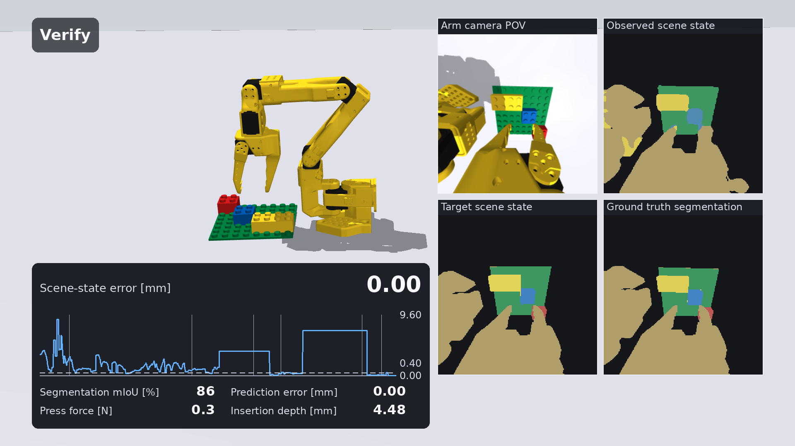

# Brick Builder Arm Robot

An SO-101 robot arm that builds LEGO DUPLO structures in a MuJoCo simulation. Stock hardware:
the vendored SO-101 follower arm with its own wrist camera, a bare table, an 8x8 baseplate and
loose bricks. A CS 6341 (Robotics) team project at UT Dallas.

[](docs/demos/videos.md)

*Closed-loop placement of a DUPLO 2x2 brick, 1920x1080, one take ([film](docs/demos/videos.md)).*

## Contents

- **Physics** — a DUPLO brick with a per-stud friction-joint snap-fit model, a press bench, a
  structure parser, breakable bricks and material damage.
- **Robot** — the vendored SO-101 MJCF, patched at load time: STS3215 servo law, gear free play
  with the encoder on the output shaft, a bus emulator, FK/IK, a static press-force map.
- **Perception** — a scene model that turns one wrist-camera frame into a handful of per-object
  slot states. Three sources ship: simulator ground truth, colour segmentation, and a trained
  convolutional model whose weights are in the repository. Others can be registered.
- **Control** — scripted motion primitives, a skill FSM, Gymnasium environments with a residual
  RL policy, PPO and SAC, and a C export of a trained actor.
- **Closed loop** — target-sequence tracking: a sequence recorded in a digital twin from the goal
  and nominal parameters, then tracked in a world whose baseplate is somewhere the controller was
  never told about.
- **Tooling** — a parameter file teammates measure and fill in, an experiment runner, a language
  front end, a demo gallery, and an MkDocs site.

## Requirements

Python 3.12 on Linux. No GPU. MuJoCo renders off-screen through EGL or OSMesa; no display server
is used. See [Install](docs/guide/01-install.md) for the full list.

## Install

```bash
git clone <repo-url> brick-builder-arm-robot
cd brick-builder-arm-robot
python3 -m venv .venv
.venv/bin/pip install --upgrade pip
.venv/bin/pip install torch --index-url https://download.pytorch.org/whl/cpu
.venv/bin/pip install -e ".[dev,docs]"
```

The CPU wheel of PyTorch first, so pip does not pull the multi-gigabyte CUDA build. Always
`.venv/bin/python`, never a bare `python`.

## First run

One closed-loop placement, headless, printing what happened:

```bash
CUDA_VISIBLE_DEVICES="" MUJOCO_GL=egl .venv/bin/python scripts/run_placement.py --cnn
```

About forty seconds. `--cnn` drives the loop from the trained convolutional scene model, which is
what the film shows; without it the same loop runs on simulator ground truth instead.

The film, at draft resolution:

```bash
CUDA_VISIBLE_DEVICES="" MUJOCO_GL=egl .venv/bin/python scripts/make_demo_video.py \
    --quality draft --cnn-drives --stills 0 --out media_out/placement.mp4
```

`--cnn-drives` runs the loop on the convolutional scene model, which is what the published film
shows; `--quality hd1080` is the 1920x1080 version and takes considerably longer. Add `--pick`
for the whole job -- fetch the brick off the table, then place it -- which is the second
[film](docs/demos/videos.md).

The docs:

```bash
.venv/bin/mkdocs serve      # http://127.0.0.1:8000
```

Use `MUJOCO_GL=osmesa` instead of `egl` on a machine with no GPU. More in
[Quickstart](docs/quickstart.md).

## Parameters

Every measured quantity lives in one YAML file. Copy it, measure, fill it in, run an experiment
against your copy:

```bash
cp configs/params/default.yaml my_params.yaml
$EDITOR my_params.yaml
CUDA_VISIBLE_DEVICES="" MUJOCO_GL=egl .venv/bin/python -m brick_builder.experiments params \
    --params my_params.yaml --out results
```

`python -m brick_builder.experiments --help` lists the runs: `params`, `force-map`, `grasp-hold`,
`pick-and-place`, `press-bench`, `seating-feasibility`. Each writes JSON and a figure. What each
field means, how to measure it and what it affects is in
[Measure and enter parameters](docs/guide/10-measure-and-enter-parameters.md).

## Retraining the vision model

The convolutional scene model ships trained, at `brick_builder/perception/weights/vision_model.pt`.
To rebuild the dataset and retrain:

```bash
CUDA_VISIBLE_DEVICES="" MUJOCO_GL=egl .venv/bin/python scripts/train_vision_model.py --help
CUDA_VISIBLE_DEVICES="" MUJOCO_GL=egl .venv/bin/python -m brick_builder.perception.cnn.demo
```

Architecture, training set, accuracy table, latency and failure modes are in
[Convolutional scene model](docs/guide/06b-conventional-vision-model.md).

## Repository layout

| Path | Contents |
|---|---|
| `brick_builder/bricks/` | brick spec and generator, snap-fit model, press bench, structures, materials, damage |
| `brick_builder/robot/` | SO-101 patches, servo model, bus emulator, kinematics, force map, joint correction |
| `brick_builder/scene/` | scene composition and domain randomization |
| `brick_builder/render/` | off-screen renderer and camera post-processing |
| `brick_builder/perception/` | scene-model interface, sources and registry, views, slot operations, readout, tokens |
| `brick_builder/perception/cnn/` | the convolutional scene model: network, dataset, training, evaluation |
| `brick_builder/control/` | motion primitives, scripted pick-and-place, skill FSM |
| `brick_builder/action/` | closed-loop placement: digital twin, visual servo, target-sequence tracking |
| `brick_builder/envs/` | Gymnasium environments and the observation-source registry |
| `brick_builder/rl/` | PPO and SAC with an asymmetric critic, networks, curriculum |
| `brick_builder/eval/` | evaluation reports, failure taxonomy, Wilson intervals |
| `brick_builder/export/` | C export of a trained actor, and its parity harness |
| `brick_builder/experiments/` | the experiment runs teammates execute |
| `brick_builder/language/` | the text front end that compiles a build into a placement list |
| `brick_builder/demo/` | the demo gallery and the film |
| `configs/` | training configs and the measured-parameter file |
| `scripts/` | train, eval, run one placement, render the film, regenerate figures |
| `tests/` | one directory per package |
| `docs/` | the MkDocs site |
| `third_party/so101/` | the vendored SO-101 model |

## Contributing

Branch, keep the suite green, keep the docs building:

```bash
git switch -c <topic>
CUDA_VISIBLE_DEVICES="" MUJOCO_GL=egl OMP_NUM_THREADS=4 .venv/bin/python -m pytest -q -m "not slow"
.venv/bin/mkdocs build --strict
```

Fix files in place; do not add `_v2` copies. An unmet target is a measured `xfail` with the
number in its reason, not a weakened assertion. A change that alters a measured number changes
the guide page that quotes it in the same commit. Full conventions in
[CONTRIBUTING.md](CONTRIBUTING.md).

## Licence

Apache License 2.0 — see [LICENSE](LICENSE).

Third-party components are attributed in [NOTICE](NOTICE). The SO-101 model under
`third_party/so101/` is vendored from [TheRobotStudio/SO-ARM100](https://github.com/TheRobotStudio/SO-ARM100)
(`Simulation/SO101`), Apache-2.0; the exact upstream commit and file list are in
[`third_party/so101/VENDORED.md`](third_party/so101/VENDORED.md). The vendored files are never
hand-edited: `brick_builder/robot/patch_so101.py` applies every correction programmatically at
load time.

## Team

Ajay Venkat, Kurt Nunn, Shahzaib Sahibzada, Vamsi Dath Meka — CS 6341 (Robotics), The University
of Texas at Dallas.
