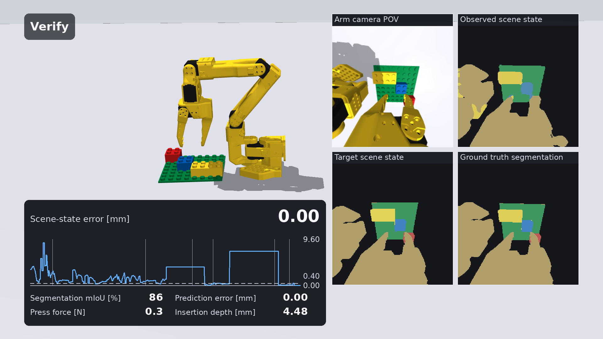
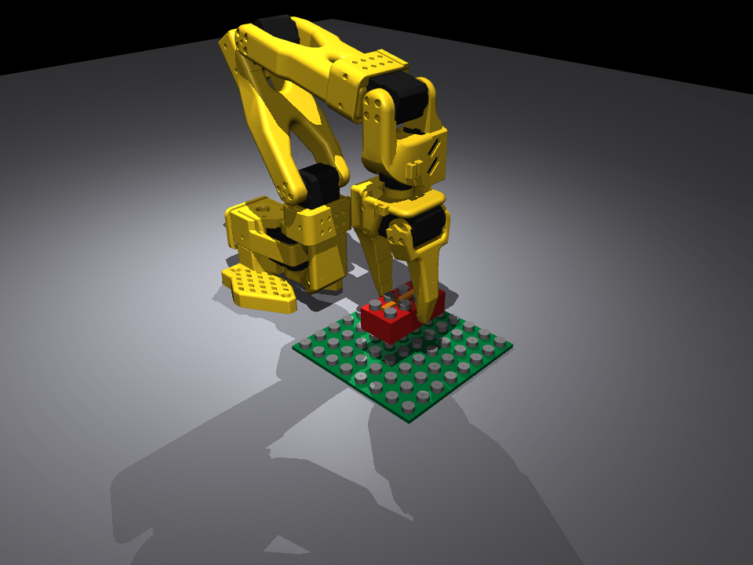
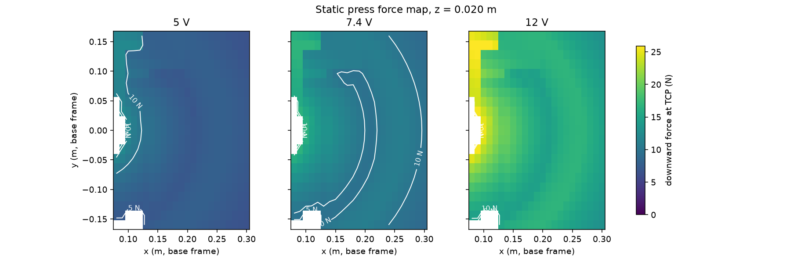

# Demo gallery

**[Closed-loop placement film](videos.md)** — 1920x1080, one continuous take. The film and three frames
are under `docs/media/hd/`.

[](videos.md)

Every demo is a subcommand of `python -m brick_builder.demo <name>`, and every one of them runs headless —
this machine has no display attached — and writes a file with `--record out.mp4` (or `.png` for the two
demos that only ever produce a single picture: `scene`, `force-map`). `scripts/make_media.py --only
demos` regenerates every demo's default output under `docs/media/demos/` from a fixed seed in one call.
Videos (`.mp4`) are git-ignored per project convention, with one exception: the pick-and-place film
above, whose 1080p copy is checked in under `docs/media/hd/` precisely so that a reader can open
it. Everything else here is reproduced by the command printed next to it, in a few seconds to a
couple of minutes. The low-resolution GIFs this page used to show inline are no longer shown:
320x240 is too small to read anything in.

```bash
CUDA_VISIBLE_DEVICES="" MUJOCO_GL=egl .venv/bin/python -m brick_builder.demo <name> --record out.mp4
```

## The demos

| name | what it shows | typical run time |
|---|---|---|
| `scene` | The default scene (arm, 8x8 baseplate, a held 2x4), overview camera. `--record out.mp4` instead records it settling under gravity. | ~1 s |
| `teleop` | A scripted jog through `BrickBuilder/Reach-v0`'s own 8-number action space — see [why it is always scripted](#teleop) below. | ~5-10 s |
| `press` | One press: the scripted baseline by default, or `--checkpoint <path> --actor torch\|c` for a trained residual policy. | ~5 s |
| `rocking` | The tilted-press strategy (`PressConfig(rocking=True)`): tilt, seat one stud row, level out. | ~10 s |
| `force-map` | The static press-force heatmap over the workspace (`brick_builder.robot.force_map`). | ~20 s |
| `policy` | Plays a trained checkpoint (default: `runs/reach_smoke/checkpoint.pt` against `BrickBuilder/Reach-v0`). | ~5 s |
| `tokens` | The full `ObjectToken` readout (x, y, yaw, confidence, age) burned onto the wrist-camera video, for either producer. | ~5-10 s |

### `scene`



```bash
.venv/bin/python -m brick_builder.demo scene --record docs/media/demos/scene.png
```

### `press`

The scripted baseline (`brick_builder.control.primitives.PressScripted`) seating a 2x4 DUPLO brick at
curriculum level 0 (no misalignment), overview camera. The command writes a 640x480 mp4; the
320x240 GIF that used to be shown here is gone, because at that size nothing in it can be read:

```bash
.venv/bin/python -m brick_builder.demo press --record press.mp4 --level 0
.venv/bin/python -m brick_builder.demo press --record press.mp4 --checkpoint runs/press/checkpoint.pt --level 3
```

See [Training and evaluation](../guide/05-training-and-evaluation.md) for what a trained residual policy
actually did against this baseline on this machine.

### `policy`

`BrickBuilder/Reach-v0`, the one skill this project has trained all the way to its acceptance target
(200/200 held-out successes). Same again: run it and watch the mp4, rather than squint at a
320x240 GIF.

```bash
.venv/bin/python -m brick_builder.demo policy --record policy.mp4 --checkpoint runs/reach_smoke/checkpoint.pt
```

### `force-map`



```bash
.venv/bin/python -m brick_builder.demo force-map --record docs/media/demos/force_map.png
```

### `teleop`

Keyboard teleop needs a real display and an OpenCV build with GUI support. This project depends on
`opencv-python-headless` (`pyproject.toml`), which has neither, and every demo has to run headless with
`--record` regardless — so `teleop` always falls back to a scripted jog: a
smooth trajectory through the same `[dx, dy, dz, d_tilt, d_spin, ...]` action space every Brick Builder Arm Robot task
takes, rather than a live keyboard-controlled window. `--interactive` attempts the real thing and prints
why it fell back, on this machine, every time.

### `rocking`, `tokens`

```bash
.venv/bin/python -m brick_builder.demo rocking --record rocking.mp4 --level 2
.venv/bin/python -m brick_builder.demo tokens --record tokens.mp4 --producer surrogate
```

## Every other figure under `docs/media/`

The rest of this page indexes which figures each module's own figure-producing functions already
produce (regenerated deterministically by
`scripts/make_media.py --only <section>`), organized by project stage. `scripts/make_media.py`'s
`--only` sections roughly follow these stages: `scene`/`bricks`/`robot` (A-B), `control`/`envs` (C),
`render`/`perception` (D), `rl`/`export`/`eval` (C), `demos` (this page).

### Stage A — Foundations

- Press-force heatmap over the workspace at 5 V, 7.4 V, and 12 V supply voltages:
  [`force_map.png`](../media/robot/force_map.png), from `brick_builder/robot/force_map.py` (also this
  page's own `force-map` demo, above).
- Servo step-response plot: [`step_response.png`](../media/robot/step_response.png), from
  `brick_builder/robot/servo_model.py`; see [Robot and servo model](../guide/03-robot-and-servo-model.md).
- Static sag plot: [`sag.png`](../media/robot/sag.png).

### Stage B — Brick physics

- Force-vs-depth plot from the press bench: [`force_vs_depth.png`](../media/bricks/force_vs_depth.png);
  see [bench test 1](../guide/02-simulator-and-bricks.md#bench-tests).
- Tilted-press vs. flat-press force trace: [`rocking_vs_flat.png`](../media/bricks/rocking_vs_flat.png).
- Exploded collision-vs-visual geometry view:
  [`exploded_collision_vs_visual.png`](../media/bricks/exploded_collision_vs_visual.png).
- GIFs of a clean seat, a misaligned failure, a pull-off, a peel, and a 3-layer stack — still not
  produced; the `press`/`rocking` demos above cover the seat and the tilted-press strategy,
  the rest is `brick_builder/bricks`'s own figure function to add.

### Stage C — RL loop (Deliverable 1)

- Learning curves: [`reach_learning_curve.png`](../media/envs/reach_learning_curve.png) (the actual
  trained skill) and [`press_learning_curve.png`](../media/envs/press_learning_curve.png). A
  **preliminary** figure also exists from the RL core's own toy acceptance test —
  [`pendulum_learning_curve.png`](../media/rl/pendulum_learning_curve.png) — which demonstrates the PPO
  implementation, not a Brick Builder Arm Robot skill.
- `python -m brick_builder.demo press --checkpoint ...` (above) is the same comparison,
  runnable against any checkpoint on demand.
- Success curve over misalignment: [`press_baseline_curve.png`](../media/envs/press_baseline_curve.png)
  (scripted baseline; `scripts/eval.py --sweep press-misalign` draws the same curve for a trained
  checkpoint). A synthetic success heatmap also exists —
  [`example_heatmap.png`](../media/eval/example_heatmap.png) — a made-up surface with no trained policy
  involved, to show the figure's shape; see [Evaluation reports](../guide/05b-evaluation-reports.md).
- Failure gallery: `scripts/eval.py`'s own `--videos` already records one clip per distinct failure
  class seen in an evaluation batch (`<out-dir>/episode_*_<failure-class>.mp4`) — not a separate,
  curated gallery page yet.
- Multi-rate timing diagram — not produced yet.
- C-actor parity plot: [`parity_and_speed.png`](../media/export/parity_and_speed.png).

### Stage D — Perception

- The `tokens` demo above is this stage's live-perception visual.
- Generic rendering contact sheet: [`contact_sheet.png`](../media/render/contact_sheet.png) (a
  self-contained two-box test scene).
- Camera post-process before/after: [`postprocess_before_after.png`](../media/render/postprocess_before_after.png).
- Slot blobs, identity sweep and occlusion bias: see [Perception](../guide/06-perception.md).

### Stages E-J

Not started.
