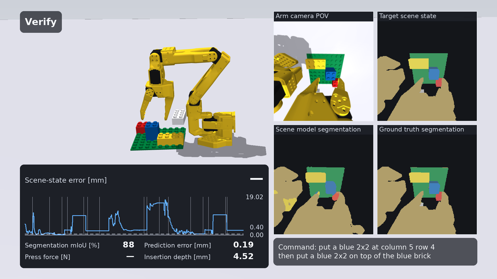

# Closed-loop placement video

<video controls preload="metadata" width="100%"
       poster="../../media/hd/closed-loop-verify.png">
  <source src="../../media/hd/brick-builder-arm-robot-closed-loop-placement-1080p.mp4" type="video/mp4">
</video>

[1920x1080 file](../media/hd/brick-builder-arm-robot-closed-loop-placement-1080p.mp4)

| Step | Frame |
|---|---|
| Align | [closed-loop-align.png](../media/hd/closed-loop-align.png) |
| Press the brick down | [closed-loop-press.png](../media/hd/closed-loop-press.png) |
| Verify | [closed-loop-verify.png](../media/hd/closed-loop-verify.png) |

## Run conditions

| Item | Value |
|---|---|
| Task | Placement of a DUPLO 2x2 brick held in the stock SO-101 gripper; two bricks already on the baseplate |
| Baseplate offset from nominal | 6.1 mm, 2.2 deg (unknown to the controller) |
| Scene model (control input) | Convolutional scene model, checkpoint `3e07a382` |
| Controller | Target-sequence tracking at 10 Hz: feed-forward target action plus feedback on target minus observed scene state |
| Target sequence | Recorded in the digital twin from the goal and nominal parameters |
| Closed-loop steps | Transport, Align (x, y, yaw of the held brick over the cell) |
| Correction after Align | Held: it estimates a static unknown (baseplate pose, brick's offset in the jaws) |
| Open-loop steps | Press the brick down, Release, Retract (run from the converged pose) |
| Video | 1920x1080, 30 fps, H.264, 24.5 s, 734 frames, single take |

## On-screen elements

| Element | Content |
|---|---|
| Arm camera POV | 256x256 wrist-camera window (model input) |
| Observed scene state | Predicted segmentation of the current frame |
| Target scene state | Segmentation of the next frame of the target sequence |
| Ground truth segmentation | Simulator labels; reference for mIoU |
| Scene-state error [mm] | Feature error between target and observed scene state; dashed line: 0.40 mm tolerance; vertical rules: step boundaries |
| Segmentation mIoU [%] | Prediction vs. ground truth, per frame |
| Prediction error [mm] | Observed minus predicted next scene state |
| Press force [N], Insertion depth [mm] | Simulator measurements, display only |

## Results

Recorded run: brick seated on the target cell; lateral error 0.11 mm; depth error 0.01 mm; Align converged to 0.85 mm over 157 vision ticks.

Ten seeds, identical displaced worlds:

| Control input | Seated on target cell | Lateral error |
|---|---|---|
| Ground-truth scene model | 10/10 | median 0.10 mm |
| Convolutional scene model | 8/10 | 0.06-0.11 mm on seated runs |
| Convolutional scene model, target sequence recorded through it | 4/10 | — |
| Camera corrections off | 4/10 | median 0.19 mm, max 16.1 mm |

The camera-off column is not a clean zero, and the reason is worth stating: the stud-and-tube
joint has a capture basin of roughly half a stud pitch, so a 4-8 mm baseplate offset is partly
inside what the press corrects by itself. Six of the ten land on the target cell and four seat
fully; the failures are two bricks pressed into the NEIGHBOURING cell (16.0 and 16.1 mm) and two
that stop half a pitch out and do not seat at all. What the loop adds is not the last
half-millimetre alone -- it is removing the whole-cell mistakes.

(An earlier version of this table read 0/10. That measurement was wrong: with corrections off the
progress index still waited for an error nothing was going to reduce, so the runs stalled part
way instead of playing through. The control condition now replays the recorded actions to the
end, which is what it always should have meant.)

Recording the target sequence through the same convolutional model measures worse, not better:
its per-frame noise enters the target as well as the observation and the median tracking error
rises from 1.4-1.9 mm to 3.2-6.2 mm.

## Scene-state error after Release

Once the brick is let go the correction is held, so camera-frame feature positions along the
retract path no longer track the recording. From Release onward the displayed error is measured
on relative geometry: the placed brick's blob against the baseplate's and the already-placed
bricks', through the same Jacobians. The absolute tracking error is logged separately. A tick
where the placed brick is not matched reports no value rather than a small one.

## Reproduction

```
CUDA_VISIBLE_DEVICES="" MUJOCO_GL=egl OMP_NUM_THREADS=4 \
  python scripts/make_demo_video.py --quality hd1080 --seed 0 --cnn-drives \
    --lead 2.2 --hold 3.0 --stills 6 \
    --stills-dir media_out/hd/closed_loop_stills \
    --out media_out/hd/brick_builder_arm_robot_closed_loop_placement_1080p.mp4
```

The video uses checkpoint `3e07a382`, which is the shipped
`brick_builder/perception/weights/vision_model.pt`. A local copy at
`results/video/vision_model_frozen.pt` (git-ignored) takes precedence when present; without it the
script loads the shipped weights.

# Closed-loop pick-and-place video

<video controls preload="metadata" width="100%"
       poster="../../media/hd/closed-loop-pick-press.png">
  <source src="../../media/hd/brick-builder-arm-robot-closed-loop-pick-and-place-1080p.mp4" type="video/mp4">
</video>

[1920x1080 file](../media/hd/brick-builder-arm-robot-closed-loop-pick-and-place-1080p.mp4)

| Step | Frame |
|---|---|
| Grasp | [closed-loop-pick-grasp.png](../media/hd/closed-loop-pick-grasp.png) |
| Press the brick down | [closed-loop-pick-press.png](../media/hd/closed-loop-pick-press.png) |

## Run conditions

| Item | Value |
|---|---|
| Task | Whole job: fetch a DUPLO 2x2 off the table and place it; two bricks already on the baseplate, one spare brick beside the one to pick |
| Baseplate offset from nominal | 6.5 mm, 2.9 deg (unknown to the controller) |
| Brick offset from the supply row | 13.4 mm, 15.8 deg (unknown to the controller) |
| Scene model (control input and panels) | Convolutional scene model, checkpoint `3e07a382` |
| Controller | Target-sequence tracking at 10 Hz: feed-forward target action plus feedback on target minus observed scene state |
| Target sequence | Recorded in the digital twin from the goal and nominal parameters |
| Dwells that estimate | Hover 55 mm above the brick, second dwell 20 mm above it, lift dwell over the bare table, align dwell over the target cell |
| Unknown per dwell | Where the brick lies (both approach dwells), how it sits in the jaws (lift), where the baseplate is (align) |
| Open-loop steps | Final descent onto the brick, Press the brick down, Release, Retract |
| Video | 1920x1080, 30 fps, H.264, 38.3 s, 1150 frames, single take, seed 1 |

On-screen elements are the same as the placement video.

## Results

Recorded run (seed 1, convolutional scene model driving): brick seated on the target cell; lateral error 0.08 mm; depth error 0.00 mm; Align converged to 0.71 mm over 71 vision ticks.

Ten seeds, identical displaced worlds:

| Control input | Seated on target cell | Lateral error |
|---|---|---|
| Ground-truth scene model | 8/10 | 0.02-0.23 mm on seated runs |
| Convolutional scene model | 8/10 | 0.07-0.33 mm on seated runs |
| Camera corrections off | 0/10 | median 16.2 mm |

Both scene models reach the same count on these ten seeds, and they do not fail on the same
ones: ground truth misses seeds 1 and 4, the convolutional model seeds 0 and 2, and on three of
those four the brick is on the target cell but short of full depth rather than on the wrong
cell. The take above is driven by the convolutional scene model.

The camera-off column is a clean zero here, unlike the placement task's. The brick's own
8-15 mm offset on the table is added to the baseplate's, and the grasp is scripted from the
supply row rather than from where the brick is, so the errors land outside the stud-and-tube
joint's capture basin instead of partly inside it.

Per-seed, ground truth driving, with the brick's pose in the jaws measured at the lift:

| Seed | Seated | On cell | Lateral [mm] | In the jaws, across / along [mm] |
|---|---|---|---|---|
| 0 | yes | yes | 0.15 | -0.30 / 3.28 |
| 1 | no | yes | 0.19 | -0.16 / 7.71 |
| 2 | yes | yes | 0.17 | -0.26 / 6.26 |
| 3 | yes | yes | 0.23 | -0.21 / -7.87 |
| 4 | no | no | 16.09 | 0.03 / -8.49 |
| 5 | yes | yes | 0.05 | -0.27 / 2.42 |
| 6 | yes | yes | 0.08 | -0.26 / -0.44 |
| 7 | yes | yes | 0.02 | -0.28 / 1.92 |
| 8 | yes | yes | 0.20 | -0.30 / -1.70 |
| 9 | yes | yes | 0.11 | -0.29 / -3.48 |

What the jaws close on is what decides a run. Every seed that misses closes on a brick sitting
more than 8 mm along the jaws; the approach's second dwell is what brought that from 8.3-13.7 mm
down to 0.4-7.9 and the count from 5/10 to 8/10.

## Reproduction

```
CUDA_VISIBLE_DEVICES="" MUJOCO_GL=egl OMP_NUM_THREADS=3 \
  python scripts/make_demo_video.py --quality hd1080 --seed 1 --pick --cnn-drives \
    --lead 2.2 --hold 3.0 --stills 6 \
    --stills-dir media_out/hd/closed_loop_pick_stills \
    --out media_out/hd/brick_builder_arm_robot_closed_loop_pick_and_place_1080p.mp4
```

One run of the same loop, headless:

```
CUDA_VISIBLE_DEVICES="" MUJOCO_GL=egl python scripts/run_placement.py --pick --seed 0
```

# Brick damage video

<video controls preload="metadata" width="100%"
       poster="../../media/hd/brick-damage-aftermath.png">
  <source src="../../media/hd/brick-builder-arm-robot-brick-damage-1080p.mp4" type="video/mp4">
</video>

[1920x1080 file](../media/hd/brick-builder-arm-robot-brick-damage-1080p.mp4)

| Step | Frame |
|---|---|
| Strike | [brick-damage-strike.png](../media/hd/brick-damage-strike.png) |
| Aftermath | [brick-damage-aftermath.png](../media/hd/brick-damage-aftermath.png) |

## Run conditions

| Item | Value |
|---|---|
| Task | Three passes of the closed gripper at the end wall of a breakable DUPLO 2x4, one brick per pass |
| Striker | Arm tool: the stock SO-101 gripper, jaws closed, no brick held |
| Commanded tool speeds | 0.1, 0.3, 0.6 m/s |
| Measured tool speed at contact | 0.100, 0.313, 0.538 m/s |
| Bricks | Three breakable DUPLO 2x4, 17 pieces each (roof, 4 walls, 4 tubes, 8 studs), seated on the baseplate's edge row |
| Weld limits | `materials.weld_limits`, unscaled: short wall 1398 N axial, 0.891 N*m at the root |
| Contact point | Bottom few millimetres of the wall, about 15 mm below the roof |
| Physics time step | 2 ms; damage monitor and weld check every step |
| Control | `control.pick_place.ArmDriver` at 50 Hz, commanded pose advancing at the pass speed and running on for 92 ms past the wall face |
| Video | 1920x1080, 30 fps, H.264, 10.9 s, 326 frames, single continuous take, real time |

## On-screen elements

| Element | Content |
|---|---|
| Wall stress [MPa] | Damage monitor's peak wall-bending stress; dashed lines: 44 MPa tensile yield, 70 MPa flexural strength; vertical rules: pass boundaries |
| Contact force [N] | Monitor's peak lateral contact load on a brick |
| Weld utilisation [%] | `F/F_limit + M/M_limit` for the most loaded weld; 100 % is the fracture criterion |
| Damage state | Monitor's worst latched state over the three bricks |
| Pieces released | Welds that have let go |
| Struck wall | Close-up of the struck end wall |

Every readout is a running peak. A rigid-body impact resolves in one 2 ms step, so the
instantaneous value is gone before the next video frame is drawn.

## Results

| Pass | Tool speed at contact | Peak wall stress | Peak contact force | Peak weld utilisation | Pieces released | Damage state |
|---|---|---|---|---|---|---|
| Strike 0.1 m/s | 0.100 m/s | 0.6 MPa | 4.6 N | 7 % | 0 | intact |
| Strike 0.3 m/s | 0.313 m/s | 7.3 MPa | 32.3 N | 58 % | 0 | intact |
| Strike 0.6 m/s | 0.538 m/s | 48.0 MPa | 60.6 N | 152 % | 1 | broken |

The third pass releases the struck brick's back wall at t = 7.476 s, at a weld utilisation of
1.52 (51.2 N against 1398 N axial, 1.80 N*m against 0.891 N*m at the root). The piece is
repainted dark grey, stays in the scene as a free body, and latches its brick to `broken`; the
take holds on it for the last three seconds, because the release itself is one step long. The
arm reaches 0.54 to 0.69 m/s at the tool, so the speed the guide's collision case needs is
inside the servos' own limit and no separate striker is required.

The wall stress crosses the 44 MPa tensile yield on the third pass and stays under the 70 MPa
flexural strength, while the weld criterion is already past 100 %: the monitor's instantaneous
peak is step-dependent by construction, and the released piece is the criterion the breakable
brick is built to answer with.

## Reproduction

```
CUDA_VISIBLE_DEVICES="" MUJOCO_GL=egl OMP_NUM_THREADS=3 \
  python scripts/make_damage_video.py --quality hd1080 --stills 6 \
    --stills-dir media_out/hd/damage_stills \
    --out media_out/hd/brick_builder_arm_robot_brick_damage_1080p.mp4
```

The same three passes without rendering:

```
CUDA_VISIBLE_DEVICES="" MUJOCO_GL=egl python scripts/make_damage_video.py --probe
```

# Two-brick stack video

[](../media/hd/two-brick-stack-verify.png)

The 1920x1080 file is not in the repository (`*.mp4` is git-ignored); the command under
Reproduction writes it to `media_out/hd/brick_builder_arm_robot_two_brick_build_1080p.mp4`.

| Step | Frame |
|---|---|
| Align, second brick | [two-brick-stack-align.png](../media/hd/two-brick-stack-align.png) |
| Verify | [two-brick-stack-verify.png](../media/hd/two-brick-stack-verify.png) |

## Run conditions

| Item | Value |
|---|---|
| Command | `put a blue 2x2 at column 5 row 4 then put a blue 2x2 on top of the blue brick` |
| Compiled placements | `2x2 (4,3,0) blue`, `2x2 (4,3,1) blue`, the targets of task `stack_2` |
| Cycle 1 | Placement of the DUPLO 2x2 held in the stock SO-101 gripper |
| Cycle 2 | Pick-and-place: a DUPLO 2x2 off the table onto the first |
| Relation to task `stack_2` | Same command and targets. `stack_2` runs both cycles as pick-and-place, each in its own world; this recording runs both in one world and starts cycle 1 with the brick in the jaws |
| Baseplate offset from nominal | 6.1 mm, 2.2 deg (unknown to the controller) |
| Scene model, control input | Simulator ground truth |
| Scene model, panels | Convolutional scene model, checkpoint `3e07a382` |
| Controller | Target-sequence tracking at 10 Hz, analytic inverse |
| Target sequences | Recorded in the digital twin from the goal and nominal parameters, one per cycle |
| Video | 1920x1080, 30 fps, H.264, 58.7 s, 1762 frames, 7.9 MB, single take, seed 0, one world for both cycles |

## On-screen elements

As the placement video, with these changes:

| Element | Script (`make_campaign_video.py`) |
|---|---|
| Title card | In the data strip's box, opaque, for the first 2.0 s; the strip takes the box back after it. The top left of the main view holds the upper arm and the wrist in this shot |
| Spec line | "Control input: ground truth" and "Display: convolutional scene model", then controller, inverse, bricks and baseplate offset; no checkpoint hash |
| Bottom-row panels | "Scene model segmentation" (the convolutional scene model's output, display only) beside "Ground truth segmentation" |
| Command | Title line under the panels |
| Press force [N] | Live value; a dash when the arm is not pushing down on the brick |
| Scene-state error [mm] | A dash in a step that has returned no measurement; a gap in the trace over that step |
| Prediction error [mm] | A dash in a step that has returned no prediction; a plain number cell, not plotted, so there is no trace to gap |

## Results

Recorded run: both bricks seated on target. First brick on the plate, lateral error 0.07 mm,
depth error 0.00 mm. Second brick on the first (`lower_bodies` = the first brick), lateral error
0.10 mm, depth error 0.00 mm, bottom face 0.44 mm below the nominal layer-1 height.

Release, Retract and Verify returned no scene-state measurement on any tick of this run. The
Scene-state error [mm] readout -- the strip's only plotted trace -- shows a dash through them,
with a gap in the trace over the same steps; the Prediction error [mm] readout, a plain number
cell with no trace of its own, shows a dash there too; see
[Closed-loop control, Two-brick recording](../guide/12-closed-loop-control.md#two-brick-recording).

Task `stack_2` on seeds 0-9, both cycles pick-and-place, each in its own world, ground truth
driving: second brick seated 10/10, whole build 9/10 (Wilson 95 % 60-98 %); see
[Closed-loop control, Two-brick builds](../guide/12-closed-loop-control.md#two-brick-builds-seeds-0-9).

## Control input

The take is driven by the simulator's ground truth, not the convolutional scene model. With the
convolutional model driving, this recording's world (cycle 1 a placement from the jaws, cycle 2 a
pick-and-place) was run headless first (`--probe`, one run per seed), and no seed tried built
both bricks. Task `stack_2` with `--source cnn` was not evaluated.

| Build | Target sequences recorded with | Seeds | Result |
|---|---|---|---|
| Stack | ground truth | 0, 1 | first brick seated on both; second brick not seated, 61.2 mm (seed 0) and 94.6 mm (seed 1) off its cell |
| Stack | the convolutional model | 1, 5 | first brick not seated on either |
| Stack | the convolutional model | 0, 2, 3 | run stopped at cycle 2's Lift: no reference blob to line up on |
| Side by side | ground truth | 8 | neither brick seated |

Two perception failures, read off the panels at the second cycle: at Lift the white 2x4 on the
table is not segmented, so the step has no reference blob; at Align the held blue brick and the
blue brick under it are one blue region, not two, and Align has no measurement (seed 0: Transport
ends at 10.34 mm scene-state error, the press step logs 14.42 mm).

Re-probed on seeds 0-2 (`--cnn-drives --probe`, target sequences recorded through the
convolutional model -- the campaign's own `--source cnn` convention) after the fixes in
`docs/guide/16b-campaign-on-the-scene-model.md`'s Fixes to the crashes and The pickling fix: none
of the three raises any more (`failure: none` on both cycles, every seed), but none seats both
bricks either.

| Seed | Baseplate offset | Brick 0 | Brick 1 | `Align` trusted ticks, cycle 1 / cycle 2 |
|---|---|---|---|---|
| 0 | -4.84, -3.69 mm, +2.20 deg | not seated, 17.47 mm off cell | not seated, 20.59 mm off cell | 0/240, 0/240 |
| 1 | +6.42, +0.64 mm, +2.86 deg | not seated, 13.62 mm off cell | seated, wrong cell, 16.28 mm off | 0/240, 0/240 |
| 2 | -3.44, +4.32 mm, +2.39 deg | not seated, 6.43 mm off cell | not seated, 21.66 mm off cell | 0/240, 0/240 |

`Align` gets zero trusted ticks out of 240 in every cycle of every seed, on both cycles -- worse
than the partial mislabeling Mislabeled reference bodies reports for `placement` (empty in none of
400 frames there), consistent with the same slot-id/instance-id defect naming the wrong or no
reference body for `stack_2`'s own geometry (a second brick present at cycle 2's `Align`), not
re-diagnosed further here. With `Align` never corrected, each brick's final position is
essentially the open-loop nominal trajectory plus the seed's own baseplate/pick noise, which is
why the lateral errors above track the baseplate offset and compound across the two cycles. No
video was recorded for this probe (see Reproduction): the acceptance was seating both bricks, and
none of the three seeds did.

## QA

Run on the file and the stills by the script after the take (`--qa-only` repeats it):

| Check | Result |
|---|---|
| Frame size | 1920x1080 RGB, file and six stills |
| Text boxes intersecting | none, on every frame (`check_layout`) and on each still |
| Arm under a box | 0 px on every frame, for every box (title card, step label, data strip, panels, command), from the main view's segmentation pass with the arm's 7 bodies as one instance |
| Smallest font | 24 px (panel titles); floor 22 px |
| Code identifiers or hashes on screen | none; the check matches snake_case, calls, file names, camelCase and hex strings of 6 or more characters with a digit and a letter |
| Step names | Approach, Grasp, Lift, Transport, Align, Press the brick down, Release, Retract, Verify |
| Studs | one colour per brick and on the baseplate, over every visual geom |
| Main view | mean horizontal pixel gradient 0.91-1.22 on the six stills, limit 5.0 |

## Reproduction

```
CUDA_VISIBLE_DEVICES="" MUJOCO_GL=egl OMP_NUM_THREADS=3 \
  python scripts/make_campaign_video.py --task stack_2 --seed 0
```

Six stills, 100 % crops of every text area and `manifest.json` go to
`media_out/hd/two_brick_build_stills/`. The same world without rendering, with the
convolutional model driving:

```
CUDA_VISIBLE_DEVICES="" MUJOCO_GL=egl python scripts/make_campaign_video.py \
  --task stack_2 --seed 0 --cnn-drives --targets truth --probe
```
