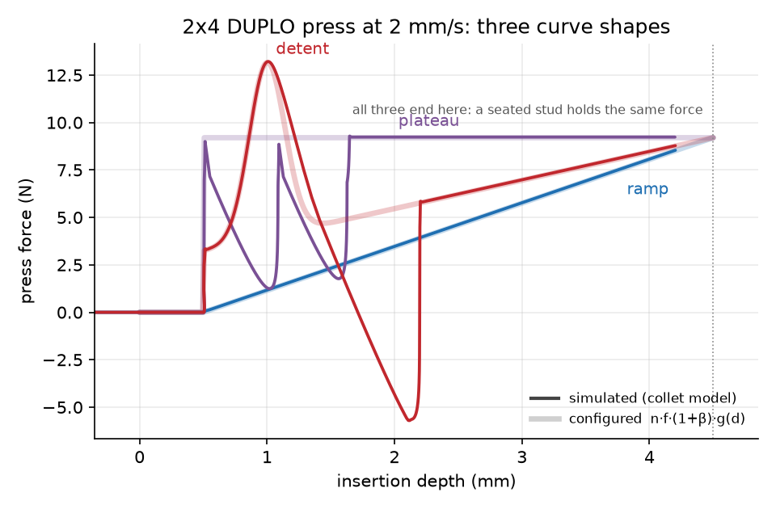
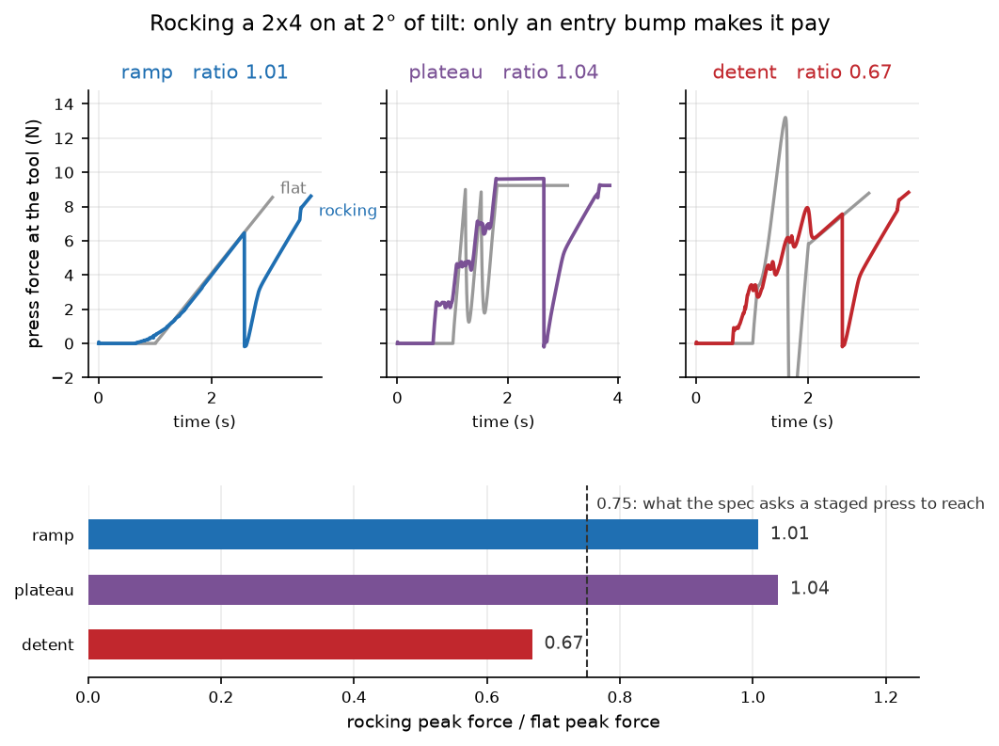
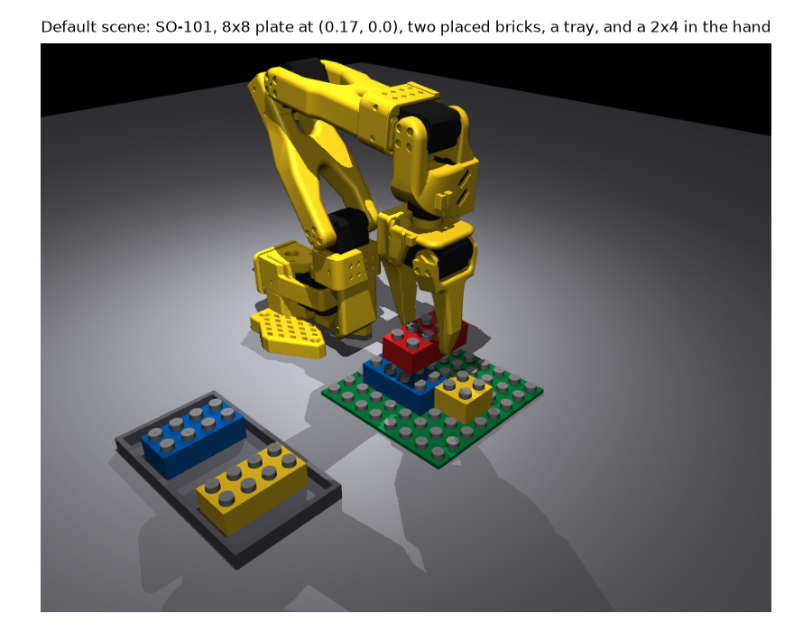
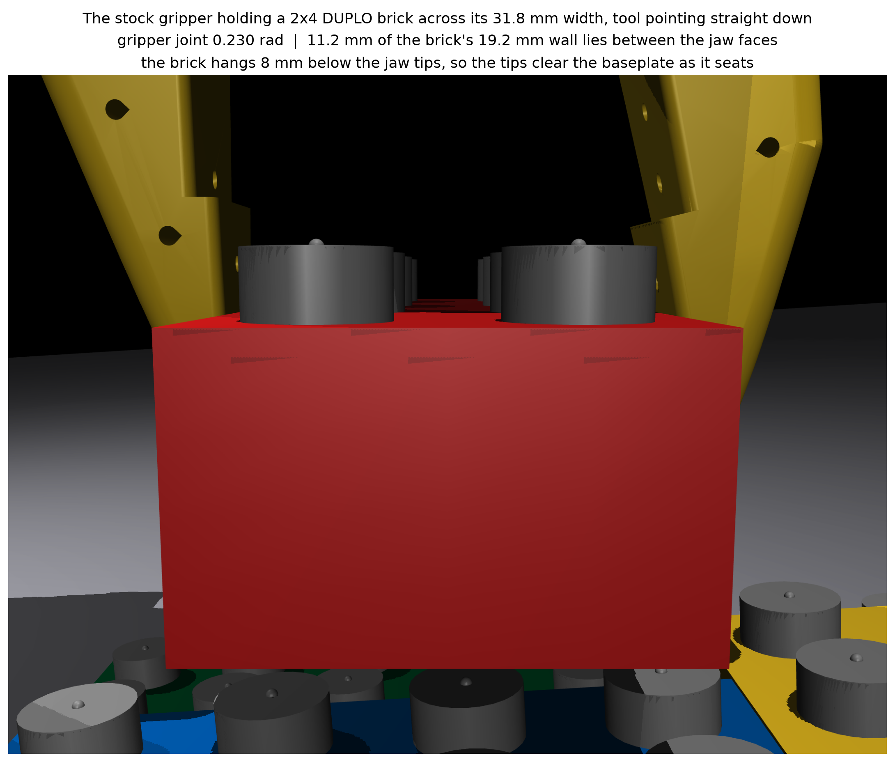
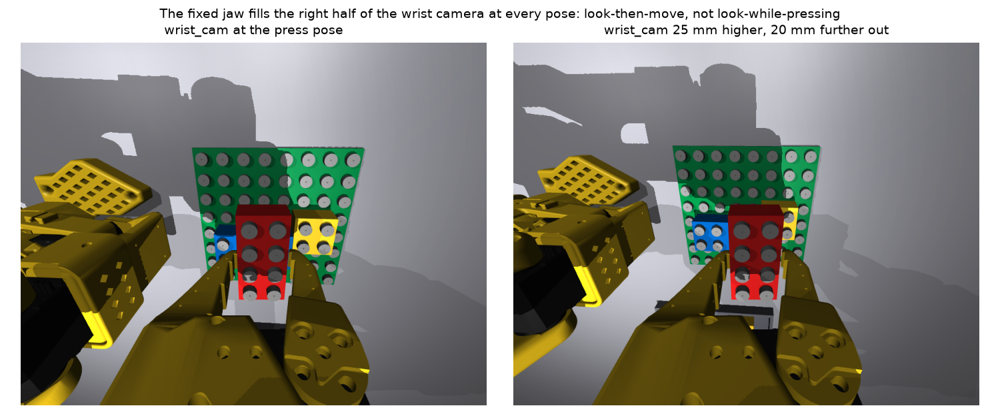

# Simulator and bricks

**Status: built.** Brick generator and snap-fit model (`brick_builder/bricks/`), scene composer
(`brick_builder/scene/`), and renderer (`brick_builder/render/`) exist; the numbers on this page
are measured from them.

## Purpose

Turns a LEGO DUPLO structure description into a simulated scene: brick geometry, a simulated
camera, and a model of how a stud presses and clicks into a tube.

## Capabilities

- Generates any DUPLO (or LEGO System, as a configuration variant) brick as a MuJoCo body, with
  separate collision geometry (convex shapes, for speed) and visual geometry (thin walls, ribs,
  hollow studs).
- Composes a scene of bricks, baseplate, and tray, and renders it from a robot camera viewpoint:
  RGB, depth, per-object segmentation.
- Runs the press bench: drives a ram onto a brick along a slide joint, logs force and depth,
  checks against [Bench tests](#bench-tests).
- Applies domain randomization: lighting, brick color jitter, camera pose, snap-fit strength, and
  more.

## DUPLO dimensions

Defaults below, from three independent sources that agree: a brick-generator project's
parameters, a caliper measurement, and a parametric-brick modeling tool.

| Dimension | Value (mm) |
|---|---|
| Stud pitch | 16 |
| Brick height | 19.2 (measured range 19.09-19.17) |
| Footprint | `n * 16 - 0.2` for an n-stud-long brick |
| Stud outer diameter | 9.40 (measured 9.38) |
| Stud height | 4.5 (measured 4.55) |
| Stud hollow inner diameter | 6.5 (measured 6.44) |
| Wall thickness | 1.55-1.6 |
| Wall rib width | about 1.5, touching the studs |
| Underside tube outer diameter | 13.4 (measured 13.48) |
| Underside tube inner diameter | 10.7 |
| Underside tubes | one at each interior grid intersection — 1 for a 2x2, 3 for a 2x4 |

Diagonal gap between two adjacent studs: `16 * sqrt(2) - 9.4 = 13.23` mm. Measured tube outer
diameter: 13.48 mm — a 0.125 mm radial interference (commonly cited LEGO tolerance: 0.1-0.2 mm),
the physical basis of the click.

A 2x4 brick masses 12.2 g (brick-cataloguing site); a 2x2 is assumed at 6.5 g pending a weighing.

## Press-fit model design

Rigid-body simulators, MuJoCo included, cannot resolve a 0.125 mm interference fit as deforming
plastic does. Three rejected approaches:

- Tuning MuJoCo's contact stiffness — force doesn't scale like a spring, uncalibratable to real
  press-force curves.
- A hand-written force law — the damping a 12 g brick needs destabilizes the contact solver.
- A rigid weld breaking past a threshold — an instant connect/disconnect, not the insertion
  process. Implemented anyway as `DetentSnap` (`bricks/snap_detent.py`), a cheap
  connected-or-not check.

**Chosen design: a per-stud friction joint** (`bricks/snap.py`, class `ColletSnap`). Each socket
gets an extra body — no geometry, no collisions, not part of the brick — turning brick-stud
relative motion into one joint coordinate for MuJoCo's solver to put **dry friction** on. Three
slide joints hang it off the brick: one along the brick's z axis (the clutch), two sideways
limited to the socket's clearance (the stud's play).

Once per physics step:

1. **Pairing and capture.** Every free socket is checked against every stud, vectorised. Within
   0.3 mm sideways, 6 degrees of parallel, and 0.5 mm onto a stud: an inactive `connect` equality
   activates (`data.eq_active`, anchors in `model.eq_data`), pinning the body to the stud tip.
   Residual sideways offset goes to the socket's own play, centred by a weak spring (a chamfer's
   self-centring).
2. **The clutch.** The body's axial coordinate is now the insertion depth. Dry friction scales
   with depth: `frictionloss(d) = f_clutch * g(d)`. `g`'s shape is a parameter,
   `SnapParams.curve` — unmeasured on a real brick (see
   [Tilted press vs. flat press](#tilted-press-vs-flat-press)):

   | `curve` | `g(d)` for an engaged stud | Behavior |
   |---|---|---|
   | `ramp` (default) | `clip((d - engage) / (h - engage), 0, 1) ** exponent` | resistance grows all the way in and is highest just as the brick goes home |
   | `plateau` | `1` | a stud is as hard to push at 1 mm as at 4 mm |
   | `detent` | a plateau at `plateau_gain` rising to 1 at full seat, plus a Gaussian bump of height `detent_gain` centred at `detent_depth` | the interference snap: hardest to push past the entry bump, easier afterwards - the click |

   All three reach `g = 1` at full seat: holding force `f_clutch * (1 - beta)` is shape-independent;
   only the work of pressing on, and the value of tilting, differ.
3. **Push/pull asymmetry.** Bound scales by `1 + beta` going in, `1 - beta` coming out: pressing
   costs `n * f_clutch * (1 + beta)`, pulling off releases at `n * f_clutch * (1 - beta)`.
4. **Seating** is `d >= h` for every engaged socket: a label, not a change of physics.
5. **Breakage** is friction saturating — a straight pull, or a peel unzipping stud by stud. A
   connection releases when its stud exits the socket mouth, or sideways constraint force tears a
   shallow one out of line.

A structure is just the graph of live connections; compressive load travels through ordinary
contacts, not the snap joints.

### Measured vs. configured force curve



A 2x4 brick pressed on at 2 mm/s under each shape, against `n * f_clutch * (1 + beta) * g(d)`.
Relative RMS error: 0.24 % (`ramp`), 0.35 % (`plateau`), 0.28 % (`detent`); under 0.1 % difference
between a 2 ms and a 0.5 ms timestep.

Trace plotted in time order, not by depth: a detent press is non-monotone in depth. Clearing the
bump releases stored energy — force dips, briefly negative (ram dragged), recovering about
1.8 mm later (the click); comparison against the quasi-static curve (`bench.quasi_static_band`)
excludes that window. `plateau` shows a smaller version at its step. Traces stop slightly short
of the end point: a press run halts once the brick is home.

### Tilted press vs. flat press



Not special-cased: tilting puts the sockets at different depths at the same instant. The four
rows of a 2x4 seat one after another, over 2.2 mm, versus all at once for a flat press. The first
row becomes the hinge; levering the rest down costs 0.27 to 0.33 N.m — inside one STS3215's
1.9 N.m limit, every curve shape.

Whether tilting lowers the peak tool force depends on the shape (bench test 4, three
measurements, not one threshold: 2° of tilt, tool at the leading edge):

| `curve` | flat peak | tilted-press peak | ratio |
|---|---|---|---|
| `ramp` | 8.54 N | 8.61 N | **1.01** |
| `plateau` | 9.28 N | 9.64 N | **1.04** |
| `detent` | 13.21 N | 8.83 N | **0.67** |

By Newton's third law, `F_tool = sum(F_stud)`, never below it. A flat press brings all eight
studs to `g = 1` simultaneously at the last moment: ratio near 1 where that is also the curve's
peak (`ramp`, `plateau`). Where the curve peaks early instead, at an entry bump, tilting spreads
the four rows' peaks across different times: 0.67, close to the design target of 0.65.

Whether to tilt is settled only by a force-gauge measurement on a physical brick (open question 2
of the design report). Default stays `ramp`, the pessimistic shape; the snap randomization group
samples all three so a trained policy does not rely on a click that may not exist.

## Calibration

Everything tunable lives in one frozen dataclass, `bricks/snap_api.SnapParams`; defaults are the
design report's placeholder values, pending real-brick calibration.

| Parameter | Default | What it does | How to measure it |
|---|---|---|---|
| `f_clutch` | 1.0 N | holding force of one fully inserted stud | push a 2x4 onto a kitchen scale in 0.5 mm shims; divide the plateau by 8 |
| `curve` | `"ramp"` | which family `g(d)` comes from | look at the shape of the measured force-against-depth curve: rising to the end, flat, or a bump near the start |
| `exponent` | 1.0 | curvature of the `ramp` (and of the `detent`'s base) | fit the shape of the same force-against-depth curve |
| `plateau_gain` | 0.35 | height of the `detent` curve's flat part, x `f_clutch` | the force between the click and full seat, over the seated holding force |
| `detent_gain` | 1.0 | height of the `detent` bump above that plateau, x `f_clutch` | the peak of the click over the seated holding force, minus `plateau_gain` |
| `detent_depth`, `detent_width` | 1.0 mm, 0.6 mm | where the bump is and how wide | read them off the same curve |
| `engage_depth` | 0.5 mm | how far in before a stud grips at all | the depth at which the scale first reads anything |
| `beta` | 0.15 | push/pull asymmetry | `(push peak - pull peak) / (push peak + pull peak)` |
| `capture_lateral` | 0.3 mm | sideways capture gate | offset jig and a feeler gauge: the largest offset that still seats |
| `capture_tilt_deg` | 6 deg | tilt capture gate | wedge shims |
| `lateral_play`, `lateral_ratio` | 1.0, 1.0 | sideways play and its grip, relative to `clearance` and `f_clutch` | how far a seated brick can be pushed sideways before it moves |

Workflow:

1. Measure, then write the numbers into a profile under `configs/snap/*.yaml` (one profile per
   brick population: new DUPLO, worn DUPLO, Mega Bloks, etc.).
2. Reproduce on the bench: `bricks/bench.py` is the virtual force gauge — a stiff ram on a
   vertical slide carrying a brick onto a baseplate, optional wrist hinge for tilting and
   peeling, logging force against depth every physics step.

   ```python
   from brick_builder.bricks.bench import BenchConfig, PressBench
   from brick_builder.bricks.snap import ColletSnap
   from brick_builder.bricks.snap_api import SnapParams

   bench = PressBench(ColletSnap(SnapParams(f_clutch=1.4, beta=0.2)), BenchConfig())
   press = bench.press(speed=0.002)     # down until the brick is home
   bench.hold(0.3)
   pull = bench.pull(speed=0.002)       # and back off again
   print(press.peak_force, pull.peak_pull)
   ```

3. Compare: `bench.predicted_press_force(depth, n_studs, params, stud_h)` gives the commanded
   curve; `trace.at_depths(grid)` gives the simulated result; `bench.quasi_static_band(params,
   stud_h)` gives the comparable part of the stroke.
   `brick_builder.bricks.media.make_force_vs_depth_figure(path)` draws all three shapes;
   `bench.measure_rocking_ratio(params)` runs the flat-against-tilted pair.
4. Re-run the bench tests: `.venv/bin/python -m pytest -q tests/bricks`.

Two numbers matter before tuning: snap update cost is about 100 microseconds/physics step for
one brick over an 8x8 baseplate, 320 microseconds for six, against 36 and 3510 microseconds for
`mj_step` itself; and a seated connection creeps about 0.01 mm/s at 90 % of nominal friction
(MuJoCo's friction-constraint regularization) — `ColletSnap` overwrites `dof_invweight0` on its
own friction joints to get there from the 5 mm/s default.

## Bench tests

Stage B's exit gate is eight bench tests (`tests/bricks/test_snap_bench.py`), run on the press
bench. Tests depending on the force-curve shape run for all three; where they differ, all three
numbers are given, order ramp / plateau / detent.

| # | Test | Acceptance | Measured |
|---|---|---|---|
| 1 | force against depth | within 10 % RMS of `n * f_c * (1 + beta) * g(d)`, under 5 % between dt 2 ms and 0.5 ms | 0.24 / 0.35 / 0.28 % RMS, under 0.1 % between timesteps |
| 2 | capture failure | 3 mm offset or 10 deg yaw never seats at twice nominal force | nothing connects at 31 N (nominal is 9.2 N); the brick stops 0.25 mm in |
| 3 | pull-off | `n * f_c * (1 - beta)` within 10 %, every connect cleared | break-away 6.87 / 6.89 / 6.88 N against 6.80 N. With `detent` the whole extraction peaks higher, at 9.77 N, because the stud has to be dragged back over the entry bump |
| 4 | tilted press | three measured cases (spec section 6b) | ratio 1.01 / 1.04 / **0.67** - see [Tilted press vs. flat press](#tilted-press-vs-flat-press) |
| 5 | stability | 3-layer overhang under 0.1 mm in 10 s; inverted brick under 0.3 mm | 0.079 / **0.241 (`xfail`)** / 0.087 mm, and 0.0013 mm inverted for all three |
| 6 | peel | failure moment within 20 % of `sum(f_c * lever)` | 0.236 / 0.256 / 0.238 N.m against 0.256 N.m |
| 7 | sanity | no energy gain, penetration under 0.1 mm at 10 N, zero warnings | no gain on a settled stack for any shape; the overhanging staircase trends 2.0e-5 / **7.4e-5 (`xfail`)** / -1.2e-5 J over 6 s; 0.006 mm of penetration at 9.8-13.2 N; zero warnings |
| 8 | save and restore | `mjSTATE_INTEGRATION` plus `SnapState` replays the trajectory | identical, bit for bit, for all three |

The two `xfail`s share a scene and cause (tests' own `reason` strings): the overhanging top brick
of the three-layer staircase rattles inside the friction joints' sideways play. Nothing comes
loose, but re-measuring over successive 5 s windows gives 0.02 to 0.38 mm, inside the rig's own
noise for every shape — `ramp` passing the 0.1 mm line is partly luck. Quieting the rattle means
damping the friction joints and brick-to-brick contact, not the force law.

The fallback model is held to tests 2, 3, 5, and 8 only (`tests/bricks/test_snap_detent.py`) —
the rest concern a force-curve shape it lacks — and passes all four.

Bricks default to a per-stud clutch force of 1.0 N (randomized log-uniformly 0.3-2.5 N during
training; unmeasured), a 0.20 mm clearance, and a 0.5 mm chamfer — placeholders until a real
brick is measured.

## Sections to be filled in as the code lands

- **Brick generator API** — `BrickSpec`, how to declare a new brick shape or a different brick
  system (LEGO System is a configuration change, not a new code path).
- **Scene composition** is written up in [Scenes and randomization](#scenes-and-randomization).
- **Rendering** is the only remaining gap; press bench and calibration workflow are in
  [Calibration](#calibration) above.

## Scenes and randomization

A *scene* is one complete world: table, arm, build plate, whatever is standing on the plate, an
optional tray of spare bricks, and usually a brick already in the gripper.
`brick_builder/scene/compose.py` builds one from a `SceneConfig`; `brick_builder/scene/randomize.py`
perturbs it between episodes.

```python
from brick_builder.scene.compose import SceneConfig, build_scene, reset_scene, settle
from brick_builder.bricks.structures import Placement

cfg = SceneConfig(
    plate_studs=(8, 8), plate_xy=(0.17, 0.0),
    placed=[Placement(2, 4, 1, 2, 0, "blue")],   # BrickGPT text format, already parsed
    grasp_mode="weld",                            # or "friction"
)
scene = build_scene(cfg)        # compiled, snap model bound, arm at its home pose
print(settle(scene, 2.0))       # warnings, drift, live connections
```



### Coordinate frame and layout

World x is forward, y is left, z is up; arm base at the origin, table top at z = 0. Plate centre
defaults to (0.17, 0.0), keeping the whole 8x8 plate between 0.10 m and 0.24 m of the base — the
band where the force map gives the arm 12-16 N of downward push at 7.4 V (1.9 N.m datasheet
torque limit, not the 3.4 N.m the servo law implies; see the robot guide).

`reset_scene` restores the arm to `scene.home_q`, lays the placed bricks against the plate's
*current* pose, returns the held brick to the hand, and re-binds the snap model. The home pose
hovers the tool's lowest point — held brick's bottom face, or jaw tips when empty — `home_hover`
above the tallest thing on the plate: jaw tips sit 8 mm below the TCP, so a home pose set for a
held brick would drive an empty gripper through a standing brick.

### Build order

`mujoco.MjSpec` does not forgive the wrong order; getting it wrong fails silently, with nothing
connecting.

1. `attach_arm`, then `add_baseplate` / `add_brick` / `build_structure`;
2. the snap model's `declare()`, adding a friction-joint body per socket and inactive equalities
   that must exist before compilation;
3. `world.compile()`;
4. the snap model's `bind()`.

`build_scene` is the one place that order is written down; use it rather than assembling a world
by hand.

### Grasp geometry

The brick is gripped across its 31.8 mm width, tool pointing straight down, so the brick's own +z
(stud direction) is the gripper body's +z. Every number in `GraspPose` comes from
`patch_so101.jaw_geometry()` plus the brick's `BrickSpec`:

| Quantity | Value for a 2x4 DUPLO brick |
|---|---|
| jaw opening | 31.8 mm (`nx * pitch - clearance`) |
| gripper joint angle where the jaws just touch | 0.2298 rad |
| brick wall between the jaw faces | 11.2 mm of its 19.2 mm height |
| brick hangs below the jaw tips | 8.0 mm |
| brick origin in the TCP frame | (-0.1, 0.0, +16.0) mm |



The moving jaw swings on a hinge, so the faces are never parallel: **narrowest high up between
the jaws, widest at the tips**. At the joint angle giving 31.8 mm at the narrow end, the tips are
39.9 mm apart. `patch_so101.gripper_angle_for_width` measures the narrow end, a guarantee for the
whole face; `compose.jaw_clearance(point, angle)` reconstructs the gap at any point instead, and
`jaw_angle_for_clearance` inverts it — closing to "31.8 mm" by `gripper_angle_for_width` leaves a
brick held at the tips completely loose.

The wedge opens downwards: a load pushing the brick *up* narrows the gap and tightens the pinch;
a load pulling it *down* widens the gap and it slides. Pressing onto the plate is the first case
— why a grip the acceptance test calls a failure can still seat bricks; see
[Brick seating with the stock gripper](#brick-seating-with-the-stock-gripper).

### Two grasp modes

`grasp_mode="weld"` (default) ties the brick to the gripper with a soft weld equality, jaws
commanded half a millimetre wider than the brick so they never touch. Compliant — about 0.17 mm
of give under 5 N — time constant and torque scale randomized, standing in for a grip without
tuning finger contact. Deliverable 1 is about the press.

`grasp_mode="friction"` closes the jaws 6 mm past the brick's face (about 19 N of pinch), relying
on friction between the bare printed jaw faces and the brick — the only grip the arm has: the
SO-101 gripper is a fixed jaw and a moving jaw, both printed, nothing attached to either.

The friction coefficient between a printed jaw and an ABS brick is unmeasured, on this arm or
elsewhere: a parameter (`ArmConfig.pad_friction`), default 1.0, a placeholder. The one related
number available is design report 01's ABS-on-ABS value, 0.35, randomized over 0.2-0.5 — dry
printed plastic on dry moulded plastic is a similar contact, so **0.3-0.5 is the band to design
against, 0.3 the value to design for.** Table: same 5 N pull, held 5 s, four coefficients:

| 5 N for 5 s | weld | friction, 0.3 | friction, 0.5 | friction, 0.8 | friction, 1.0 |
|---|---|---|---|---|---|
| downward (pulling the brick out) | 0.17 mm | **28.4 mm** | 2.32 mm | 2.11 mm | 2.08 mm |
| upward (the press direction) | 0.08 mm | 1.15 mm | 1.10 mm | 1.06 mm | 1.04 mm |
| sideways, across the jaws | 0.02 mm | brick ejected | brick ejected | 1.25 mm | 1.29 mm |
| along the brick | 0.03 mm | brick ejected | 6.10 mm | 8.53 mm | 9.28 mm |
| no load at all, 5 s | 0.000 mm | 0.84 mm | 0.88 mm | 0.86 mm | 0.85 mm |

Bottom row matters most: creep from the brick sliding out of the wedge under its own 12 g does
not stop — the same hold run for 10 s instead of 5 gives 1.43 mm at coefficient 0.3 and 1.55 mm
at 0.5, leaking out at about a tenth of a millimetre a second when the clock runs out. **A
stock-gripper pick and place has to be quick;** the scripted sequence below carries a brick about
six seconds and loses roughly 0.7 mm of grip.

Downward, the grasp is unusable below coefficient 0.5, never better than 2 mm above it: the
wedge, not Coulomb friction, is the cause — squeezing harder makes it worse (0.85 mm unloaded
creep at 18.8 N pinch, 1.22 mm at 33 N). Upward, creep is about 1 mm at every coefficient tested,
including 0.3, since the gap closes as the brick rides up. "Brick ejected": the 5 N sideways pull
squirted the brick into the mechanism (MuJoCo bad-acceleration warning).

`tests/scene/test_compose.py` keeps the 1 mm downward test as a strict xfail with these numbers;
weld mode stays the default for training.

### Brick seating with the stock gripper

`brick_builder.control.pick_place` drives the job through the servo bus at 50 Hz: home, over the
tray, open, down onto a brick, close, lift, carry, line up over the target studs, seat it, let
go, retreat, home. A generator, one step per control tick, so a video script can record it.
`verify_placement` reads the result from the simulator: connected, at the intended cell, within
0.3 mm of full depth, still there once the arm has left.

The fixed jaw cannot move, so arriving with the brick flush against it — where it ends up once
the jaws close — leaves the brick a couple of millimetres off in that direction, outside the
gripper. The descent instead aims for the *middle* of the open gap, half the open clearance back,
letting the moving jaw shove the brick flush as it closes. Error across the jaws is corrected by
gripping; error along the brick, and yaw, are not.

Three seating methods, built and measured against each other:

**Press while gripping.** Keep hold of the brick, drive the tool down until the studs seat. The
reaction pushes the brick into the narrowing part of the gap, tightening the press's own grip.

**Place, let go, then push.** Set the brick on the stud tops, open the jaws, lift clear, bring
the jaws together, push straight down on the roof with the tip of the fixed jaw — 7.2 mm lower
than the moving one, the only thing that touches. No grip force is involved.

**Both, in that order.** Press it in while holding it, let go, push once more on the roof with
the jaws together, addressing what the first push leaves behind when it fails.

Test conditions: thirty runs per cell, a 2x4 brick, friction coefficient 0.5 between jaws and
brick, a fresh draw each run of the brick's tray position (+-2 mm, +-2 degrees, unknown to the
arm) and error direction. "Seated" means every stud within 0.3 mm of full depth, on the intended
cell, still there after the arm goes home.

**These numbers were corrected after first publication.** The servo bus reported *motor*-side
encoder position, hiding gear backlash between motor and output shaft; the STS3215's actual
encoder is on the output shaft (see
[Gear free play and encoder position](03-robot-and-servo-model.md#gear-free-play-and-encoder-position)).
Corrected, the arm settles about 0.4 mm from its commanded pose, against 3.6-6.0 mm before — the
seating rates below depended on that hidden play: the old tool arrived several millimetres off
target and crept sideways into the cell while pressing, dragging the brick along. The corrected
arm does not; instead the brick lands on the stud tops about 1 mm off centre (jaw-axis position
varies that much), and a blind press with a 0.25 mm capture window has no lateral motion left to
find the sockets.

#### 2x4

| placement error the arm does not know about | press while gripping | place, let go, push | both, in that order |
|---|---|---|---|
| 0 mm | 86 % → **0 %** | 46 % → **17 %** | 92 % → **17 %** |
| 1 mm | 84 % → **0 %** | 54 % → **3 %** | 90 % → **7 %** |
| 2 mm | 66 % → **3 %** | 28 % → **10 %** | 72 % → **10 %** |

Each cell: old (motor-side encoder) → corrected (output-shaft encoder). Timing is unchanged for
the first two strategies — about 15 s pressing while gripping, 18.1 s placing and pushing — and
20-23 s for both together; arm joints peak at about 0.9 N.m against the 1.9 N.m limit, only the
gripper reaching its own limit. Sustained press force on the 2x4 drops from about 9.5 N to 3-6 N,
a symptom of the corrected tracking, not a new failure.

#### 2x2 (both, in that order)

| placement error | old | corrected |
|---|---|---|
| 0 mm | 100 % | 83 % |
| 1 mm | 98 % | 53 % |
| 2 mm | 98 % | 43 % |

A 2x2 fails less often than a 2x4 at the same placement error: half the studs need half the
force, and a 32 mm square footprint has far less leverage than a 64 mm one to stand itself up on
one row of studs.

Blind scripted pressing is therefore not enough: **closed-loop visual alignment is required** to
seat a 2x4 reliably. The spiral search in `PressScripted` does not rescue a friction grip the way
it rescues a welded one: its trigger waits for the tool to drop into a socket, and a friction
grip lets the brick move in the hand instead, so the trigger never fires.

All figures above come from `brick_builder.control.pick_place.bench`, the code path the tests run.

### Wrist camera field of view



The wrist camera pose comes from TheRobotStudio's official SO-101 wrist camera mount
(`so101_new_calib_camera.xml`); its lens is modelled at 115 degrees diagonal field of view,
randomized over 100-130 degrees. At that field of view the fixed jaw covers 7-15% of the frame,
and the whole 8x8 baseplate is visible at a 5.8 cm hover. See
[Robot and servo model](03-robot-and-servo-model.md#the-wrist-camera) for full pose, lens, and
image-composition detail.

### Randomization

`randomize.sample(rng, level)` returns one flat dictionary keyed `"<group>.<field>"`, the same
dictionary that goes into the critic observation and `EpisodeResult.params`, so a run is
reproducible from what was logged rather than a seed plus source version.
`randomize.apply(scene, sample)` writes it into the compiled model in place.

| group | what it moves |
|---|---|
| `dynamics` | servo gain, torque limit, joint damping, friction loss, armature, backlash, supply voltage, link mass |
| `command` | dead band, slew limit, command delay and jitter, read skew and noise, bus packet loss and period jitter |
| `snap` | clutch force (log-uniform), asymmetry, curve exponent, capture gates, and which of `ramp`/`plateau`/`detent` this episode uses |
| `contact` | brick, pad and table friction, and the stud diameter |
| `plate` | the build plate's pose, +-3 mm and +-2 degrees |
| `in_hand` | the in-hand offset and yaw of the held brick, and the soft weld's compliance |
| `visual` | lights, camera extrinsics and field of view, brick colour, and the image post-process |

`level` is a number in [0, 1]: how much of the range to use. Level 0 gives every parameter its
nominal value, so `apply(scene, sample(rng, 0))` leaves the model bit-for-bit as built — the
control condition every sweep should include. (The task curriculum's own `level` 0..5 is a
separate number, used in the environments.)

Order matters: **randomize, then reset.** `apply` writes the model; `reset_scene` lays the bricks
out against the plate pose just chosen and re-binds the snap model, also restoring the
friction-joint regularization after a link-mass change forces MuJoCo to recompute its constants.

Three exceptions:

- Supply voltage is sampled but *not* re-applied to gain and torque limit: published ranges for
  gain (7-20 N.m/rad) and torque limit (1.5-3.4 N.m) already span the 6.8-7.6 V band plus the
  datasheet-versus-BAM disagreement, so multiplying again would exceed them. Voltage still
  reaches the servo emulation via `randomize.servo_config` (current and load readings).
- The visual group writes lights, cameras, and colours directly into the compiled model,
  bypassing `render.domain_rand`'s scene-side helpers (uncompiled `MjSpec`, would force a
  recompile per episode); sampling and colour maths still come from that module.
- Brick friction is 0.35 (design report 01 section 4), set by the scene on compiled geoms;
  `bricks/generator.py` leaves them at MuJoCo's default of 1.0 (a placeholder), and changing it
  there would shift the calibrated bench tests.

### Measured, on this machine

| | |
|---|---|
| build + compile, 8x8 plate + 2 placed + held brick | 0.15 s |
| `reset_scene` | 3.8 ms |
| physics steps/s, arm + 8x8 plate + held 2x4 | 1810 |
| ... + 2 placed bricks | 1500 |
| ... + a tray of 3 more bricks | 560 |
| settle, 2 s, any of the above | zero MuJoCo warnings, every placed brick seated, residual speed under 0.6 mm/s |

Physics steps, not environment steps: at 10 physics steps per control tick, before the servo bus
and rendering are added, the middle row is about 150 control ticks per second in one process.
