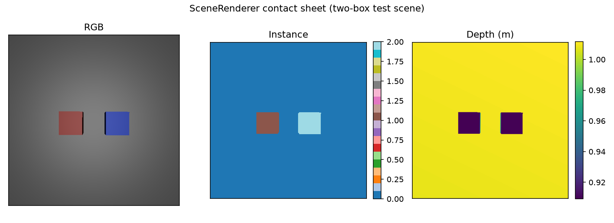
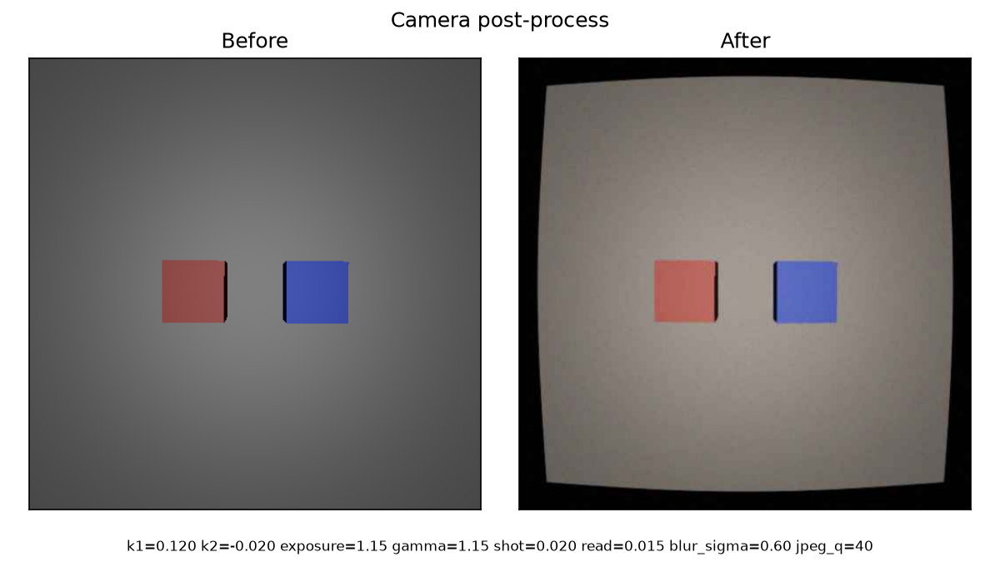

# Rendering and datasets

This page covers `brick_builder/render/` (`renderer.py`, `domain_rand.py`): the module that turns an
`MjModel`/`MjData` pair into what a camera on the robot would see — RGB, metric depth, and a
per-object instance map — and randomizes that scene and image the way training needs. It does not
build the scene itself (bricks, robot, table) — that is `brick_builder/bricks/`, `brick_builder/robot/` and
`brick_builder/scene/` — it only renders whatever `MjModel` it is handed.

## The problem `mujoco.Renderer` doesn't solve

`mujoco.Renderer`'s depth mode and its segmentation mode are mutually exclusive — you can turn on
one or the other, never both, on the same renderer instance. Getting RGB, depth and an instance map
for one time step therefore needs its own thin renderer working directly on `GLContext`, `MjvScene`
and `MjrContext`, rendering the scene twice:

1. **Pass 1 (RGB + depth).** Render normally, then read RGB and depth from the same framebuffer with
   one `mjr_readPixels(rgb, depth, rect, ctx)` call.
2. **Pass 2 (segmentation).** Turn on `scene.flags[mjRND_SEGMENT]` and `scene.flags[mjRND_IDCOLOR]`,
   render again, and read back a colour image whose RGB triple at each pixel encodes `segid + 1` (0
   = background). `scene.geoms[k].objid` / `.objtype` recover which geom painted that segid, and
   `model.geom_bodyid[objid]` recovers its body.

The depth
conversion (reverse-Z NDC to metres, using `<visual><map znear/zfar>` scaled by `model.stat.extent`)
was checked against `mujoco` 3.13.0's own `mujoco.Renderer` source and matches it exactly; if this
low-level path ever proves unreliable on a different driver, the fallback is `mujoco.Renderer` run
twice (once with `enable_depth_rendering()`, once with `enable_segmentation_rendering()`) — slower,
but built entirely from public, supported API.

## `SceneRenderer`

```python
from brick_builder.render.renderer import SceneRenderer

renderer = SceneRenderer(model, width=256, height=256)
renderer.instance_lut({"box_red": 1, "box_blue": 2})   # body name -> instance id
frame = renderer.render(data, camera="cam0")
renderer.close()   # or: with SceneRenderer(...) as renderer: ...
```

- The GL context and `MjrContext` are created lazily, on first use — never in `__init__` and never
  at import time — because `gymnasium.vector.AsyncVectorEnv` forks worker processes and a forked
  process must not inherit an open GL context from its parent.
- `instance_lut` sets which body maps to which instance id. A body not in the map renders as
  instance `0`; true background (no geom hit at all) always renders as `-1`.
- Collision-only geoms are hidden from every pass through `MjvOption.geomgroup`: this codebase's
  MJCF convention (shared with the vendored SO-101 model) is geom group 2 for visual meshes and
  group 3 for collision primitives, so group 3 is masked off (`COLLISION_GEOM_GROUP` in
  `renderer.py`).
- `render()` returns a `Frame(rgb, depth, instance, body_ids)`: `rgb` is `uint8 [H, W, 3]`, `depth`
  is `float32 [H, W]` in metres, `instance` is `int32 [H, W]`, and `body_ids` is the instance map
  that was active for that call.

### Camera-space depth, not ray length

The depth buffer follows the standard OpenGL/MuJoCo convention: each pixel holds the distance along
the camera's optical axis to whatever it hit, not the Euclidean distance along that pixel's ray. A
flat plane held exactly perpendicular to the camera reads back at the *same* depth at every pixel
(the camera's height above it), even at the edges of the image where the ray is off-axis — this is
tested directly in `tests/render/test_renderer.py::test_depth_of_known_plane_within_1mm` and holds
to better than 1 mm.

### Contact sheet



RGB, instance and depth for the same frame of a self-contained two-box test scene (see
[Reproducing the example figures](#reproducing-the-example-figures)). `plot_contact_sheet(frame,
out_path)` in `renderer.py` is the figure-producing function `scripts/make_media.py` calls for this
page.

## Domain randomization: `domain_rand.py`

Two kinds of randomization, matching where they naturally belong:

**Scene-side**, applied to an `mujoco.MjSpec` before it is compiled — the same place the rest of
brick_builder randomizes physical parameters (`kp`, `forcerange`, and so on) — so a whole episode's
rendering conditions are fixed once per episode rather than drifting frame to frame:

```python
from brick_builder.render.domain_rand import (
    ColourJitterConfig, randomize_material_colour,
    LightRigConfig, randomize_lights,
    CameraJitterConfig, randomize_camera,
)

rng = np.random.default_rng(seed)
randomize_material_colour(spec.material("mat_brick_red"), (0.8, 0.1, 0.1), ColourJitterConfig(), rng)
randomize_lights(spec, LightRigConfig(n_lights=(1, 4)), rng)
randomize_camera(spec, "wrist_cam", CameraJitterConfig(pos_jitter_m=0.005, rot_jitter_deg=3.0), rng)
model = spec.compile()
```

- `randomize_material_colour` jitters a colour in HSV space (hue, saturation, value each with their
  own range) and writes it back to `material.rgba`, used for brick-colour and table-colour jitter
  alike.
- `randomize_lights` deletes every light on the worldbody and adds a fresh rig of 1-4 point lights
  at randomized positions with randomized diffuse/specular gain.
- `randomize_camera` perturbs a named camera's position (uniform box), orientation (a random small
  rotation about a random axis) and vertical fov, all from one `rng`.

**Image-side**, applied per rendered `Frame` — camera and sensor artefacts that have no MJCF
equivalent:

```python
from brick_builder.render.domain_rand import sample_postprocess_config, apply_postprocess

cfg = sample_postprocess_config(rng)     # or build a PostProcessConfig by hand
noisy_frame = apply_postprocess(frame, cfg, rng)
```

`PostProcessConfig` covers radial lens distortion (`k1`, `k2`), exposure, per-channel white
balance, gamma, shot noise (signal-dependent), read noise (constant), Gaussian blur, and an
optional JPEG re-encode. The lens-distortion remap uses bilinear sampling for RGB but
**nearest-neighbour** for depth and instance, so a distorted depth or instance pixel is always a
straight copy of some input pixel, never a blend of two different objects' values or two different
distances — `tests/render/test_domain_rand.py::test_distortion_remap_uses_nearest_neighbour_for_depth_and_instance`
checks this directly. With every parameter at its neutral value (`PostProcessConfig()`, the
default), `apply_postprocess` is the identity: same bytes back out.

### Before / after



`plot_postprocess_before_after(frame, cfg, rng, out_path)` in `domain_rand.py` is the
figure-producing function `scripts/make_media.py` calls for this panel.

## Measured numbers

On this machine (CPU-only test run, `MUJOCO_GL=egl`), a combined RGB + depth + instance render of
the two-box test scene at 256x256, after a warm-up call to pay for context creation and shader
compilation: **about 700 frames/s**, comfortably over the spec target of >=150 fps.
`tests/render/test_renderer.py::test_throughput_rgb_depth_instance_256` measures and prints this
number on every run (marked `slow`, since it renders 200 frames); it does not fail the test suite on
speed, per spec section 4 — only reports what was measured.

## Reproducing the example figures

Both figures above come from a self-contained two-box MJCF scene (a grey table with a red and a
blue box, one point light, a single downward-looking camera), the same scene
`tests/render/conftest.py` defines as `two_box_mjcf` — no dependency on the brick or robot
modules, since render's own tests must not depend on other packages. The
contact sheet uses a scene mutated in place by `randomize_material_colour`, `randomize_lights` and
`randomize_camera` with seed 0. The before/after panel applies a hand-picked (not randomly sampled)
`PostProcessConfig` with visible barrel distortion, warm white balance, gamma lift, noise and blur,
so the two images are easy to tell apart at a glance; a real dataset instead draws its
`PostProcessConfig` from `sample_postprocess_config`.

## GPU-side non-determinism

`SceneRenderer` is deterministic given the same `MjModel`/`MjData` state and the same instance map:
same input, same bytes out, checked directly in
`tests/render/test_renderer.py::test_same_data_renders_identical_bytes`. That test — and the two
example-scene MJCF fragments in `tests/render/conftest.py` — set `<visual><quality
offsamples="0"/></visual>`, which disables multisample anti-aliasing on the offscreen framebuffer.
With the default `offsamples` (4x MSAA), repeated renders of the identical scene state could differ
by a handful of shadow/edge pixels, off by one greyscale value each — ordinary GPU-driver blending
non-determinism, not a bug in this module. Do not rely on frame-identity for a scene compiled with
anti-aliasing left on.
