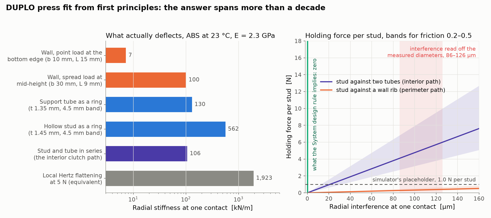
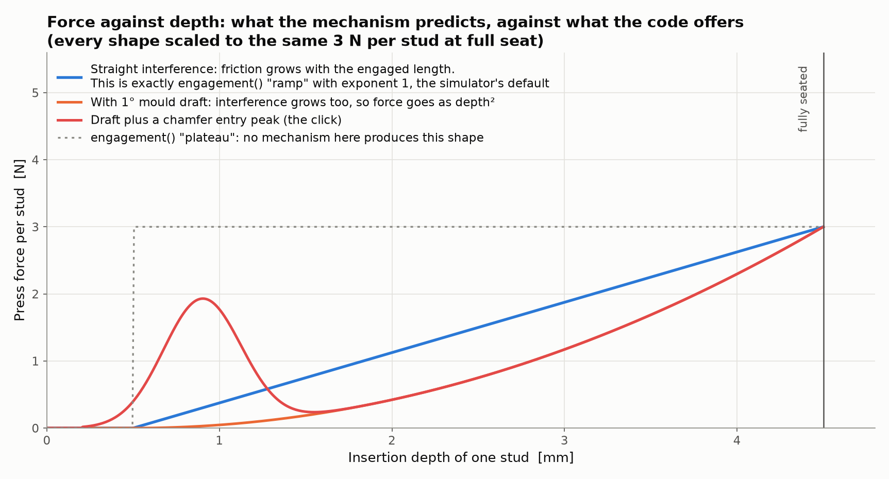
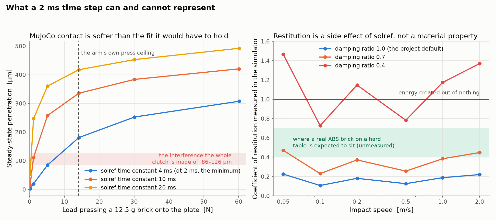
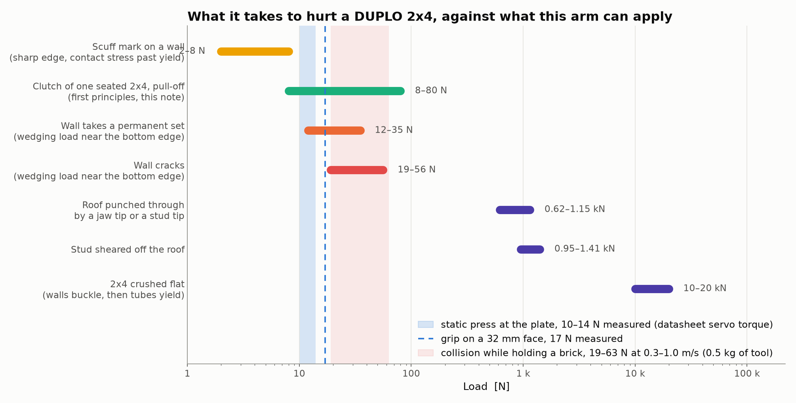
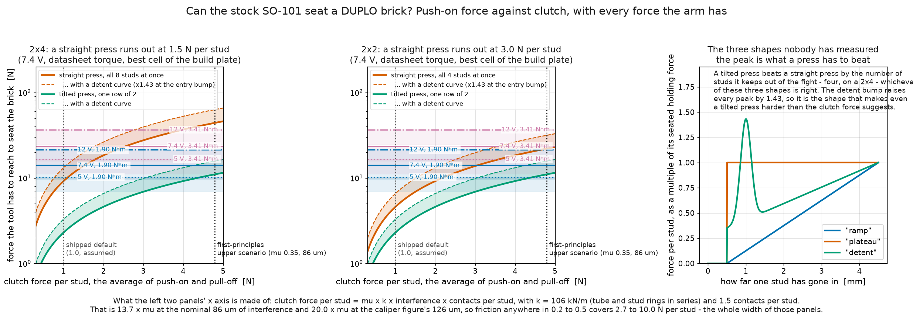
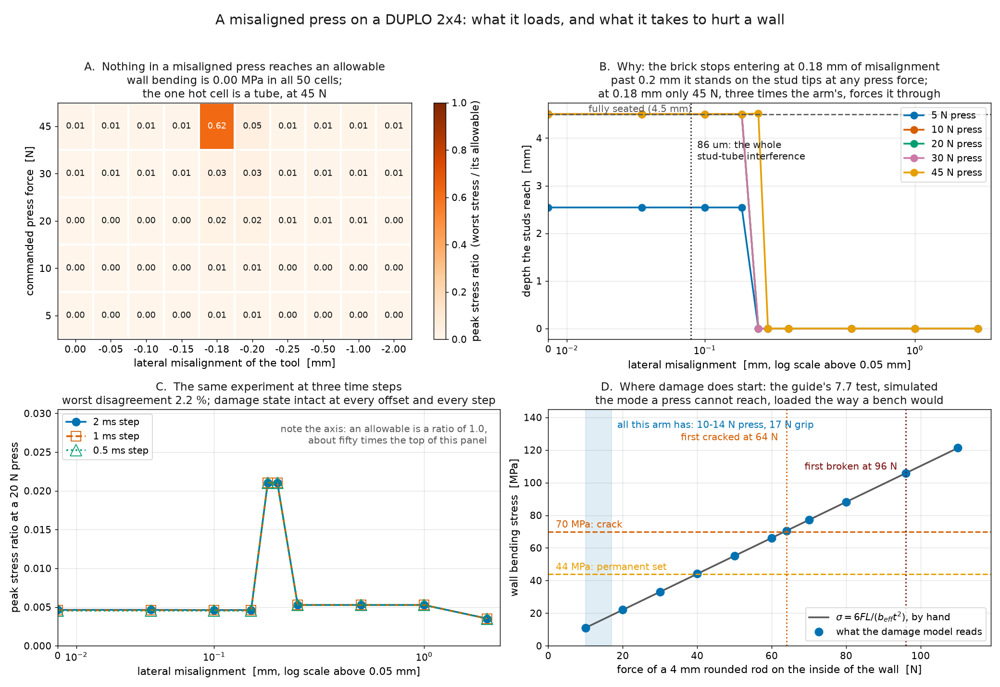
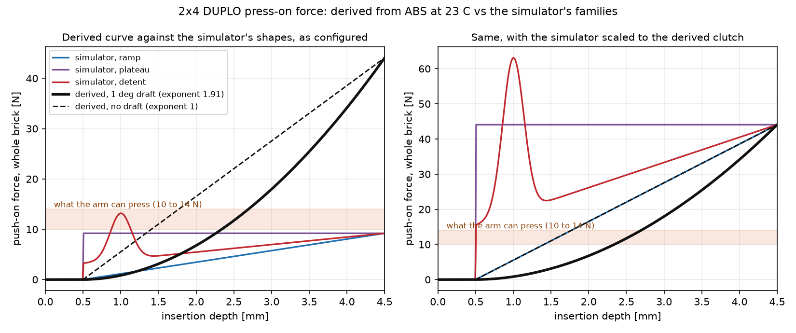
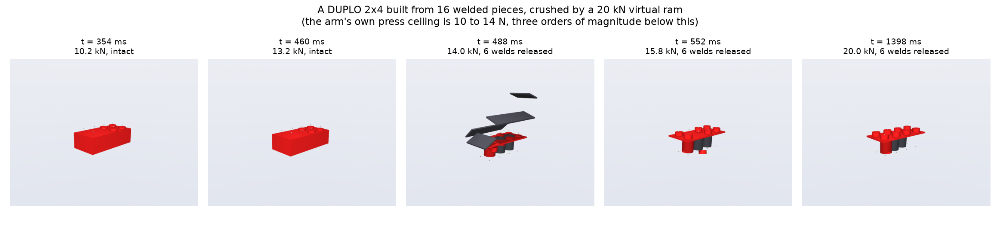

# Materials and damage

**Status: analysis, plus three modules that implement it.** Sections 1-5 cover
plastic behaviour at room temperature, the press-fit mechanics, and brick failure thresholds.
Section 6 is now code: `brick_builder/bricks/materials.py` (sourced property database and every
derivation on this page), `damage.py` (cheap per-step estimate), and `breakable.py` (a brick built
from separable pieces), described under "Using the material and damage models" at the end.
Section 7 lists the measurements needed to replace the remaining assumptions with facts.

**Default wiring.** Every composed scene attaches a damage monitor (`damage.py`), and the contact
settings of the jaw-brick and arm-link pairs come from `materials.contact_settings`; breakable
bricks (`breakable.py`) are a parameter, off by default. Details, switches and measured costs:
[Damage and breakable bricks](02d-damage-and-breakable-bricks.md). The simulator's `f_clutch`
default stays at the assumed 1.0 N per stud, not the 4.8 N this page derives, and damage is not in
any reward or termination condition; section 6.3 specifies what that would require.

Units are SI at 23 °C unless stated otherwise. Every number carries its source; an assumption is
labelled as such, and an unresearched quantity is labelled unknown.

## 0. The short version

- The brick plastic is ABS; stiffness and strength at room temperature are known to about ±20 %.
- The press fit is uncertain by a factor of about twenty (two dimensions near 13 mm; the LEGO
  System rule makes the equivalent difference exactly zero). Shipped default: 1.0 N per stud
  (status `assumed`), near the bottom of a 0.5 to 5 N plausible range and possibly several times
  too low. No real DUPLO clutch has been measured; this page's first-principles estimate, 4.79 N
  (below), is an upper scenario, not the default, resting on an assumed interference never checked
  against a real brick.
- The arm cannot break a DUPLO brick by pressing: crushing needs 13.2 kN, shearing a stud off
  needs about 1 kN, and the arm's measured static press at the build plate is 10 to 14 N.
- Three damage routes: scuff, permanently bend a wall in a jam, or crack a wall in a collision.
  Cracking is the only true breakage, at 19 to 56 N of lateral load, reached only dynamically from
  about 0.3 m/s. A fourth, slow route: the clutch wears out over tens of thousands of cycles.
- "Brick destruction" here means a wall going out of shape or a connection losing grip, not
  shattering — loads of the same order a press policy will be tempted to use.
- **A misaligned press cannot bend a wall at all in the simulator** (section 6.4): studs and tubes
  overlap 86 µm and jam at about 0.18 mm of misalignment, and the nearest wall is 1.65 mm away, so
  the brick stalls on the stud tips first. A rod against a real wall's inside face (section 7.7)
  cracks it at 64 N, 4.5 times the arm's press.
- **The press-fit force decides whether this project works, and it is unmeasured.** At the
  mechanics' 4.8 N-per-stud estimate, a flat press of a 2x4 needs 44 N against an arm that has 10
  to 14 N, so only a tilted press is possible. A twenty-minute kitchen-scale measurement settles
  it: see "Seating feasibility with the stock arm" and section 7.2.

## 1. Materials at 23 °C

### 1.1 The brick plastic

LEGO and DUPLO bricks are moulded in ABS (acrylonitrile butadiene styrene), about 80 % of LEGO
elements; transparent parts are polycarbonate, thin flexible parts polypropylene or polyethylene,
neither present in a DUPLO brick ([BrickNerd](https://bricknerd.com), LEGO's own
[materials page](https://www.lego.com/en-us/sustainability/product-safety/materials)). No source
gives a DUPLO-specific grade; the grade usually cited for LEGO, Novodur P2H-AT, is unconfirmed
against a manufacturer datasheet (PDFs return 404 and 403), and sources disagree on whether INEOS
Styrolution or Lanxess supplies it. The table below treats it as unfilled injection-moulding ABS.

| Property | Nominal | Randomization range | Source |
|---|---|---|---|
| Density | 1050 kg/m³ | 1030 to 1070 | Novodur P2H-AT listed at 1040 kg/m³ (plastics-database.org); generic unfilled ABS 1030 to 1070 |
| Young's modulus, tensile | 2.3 GPa | 1.8 to 2.7 | Novodur P2H-AT 2500 MPa (Albis datasheet listing); generic ABS 1.58 to 2.63 GPa (ASTM D638), 1.79 to 2.89 GPa (ISO 527-2) |
| Poisson's ratio | 0.35 | 0.34 to 0.38 | aggregated literature; ABS datasheets rarely publish it. **Low confidence.** |
| Tensile yield stress | 44 MPa | 36 to 52 | Novodur P2H-AT 44 MPa; generic 35.1 to 51.0 MPa (ASTM D638) |
| Flexural strength (modulus of rupture) | 70 MPa | 60 to 95 | generic ABS 72 to 97 MPa (MakeItFrom) |
| Shear strength (assumed 0.6 × tensile yield) | 26 MPa | 22 to 31 | **Assumption.** No measured ABS shear strength was found |
| Elongation at break | 20 % | 3 to 50 | generic ABS 3.4 to 26 % (ISO 527-2), 1.0 to 57 % (ASTM D638) |
| Notched Izod impact | 300 J/m | 70 to 370 | Novodur P2H-AT 300 J/m at 23 °C; generic range from MakeItFrom |
| Glass transition | 104 °C | 100 to 106 | DSC on an actual unaged LEGO brick ([PMC10422395](https://pmc.ncbi.nlm.nih.gov/articles/PMC10422395/)). **High confidence**, and the only property here measured on a real brick |
| Heat deflection temperature | 94 °C at 0.45 MPa | — | plastics-database.org for Novodur P2H-AT; generic unfilled ABS 75 to 88 °C at 1.8 MPa |
| Coefficient of friction, ABS on ABS | 0.35 (the value already in the bench) | 0.2 to 0.5 | **No source exists.** See below |
| Coefficient of restitution | unknown | — | **No source exists.** See section 3.3 |
| Linear thermal expansion | 90 × 10⁻⁶ /K | 70 to 110 | generic ABS. Used only for the temperature check in 2.7 |

Two rows are unresolved. The friction coefficient is the more consequential: the Engineering
ToolBox friction table omits ABS, no ABS-on-ABS or ABS-on-PLA measurement was found, and the 0.3
carried through this project's design work traces to no source. Every clutch force on this page
scales linearly with it, making it the single most load-bearing unsourced number in the model.
Section 7.3 measures it.

Aged and coloured bricks differ. UV exposure drops a real brick's glass transition from 104 °C to
85 °C after 1390 hours under a xenon lamp at 60 W/m², by chain scission that also lowers toughness
(PMC10422395). Dark brown, dark red and gold elements made through the 2010s were brittle,
attributed to pigment-catalysed oxidative attack on the butadiene phase, until reformulated around
2019 (enthusiast press, no primary paper). New bricks at room temperature are unaffected; section
7 measurements use new, light-coloured bricks only.

### 1.2 The arm's printed structure

The SO-101's structural parts are printed. Upstream specifies PLA+ at 15 % infill, 0.2 mm layers,
with no wall count given
([TheRobotStudio/SO-ARM100](https://github.com/TheRobotStudio/SO-ARM100/blob/main/README.md)). A
printed part is anisotropic, severely so in one direction.

| Property | Nominal | Range | Note |
|---|---|---|---|
| Density | 1240 kg/m³ | — | bulk PLA |
| Modulus, in-plane (layers parallel to the load) | 3.5 GPa | 2.5 to 3.9 | FDM tensile study, room temperature |
| Modulus, through-layer | 2.1 GPa | 1.5 to 2.5 | about 40 % below in-plane |
| Strength, in-plane | 55 MPa | 45 to 65 | |
| Strength, through-layer (interlayer bond) | 5 MPa | 3 to 15 | about 91 % below in-plane. This is what fails |
| Glass transition | 57 °C | 55 to 60 | |
| Heat deflection temperature | 55 °C | 45 to 60 | |

The through-layer strength governs: a part loaded across a layer line is roughly a tenth as strong
as one loaded along its layers, and upstream specifies no print orientation. The one reported
failure on this kit matches: the gripper servo horn screw stripping the threads cut into the
printed boss (Waveshare assembly wiki), not the servo's steel gears.

Room temperature differs for arm and bricks: PLA's heat deflection temperature is 45 to 60 °C, the
servo cuts torque at about 70 °C internal (Feetech datasheet), and one bench test recorded a
15 °C rise after ten minutes of continuous motion under load. A bracket clamped around a working
servo can exceed its own creep temperature while bricks two centimetres away stay at 23 °C: the
arm, not the brick, can soften at room temperature.

### 1.3 The servo gear train

| Property | Value | Source |
|---|---|---|
| Gear material | steel gears in a glass-filled nylon case, plastic output horn | RobotShop, Seeed listings |
| Stall torque at 7.4 V | 1.9 N·m (datasheet) or 3.41 N·m (identified law at full duty) | `ArmConfig.torque_limit_nm`, `servo_stall_torque` |
| Dry friction in the train | 0.0515 N·m | BAM identification, `BAM_FRICTION_BASE` |
| Viscous friction | 0.0599 N·m·s/rad | `BAM_FRICTION_VISCOUS` |
| Apparent rotor inertia at the output | 0.0261 kg·m² | `BAM_ARMATURE` |
| Backlash | 0.5° specified, 0.87° measured | Feetech spec vs Robonine bench test |
| Overload trip | above about 80 % of stall held for about 25 ms | Feetech datasheet, translated |
| Thermal cutout | about 70 °C internal | same |

The gear train is steel and is not a candidate for damage in this task. The overload trip is an
existing mechanical fuse: the servo gives up before applying damaging force, one more reason the
arm cannot break a brick by force alone.

## 2. The press fit, from first principles



### 2.1 Press-fit geometry

DUPLO dimensions, from `brick_builder/bricks/spec.py`: pitch 16 mm, stud outer diameter 9.4 mm,
hollow stud bore 6.5 mm, tube outer diameter 13.4 mm, tube bore 10.7 mm, wall 1.55 mm, roof
1.5 mm, brick height 19.2 mm, stud height 4.5 mm.

A stud from the brick below rises into the square cell bounded by four tube positions and, at the
perimeter, by the walls. Its centre sits a half-diagonal from each neighbouring tube centre:

    d = pitch × √2 / 2 = 16 × 1.41421 / 2 = 11.314 mm

The two radii that must fit into that distance sum to

    r_stud + r_tube = 4.700 + 6.700 = 11.400 mm

so each stud-and-tube pair overlaps by **0.086 mm** on the radius. The caliper figure for the tube
(13.48 mm) gives 0.126 mm instead. Both appear in the figure above.

Contact count, a 2x4 pressed onto another 2x4: studs sit at (±8, −24/−8/8/24) mm; the upper brick
has three tubes on its centreline at (0, −16/0/16) mm. Each of the four interior studs is a
half-diagonal from two tubes; each of the four corner studs is a half-diagonal from one — **12
stud-on-tube contacts** for the brick, an average of 1.5 per stud.

The walls make no contact: wall inner face at |x| = 14.350 mm, stud outer surface at
|x| = 12.700 mm, a **1.65 mm gap** (same at the end walls). A real DUPLO brick bridges that gap
with internal ribs (about 1.5 mm wide, touching the studs, per the dimension table in
[Simulator and bricks](02-simulator-and-bricks.md)); the generator models no ribs, so the
perimeter load path does not exist in the simulated geometry, and an analysis that puts the clutch
in the walls describes a brick this project does not have.

An earlier estimate treated the wall as the deflecting member and got 0.6 to 1.1 N of holding
force per stud, close to the simulator's 1.0 N placeholder — but the wall is correct only for the
perimeter contacts of a real ribbed brick, and is the most compliant of the three members, so that
estimate sits at the bottom of the range rather than the middle.

### 2.2 Member stiffness

Three elastic members can take up the interference, and their stiffnesses differ sharply.

**The wall, as a plate strip.** Built into the roof at the top, free at the bottom, 17.7 mm tall,
1.55 mm thick. A load at distance L from the roof, spread over width b, deflects it like a
cantilever strip in plane strain:

    k = 3 E' I / L³,   I = b t³ / 12,   E' = E / (1 − ν²)

With E = 2.3 GPa, ν = 0.35, t = 1.55 mm, L = 15 mm (a contact near the bottom edge) and b = 10 mm:
I = 3.10 × 10⁻¹² m⁴, **k = 7.2 kN/m**, confirming the earlier 7 to 8 N/mm estimate for those
assumptions. Since k scales as b/L³, the same wall is **100 kN/m** against a load spread over
30 mm at mid-height (L = 9 mm) — a factor of fourteen across load cases this arm can produce.
Section 6 uses that range.

**The tube, as a ring.** A ring squeezed between two opposite point loads changes diameter by
Δd = 0.149 F R³/(EI), so its radial stiffness at one load point, relative to its own centre, is
2/(Δd/F). With mean radius 6.025 mm, wall 1.35 mm and a loaded band equal to the engaged stud
height (4.5 mm), I = 9.23 × 10⁻¹³ m⁴ and **k = 130 kN/m**.

**The hollow stud, as a ring.** Same formula, mean radius 3.975 mm, wall 1.45 mm, band 4.5 mm:
**k = 562 kN/m**.

In series at one stud-on-tube contact, **k = 106 kN/m**, fifteen times the compliant wall case.

**Local flattening is negligible.** Two parallel cylinders in line contact approach by about
2.6 µm at 5 N over a 4.5 mm band (Johnson's line-contact expression, E* = E/2(1−ν²) = 1.31 GPa), an
equivalent stiffness of 1900 kN/m — under 3 % of the 86 to 126 µm interference take-up. The press
fit is structural flexure, not contact deformation: beam and ring formulas apply.

Same calculation, contact stress for section 4: at 5 N over 4.5 mm, half-width 55 µm and peak
pressure 13 MPa; at 9 N, 73 µm and 17 MPa — both under yield, so a correctly seated stud does not
mark its tube. Peak bending stress around the tube ring, σ = 0.318 F R (t/2)/I, is 12.7 MPa at 9 N.

### 2.3 Predicted force and its uncertainty

Normal force per contact is k δ, clutch force per stud is μ × k δ × (contacts per stud):

| Path | k | δ = 0.086 mm | δ = 0.126 mm |
|---|---|---|---|
| Stud on tube, 1.5 contacts per stud, μ = 0.3 | 106 kN/m | 4.1 N/stud, 33 N per 2x4 | 6.0 N/stud, 48 N per 2x4 |
| Wall-only path (the first-pass estimate) | 7.2 kN/m | 0.3 N/stud | 0.4 N/stud |

LEGO System makes the same arithmetic exact: pitch × √2 − stud diameter = tube outer diameter,
8 × 1.41421 − 4.8 = 6.514 mm, against a quoted tube diameter of 6.51 mm — **the nominal
interference is zero.** A System brick's clutch comes entirely from mould draft, tolerance band
and elastic recovery after ejection, not a designed interference; the widely repeated "0.1 to
0.2 mm interference" figure traces to one engineering blog interpreting LEGO's marketing claims,
with no primary source.

For DUPLO, the same rule gives 16 × 1.41421 − 9.4 = 13.227 mm, against the 13.4 mm in `spec.py` —
a hobbyist dimension, not a LEGO drawing. If DUPLO follows the System rule, the nominal
interference is zero and the table above collapses to the tolerance; if 13.4 mm is a real design
value, the table stands and the clutch is 33 to 48 N per 2x4.

The first-principles press fit therefore spans **0.3 to 6 N per stud**, a factor of twenty. The
uncertainty is not in the mechanics but in a single geometric difference of two numbers near
13 mm, each quoted by hobbyist sources to ±0.05 mm, multiplied by an unmeasured friction
coefficient; more careful elasticity would not narrow it.

- The simulator's 1.0 N per stud is not wrong, but sits near the bottom of the range and is more
  likely several times low than high.
- A 2x4 likely takes 8 to 80 N to pull off, on the stud-on-tube path with friction in 0.2 to 0.5
  and interference in the band above; the wall-only path gives a tenth of that and is the wrong
  path (section 2.1). Two external anchors: a hobbyist rig measured a System stud at about 6.4 N
  minimum ([lambsandwich.net](https://lambsandwich.net/welcome-to-lambsandwich-net/a-comment-on-lego-clutch-power/),
  small sample, non-standard rig); the widely quoted "3 to 5 N to pull two bricks apart" traces to
  an aggregator site with no stated method and is disregarded.
- Section 7.2 settles this in about twenty minutes with a kitchen scale.

### 2.4 Force against insertion depth



For a straight interference between two parallel cylinders, normal force per unit engaged length
is constant, so friction is proportional to engaged length and the press force **rises linearly
with depth** — `engagement()`'s `"ramp"` family with `exponent = 1`, the simulator's default,
which therefore has a mechanism behind it. `"plateau"` does not: no straight-sided interference
produces full force the instant the stud engages.

Mould draft changes this. Injection-moulded parts need draft to eject, typically 0.5° to 1.5° per
side; over the 4.5 mm of stud engagement, 1° of draft changes the radius by **79 µm**, comparable
to the entire nominal interference. If stud and tube are both drafted so the fit tightens going
in, interference grows roughly linearly with depth, friction goes as the product, and force rises
roughly as **depth²**. The default exponent should be randomized over **1.0 to 2.5** rather than
fixed at 1, until measured.

A chamfered or radiused stud tip also gives an entry peak — the "click" — wedging a local
deflection larger than steady-state before sliding in. The `"detent"` family in `engagement()`
shapes this; its bump parameters are what section 7.4 would fit. No published
force-against-displacement curve for seating a LEGO brick was found — the single most
consequential gap for this project — so the shape stays a parameter.

Sensitivity, for the randomization config:

| Perturbation | Effect on clutch force |
|---|---|
| ±0.01 mm on the tube diameter (the mould tolerance often quoted) | ±6 to ±12 %, since δ is 86 to 126 µm and the diameter change is halved onto the radius |
| ±0.05 mm (realistic caliper uncertainty on a hobbyist dimension) | ±30 to ±60 % |
| friction 0.2 to 0.5 | −33 % to +67 % |
| E across its range, 1.8 to 2.7 GPa | ±20 % |
| number of engaged contacts, 1 or 2 per stud | ±33 % |

Randomizing `f_clutch` over a factor of three either side of nominal reflects what is known.

### 2.5 Push-on against pull-off

The model scales the friction bound by `1 ± beta` with direction of travel: `f_clutch (1+β)` to
push, `f_clutch (1−β)` to release. Not a material property — it comes from draft (tighter going in
than out) and static exceeding kinetic friction. With β = 0.15 the push-to-pull ratio is 1.35,
unmeasured; draft of 0.5° to 1.5° would produce a ratio of 1.2 to 1.8, so the current value is
reasonable and should be randomized over that range.

### 2.6 Stick-slip

Dry friction against an elastic member is a stick-slip system; the per-stud friction joint model
gets this for free, since MuJoCo solves dry friction directly. Characteristic length scale, the
elastic deflection at break-away, δ_break = f_clutch/k: 38 µm for the tube path at 4 N per stud,
550 µm for the wall path — judder on a scale of tens of microns, below what the arm can command or
observe, so the simulator need not resolve it, only the break-away force itself (section 7.4).

### 2.7 Temperature around room temperature

**Thermal expansion contributes almost nothing.** The interference is a difference between
dimensions of two parts of the same material at the same temperature; both scale by (1 + αΔT), so
the difference scales the same way: at α = 90 × 10⁻⁶/K, a 10 K change alters an 86 µm interference
by **0.09 %**. It would matter only if brick and plate were at different temperatures or different
plastics, which they are not.

**Modulus does the work.** ABS softens continuously toward its glass transition at 104 °C. No
source gives dE/dT for ABS near 23 °C; assuming the common −0.7 %/K for amorphous thermoplastics
well below Tg, an 18 to 28 °C room changes the modulus by about ±3.5 %, and the clutch force with
it — smaller than the tolerance spread and much smaller than the friction uncertainty.

At room temperature the bricks are effectively temperature-independent to within a few percent; a
domain randomization range of ±5 % on `f_clutch` covers the plausible room. The temperature effect
that matters is on the arm (section 1.2), where a printed bracket beside a working servo can reach
its own heat deflection temperature.

## 3. Contact, damping and restitution at a 2 ms time step



Measured in this repository's solver configuration (implicit-fast integrator, elliptic cone,
`impratio` 10, Newton solver, 100 iterations) on a 12.5 g box pressed onto a plate — the same
configuration `BenchConfig` and `patch_so101` use.

### 3.1 Contact softness

MuJoCo's soft constraint takes a `solref` of (time constant, damping ratio), and the time constant
must be at least twice the step, so **dt = 2 ms forces a floor of 4 ms**, where the bench sits.
Measured steady-state penetration of a brick pressed onto the plate, at the bench's
`solref = (0.004, 1.0)` and `solimp = (0.95, 0.999, 0.0005)`:

| Load | 4 ms | 10 ms | 20 ms |
|---|---|---|---|
| 0.12 N (own weight) | 2.2 µm | 13.5 µm | 52.9 µm |
| 1.1 N | 19.8 µm | 110.9 µm | 246.7 µm |
| 5.1 N | 84.9 µm | 257.6 µm | 360.1 µm |
| 14.1 N (the arm's press ceiling) | 180.7 µm | 335.3 µm | 417.3 µm |
| 60.1 N | 307.4 µm | 420.4 µm | 492.0 µm |

At the arm's own maximum press (14.1 N), the simulated brick sinks 180.7 µm into the plate —
deeper than the entire 86 µm interference the clutch is made of. Contact is also strongly
non-linear by design: incremental stiffness runs 57 kN/m near zero load to 547 kN/m at 60 N,
because `solimp` ramps impedance 0.95 to 0.999 over the first 0.5 mm.

This is the quantitative justification for the per-stud friction joint in `snap.py`: ordinary
contact at a 2 ms step cannot hold a 0.086 mm interference, already exceeded by penetration at
working loads. Building the clutch from geometric interference and contact stiffness would mean
resolving a fit inside its own penetration error; the dry-friction joint sidesteps this.

Reducing the step does not help as expected. At 0.5, 1 and 2 ms with the time constant held at
4 ms, penetration is identical (180.7 µm each), since the time constant, not the step, sets
stiffness. Only increasing the time constant to 8 ms (forced by a 4 ms step) changes it — the
wrong direction, to 302.7 µm.

### 3.2 Settings per contact pair

| Pair | condim | solref | solimp | friction | Confidence |
|---|---|---|---|---|---|
| brick on brick, brick on baseplate | 3 | press bench: (0.004, 1.0); composed scene: (0.02, 1.0) | bench: (0.95, 0.999, 0.0005); scene: (0.9, 0.95, 0.001) | 0.35 | friction has **no source**; randomize 0.2 to 0.5. The scene keeps MuJoCo's default on this pair: at 4 ms the closed-loop press stops 4.50 mm short of seating ([Damage and breakable bricks](02d-damage-and-breakable-bricks.md), section 2.2) |
| jaw pad on brick (PLA on ABS) | 4, priority 1 | (0.004, 1.0) | (0.95, 0.999, 0.0005) | currently 1.0 | 1.0 is a modelling choice to make the grasp hold, not a measurement. PLA is reported to have *lower* friction than ABS, so the physical value is more likely 0.3 to 0.5. Randomize 0.3 to 1.0 and keep the priority so the pad's value wins |
| brick on table | 3 | press bench: (0.004, 1.0); composed scene: MuJoCo's (0.02, 1.0) | bench: same; scene: MuJoCo's | 0.4 | depends entirely on the table; randomize 0.2 to 0.8 |
| arm link on anything | 3 | (0.004, 1.0) | same | default | collisions, not manipulation; nothing rests on these |

The `condim 4` / `priority 1` setting on the pads is correct and should stay: it gives the pad
torsional friction, which stops a gripped brick from spinning about the pinch axis, and the
priority makes the pad's friction win over the brick's.

### 3.3 Restitution

MuJoCo has no restitution parameter; bounce is a side effect of `solref` and is nearly independent
of impact speed, the opposite of real elastic-plastic behaviour (restitution falls as impact speed
rises once local yielding starts).

| Damping ratio | e at 0.05 m/s | 0.2 | 1.0 | 2.0 |
|---|---|---|---|---|
| 1.0 (the project default) | 0.23 | 0.18 | 0.19 | 0.22 |
| 0.7 | 0.47 | 0.37 | 0.38 | 0.45 |
| 0.4 | 1.47 | 1.15 | 1.17 | 1.37 |

Scatter within a row is a sampling artifact — the rebound takes a handful of steps, and where
separation falls inside a 2 ms step shifts the reading; the row-to-row trend is the real result.
**A damping ratio of 0.4 creates energy** (returns more speed than went in) and is unusable at any
step size. The default of 1.0 gives e ≈ 0.2, matching the simulator.

No coefficient of restitution for ABS or a LEGO brick was found. A hard plastic on a hard table is
usually 0.4 to 0.7, so **the simulator under-bounces**: a dropped brick stops sooner than a real
one. The only affected quantity is how far a dropped brick skitters, acceptable but noted here.
Section 7.6 measures the real value with a phone camera; a damping ratio of 0.7 would give e ≈ 0.4
at the cost of a springier contact elsewhere.

## 4. Failure modes



Cross-sections for a 2x4, from the generator's shell: four walls totalling 286.8 mm², three tubes
totalling 153.3 mm², 440.1 mm² total. A 2x2 has the same walls scaled (2 at 31.8 mm, 2 at 28.7 mm)
plus one tube. Generated 2x4 mass 12.52 g vs 12.2 g catalogue; generated System 2x2 mass 1.115 g
vs 1.152 g weighed in the Open University test — shell model and 1050 kg/m³ density both within
3 %.

### 4.1 Crushing

Compressive load runs down the walls and tubes. An earlier estimate took 296 mm² of wall at 65 MPa
and got 19 kN. Three corrections: (1) the three tubes carry load too, section 440 mm² not
287 mm²; (2) 65 MPa is a flexural strength (stress at which a bent bar ruptures), the compressive
allowable is the yield stress, 44 MPa; (3) **thin walls buckle before they yield**. For a plate of
thickness t and width b compressed along its height a, σ_cr = k π² E / (12(1−ν²)) × (t/b)², with
k ≈ (b/a + a/b)² for a short wide plate. At the idealised 63.8 mm footprint edge (a = 17.7 mm,
t = 1.55 mm), k = 15.1 and **σ_cr = 19.2 MPa**, below yield. The tubes do not buckle: a cylinder's
critical stress is 0.6 E t/R = 309 MPa, so they yield first at 44 MPa.

Buckling depends on wall length, and the four walls of a 2x4 differ in length, so each wall pair
is taken at its own critical stress, from the lengths the generator builds:

| Member | Section | Critical stress | Load |
|---|---|---|---|
| Front and back walls | 2 × 31.8 mm × 1.55 mm = 98.6 mm² | 28.4 MPa, buckling | 2.80 kN |
| Left and right walls | 2 × 60.7 mm × 1.55 mm = 188.2 mm² (shortened at the corners) | 19.5 MPa, buckling | 3.66 kN |
| Three tubes | 153.3 mm² | 44 MPa, yield | 6.75 kN |
| **Total** | **440.1 mm²** | | **13.2 kN** |

**13.2 kN** is what `crush_load()` computes and what this page quotes throughout. An earlier
figure of 12.2 kN applied the softest wall's 19.2 MPa to all 286.8 mm² of wall — conservative,
8 % low, not what the code does. A DUPLO 2x2 comes out at **7.85 kN** by the same method (2.80 kN
of front/back wall at 28.4 MPa, 2.80 kN of left/right wall at 31.5 MPa, one tube at 2.25 kN); an
earlier figure of 7.6 kN had the same cause.

Check: the Open University measured a System 2x2 failing at 4240 N by slow plastic collapse, not
fracture; its 82.9 mm² section gives a mean stress of 51.1 MPa. That brick's walls are short and
stubby (k = 5.6, σ_cr = 69 MPa), so it should yield rather than buckle, and did, near the ABS yield
stress — agreement on both number and mechanism.

Either number is **three orders of magnitude beyond the arm**. Not relevant.

### 4.2 Stud sheared off the roof

The stud root is an annulus of area π(9.4² − 6.5²)/4 = 36.2 mm². At the assumed shear strength of
0.6 × yield = 26 MPa, that is **942 N** (1412 N using the flexural figure instead) — consistent
with the earlier 1.1 kN estimate. Two orders of magnitude beyond the arm; not relevant.

### 4.3 A wall bent outward by a wedging load

A misaligned stud whose chamfer rides up the inside of a wall pushes that wall outward — the
failure mode that matters. Treat the wall as a cantilever strip built into the roof:

    σ = 6 F L / (b t²)

with L the distance from the contact to the roof and b the width the load spreads over. At
L = 15 mm (a contact near the bottom edge) and t = 1.55 mm:

| Effective width b | First yield, 44 MPa | Rupture, 70 MPa |
|---|---|---|
| 10 mm | 11.7 N | 18.7 N |
| 20 mm | 23.5 N | 37.4 N |
| 30 mm | 35.2 N | 56.1 N |

So **permanent set at 12 to 35 N** and **crack at 19 to 56 N**, depending on load spread. An
earlier estimate put the crack at 25 to 40 N (inside this band, slightly optimistic at the low
end) without noting that the permanent-set threshold, lower than the crack threshold, arrives
first. A wall that has taken a set no longer grips properly — a functional failure even though the
brick stays intact.

These are nominal stresses; the wall-to-roof junction is not nominal. The beam formula gives the
stress in a prismatic strip, but a real moulded corner has a fillet, and local stress at a
filleted shoulder root in bending exceeds nominal by the stress concentration factor K_t.
Published charts put K_t at roughly 1.3 to 2.0 for the fillet radii a 1.55 mm wall would carry
(r/t about 0.1 to 0.5), falling to 1.0 only with a generous radius. Unmeasured on a DUPLO brick;
the model does not apply it — default K_t = 1.0, so every number here is nominal-stress, and the
error is one-sided: a real wall is weaker than this model says, never stronger:

| K_t | Permanent set | Crack |
|---|---|---|
| 1.0 (the default, nominal stress) | 11.7 to 35.1 N | 18.6 to 55.9 N |
| 1.3 | 9.0 to 27.0 N | 14.3 to 43.0 N |
| 2.0 | 5.9 to 17.6 N | 9.3 to 27.9 N |

At the pessimistic end the permanent-set floor is 5.9 N, inside what the arm can apply (10 to
14 N press, 17 N grip) rather than at its edge: K_t is the difference between "the arm cannot
quite bend a wall" and "the arm can." It is a parameter of `wall_bending_stress()` and
`wall_thresholds()`, randomization range 1.0 to 2.0 (`materials.WALL_KT_RANGE`); section 7.7
settles it, since a measured force at a visible set contains K_t regardless of whether named.

The lateral force comes from a vertical press on an inclined chamfer:

    F_lateral / F_vertical = (tan θ − μ) / (1 + μ tan θ)

with θ the chamfer angle from the press axis. At 45° and μ = 0.3 the ratio is 0.54; at 60°, 0.94;
at 30°, 0.24. A 14 N press on a badly misaligned stud thus delivers 3 to 13 N sideways — under the
permanent-set threshold but within a factor of two of it. A sharp edge contact instead of a spread
one removes that margin.

### 4.4 Roof punched through by a jaw tip or a stud tip

Punch-out shear over a perimeter p through a 1.5 mm roof at 26 MPa: a stud-sized 9.4 mm circle
gives **1152 N**, a 4 mm square jaw corner gives **624 N** — not reachable. The roof is more
vulnerable in bending near its edge, where a 1 mm strip has a limiting moment of 26 mN·m, but the
jaw pads are 15 mm wide and spread their load, so this does not arise in normal handling.

### 4.5 Tube ovalisation

Ring bending stress at a stud contact, 0.318 F R (t/2)/I, is 12.7 MPa at 9 N and reaches 44 MPa at
about 31 N per contact — around four times the designed contact force. A jammed press wedging one
stud hard into one tube could reach it, but only in a jam already bending a wall at a lower load,
so the wall fails first.

### 4.6 Surface marking

Hertz line contact at a designed clutch load peaks at 13 to 17 MPa, far under yield: normal
seating leaves no mark. A box corner or jaw edge differs: the same 17 N grip spread over 3 mm
instead of 30 mm raises wall bending stress from 13 MPa to 127 MPa, past rupture. **Marking and
cracking are both questions of contact width, not force** — why the damage estimate in section 6
reads contact geometry, not only contact force.

### 4.7 Fatigue, wear and relaxation

The only cycle-life datum found is a hobbyist rig that assembled and separated System bricks
**37,112 times over about ten days** before they lost their clutch
([Philippe Cantin's write-up](http://phillipecantin.blogspot.com/2013/02/legos-magic-number-is-37112.html),
corroborated by [Arduino](https://blog.arduino.cc/2013/04/16/lego-stress-test-magic-number/),
[Make:](https://makezine.com/article/technology/arduino/stress-testing-lego/) and
[Hackaday](https://hackaday.com/2013/04/19/measuring-the-lifespan-of-lego/); the HOTH Bricks URL
previously cited for this now 404s). Three qualifications on that number:

- **The bricks were old and worn**, not new (author: "I used old LEGO bricks for this first test
  so they were clearly used before"; press coverage dates them to the 1970s) — the opposite
  material from the new, light-coloured bricks section 7 specifies.
- **They were 2x3 System bricks**, not DUPLO, not a 2x4.
- **What failed was about half the clutch, not all of it**: "both pieces failed at 50 %... can
  still hold on (not strongly) to normal bricks but, when put together, they can't hold" — the
  number section 6.1's constants are anchored on, and what "lost their clutch" means here.

No S-N curve for injection-moulded ABS at 23 °C was found, and no DUPLO cycle-life data exists.
ABS stress relaxation obeys time-temperature superposition over 0.5 to 5 % strain and 10 to 50 °C,
so a room-temperature master curve could be built, but no relaxation modulus numbers were
obtainable (paper paywalled).

Practical form: the clutch decays with cycles and time under load, on a scale of tens of thousands
of cycles, represented in the simulator as a slow multiplier rather than an event. Section 6.1
gives the form; section 7.5 measures the rate.

### 4.8 Impact

A collision is a different regime, and the one that can break something. For a striker of
effective mass m at speed v hitting a spring of stiffness k, the peak force is F = v √(m k).

Effective mass is measured, not guessed: operational-space inertia of the patched arm at press
poses over the build plate, 1/(J M⁻¹ Jᵀ)_zz, is 0.62 kg at (0.17, 0, 0.03) m, 0.50 kg at
(0.17, 0, 0.08) m, 0.32 kg at (0.25, 0, 0.05) m — **0.3 to 0.6 kg** across the working region. Tool
speed bound, from the servo firmware's 5.29 rad/s rate limit: 1.9 to 3.0 m/s vertically at those
poses, though no sensible controller commands that.

| Case | m | k | v | Peak force |
|---|---|---|---|---|
| Arm drives a held brick into a wall, gentle | 0.5 kg | 8 kN/m (compliant wall) | 0.3 m/s | 19 N |
| Arm drives a held brick into a wall, fast | 0.5 kg | 8 kN/m | 1.0 m/s | 63 N |
| Arm strikes a *free* brick | 0.012 kg reduced | 8 kN/m | 1.0 m/s | 10 N |
| Brick dropped 0.3 m onto a table | 0.012 kg | 100 kN/m (edge) | 2.4 m/s | 83 N |

A free brick is mostly knocked away: the reduced mass is the brick's own 12 g, so it absorbs
almost nothing and flies off near the striking speed. A brick clamped in the jaw is backed by the
whole arm, and the peak force climbs into the wall-cracking band — **the one way this arm can
break a brick, and it is a speed limit rather than a force limit.**

The dropped brick's 83 N looks alarming but is not: ABS has a notched Izod impact strength of
300 J/m and DUPLO bricks survive being dropped by toddlers routinely. The 0.036 J of a 0.3 m drop
is absorbed elastically over a corner. This case serves as a negative control: a damage model that
flags an ordinary drop as breakage is wrong, worth testing for directly.

### 4.9 Order of failure on the arm

| Part | Limit | Reached at |
|---|---|---|
| Servo overload trip | 80 % of stall for 25 ms | routinely, in any jam. This is the real protection |
| Servo torque | 1.9 N·m (datasheet) | 10 to 14 N at the tool, measured on the force map |
| Printed jaw finger, bending at a layer line | not estimable from what is in the repository | see below |
| Printed servo-horn boss | thread stripping | the one failure reported on this kit |
| Steel gear teeth | far above the servo's own torque limit | never |
| Brick wall | 12 to 35 N lateral | see 4.3 |

A note on the jaw finger, since the computation is tempting and wrong: `jaw_geometry` fits
axis-aligned bounding boxes to the STL, 23.8 × 22.9 mm at the finger root. Treated as solid PLA at
5 MPa through-layer strength, that section would take 10.4 N·m (231 N at the pad) — but the real
part is neither solid nor box-shaped, so the bounding box overstates strength by an unknown
factor. No reported breakage; the reported failure on this kit is the horn screw stripping its
printed boss. Treat the jaw as stronger than the brick wall until measured.

## 5. Damage modes and safe limits

With the numbers from section 4:

1. **The arm cannot crush, shear or punch a brick.** Those modes need 0.6 to 13.2 kN; the arm
   produces 10 to 14 N of static press at the plate (measured on the force map at 7.4 V with the
   datasheet torque limit; 16 to 23 N with the identified servo law's higher ceiling) and 17 N of
   grip.
2. **The arm can scuff a brick** wherever a sharp edge concentrates a few newtons.
3. **The arm can permanently bend a wall**, at 12 to 35 N lateral load (6 to 18 N at the
   pessimistic end of section 4.3's fillet concentration), reached only in a jam where a
   misaligned stud wedges against a wall, or the jaw pinches an edge rather than a face — the
   brick stays intact but stops gripping properly. Per section 6.4, a misaligned stud cannot reach
   a wall in the simulated geometry, so the pinched edge is the only route left in simulation.
4. **The arm can crack a wall in a collision**, at 19 to 56 N, reached only dynamically: about
   0.3 m/s while holding a brick against something solid.
5. **The arm can wear the clutch out**, over tens of thousands of cycles.

Limits a press policy should respect, at a safety factor of 2 against the bottom of each band:

| Quantity | Limit | Derivation |
|---|---|---|
| Vertical press at the tool | 7 N | half of 14 N, and also half the 12 N permanent-set threshold once the wedge factor is applied |
| Lateral force on any wall | 6 N | half of the 12 N permanent-set threshold |
| Tool speed at contact | 0.15 m/s | half the 0.3 m/s that reaches 19 N with 0.5 kg of tool |
| Grip force on a brick face | 8 N | half of 17 N; also keeps a 3 mm edge contact under 60 MPa |
| Wrist torque during a tilted press | 0.5 N·m | a quarter of the 1.9 N·m servo limit, leaving room for gravity |

These limits are derived at K_t = 1; at the pessimistic end of section 4.3's fillet range they
halve, and the 6 N lateral limit becomes 3 N.

A conflict follows. If the clutch is the 4.8 N per stud the mechanics predict, a 2x4's whole-brick
clutch (8 studs) is 38 N, and seating it flat needs 1.15 times that — 44 N of push — more than
this arm has anywhere in its workspace at any supply voltage, about six times the 7 N limit above.
A flat press of a 2x4 may not be within this arm's capability, and the tilted press `bench.py`
already implements changes from an optimisation to a requirement — worked out in the next section.
(Upper-scenario clutch, not the shipped default: the default is 1.0 N per stud, `assumed`, which
this arm seats with room to spare — see below.)

## Seating feasibility with the stock arm

**The press-fit force is the single most important measurement in the project** — not wall
strength, friction coefficient or restitution: it determines whether the job is possible, not how
well it is performed. The simulator ships 1.0 N per stud (`assumed`, the bare placeholder) because
it is unmeasured. At the top of the mechanics' range, about 10 N per stud, a straight press of a
2x4 is out of reach at every supply voltage and torque assumption tried here; even a tilted press
becomes possible only in the best part of the build plate at 7.4 V under the higher identified-law
torque estimate, reaching everywhere on the plate only at 12 V under that assumption. Twenty
minutes with a kitchen scale settles which end of the range the project is in.



**Push-on force equals the clutch (average of push-on and pull-off force per stud) times studs,
times (1+β).** Pushing is harder than pulling because mould draft tightens the fit going in and
static friction exceeds kinetic; β = 0.15 gives push = clutch × (1+β), pull = clutch × (1−β) per
stud, a push-to-pull ratio of (1+β)/(1−β) = 1.35 (section 2.5) — distinct from the push-per-clutch
multiplier used here. A 2x4 needs 8 × 1.15 = 9.2 N of push per newton of clutch per stud; a 2x2
needs 4 × 1.15 = 4.6 N. Each figure panel's x axis runs 0.3 to 5 N per stud, nearly all of section
2.3's 0.3 to 6 N band; the caption gives the friction/interference combinations that place a brick
on it.

**Arm force**, from `brick_builder.robot.force_map`, over a build-plate patch at x = 0.12 to
0.24 m, y = ±0.06 m, z = 0.02 m, tool-down. The two columns reflect the unresolved disagreement of
section 1.3 — the Feetech datasheet's 1.9 N·m stall torque at 7.4 V against the 3.41 N·m the
identified servo law reaches at full duty; which is correct on this arm is unmeasured:

| Supply | Datasheet, 1.9 N·m | Identified law, 3.41 N·m |
|---|---|---|
| 5.0 V | 6.9 to 10.2 N | 11.2 to 16.6 N |
| 7.4 V | 9.5 to 14.0 N | 15.7 to 23.5 N |
| 12.0 V | 14.4 to 21.4 N | 24.4 to 36.7 N |

Clutch value at which each press runs out, at the best cell of the build plate (the worst cell is
about 30 % lower):

| | 2x4, straight | 2x4, tilted | 2x2, straight | 2x2, tilted |
|---|---|---|---|---|
| 5 V, datasheet | 1.1 N/stud | 4.4 N/stud | 2.2 N/stud | 4.4 N/stud |
| 7.4 V, datasheet | **1.5 N/stud** | 6.1 N/stud | 3.0 N/stud | 6.1 N/stud |
| 12 V, datasheet | 2.3 N/stud | 9.3 N/stud | 4.7 N/stud | 9.3 N/stud |
| 5 V, identified | 1.8 N/stud | 7.2 N/stud | 3.6 N/stud | 7.2 N/stud |
| 7.4 V, identified | 2.5 N/stud | 10.2 N/stud | 5.1 N/stud | 10.2 N/stud |
| 12 V, identified | 4.0 N/stud | 16.0 N/stud | 8.0 N/stud | 16.0 N/stud |

At the project's own supply and the datasheet torque limit, **a straight press of a 2x4 works only
if the clutch is under about 1.5 N per stud.** The first-principles estimate is 4.8 N per stud
(band 2.7 to 10.0); if it holds, a flat press of a 2x4 is out of reach at every supply voltage
under both torque assumptions — it needs 44 N and the most the arm has anywhere in the table is
37 N. A straight 2x2 is also out of reach at 7.4 V under the datasheet torque (22 N needed against
14 N), but becomes at least partly possible under the identified law, already achievable in the
best part of the plate at 7.4 V (22 N needed against 15.7 to 23.5 N), not only at 12 V.

**A tilted press, in this simplified accounting:** tilting so one row of two studs enters at a
time instead of all eight is modelled as only the sliding row resisting, so the force needed drops
by the studs kept out of the fight — a factor of four on a 2x4, two on a 2x2. This lifts the 2x4
ceiling from 1.5 to 6.1 N per stud at 7.4 V with the datasheet torque, past the 4.8 N
first-principles estimate.

**That per-row accounting is optimistic.** `tests/bricks/test_snap_bench.py` measures a complete
tilted run through the real per-socket mechanism (`ColletSnap`/`engagement()`); for `"ramp"` (the
shipped default), a tilted press's peak force comes within about 10% of a flat press's, not
divided by four (`test_rocking_peak_against_flat_press_depends_on_the_curve_shape`). Reason: a
rigid brick's last moments of seating bring every stud to full depth together regardless of tilt,
and the ram reads the summed force of every stud, so whichever row seats last still adds its full
share while earlier rows are still near full force. Staging is real — sockets do reach full depth
at different times (`test_rocking_really_stages_the_rows_one_at_a_time`) — but it shifts *when*
each row's force arrives, not the summed *peak*. The per-row ceiling is a valid account of the
force to start the leading row, useful for comparing configurations, but not a validated
prediction of a whole tilted run's peak; the "tilted" column throughout this section is optimistic
pending reconciliation. A tilted press also puts the tool on a longer lever, costing wrist torque
rather than vertical force, not counted here.

The three curve shapes of section 2.4 change this each in one way, shown in the figure's third
panel:

- **"ramp"** (default, has a mechanism): force grows with depth, peaks at full seat. A tilted
  press meets that peak one row at a time but, per the caveat above, ends up near the flat press's
  peak by the last row.
- **"plateau"**: full force from the instant the stud engages — same peak, no gentle onset, so a
  force-limited press has no warning before stalling. No straight-sided interference produces this
  shape (section 2.4).
- **"detent"**: an entry bump, the "click" a real brick is supposed to have. Peak is **1.43× the
  seated holding force**, and that peak must be beaten: every ceiling above divides by 1.43 under
  this shape, so the 2x4 tilted ceiling at 7.4 V falls from 6.1 to 4.3 N per stud, below the
  first-principles estimate. Unlike "ramp," a bench measurement backs a tilted benefit here (about
  a third lower peak than flat, `test_rocking_peak_against_flat_press_depends_on_the_curve_shape`):
  the bump is transient and localised in depth rather than persisting to full seat, so tilting is
  expected to help.

**The toy's age rating narrows this only partly.** DUPLO is sold for ages 18 months and up, so an
18-month-old must be able to press bricks together and pull them apart — a real, unmeasured bound.
No published or careful hobby measurement of DUPLO separation force was found: the repeated "3 to
5 N to pull two bricks apart" traces to aggregator sites with no stated method; the one serious
hobby rig built ([lambsandwich](https://lambsandwich.net/welcome-to-lambsandwich-net/a-comment-on-lego-clutch-power/),
650 gf ≈ 6.4 N per stud) measured System, not DUPLO; [Brick Architect](https://brickarchitect.com/2021/lego-clutch-test-implements-bricks/)
describes test implements without reporting a force. Published child grip-strength norms do not go
below about four years old, since dynamometer testing younger children is unreliable.

So the toy argument is an inference, not a datum: if a 2x4's whole-brick clutch were the 38 N the
first-principles estimate implies, an 18-month-old could not take those bricks apart, and they
demonstrably do. That argues against the top of the 0.3 to 6 N band and says nothing about the
bottom — narrowing a factor of twenty to perhaps ten. Section 7.2 is still what settles it, and is
first on the list for that reason.

## 6. Making damage representable

Two mechanisms, for two different jobs, plus the training interface.

### 6.1 The cheap estimate, for training

Everything needed is already in the simulator: one pass over the contact list per step, adding no
bodies, constraints or geometry.

**Inputs available.** `data.contact` with `mj_contactForce` gives a force and frame for every
contact; the generator's naming makes geometry self-describing without a lookup table
(`{brick}_col_wall_{side}`, `{brick}_col_tube_{k}`, `{brick}_col_stud_{i}_{j}`, `{brick}_col_roof`,
and the arm's `fixed_pad` / `moving_pad`). `equality_forces` in `snap_api.py` returns the
constraint force of every connection. `ColletSnap.stud_depths` gives per-stud insertion. Contact
position in the brick's own frame gives the lever arm; the two geoms' sizes give the contact
width, as important as the force itself (section 4.6).

**Stress from each contact**, one formula per mode, from section 4:

| Mode | Formula | Allowable |
|---|---|---|
| Wall bending | σ = 6 F_n L / (b_eff t²), L = (height − roof) − z_contact, b_eff = min(2L + w_contact, wall length) | 44 MPa set, 70 MPa crack |
| Stud root shear | τ = F_lateral / (π(d_o² − d_i²)/4) | 26 MPa |
| Stud root bending | σ = 32 F_lateral h_engaged d_o / (π(d_o⁴ − d_i⁴)) | 70 MPa |
| Tube ovalisation | σ = 0.318 F R (t/2) / I, I = h t³/12 | 44 MPa |
| Roof bending near an edge | σ = 6 F L / (b t_roof²) | 70 MPa |
| Contact marking | p_max = 2F/(π b L) with the Hertz half-width b, or the projected pressure for an edge contact with an assumed 0.2 mm edge radius | 44 MPa |

The `b_eff = 2L + w_contact` rule is a 45° load-spread approximation from the contact to the roof
— the reason the wall bending band in section 4.3 is a band rather than a number, and it should be
stated as an approximation in the code. Two further simplifications:

- **Simultaneous contacts on one member combine by maximum, not superposition.** Per-contact rows
  reduce to a per-brick number by maximum, so an interior stud touching two tubes at once (1.5
  contacts per stud, per the geometry) is scored by the worse of the two, not their sum —
  superposing is correct only for colinear forces, and in this diagonal grid they run roughly 90°
  apart, so a sum would over-state as often as the maximum understates. The maximum also keeps a
  resting brick from accumulating damage for doing nothing.
- **A load must persist to count.** Anything past an allowable must hold for 10 ms before it can
  move a brick's permanent state (reason and arithmetic in section 6.4).

**Accumulation**, per brick per step, with `s = σ/σ_allow` the worst stress ratio over all modes:

```python
peak     = max(peak, s)                          # worst instantaneous stress ratio
fatigue += (s / 0.5) ** 8 / 37_112               # Palmgren-Miner sum, per press cycle
relax   += max(s - 0.2, 0.0) * dt / tau_relax    # sustained load
clutch_multiplier = clip(1.0 - 0.5 * fatigue - 0.3 * relax, 0.2, 1.0)
```

The exponent 8 and the 37,112 are anchored on the only cycle-life datum that exists (section 4.7).
Worked through, the constants say:

| At half the allowable stress | Cycles | What the source reports |
|---|---|---|
| `loosened` — clutch down to 0.8 | 14,845 | — |
| **clutch halved — 0.5** | **37,112** | **"both pieces failed at 50 %" at 37,112 cycles** |
| clutch at the 0.2 floor | 59,379 | — |

**The constants match the anchor**: `fatigue_weight = 0.5` with `cycles_ref = 37112` puts the
clutch at exactly half after the cited cycle count, matching Cantin's measurement. `loosened` is
the first rung and arrives 2.5× sooner, at about 14,800 cycles; nothing in the source speaks to
that number. Both constants are guesses in shape as well as value and should be randomized over at
least a factor of three; section 7.5 measures the real decay on this arm, on new DUPLO rather than
worn 1970s System.

**States**, in order, each one latching:

| State | Trigger | Effect |
|---|---|---|
| intact | — | — |
| marked | contact stress past yield anywhere | visual only: darken the geom's colour |
| loosened | `clutch_multiplier < 0.8` | `f_clutch` for that brick's sockets is scaled permanently |
| cracked | any bending mode past 70 MPa | clutch multiplier drops to 0.3, visual change |
| broken | any bending mode past 1.5 × 70 MPa, or the breakable model releases a weld | the brick is removed from the buildable set |

Cost: one loop over contacts, so tens of microseconds per step against the 105 µs a plate-and-brick
scene already takes. Suitable for training.

### 6.2 The breakable brick, for validation

The brick is built from separate rigid pieces (roof, four walls, three tubes, eight studs) joined
by weld equalities to the roof body, with each weld's force and moment limits taken from the real
cross-section; a weld deactivates at run time when its constraint force exceeds them. Weld force
is read with the same `equality_forces` helper the snap model uses, and `data.eq_active` is
already written at run time by `ColletSnap`, so no new machinery is needed.

Limits, from section 4 at 44 MPa axial and 70 MPa bending:

| Joint | Section | Axial limit | Moment limit |
|---|---|---|---|
| Long wall to roof | 63.8 × 1.55 mm, Z = 25.6 mm³ | 4351 N | 1.79 N·m |
| Short wall to roof | 28.7 × 1.55 mm, Z = 11.5 mm³ | 1957 N | 0.80 N·m |
| Tube to roof | annulus 13.4/10.7 mm, Z = 140.2 mm³ | 2249 N | 9.81 N·m |
| Stud to roof | annulus 9.4/6.5 mm, Z = 62.9 mm³ | 942 N (shear) | 4.40 N·m |

**Cost, measured on this machine.** A scene with a 4x6 baseplate and one monolithic 2x4 steps in
105.5 µs (3 bodies, 82 geoms, 6 degrees of freedom). The same scene with that brick built from
16 welded pieces steps in 716.2 µs (18 bodies, 96 degrees of freedom, 15 equalities), a **6.8×
slowdown for one brick**. A four-brick build would be unusable for training.

So the cheap estimate covers every training run; the breakable brick serves three jobs only:
validating that the cheap estimate's thresholds match where pieces separate, producing
demonstration footage of a brick failing, and answering specific "what if the arm did X at full
speed" questions.

### 6.3 Damage during training

- **Reward.** A penalty on the damage increment, not the state, so a policy is punished at the
  moment of harm rather than for the rest of the episode. Weighted so marking costs about as much
  as a small positional error and cracking costs more than failing the task: prefer not placing
  the brick over breaking it.
- **Failure class.** "brick damaged" alongside existing classes, so evaluation reports separate a
  missed press from a destructively successful one — seating a brick while cracking a wall is not
  a success.
- **Termination.** On `cracked` or worse, not `marked` or `loosened`, which are recoverable and a
  policy should be allowed to trade against.
- **Randomization.** All allowables over ±30 % (the material table's spread, section 1.1); the
  fatigue constants over a factor of three; the wedge geometry (chamfer angle 0.5° to 1.5° of
  draft, 30° to 60° of lead-in) per episode. A policy that works with only one wall strength has
  learned the wrong thing.
- **Observation.** The policy must **not** observe the damage state — a real robot cannot see it.
  What it can observe instead is the servo's own `Present_Load` register: the duty cycle the
  firmware commands, which the identified servo law turns into torque — a real signal, already
  computed in `duty_from_error`. Damage stays a reward and termination signal only.
- **Randomize K_t too.** Section 4.3 puts the fillet stress concentration at 1.0 to 2.0 and the
  model's default at 1.0. A policy trained only against the nominal-stress wall is trained against
  the strongest wall the brick might have.

### 6.4 Misalignment sweep results



An earlier configuration of this experiment was not converged: the same scenario read "broken" at
a 2 ms step and "undamaged" at 1 ms. Cause: the ram — a 1 g body on a 2 N·s/m dashpot, carrying
12.5 g of brick, with 20 g of joint armature making up most of what moved — plunged 0.8 mm past
its own resting place during the first half second of the ramp, and the damage model latched that
plunge rather than a real measurement. On that dashpot, the commanded 20 N implies a terminal
speed of 10 m/s.

The rig specification that converges:

- **Ram mass 0.5 kg** (the arm's own operational-space inertia at press poses, section 4.8), no
  armature.
- **Dashpot 1500 N·s/m**: terminal speed F/1500 — 30 mm/s at the 45 N sweep top, 1.3 mm/s at the
  2 N approach — so the rig cannot build impact-level kinetic energy.
- **Velocity-limited approach; ramp starts only once the brick touches**, three phases in seconds
  (not steps, so the experiment runs at any time step): approach under 2 N until first contact or
  the starting gap closes (an aligned brick makes no geometric contact going in, since the snap
  model owns the stud-in-tube fit); ramp to commanded force over 0.5 s; hold at least 0.4 s and
  until the ram is under 0.2 mm/s — a fixed-time hold is not enough, since seating against the
  clutch creeps for about a second at 15 N and a mid-motion reading is not a force balance.
- **Contact damping ratio 2.0, not 1.0** — the deciding setting. At 1.0 with a 2 ms step, a brick
  on the stud tips limit-cycles about ±35 µm at 20 Hz, force swinging 10 to 26 N under a steady
  20 N press, pushing a misaligned stud into a wall for tens of newtons of spurious sideways
  force. At 2.0 it settles to within 0.4 µm; MuJoCo's constraint stiffness falls as 1/dampratio²,
  so contacts run four times softer than the simulator's own — 2.4 µm penetration at 20 N instead
  of 0.6 µm, both far under the 86 µm interference.
- **A 10 ms persistence guard against latching transients**: a stress past an allowable must hold
  10 ms before moving a brick's permanent state; instantaneous peaks are still recorded every
  step, unfiltered, reported separately. Basis: the gentlest collision that can crack a wall
  (section 4.8: 0.5 kg at 0.3 m/s on an 8 kN/m wall) is a
  half-sine lasting π√(m/k) = 25 ms, about 14 ms above the permanent-set load, carrying
  150 mN·s of impulse; a one-step solver transient lasts 2 ms, a few mN·s, about 2 % of
  that — not enough to crack ABS. `loosened` is unguarded, since it comes from time
  integrals a single step cannot move.

**Converged result.** Sweeping misalignment from 0 to 2.2 mm at press forces from 5 to 45 N, at
2 ms, 1 ms and 0.5 ms:

| | Result |
|---|---|
| Wall bending stress | **0.00 MPa in every one of the 50 cells** |
| Worst stress ratio anywhere | 0.05, except one cell at 0.62 (a tube, at 45 N and 0.18 mm) |
| Damage state | `intact` at every offset, every force and every time step |
| Worst disagreement between 2, 1 and 0.5 ms | **2.2 %** on the peak stress ratio, zero on the state |
| Seating | full (4.50 mm) up to 0.15 mm of misalignment and 10 N of press; nothing at all past 0.20 mm |
| The one exception | at 0.18 mm, a 45 N press — three times what the arm has — forces the studs past the tube rims and seats the brick, loading a *tube* to 62 % of its allowable on the way |

The seating column is a second check the model predicts rather than measures: with the
simulator's placeholder clutch of 1.0 N per stud and β = 0.15, a 2x4 needs 8 × 1.0 × 1.15 = 9.2 N
to go all the way in, and the rig stalls the brick half-way at 8 N and seats it at 10 N — the rig
reproduces its own press-fit model.

The geometry explains the result, running counter to what section 4.3's mechanics would suggest:
**a plate stud cannot reach a wall.** The stud and tube overlap by 86 µm on the radius, so about
0.18 mm of misalignment stops a stud entering its cell at all; the brick then stands on the stud
tips and goes no deeper regardless of press force. The nearest wall is 1.65 mm away — nineteen
times further — and a real DUPLO brick bridges that gap with internal ribs the generator does not
model (section 2.1). In this project's geometry, the wedging load of section 4.3 has no path to a
wall: every newton of lateral force the earlier configuration reported was the solver resolving an
overlap a quasi-static press cannot create.

**Where damage does start.** The wall is loaded the way section 7.7 loads a real one: a 4 mm
rounded rod against the inside face, 15.0 mm below the roof, force-controlled and ramped. This is
well posed — the contact normal does not depend on how the solver resolves a corner — and
reproduces σ = 6FL/(b_eff t²) to within 0.1 % at every time step, with b_eff = 34.1 mm:

| | Rod force | At K_t = 2.0 |
|---|---|---|
| 44 MPa, permanent set | 39.9 N | 20.0 N |
| 70 MPa, `cracked` | **64 N** (63.5 N by hand) | 32 N |
| 105 MPa, `broken` | **96 N** (95.3 N by hand) | 48 N |

The permanent-set row has no rung of its own in the damage ladder: `marked` is triggered by a
contact pressure past yield, not a bending stress past yield, so a wall that has quietly taken a
permanent set is not a state the ladder reports (section 6.1's table is unchanged here). It is
listed because the permanent set is the failure that arrives first and the one a functional test
would notice.

Against the arm's 14 N press, that is a margin of 4.6× at nominal K_t and 2.3× at the pessimistic
value; against its 17 N grip, 3.8× and 1.9×. The conclusion of section 5 survives — this arm is
not a brick-breaking machine — but the simulated evidence for the wedging failure mode does not:
the rig cannot produce it, and what previously looked like evidence was a numerical artefact. A
jaw pinching a wall edge, which section 4.6 shows concentrates the same 17 N into a 3 mm contact,
remains the one route this arm plausibly has to a wall, and has not been exercised here.

## 7. Measurements to make on real bricks

In order, cheapest and least destructive first. Everything here uses the stock arm, a kitchen
scale, a caliper and a phone — no added part, fixture or sensor.

### 7.0 The one to do first, exactly as written

Twenty minutes, no arm, no fixture. Settles the number the previous section identifies as
deciding the project. Use **new** bricks of a light colour, not from the toy box: section 1.1
covers why an aged or dark brick is a different material.

**Push-on.** Place a 0.1 g kitchen scale on the table and a baseplate flat on the scale. Tare it.
Press a new 2x2 down onto the plate, slowly and squarely, with one finger on the middle of the
brick, until fully home. Read the **peak** the scale showed on the way down — most kitchen scales
settle too slowly to catch it, so film the display with a phone at 60 fps and step through the
frames, or use a scale with a peak-hold mode. Repeat five times, on five different stud positions
if there is room. Repeat with a 2x4.

**Pull-off.** Press the same brick on, invert the plate and hold it by the edges, and hang a bag
from the brick. Add water gradually until the brick lets go. Weigh the bag: grams × 0.00981 =
newtons. Repeat five times. Repeat again with only two studs of the 2x4 engaged (hang the brick
off the edge of the plate) to separate the per-stud force from the per-brick one.

Every row sets a simulator parameter; the last column says which:

| Measurement | 1 | 2 | 3 | 4 | 5 | Mean | Sets |
|---|---|---|---|---|---|---|---|
| 2x2 push-on, whole brick [N] | | | | | | | `SnapParams.f_clutch` via ÷ 4 ÷ (1+β) |
| 2x4 push-on, whole brick [N] | | | | | | | the same number, via ÷ 8 ÷ (1+β): the two must agree |
| 2x2 pull-off, whole brick [N] | | | | | | | `SnapParams.f_clutch` = mean ÷ 4 ÷ (1−β) |
| 2x4 pull-off, whole brick [N] | | | | | | | `SnapParams.f_clutch` = mean ÷ 8 ÷ (1−β) |
| 2x4 pull-off, 2 studs only [N] | | | | | | | checks that the force is per stud |
| push-on ÷ pull-off, either brick | | | | | | | `SnapParams.beta` = (r−1)/(r+1) |
| spread across the five repeats | | | | | | | the randomization width for `f_clutch` |

Three things to note, since the simulator is guessing at all of them:

- **Does the force build smoothly, or is there a click?** A click indicates the `"detent"` curve
  family and its entry bump; a smooth build indicates `"ramp"` (section 2.4 and the seating
  figure's third panel).
- **Does the 2x4 take twice the 2x2?** If so, the force is per stud and the model's structure is
  right. If not, something else carries load — most likely ribs, which section 2.1 notes the
  generated brick does not have.
- **How hard is it with one hand?** A deliberate shove indicates the clutch is at the high end,
  confirming that this arm will need a tilted press (previous section).

Then the rest of the list, in order.

**7.1 Dimensions and mass, non-destructive, about an hour.** Ten new 2x4 bricks of the same
colour. Caliper each for: stud outer diameter at tip and root (the difference over 4.5 mm gives
mould draft directly; 0.5° of draft is 39 µm, resolvable by a 0.01 mm caliper), tube outer and
inner diameter, wall thickness, brick height, and rib projection if present. Weigh each on a
0.1 g kitchen scale. This gives the tolerance spread that feeds the randomization ranges, confirms
or refutes the 13.4 mm tube diameter section 2.3 shows the whole clutch estimate hangs on, and
checks the 12.5 g the generator produces.

**7.2 Pull-off force, non-destructive, about twenty minutes.** Section 7.0 above, the single
measurement on this list that decides whether the project is possible rather than how well it
goes. It is the inverted-plate scene `build_stack_scene(inverted=True)` simulates, done
physically, giving the holding force of n studs directly (section 2.3's first-principles answer
spans a factor of twenty).

**7.3 Friction, non-destructive, ten minutes.** Put one brick flat on another and tilt until it
slides; the tangent of the tilt angle is the static coefficient. Repeat with a printed PLA offcut
on a brick for the jaw pair. Replaces the one number on this page with no source at all, at no
cost.

**7.4 Force against depth, non-destructive, needs the arm.** Stand the baseplate on a kitchen
scale, press a brick on by hand slowly, filming the scale. The peak reading is the push-on force;
the trace shape against descent is the curve `engagement()` is guessing at. Repeat with the arm,
its own force gauge: the servo's `Present_Load` register gives the firmware duty, the identified
law turns duty into torque (35.2 mN·m per 1 % of duty at 7.4 V), and the Jacobian turns torque into
force at the tool. The gear train's dry friction of 0.0515 N·m sets the resolution floor, **0.26 N**
at a 0.2 m lever — fine for measuring a clutch of a few newtons. Calibrate the arm against the
kitchen scale first, then use the arm for everything else, since it moves at a known speed and
logs every step.

**7.5 Cycle life, unattended, days.** Have the arm press and pull the same brick repeatedly,
re-measuring pull-off force every hundred cycles by the method in 7.2. Measures the decay rate
section 6.1 currently anchors on a hobbyist's 37,112-cycle System result — the only way to get a
DUPLO number, since none exists.

**7.6 Restitution, ten minutes.** Drop a brick from a measured height onto a hard table, film at
high frame rate, measure rebound height. e = √(h′/h). Fills the gap in section 3.3.

**7.7 Wall strength, destructive, three bricks.** The only test that costs bricks, and the one
that calibrates the damage model. Stand a brick on a kitchen scale and push a rounded rod against
the inside of a wall near its bottom edge, increasing force until the wall takes a visible set,
then until it cracks. Record both forces. Section 4.3 predicts 12 to 35 N and 19 to 56 N, a band
wide enough for this measurement to narrow it. Test at three contact widths (rod, edge, flat
block) to check the b_eff rule in section 6.1, the weakest assumption in the damage estimate.

Nothing on this list needs a load cell, a universal testing machine or a fixture. The crush test
in section 4.1 does, and is not worth doing: the Open University's 4240 N on a System 2x2 already
anchors that end of the ladder, and no policy will get near it.

## Using the material and damage models

Sections 0 to 7 are the analysis; this section is the code that implements it. The damage monitor
is attached to every composed scene by default; breakable bricks and the fully derived contact
model are parameters. Damage states: intact, marked, loosened, yielded, cracked, broken.

| Module | What it is | When you want it |
|---|---|---|
| `brick_builder/bricks/materials.py` | the sourced property database and every derivation on this page | working out what a simulator parameter *should* be |
| `brick_builder/bricks/damage.py` | the cheap estimate of section 6.1 | every training run |
| `brick_builder/bricks/breakable.py` | the breakable brick of section 6.2 | validation and demonstrations only |

### Materials: lookup and derived values

Every property carries its value, randomization range, units, source string and a confidence
field; `"unsourced"` means exactly that.

```python
from brick_builder.bricks import materials as mat

mat.ABS_BRICK_23C.tensile_yield          # Prop(44e6 Pa, 36e6 to 52e6, "Novodur P2H-AT ...")
mat.ABS_BRICK_23C.E                      # 2.3e9, the nominal, as a plain float
mat.ABS_BRICK_23C.modulus_at(28.0)       # 2.22e9: a warm room, 3.5 % softer
mat.unsourced_properties()               # the short list of numbers nobody has measured
```

The derivations take a `BrickSpec` and a `Material` and return the numbers section 2 works out by
hand:

```python
mat.press_fit_geometry()          # interference 86.3 um, wall gap 1.65 mm, 12 contacts
mat.press_fit_stiffness()         # tube 130, stud 562, series 106, soft wall 7.2 kN/m
mat.clutch_force()                # 4.79 N/stud, 38.3 N/brick, band 2.7 to 10.0 N
mat.clutch_force(path="wall")     # 0.33 N/stud: the first-pass estimate, and the wrong path
mat.draft_exponent(draft_deg=1.0) # 1.91, not 1
mat.wall_thresholds()             # set 11.7 to 35.1 N, crack 18.6 to 55.9 N (K_t = 1)
mat.wall_thresholds(k_t=2.0)      # set 5.9 to 17.6 N, crack 9.3 to 27.9 N: section 4.3
mat.crush_load()                  # 13.2 kN, by buckling (2x2: 7.85 kN)
mat.weld_limits()                 # per-piece force and moment for the breakable brick
mat.contact_settings(timestep=0.002)   # solref/solimp/friction per pair, floor respected
mat.randomization_ranges()             # everything worth randomizing, as (lo, nominal, hi)
```

The seating question in "Seating feasibility with the stock arm" is three calls; the middle one is
the only place in this module that reaches outside the bricks, importing
`brick_builder.robot.force_map` read-only:

```python
mat.push_on_force(4.79, n_studs=8)                  # 44.1 N to press a 2x4 on flat
mat.push_on_force(4.79, n_studs=8, tilted=True)     # 11.0 N tilted, one row of two at a time
mat.push_on_force(4.79, n_studs=8, shape="detent")  # 63.1 N if the curve has an entry bump
mat.arm_press_force_band()        # {'datasheet': {7.4: (9.5, 14.0), ...}, 'identified': {...}}
mat.seating_feasibility()         # the clutch each supply and torque law can still seat
```

`mat.print_comparison()` puts the derived values beside the simulator's current defaults. It reads
`SnapParams()` and `spec.py` and writes to neither. Running the module directly
(`python -m brick_builder.bricks.materials`) prints that table, then the unsourced list.

To use the derived parameters explicitly:

```python
params = mat.derived_snap_params()       # f_clutch 4.79 N, exponent 1.91, curve "ramp"
snap = ColletSnap(params)
```

At 4.8 N per stud a 2x4 needs about 44 N to push on, against an arm that produces 10 to 14 N
(section 5) — a consequence to note before switching this on.

### Damage: one call per step

```python
from brick_builder.bricks.damage import DamageModel

damage = DamageModel(model, data, bricks, snap=snap)   # after compile and bind
...
mujoco.mj_step(model, data)
snap.update(model, data)
damage.update()                 # one vectorised pass over the contact list
damage.apply_consequences()     # optional, and must come after snap.update
```

Queries: `damage.brick(name)` (one brick's full record), `damage.states()` (the ladder),
`damage.worst_state()` (termination check), `damage.summary()` (evaluation record),
`damage.reward_penalty()` (increment since last call). `get_state()` / `set_state()` round-trip
everything the model carries between steps, so a checkpoint restores exactly.

Two rigs exercise it, both quasi-static and checked at three time steps (section 6.4):

```python
from brick_builder.bricks.damage import (build_press_rig, run_press, misalignment_sweep,
                                    build_wall_rig, run_wall_push, wall_push_onset)

run_press(build_press_rig(offset_x=-0.2e-3), 20.0)   # a misaligned press onto a baseplate
misalignment_sweep(offsets_m, force_N=20.0, timestep=0.001)
run_wall_push(build_wall_rig(), 64.0)                # section 7.7's rod, simulated: cracked
wall_push_onset()["onset_N"]                         # the first force in the sweep that cracks
```

Four notes:

**Wall bending uses the force component perpendicular to the wall's own plane.** A brick standing
on a table puts its whole weight down its walls, which is compression, not bending; using force
magnitude would accumulate damage for doing nothing.

**Simultaneous contacts on one member are combined by maximum, not superposed** (section 6.1).
`peak_normal_N` on a settled brick is one contact's force, not the sum over the contact patch.

**A state change needs 10 ms of load; an instantaneous peak needs none.**
`DamageThresholds.persist_s` is the section 6.4 guard; `record.peak_ratio` and
`record.peak_by_mode` are the unfiltered instantaneous peaks, and `record.longest_overload_s` is
how long the worst one lasted. A large `peak_ratio` with `longest_overload_s` of zero is
a transient — reading the first without the second is how the earlier misalignment sweep reported
cracked walls that were not there.

**`apply_consequences` is a workaround, not an interface.** `ColletSnap` rewrites
`model.dof_frictionloss` from `params.f_clutch` on every update, so the only way to reduce one
damaged brick's clutch today is to multiply those dofs afterwards, every tick. A public
per-brick clutch scale on the snap model would replace it.

### Breakable bricks: for validation

```python
from brick_builder.bricks import breakable as brk

model, data, handle, manager = brk.build_crush_scene()
brk.crush(model, data, manager, force_N=20_000.0)     # the walls let go at about 14 kN
brk.drop(model, data, manager, height=1.0)            # nothing lets go, as it should not
```

`add_breakable_brick` builds the same brick the generator builds (same geoms, names, sites) but
with each wall, tube and stud its own body welded to the roof, so `ColletSnap` binds unchanged and
the press fit still works intact. Costs about three times a monolithic brick per step, hence
validation rather than training use. Limitation: stud sites stay on the roof, so a stud whose weld
released still counts as attached to the snap model.

### Figures



The derived curve peaks at 44 N for a 2x4, against 9 N for the simulator's shipped default and 10
to 14 N for the arm. With mould draft it is also the wrong shape: quadratic rather than linear.


The most important figure on this page; discussed in full under "Seating feasibility with the
stock arm" above.


The four panels of section 6.4, discussed there in full, including the earlier under-damped-ram
artefact the corrected version replaced.



The walls go first, at about 14 kN against the 13.2 kN `crush_load()` predicts, by buckling rather
than yielding. The tubes hold longest. The arm produces 10 to 14 N.
