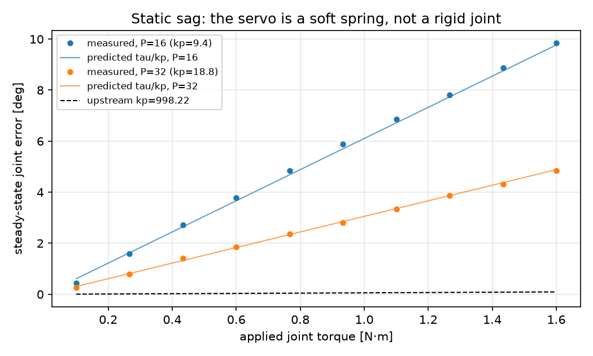
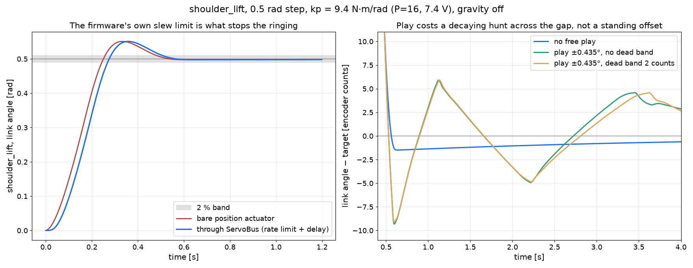
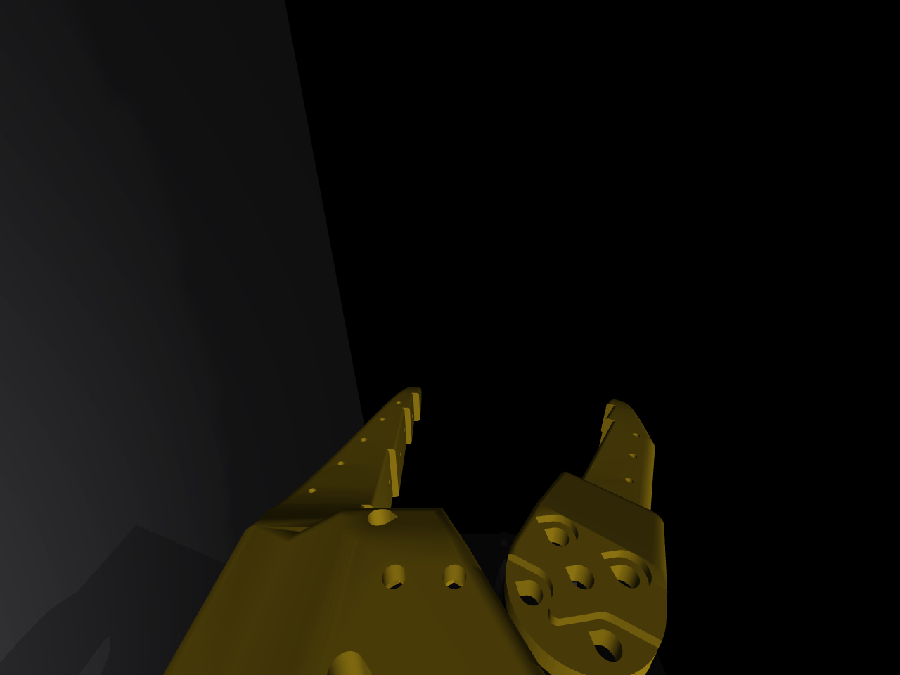
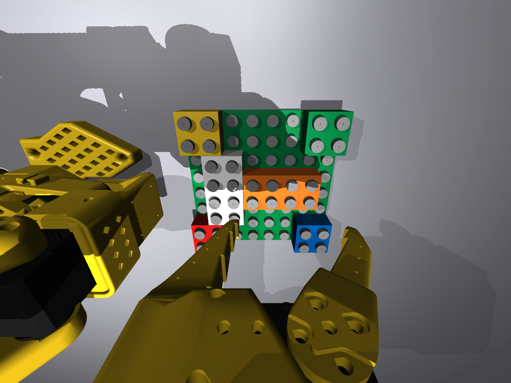
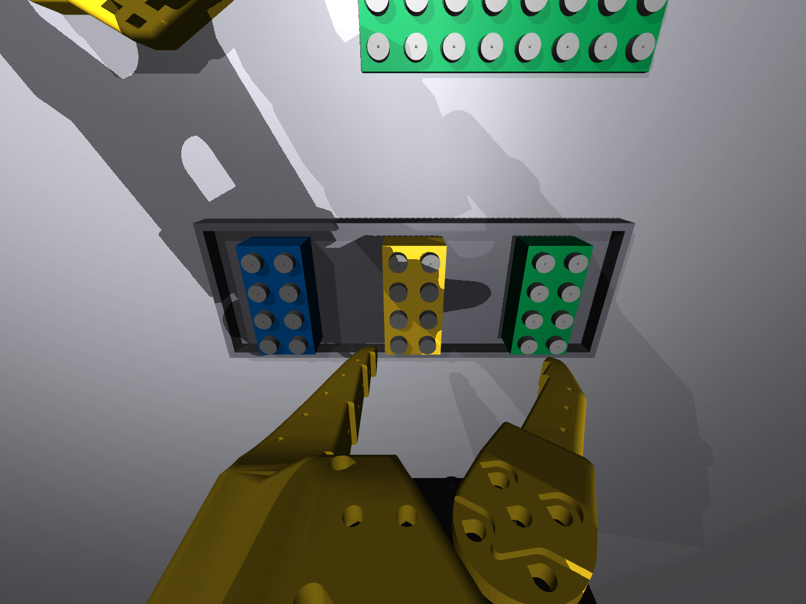
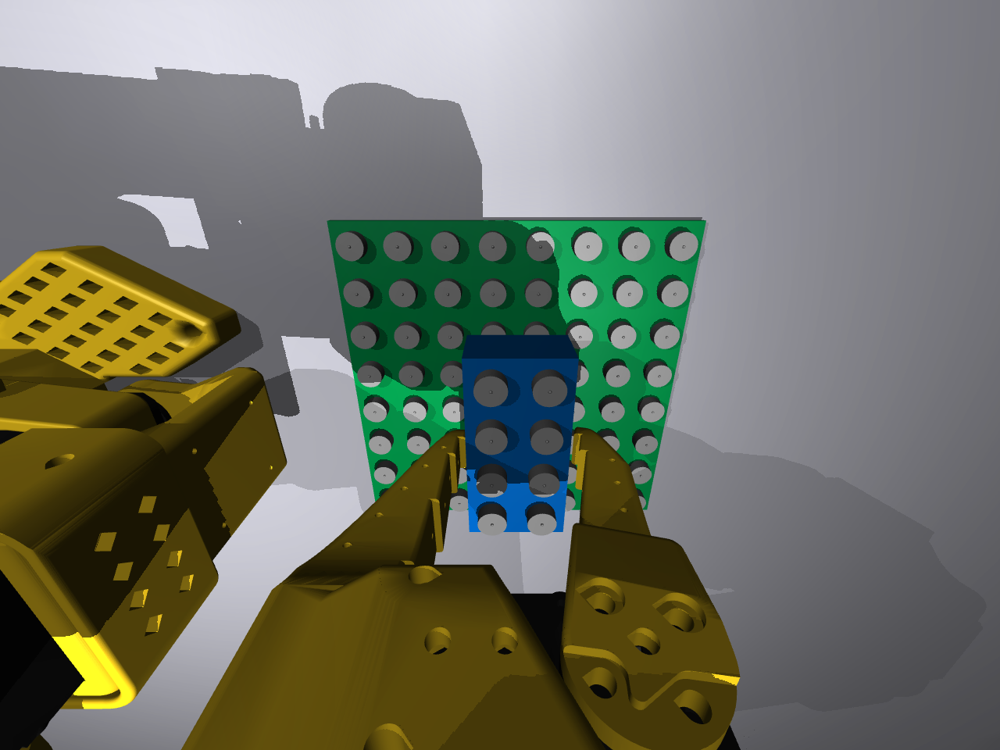
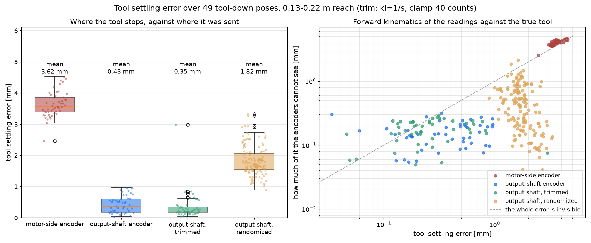
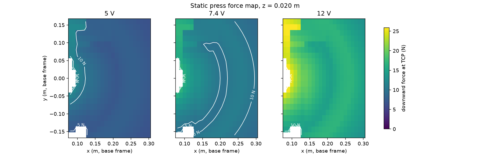

# Robot and servo model

Models the SO-101 arm: geometry, the collision shapes physics uses, and a corrected servo model.
The manufacturer's simulation file misrepresents servo behavior in a way that affects press force.

Code: `brick_builder/robot/patch_so101.py`, `brick_builder/robot/servo_model.py`,
`brick_builder/robot/bus_emulator.py`, `brick_builder/robot/kinematics.py`, `brick_builder/robot/force_map.py`.

## Model overview

The arm is vendored: `third_party/so101/so101_new_calib.xml` comes from TheRobotStudio's SO-ARM100
repository at a pinned commit, unedited. Corrections apply in memory to a `mujoco.MjSpec` at load
time, so a new upstream release drops in and the same patches re-apply without a merge.

```python
from brick_builder.robot.patch_so101 import ArmConfig, build_arm_spec, attach_arm

spec = build_arm_spec(ArmConfig())        # patched, uncompiled MjSpec
model = spec.compile()

# or drop the arm into a scene you are already building
import mujoco
world = mujoco.MjSpec()
attach_arm(world, ArmConfig(), pos=(0, 0, 0))
```

What `build_arm_spec` changes:

| Patch | Why |
|---|---|
| Position actuators at `kp = servo_kp(P, Vin)`, `kv = 0` | Upstream's 998 is about 100x too stiff (below) |
| `forcerange = ±torque_limit_nm · Vin/7.4` | Upstream's ±3.35 is a 12 V number |
| Joint damping 0.62, frictionloss `ArmConfig.joint_friction_nm` (default 0.052), armature 0.026 | Rhoban BAM's identified values for this servo |
| Every printed-part material recoloured to `ArmConfig.print_color_rgba` | At the default value this reproduces the upstream mesh's own colour exactly |
| Optional backlash joint beside each actuated joint | Real gear play is larger than a stud's capture window |
| Boxes instead of collision meshes, plus two fingertip pads | A mesh's convex hull fills the jaw gap (below) |
| `tcp_pinch` site, `wrist_cam` camera on the `gripper` body | The tool point and the camera the policy sees through |
| implicitfast, elliptic cone, impratio 10, Newton, noslip 0 | Design report 01 section 1; noslip 0 also keeps a GPU port possible |

Stable names: `ARM_JOINTS` (the six actuated joints in servo-ID order), `TCP_SITE`, `WRIST_CAM`,
`FIXED_PAD_GEOM`, `MOVING_PAD_GEOM`. `attach_arm` keeps them unprefixed.

## Upstream servo gain error

The official file sets position gain 998.22, derived assuming the firmware measures position error
in degrees. It does not: the firmware works in encoder ticks; its internal constant was measured
(oscilloscope) by the Rhoban BAM project. Measured law:

```
duty = clip(error_rad · P · 0.166 · ratio, ±0.97)
tau  = kt · (Vin · duty − kt · dq) / R
```

Near zero error this is a plain spring, `tau = kp · error`:

```
kp = (kt / R) · Vin · 0.166 · ratio · P
```

With BAM's identified constants for the 7.4 V STS3215 (`kt = 1.1776`, `R = 2.4787`,
`ratio = 1.0049`): **9.38 N·m/rad at P = 16** (LeRobot's connect-time value), **18.77 at P = 32**
(factory default). Upstream's 998 is about a hundred times stiffer than the part it claims to
model.

| Source | kp at P=16 | kp at P=32 |
|---|---|---|
| Upstream simulation file | 998.22 (for any P) | 998.22 |
| Rhoban BAM measured law (what this model uses) | 9.38 | 18.77 |
| Independent bench test at 12 V | not measured | about 38 (BAM predicts about 30) |

Press force is `kp · error` up to saturation: a 100x gain error makes a simulated press seat every
brick effortlessly — a sim-to-real gap invisible until real hardware.

Two more values follow from the same constants (both match the design report):

- **Joint damping**: back-EMF term `kt²/R = 0.559` plus BAM's mechanical viscous friction `0.060`
  = `0.619`. Placed in the joint, not the actuator's `kv`, to reproduce BAM's torque law exactly
  and keep the actuator a pure position spring (portable to a GPU pipeline).
- **Saturation.** Full duty: `kt · Vin · 0.97 / R = 3.41 N·m`; datasheet stall for the 7.4 V part:
  1.9 N·m. Unresolved (unmeasured on this arm); `forcerange` defaults to the conservative 1.9,
  randomization spans both.

### Sag: the servo as a spring



A known torque on `shoulder_lift`, settled: the joint gives way by `tau / kp` to within a few
percent over 0.4 to 1.6 N·m; doubling P halves the sag. Upstream's gain predicts 0.06° at 1 N·m;
the real servo gives about 6°.

Reproduce with `brick_builder.robot.servo_model.measure_sag`.

### Step response



A 0.5 rad step on `shoulder_lift` settles into a 2% band in about 0.50 s, overshooting about 10%.
Design spec assumed an over-damped response; the identified constants don't support it —
over-damped needs damping of at least `2·sqrt(kp·I)` = 0.99 N·m·s/rad for the 0.026 kg·m² armature
alone, against BAM's actual 0.62. No joint is over-damped at P = 16. The firmware's rate limit
doesn't rescue it either: 5.2 rad/s crosses a 0.5 rad step in 0.1 s, against a natural period of
about 0.3 s. `wrist_flex` is milder: about 4.6% overshoot, 0.43 s settling. `tests/robot/test_servo_model.py`
now asserts this directly (overshoot at most 15%, 2% settling under 0.65 s for a 0.5 rad step)
rather than keeping the over-damped assumption as an xfail; hardware system identification will
refine these numbers further.

The right-hand panel is the free play. With the loop closed on the output shaft, the play leaves
no standing offset (the trace crosses zero repeatedly) but a hunt across the gap, period about a
second, that decays: at the nominal gain the per-second peak-to-peak falls from 9.2 counts at one
second to 0.7 at eight. At the top of the randomized gain range (20 N·m/rad) it stops decaying and
settles into a flat limit cycle of 11.8 counts, 1.02° at the joint, steady to within 0.2 counts
over twenty seconds. Measured with gravity off, where nothing preloads the play against a stop;
with gravity on the same joint buzzes about half as far. Account for it before reading a tracking
error off a stationary arm. `servo_model.step_response_sweep` reports it for every joint at every
corner of the gain range; `tests/robot/test_servo_model.py` bounds it.

## Changing the voltage and the gain

Everything lives in `ArmConfig`, which is frozen: make a new one rather than mutating it.

```python
from brick_builder.robot.patch_so101 import ArmConfig, build_arm_spec, servo_kp

servo_kp(16, 7.4)                 # 9.38  N*m/rad
servo_kp(32, 7.4)                 # 18.77
servo_kp(16, 12.0)                # 15.22, because kp is linear in supply voltage

cfg = ArmConfig(p_gain=32, vin=6.9, torque_limit_nm=1.9)
model = build_arm_spec(cfg).compile()
```

- `p_gain` is the servo's P register (address 21), in EPROM: not rewritten every tick on real
  hardware. Change it at skill boundaries only.
- `vin` scales both `kp` and `forcerange` (what a sagging battery does). Training randomization
  range: 6.8 to 7.6 V.
- `torque_limit_nm` is the stall torque **at 7.4 V**; `forcerange` scales by `vin / 7.4` from
  there.
- `backlash_deg` is the **half-range** of the free-play joints, so total lost motion is twice it;
  `0` removes them entirely — useful for isolating the actuator law in a test, and also the
  configuration under which this model is bit-for-bit identical to the pre-encoder-correction one.

The per-tick compliance knob is a different register: `Torque_Limit` (address 48), RAM, writable
every tick — exposed through `ServoBus.write(goal, torque_limit=...)` as a per-joint fraction of
the forcerange. A policy uses this to press gently, then firmly.

## Collision geometry and grasp failure

Upstream uses the full visual mesh as collision geometry. MuJoCo collides against a mesh's
**convex hull**, and the hull of `wrist_roll_follower` (the fixed jaw) spans the opening between
the jaws: the pinch point sits inside solid geometry, and a brick placed there starts about 8 mm
interpenetrated — squirted out rather than held, never touching the fingertips.
`tests/robot/test_patch_so101.py::test_mesh_collision_cannot_grasp_because_the_hull_fills_the_jaw`
records this; `ArmConfig(primitive_collision=False)` reproduces it.

With `primitive_collision=True` (the default), every collision mesh is replaced by convex
primitives fitted to the STL vertices at load time:

- Each arm link part gets one box in its own mesh frame — tighter than capsules on these boxy,
  printed parts.
- Each jaw is cut into slabs along the finger, one box per slab, so the staircase follows the
  taper and cannot bridge the gap the way a single hull does.
- Each fingertip gives up its inner 1.2 mm to a **pad**: `condim 4`, friction from
  `ArmConfig.pad_friction`, `priority 1` (the pad's friction wins over whatever it touches).

Fit by a small binary-STL reader in `patch_so101.py` (`read_binary_stl`); no trimesh, nothing read
at import time. A test checks the reader lands vertices exactly where MuJoCo's own loader does.

### The TCP and the grasp it assumes

`tcp_pinch` sits between the fingertips, z axis along the approach direction, at the centre of a
nominal 32 mm brick held by the fingertips, 8 mm past them.

The moving jaw swings on a hinge, so the two pad faces are never parallel: at a 32 mm opening the
gap is widest at the tips, narrowing up the finger. A 32 mm brick sits at the tips, not pushed
deeper in. `gripper_angle_for_width` returns the joint angle at which the gap's narrowest point
equals a given width — the number that decides fit.

With the primitive geometry, the arm closes on a 32 mm, 12.2 g brick with about 17 N, holding it
against gravity with 0.5 mm of slip over two seconds. Pulling at 2 N barely moves it; 20 N rips it
out — friction, not adhesion.

## The wrist camera

Hardware: a 32x32 mm USB UVC camera module on TheRobotStudio's own SO101 Wrist Cam Hex-Nut Mount —
upstream's `README.md` (section "Wrist-Mount Cameras") lists three 32x32-UVC wrist mounts and
labels only this one "(SO101)"; the other two replace the wrist-roll part itself (shared
SO100/101) or are SO100-only. Vendored at `third_party/so101/wrist_camera_mount/` (STL, STEP, the
upstream README, an installed-hardware photo, `VENDORED.md`).

An earlier pose (aimed at `tcp_pinch`, 41.4° vertical fov — an OV5647 number unrelated to this
hardware) put the fixed jaw at 80-85% of the frame. Current geometry comes from TheRobotStudio's
own camera-equipped assembly for this exact hardware: `Simulation/SO101/so101_new_calib_camera.xml`
/ `.urdf`, vendored at the same commit as `so101_new_calib.xml`, chains `wrist_camera_mount` then
`wrist_camera` off `gripper` as two fixed (jointless), welded bodies — composing them into one
gripper-relative camera pose is exact for the CAD-nominal design. `patch_so101.py`'s
`WRIST_CAM_POS_IN_GRIPPER` / `WRIST_CAM_QUAT_IN_GRIPPER` are that composed transform, confirmed by
two independent checks: z-profiling the board mesh, and a probe camera rendered down the derived
axis.

**Pose, gripper body frame:** position `(2.5, 73.4, 6.6) mm`; forward axis `(0, -0.424, -0.906)` —
mostly along the fixed jaw's own pointing direction (`-z`), tilted about 25° toward the palm side
(`-y`). At the nominal grip this axis passes about 11° from `tcp_pinch`: close, but the real mount
is bolted on with a fixed geometric relationship to the jaw, not independently aimed at the grasp
point the way the old guess was.
`tests/robot/test_patch_so101.py::test_wrist_camera_pose_matches_the_derived_mount_constants` pins
the exact axis; `..._is_on_the_gripper_body_and_sees_the_tcp` checks the (now merely approximate)
20° bound.

**Uncertainty.** A CAD-nominal derivation, not a measurement on assembled hardware:

- *Position*, roughly ±3-5 mm: FDM print shrinkage is negligible (well under a millimetre over a
  66 mm bracket); the M3-screw-through-hex-nut mount has real clearance, and the sensor's exact
  placement inside a purchased "32x32 mm UVC module" board isn't part of the CAD (that class of
  module is sourced from more than one vendor).
- *Orientation*, roughly ±3-5° pitch/yaw, same reasons; the ~74 mm lever arm from the gripper
  origin to the camera turns a couple of degrees of mount play into a few mm at the lens.
- *Roll* is fixed by the rigid mount, except for one binary risk this derivation cannot rule out:
  a purchased module with its sensor die soldered rotated 180° would flip the image upside down —
  a firmware fix (rotate the frame), not a pose error.

**`CameraConfig`.** Resolution, lens (a diagonal field of view or, once measured, `fx`/`fy`/`cx`/`cy`
in pixels), lens distortion (`k1`/`k2`), and pose in the gripper frame are all fields of
`patch_so101.CameraConfig`, threaded through `build_arm_spec()`/`attach_arm()` as `ArmConfig.camera`.
Every default reproduces the module constants above exactly (`WRIST_CAM_FOVY_DEG`,
`WRIST_CAM_POS_IN_GRIPPER`, `WRIST_CAM_QUAT_IN_GRIPPER`) — building an `ArmConfig()` without
touching `camera` compiles the identical wrist camera this module has always built; pinned by
`tests/calib/test_camera_config.py` two ways against `_legacy_build_arm_spec` (a hand-reconstructed
copy of the pre-`CameraConfig` code path, kept only in the test file): rendered images match pixel
for pixel (up to the GL rasterizer's own antialiasing noise, measured at ±1 on a handful of edge
pixels even rendering the same compiled model twice), and, more strictly, the default config's
`build_arm_spec` output and `_legacy_build_arm_spec`'s, both serialized with `mujoco.mj_saveModel`,
compare byte-for-byte equal — the whole compiled model, not only the `cam_*` fields, with none of
the pixel test's GL-noise tolerance. Setting any of `fx_px`/`fy_px`/`cx_px`/`cy_px` switches the
compiled camera from MuJoCo's `fovy` model to its pixel-intrinsics model
(`focal_pixel`/`principal_pixel`/`resolution`) instead — what a measured calibration produces.
MuJoCo's `principal_pixel` offsets the sensor, not the image, so a positive offset shifts the
*rendered* image the opposite way on both axes (the standard lens/sensor-shift duality, not an
axis-convention mirror — MuJoCo's and OpenCV's camera-frame `x` both point right); a real bug
caught while building this passed the offset straight through unnegated and rendered every
off-centre `cx`/`cy` at `(width - 1) - cx`/`(height - 1) - cy`, the mirror image of what was asked
for on each axis (`test_off_centre_principal_point_lands_on_the_requested_side`).
The pixel-intrinsics model is also not runtime-equivalent to the `fovy` model: a compiled
pixel-intrinsics camera's frustum does not respond to a later write to `model.cam_fovy`, which
`render.domain_rand`'s fovy jitter and `perception.views`/`perception.backproject` all do on the
wrist camera (and `backproject.camera_geometry` assumes a centred principal point regardless) —
none of those call sites know about `CameraConfig` yet, so a measured-intrinsics wrist camera run
through one of them keeps whatever frustum it compiled with.
`brick_builder.calib.camera.camera_config_from_params` builds one from a loaded parameter file's
`camera.*` fields. Each of `fx_px`/`fy_px`/`cx_px`/`cy_px` only reaches the built config when that
individual field has `status: measured` in the file — not "any of the four measured, so pass all
four through": a file that only measured `fx_px` must build a config with `fy_px` still `None`
(square pixels), not the default file's own unmeasured `fy_px` number silently standing in as if it
were part of the same calibration. The mount pose (`mount_x_mm`/`_y_mm`/`_z_mm`/`_roll_deg`/
`_pitch_deg`/`_yaw_deg`) is gated the same way, together, since one hand-eye calibration measures
the whole pose: the built config's position/orientation come from the file's numbers only when at
least one of those six is `status: measured`, and are `CameraConfig()`'s own defaults otherwise —
not the default file's `assumed` mount numbers recomputed through degrees and trigonometry, which
do not reproduce `WRIST_CAM_QUAT_IN_GRIPPER` to full precision (`mount_roll_deg`'s stored 3 decimal
places are one order of magnitude coarser than the module constant's own 6-decimal literal) and so
would silently compile the default scene's wrist camera fractionally off the constant it is meant
to reproduce exactly. The shipped default file carries plausible-looking `assumed` values for every
`camera.*` field regardless, so a member reading it sees a number, not a blank, without any of them
switching a default scene's wrist camera onto the measured path.
`brick_builder.params.to_arm_config` calls it to set `ArmConfig.camera`.

**Calibration.** Implemented in `brick_builder/calib/camera.py` (checkerboard corner detection,
`cv2.calibrateCamera` intrinsics + distortion, a hand-eye `AX = XB` solve, and a 180°-sensor-flip
check) and `scripts/calibrate_camera.py` (images + a `poses.json` of gripper-body poses in, a
`configs/params/` fragment out; `--simulate` renders its own checkerboard set with MuJoCo instead
of needing photographs). This project's OpenCV 5.0 build exposes the `CALIB_HAND_EYE_*` method
constants but not the `cv2.calibrateHandEye` function itself (absent from `dir(cv2)` and the
installed `cv2/__init__.pyi` stub); `calibrate_hand_eye` falls back to a from-scratch closed-form
axis-correspondence solve that does not implement Tsai, Park, Horaud, Andreff or Daniilidis and
ignores the requested `method` — the written fragment's notes name whichever one actually ran
(`HandEyeResult.solver_description`), not always `cv2.calibrateHandEye`.

Print a checkerboard (9x6 internal corners, 15 mm squares —
`brick_builder.calib.camera.CheckerboardTarget`'s defaults), mount it rigidly at a known survey
position, drive the arm through 15-20+ varied poses (position *and* orientation — rotational
spread is what makes the hand-eye solve well-conditioned, not just translation) logging the
**`gripper` body**'s base-frame pose at each, and run the script. `ArmKinematics.fk` returns the
TCP site's pose, not the gripper body's — the two differ by a fixed, non-trivial transform (about
97 mm and 180° at a typical pose); convert with `scripts.calibrate_camera.gripper_pose_from_tcp_pose`
first if a forward-kinematics reading only gives the TCP pose. The script prints the 180°-flip
check (`brick_builder.calib.camera.check_sensor_flip`) and converts the hand-eye result from
OpenCV's convention (+z forward, +y down) to MuJoCo's (-z forward, +y up; a fixed 180° flip about
the camera's own x axis) before writing `mount_x_mm`/`_y_mm`/`_z_mm`/`_roll_deg`/`_pitch_deg`/
`_yaw_deg` (extracted as `R = Rz(yaw) @ Ry(pitch) @ Rx(roll)`, `kinematics.euler_zyx`'s own
convention — yaw/pitch/roll about the fixed base-frame axes, not the body's own rotated axes).

*Validated in simulation* (`tests/calib/test_camera_sim.py`, `@pytest.mark.slow`): a test-only
scene (never reachable from `brick_builder.scene.compose`'s default scene builder) — the checkerboard
as a grid of individual flat boxes, not a texture, so every printed corner's 3D position is exact,
not subject to UV-mapping error — rendered at 65 known arm poses (`ArmKinematics.ik`'d position,
pitch and roll, not just yaw, near a hover a few centimetres over the board) with a known
`CameraConfig`, run back through the calibration pipeline above and compared against that known
truth:

| Case | poses (found/requested) | reprojection RMS [px] | focal error [%] | position error [mm] | rotation error [deg] |
|---|---|---|---|---|---|
| default | 16/65 | 0.668 | 1.26 | 5.85 | 4.050 |
| perturbed pose (+4/-3/+2 mm, ~2°) | 35/65 | 1.021 | 6.15 | 31.85 | 1.515 |
| perturbed fov (100° diagonal) | 22/65 | 0.742 | 0.32 | 5.42 | 0.968 |

(`.venv/bin/python -m pytest tests/calib/test_camera_sim.py -m slow`; seeds 0/1/2 respectively,
`tsai` hand-eye method, 65 poses requested per case — `format_report_table`'s own output, pasted
in here, not retyped by hand. This table predates the corner-detection fix described below and has
not yet been re-run against it; the fix should lower every one of these numbers, most visibly the
perturbed-pose row's, but by how much is not yet measured.)

The 180° flip check correctly reports "not flipped" in every case (nowhere near ambiguous;
`test_flipped_images_are_detected_by_the_180_degree_flip_check` renders a flipped set and confirms
the check does fire). The perturbed-pose case's reprojection RMS and focal error are both worse
than the other two cases' (1.021 px/6.15%, against 0.668-0.742 px/0.32-1.26%). The root cause is
not the intrinsics fit's own conditioning: given clean corners, `cv2.calibrateCamera` and the
closed-form `AX = XB` hand-eye solve are both accurate (a real
`cv2.calibrateHandEye` binding would not change this — see `HAS_CV2_HAND_EYE_BINDING`, which is a
separate, honestly-documented gap). It traces to `find_corners`' `cv2.cornerSubPix` refinement: a
single fixed 11x11-pixel search window, which also runs on real photographs, is too large on this
pose set's foreshortened far rows, where adjacent squares are only about 10-15 px apart — the
window then reaches past the neighbouring corner and the refined estimate is pulled toward it,
by up to several pixels on the worst-affected rows. `solve_checkerboard_pose` uses that same
corner-detection error (through whichever camera matrix it is given, fitted or true) to get each
view's checkerboard pose, so it reaches the intrinsics fit and, through it, the hand-eye solve.
`find_corners` now sizes its `cornerSubPix` window from each image's own detected corner spacing
instead of a single fixed value (`brick_builder.calib.camera._corner_subpix_window`), capped below
half the closest spacing per OpenCV's own guidance; this removes the failure mode on far rows
without giving up the wider, steadier window near rows that can support it.
`test_perturbed_pose_hand_eye_solve_is_accurate_given_the_true_intrinsics` isolates the hand-eye
solve from the intrinsics fit and checks its result against the injected perturbation itself; at
this close a hover with the tool tilted, only a fraction of poses keep the board's outermost corner
row clear of the gripper's own silhouette (`render_calibration_set`'s docstring); the script and
the test both oversample to compensate rather than trusting every rendered pose to be usable.

**This does not yet demonstrate resolving a real few-mm mount offset.** Every case's recovered
position error in the (not yet re-measured) table above is at or above both the pose
perturbation being tested (5.4 mm) and the CAD-nominal mount pose's own prior uncertainty
(`configs/params/default.yaml`'s `camera.mount_x_mm` etc., "about 3-5 mm"). What this table shows
is that the pipeline runs end to end and recovers a camera in roughly the right place and
orientation, with a working 180°-flip check — not that it can yet resolve a genuine few-mm mount
offset from the CAD-nominal prior.

**Lens.** The specified lens is the "~120°" wide-angle class, stated range 100-130° on the sensor
**diagonal**. `WRIST_CAM_DIAGONAL_FOV_RANGE_DEG = (100.0, 130.0)` is that range (for domain
randomization); `WRIST_CAM_DIAGONAL_FOV_DEG = 115.0` (midpoint) is nominal. A MuJoCo camera takes
only a vertical `fovy`, deriving horizontal extent from the render's aspect ratio, so a diagonal
spec must be converted per resolution: `fovy_from_diagonal_fov(diagonal_deg, width, height)` does
this for any aspect ratio (4:3, 16:9, or the square renders the scene model takes), from
`tan(diag/2)**2 == tan(fovx/2)**2 + tan(fovy/2)**2` with `tan(fovx/2) == aspect * tan(fovy/2)`. The
compiled model's default, `WRIST_CAM_FOVY_DEG` (86.6°), is that formula at 640x480 (4:3) — the
module's recommended operating resolution and `brick_builder/envs/align_env.py`'s wrist-cam render
size (160x120, also 4:3); 4:3 spends part of the diagonal horizontally, so 115° diagonal gives a
*smaller* vertical number. At the range's endpoints: 71.1° (100° diagonal) to 104.3° (130°
diagonal). A different aspect ratio requires recomputing fovy rather than reusing
`WRIST_CAM_FOVY_DEG`.

Barrel distortion uses the existing representation (`render.domain_rand.PostProcessConfig.k1`/`k2`,
image-space radial remap) rather than a new model. A lens this wide typically shows substantial
barrel distortion even after in-lens correction; `WRIST_CAM_DISTORTION_K1_RANGE = (-0.35, -0.10)`
and `WRIST_CAM_DISTORTION_K2_RANGE = (0.0, 0.08)` are an engineering estimate (negative `k1`
compresses image content toward the edges, in `domain_rand`'s convention), not a measured number —
refit once the calibration procedure above produces real images. `render/domain_rand.py`'s own
default range is untouched; using this camera's distortion elsewhere means passing these ranges
through `sample_postprocess_config`'s `ranges` argument.

**Measured image composition**, rendered at 1280x960 (full resolution, not a thumbnail) and
measured by instance segmentation (`brick_builder.render.renderer.SceneRenderer`, gripper +
moving-jaw bodies counted together as "jaws"):

| Scene | jaws | held brick | plate mesh | notes |
|---|---|---|---|---|
| `wrist_camera_home.png` -- arm at qpos 0, empty gripper | 14.6% | -- | 0% | the arm's rest configuration is not aimed at anything in particular |
| `wrist_camera_baseplate_view.png` -- tool-down, 7 cm above the plate centre, 6 bricks placed | 14.6% | -- | 3.8% (bricks cover much more of the visible plate area) | |
| `wrist_camera_tray_view.png` -- tool-down, 7 cm above the loose-brick tray, 3 bricks | 14.6% | -- | 4.5% | tray + 3 bricks clearly visible |
| `wrist_camera_held_brick.png` -- default scene, a 2x4 brick held | 14.4% | 2.8% | 8.9% | |






Jaw share is nearly constant across poses (14.4-14.6%): an angular constant of a camera rigidly
attached to the same body as the jaw.

## Gear free play and encoder position

A real STS3215 measured about 0.87° of total gear play at the output shaft, against a 0.5° spec.
Model: a second hinge on the same axis per actuated joint, limited to `±backlash_deg` (two hinges
about one axis compose to a single angle — upstream's dummy-body pattern with one fewer body). The
actuator drives the first hinge, the link hangs off the second; motor torque reaches the link only
once the slack has been taken up.

**`backlash_deg` is a half-range.** Total lost motion is twice it. The 0.87° is a total — a dial
gauge on an 86 mm lever read 1.3 mm end to end — so the default is 0.435. The previous default
(0.5) read the datasheet's own total as a half-range, doubling the modelled play.

### Encoder position, relative to the gearbox

The STS3215's 12-bit magnetic encoder sits on the **output shaft**, past the 1:345 reduction —
the only arrangement in which one absolute 0–4095 reading can cover one output turn, matching
independent bench measurements of the part. `Present_Position` is therefore the angle of the
*link*, the firmware's proportional law is closed on the link, and `ServoBus` reports and controls
the driven joint plus its free-play partner.

The model previously placed the encoder on the motor side. Effect:

| | encoder on the motor side (wrong) | encoder on the output shaft (hardware) |
|---|---|---|
| Steady-state placement error at the tool, nominal servo | 3.6 mm (2.5–4.5) | 0.43 mm (0.07–0.96) |
| ditto, randomized servos | 6.0 mm (2.9–8.1) | 0.42 mm (0.05–1.3) |
| How much of that error the robot can see | none: the encoder gap is 4.0 mm of a 3.6 mm error | all but 0.16 mm |
| Loaded clockwise-vs-counter-clockwise deviation | 2·τ/kp, play invisible | 2·τ/kp, and the play shows up inside the dead band |

Measured over 49 tool-down poses, 0.13–0.22 m reach, three heights, five bearings. Key row: the
third — with the loop closed on the output shaft, the servo **takes up the slack itself**, so gear
play is not a standing, invisible placement error. Play costs dead time (the motor crosses the gap
before torque reaches the link) and freedom inside the firmware's dead band, where the servo
commands nothing and the link can drift in the slack — exactly what the dial-gauge measurement
reads.

What is still invisible on the real arm: link and horn flex, spline play outboard of the encoder,
and calibration error. Gear play is no longer on that list.

At the home pose one joint's worth of play moves the tool 6.1 mm for `shoulder_pan`, 6.0 mm for
`shoulder_lift`, 5.1 for `elbow_flex`, 2.8 for `wrist_flex` and essentially nothing for
`wrist_roll` and `gripper`, so a DUPLO stud's 0.3 mm capture window is still an order of magnitude
tighter than one gap. That number now bounds a transient, not a resting offset.

### Checking the model against the bench

`tests/robot/test_servo_model.py` reproduces the published measurements on the 12 V part at what
the numbers imply is the factory default P = 32 (kp = 30.4 N·m/rad):

| measurement | bench | this model |
|---|---|---|
| droop at 10 kg·cm | ≈ 22.5 counts | 21 counts (τ/kp = 1.85°) |
| droop at 15 kg·cm | ≈ 30 counts | 31 counts (τ/kp = 2.77°) |
| CW-vs-CCW deviation, loaded ≈ 3 kg·cm | 14.78 counts | 12 counts at 3.0 kg·cm; 14.78 implies 3.5 kg·cm |
| free play, gentle push, dead band open | 0.87° | 1.06° (2·`backlash_deg` plus two counts of solver compliance) |
| unloaded repeatability | ±2 counts | quantization, ±0.5 count |

The CW/CCW row: with the encoder on the output shaft, a *loaded, powered, settled* deviation
measures twice the elastic droop and nothing else — sweeping `backlash_deg` from 0 to 1.0 changes
it by less than one count. The bench's 14.78 reflects the identified law at a slightly heavier
load than "about 3 kg·cm," not gear play.

## The servo bus

`ServoBus` sits between a policy and `data.ctrl` and makes the arm behave like six serial servos
rather than six ideal joints.

```python
from brick_builder.robot.servo_model import ServoBus, ServoConfig

bus = ServoBus(model, data, cfg=ServoConfig(), rng=np.random.default_rng(0))
for tick in range(n_control_ticks):
    bus.write(goal_rad, torque_limit=compliance)   # once per control tick, 50 Hz
    for _ in range(10):                            # ten physics steps per tick at dt 2 ms
        bus.substep()
        mujoco.mj_step(model, data)
    readings = bus.read()
```

A command: quantized to encoder ticks, dropped if it moved less than the dead zone, queued behind
the wire delay, then chased by the firmware's own internal target, which can only slew at about
5.2 rad/s. What comes back is quantized too, with each servo sampled a little later than the one
before it. One count is 0.088°, both ways.

`data.ctrl` is not the firmware's target: MuJoCo's position actuator computes
`kp · (ctrl − qpos_driven)`, while the firmware's error is `target − (qpos_driven + qpos_play)`.
The bus writes `target − qpos_play` so the two agree; `ServoBus.target` is the firmware number.
With no free-play joints they're identical and the write is unchanged — `backlash_deg = 0` is
bit-for-bit the pre-correction model.

| Field | Default | Randomization range | What it is |
|---|---|---|---|
| `ticks_per_rev` | 4096 | fixed | Encoder resolution |
| `deadband_ticks` | 0 | 0 to 10 | Command dead zone: a *goal change* smaller than this is dropped |
| `error_deadband_ticks` | 0 | 0 to 10 | Firmware position dead band, registers 26/27: no correction while the error is inside it |
| `encoder_on_output` | `True` | fixed | Where the encoder is. `False` is the motor-side model this project ran before the correction, kept only so the two can be measured against each other |
| `rate_limit` | 5.29 rad/s | 4 to 6 | Firmware target slew (BAM's identified `max_velocity`) |
| `action_delay_s` | 0.008 | with jitter, 4 to 12 ms | Command latency |
| `action_delay_jitter_s` | 0.004 | | Uniform, per write |
| `read_skew_s` | 0.0005 | from the bus model | Per-servo sampling offset inside one read |
| `load_lsb` | 0.001 | fixed | `Present_Load` step, 0.1% of duty |
| `current_lsb` | 0.0065 | fixed | `Present_Current` step, 6.5 mA |
| `overload_duty` / `overload_time_s` / `overload_derate` | 0.95 / 1.5 s / 0.2 | | Emulated overload protection |
| `read_noise_ticks` | 0 | 0 to a few | Extra read noise |
| `vin` | 7.4 | 6.8 to 7.6 | Supply the duty estimate assumes |

Two details for reading this off the real robot:

- **`Present_Load` is a PWM duty cycle, not a torque.** Saturates at 0.97 while joint torque
  saturates at whatever `forcerange` says. `ServoReadings.load` reports duty in 0.1% steps; a test
  pins both facts.
- **The dead band is a guess until measured.** `error_deadband_ticks` defaults to 0 (same
  convention as the command dead zone: nominal = identified law, nothing added).
  `servo_model.STS3215_ERROR_DEADBAND_TICKS` = 2 counts, per the published measurements — the
  bench report's "10 counts" is ruled out by its own ±2-count unloaded repeatability (a servo that
  stopped correcting anywhere inside ±10 counts couldn't return to the same count twice). Read the
  real value off actual servos (below) before trusting either.
- **Overload protection latches.** Duty above 0.95 for 1.5 s trips the servo; forcerange derates
  to 20% until `reset_overload()`. In the press environment this is a termination condition, not
  something to train through.

## The outer correction

The firmware's proportional law leaves a standing error wherever something pushes back: dry
friction in the gear train (about 0.05 N·m against a 9.4 N·m/rad gain, a dead zone of roughly
±0.32° per joint) and its own dead band, inside which it commands nothing at all. Gravity has a
feedforward term already; neither of the others can have one, because where inside a dead zone a
joint stops depends on which way it came from. `brick_builder/robot/joint_correction.py` closes
that at the host, at the 50 Hz control tick, on the angles the bus reports — which is only
meaningful now that those angles are the link's.

```python
from brick_builder.robot.joint_correction import JointCorrection, JointCorrectionConfig

corr = JointCorrection(5, JointCorrectionConfig())     # five joints: the gripper is left alone
for tick in range(n):
    corr.update(q_desired, readings.position[:5], freeze=pressing_or_gripping)
    bus.write(np.concatenate([gravity_feedforward(q_desired) + corr.correction, [grip]]))
```

One clamped integrator per joint, nothing else. `update` returns `desired + correction`; a caller
with its own feedforward adds `corr.correction` instead, so the integrator sees plain tracking
error rather than re-deriving the gravity term. Written for a C99 port: fixed arrays, one loop, no
allocation, buffer reused between calls.

| Field | Default | What it is |
|---|---|---|
| `ki` | 1.0 /s | Integral gain. Swept over the workspace grid; 1.0 is the lowest mean error of anything tried, and 2.0 and 4.0 give most of it back as a limit cycle |
| `clamp_ticks` | 40 | Largest trim any joint may accumulate (3.5°). Settled it is 2–6 counts; the clamp binds transiently on 5 of 49 poses during a step across the whole workspace, which is the windup it exists to bound |
| `deadzone_ticks` | 1.0 | Below one count the reading does not carry the sign of the error |
| `dt` | 0.02 s | Seconds per call |

Three things to know before switching it on.

- **The gripper is excluded.** Its command is a squeeze past the object's face: position error is
  large, deliberate, permanent. The corrector uses five joints.
- **Freeze it while the arm leans on something.** An error the arm is *meant* to have — tool
  pushed into a brick, jaws closing on a face — would otherwise wind the trim up and release it as
  a lurch when contact ends. `ArmDriver` freezes automatically on any tick commanding compliance
  below 1.
- **The dead zone must clear the read noise.** At the top of `read_noise_ticks`' randomization
  range (2 counts) with a one-count dead zone, the trim chases noise: mean settling error goes
  from 0.42 mm untrimmed to 0.80 mm trimmed. Raise `deadzone_ticks` above the noise, or leave the
  trim off.

It earns its place on the firmware dead band — the one error the proportional law cannot remove
by itself:

| firmware dead band | untrimmed | trimmed | settling time |
|---|---|---|---|
| 0 counts | 0.43 mm | 0.35 mm | 0.84 s → 1.79 s |
| 2 counts | 0.51 mm | 0.36 mm | 0.84 s → 1.77 s |
| 7 counts | 1.12 mm | 0.44 mm | 0.76 s → 1.80 s |

Mean over the same 49 poses, nominal servo. The trim roughly doubles the time to arrive and adds a
visible buzz — mean 0.33 mm of peak-to-peak tool motion in the last second against 0.19 mm — the
price of integral action against a friction dead zone, and not going away.



Reproduce the whole thing with:

```bash
.venv/bin/python -c "
from brick_builder.robot.joint_correction import measure_settling, summarize
print(summarize(measure_settling()))"
```

## Reading the servo registers

Four registers decide everything on this page; none has been read off the hardware yet. All four
are in the STS3215's memory table, reachable from either Feetech's own tool or the LeRobot driver
already in use.

| Register | Address | What it decides here |
|---|---|---|
| P coefficient | 21 | `ArmConfig.p_gain`, hence `kp` and every press force |
| CW dead band | 26 | `ServoConfig.error_deadband_ticks` |
| CCW dead band | 27 | the same, in the other direction |
| Torque limit | 48 | the per-tick compliance knob |

With FD.exe / FT SCServo Debug (Feetech's own Windows tool): connect at 1 Mbps, select each servo
ID in turn, open the EPROM page and read addresses 21, 26 and 27 straight off it. Record per
servo — they are set per unit at the factory and a second-hand arm may not be uniform.

From Python, with LeRobot installed:

```python
from lerobot.common.motors.feetech import FeetechMotorsBus

bus = FeetechMotorsBus(port="/dev/ttyUSB0", motors={...})   # your six, in ID order
bus.connect()
for name in bus.motors:
    print(name,
          bus.read("P_Coefficient", name),
          bus.read("CW_Dead_Band", name),
          bus.read("CCW_Dead_Band", name))
```

If the register names differ by version, read the raw addresses instead: 21, 26, 27, one byte
each. Enter them in the parameter file — `arm.servo_p_gain` and `arm.servo_dead_band_counts` both
exist already — and re-run the sag and step-response measurements against the real arm.

Two measurements the model is fitted to, worth taking at the same time:

- **Dead band, directly.** Command a hold, then push the output shaft by hand with a torque small
  enough not to back-drive the gearbox, and log `Present_Position` at both extremes. The free
  motion read is the gear play if the dead band is wider than it, the dead band if it is not.
  Repeat with a dial gauge on a lever to separate horn and spline play, which the encoder cannot
  see, from gear play, which it can.
- **Droop.** Hang known masses on a lever and log `Present_Position` against torque. The slope is
  `1/kp`, and `kp` from the law at the read P value should land on it. If it does not, the law's
  `0.166` firmware factor is the thing to refit.

## Bus timing

`bus_emulator.py` is the timing half, with no MuJoCo in it at all. It models one 1 Mbps
half-duplex line carrying one sync-write and one sync-read per control tick.

```python
from brick_builder.robot.bus_emulator import BusConfig, BusEmulator

bus = BusEmulator(BusConfig(), rng=np.random.default_rng(0))
timing = bus.tick(t_now)
timing.command_latency_s   # 260 us
timing.read_skew_s         # 2.05 ms across six servos
timing.reply_lost          # per servo
```

Durations follow from frame sizes, not tuned constants. A 2-byte Goal_Position sync-write to six
servos: 26 bytes, 10 µs/byte = **260 µs**. A sync-read of addresses 56-70: 14-byte request plus
six 21-byte replies = 140 bytes, **1.4 ms**. With a 200 µs turnaround before each reply, the
exchange takes 3.06 ms (inside a 20 ms tick); servo 5 samples 2.05 ms after servo 0. Packet loss
defaults to 0.5%/packet; a lost request takes every reply that tick with it.

## Randomizing the firmware dead band

`error_deadband_ticks` is in the randomization ranges (`randomize.RANGES`/`NOMINAL`, key
`command.error_deadband_ticks`) and reaches `ServoConfig` through `randomize.servo_config`. It is
not one of `envs.base_env.DR_PARAM_KEYS`, the critic's fixed 17-wide `dr_params` observation
entry, which stays 17 wide. The episode still randomizes over the dead band and
`Scene.randomization` still records the value drawn; only the critic's dedicated summary vector
does not carry it.

Every group's sampler shares one `rng.Generator`, drawn group by group in a fixed order
(`dynamics`, `command`, `snap`, `contact`, `plate`, `in_hand`, `visual`), so a new key anywhere in
`RANGES` would normally consume one more `rng` call before later groups draw, shifting every
later group's numbers for a fixed seed. `sample_command` draws `command.error_deadband_ticks`
from `rng.spawn(1)[0]` instead: `Generator.spawn` derives the child from `rng`'s `SeedSequence`
without drawing any numbers from `rng` itself, so `rng`'s state after `sample()` returns is
unchanged from what it was before this parameter existed, and no later draw shifts.
`tests/robot/test_servo_model.py` pins this for seeds 0-4 and several `groups` values: every
pre-existing draw and `rng`'s post-`sample()` state match what they are with the key absent from
`RANGES`/`NOMINAL`. Caveat: this matching is on `rng.bit_generator.state`, which does not include
`SeedSequence.spawn`'s own counter; saving and restoring `bit_generator.state` around two
`sample()` calls reproduces every other field but draws a different `error_deadband_ticks` each
time. Nothing in this codebase saves and restores `bit_generator.state`.

## Figures

The sag, step-response and settling-error plots on this page regenerate from one function after
any change:

```bash
.venv/bin/python -c "from brick_builder.robot.servo_model import make_figures; make_figures('docs/media/robot')"
```

The settling-error panel drives the arm to 49 poses four times over and takes a few minutes; the
other two are seconds.

## Still to come

- **Servo system identification**, once hardware exists, to settle whether saturation is 1.9 or
  3.4 N·m and the real overload time constant. Three disagreeing numbers: datasheet stall 1.9 N·m
  at 7.4 V; identified law at full duty, 3.41 N·m at 7.4 V; independent bench, 35 kg·cm (3.43 N·m)
  at 12 V, where the same law predicts 5.53. `forcerange` keeps the conservative 1.9; randomization
  spans 1.5-3.4.
- **The firmware dead band** (registers 26, 27): unread on real hardware. `error_deadband_ticks`
  defaults to 0; the documented 2-count value brackets the bench report's "10 counts" against its
  own ±2-count repeatability — not a measurement. See
  [Randomizing the firmware dead band](#randomizing-the-firmware-dead-band) for how a value here
  reaches the simulator today.

## Kinematics

`kinematics.py` implements forward/inverse kinematics for the arm's five non-gripper joints
(`shoulder_pan`...`wrist_roll`; the gripper doesn't move the TCP along any axis this module solves
for). Built on two MuJoCo calls, `mj_forward` and `mj_jacSite`, nothing else — no separate
DH-parameter or screw-axis table to keep in sync with the MJCF, so `ArmKinematics` picks up
vendored geometry changes automatically.

```python
from brick_builder.robot.kinematics import ArmKinematics, euler_zyx

kin = ArmKinematics(model)               # model is a compiled mujoco.MjModel with the arm attached
pos, rot = kin.fk(q)                     # TCP position (3,) and rotation matrix (3, 3)
jac = kin.jacobian(q)                    # (6, 5): linear velocity rows, then angular velocity rows
tau_g = kin.gravity_torque(q)            # (5,): torque needed to hold q against gravity alone

yaw, pitch, roll = euler_zyx(rot)        # read a pose's orientation in the module's own convention
result = kin.ik(pos, pitch, roll, q0)    # IKResult(q, converged, pos_error, pitch_error, roll_error, iterations)
```

**Orientation convention.** Rotation decomposes as `R = Rz(yaw) @ Ry(pitch) @ Rx(roll)` (world
axes). `ik` takes only target position, pitch and roll — five numbers for five joints — since
there's no independent wrist yaw joint: yaw is whatever `shoulder_pan` needs to reach the target
x/y. IK pins the target frame's yaw to the arm's current yaw at every evaluation, reading angular
error via the standard cross-product formula — avoiding the gimbal lock a "solve for a full target
rotation" approach would hit exactly where a press needs it: tool straight down. Since this makes
the residual a mildly moving target, its Jacobian uses finite differences of the exact residual
rather than an analytic derivative through the yaw extraction, and each Newton step is kept only
if it lowers the re-evaluated residual (Levenberg-Marquardt) — both guard against `shoulder_lift`,
`elbow_flex` and `wrist_flex` sharing one rotation axis, which the orientation Jacobian cannot
separate on its own.

**Accuracy.** `fk` matches MuJoCo's own site pose to floating-point precision (same call).
Round-trip test (FK a random pose, perturb the seed up to ~3° per joint, IK back): 2496 of 2500
draws across five seeds (99.84%) recover the pose to under 0.5 mm and 0.5°, median error about
0.01 mm / 0.0001°. A target outside the workspace, or a seed far from any solution, returns
`converged=False` with the solver's residual — never a plausible-looking wrong answer. The misses
are genuine local minima of the damped least squares, not numerical noise, so the residual is
reported rather than hidden.

## Force map

`force_map.py` computes downward force the arm can deliver at the TCP, tool-down, across the
workspace, at 5.0, 7.4 and 12.0 V — the number that sets build-plate placement and supply voltage.

By the principle of virtual work, a joint torque `tau_i` acting alone would produce a vertical TCP
force `tau_i / J_z,i`, where `J_z,i` is the z-row of the position Jacobian's i-th column; the
joint that saturates first sets the ceiling for the whole arm, so

```
F = min_i (tau_max_i - tau_gravity_i) / |J_z,i|
```

`tau_max_i`: per-voltage stall torque budget. `tau_gravity_i`: torque to hold the arm still at
that pose (`ArmKinematics.gravity_torque`, i.e. `qfrc_bias` at zero velocity). A per-joint
torque-budget bound, not a full multi-joint optimisation — the simplified estimate the design
report calls for.

The datasheet stall torque (1.9 N·m at 7.4 V) and the BAM law's saturation ceiling (3.41 N·m at
full duty, `patch_so101.servo_stall_torque`) disagree by 1.8x; neither is measured on the real
arm. `stall_torque(vin, torque_limit_nm=...)` takes which to use explicitly; every force number
below states which.

```python
from brick_builder.robot.force_map import press_force_map, figure_force_map

result = press_force_map(model, kin, xs, ys, z=0.02, vin_list=(5.0, 7.4, 12.0))
# result: xs, ys, z, reachable (ny, nx bool), q (ny, nx, 5), force ({vin: (ny, nx) N})
figure_force_map(result, "docs/media/robot/force_map.png")
```

Unreachable grid points are left `NaN` in `force`, `False` in `reachable` — not filled from a
neighbour. Each cell solves from up to three seeds (the solved cell to its left, the solved cell
above, a fresh start); when more than one converges, the solution closest in joint space to solved
neighbours is kept, so a row or column stays on one elbow branch. A repair pass retries any cell
still unreached once its right and below neighbours are solved: on the grid below this cut
unreachable cells from 39 to 17 of 483 and removed every isolated single-cell hole, leaving only
the genuinely unreachable band near the base.



Available downward force along the arm's centreline (`y = 0`, `z = 0.02 m`, tool-down), at four
reaches, under both torque-limit assumptions:

**1.9 N·m datasheet stall torque:**

| reach (m) | 5.0 V | 7.4 V | 12.0 V |
|---|---|---|---|
| 0.12 | 10.16 N | 13.99 N | 21.34 N |
| 0.16 | 8.71 N | 11.95 N | 18.16 N |
| 0.20 | 7.30 N | 9.98 N | 15.12 N |
| 0.24 | 7.71 N | 10.69 N | 16.39 N |

**3.41 N·m identified-servo-law stall torque (BAM law's full-duty ceiling at 7.4 V, scaled the
same way with voltage):**

| reach (m) | 5.0 V | 7.4 V | 12.0 V |
|---|---|---|---|
| 0.12 | 16.51 N | 23.39 N | 36.58 N |
| 0.16 | 14.07 N | 19.89 N | 31.03 N |
| 0.20 | 11.74 N | 16.55 N | 25.77 N |
| 0.24 | 12.64 N | 17.98 N | 28.21 N |

Force falls with reach to about 0.20 m, then rises at 0.24 m: the IK solver lands on a different
elbow configuration there, with a longer lever arm from `shoulder_lift` to the TCP; the map
reports whichever branch it finds. At the design's chosen supply (7.4 V, datasheet limit):
14.0-10.0 N across x = 0.12-0.20 m, under the design report's 12-16 N back-of-envelope estimate
for that range — to recheck once the torque-limit uncertainty above is resolved, since it scales
every number in both tables.

Near full extension (0.28-0.36 m at this height), `shoulder_lift` is consistently the limiting
joint — the "shoulder-limited region" the spec's `torque / reach` rule of thumb refers to — but
that rule runs 55-59% low there (measured 8.4-10.5 N at 7.4 V, datasheet limit, against 5.3-6.8 N
predicted): it assumes a single rigid link with the whole torque budget free for the load. On the
real chain, `shoulder_lift`'s gravity torque spends a sixth to a third of the 1.9 N·m budget
before any press force, and its lever arm to the TCP is well under the straight-line reach, since
the forearm folds toward the low press height rather than staying collinear with the upper arm.
`tests/robot/test_force_map.py` checks this with an independent statics test: it applies the
map's reported force back at the TCP as a real Cartesian wrench in simulation (`mj_applyFT` plus
forward-dynamics settling, not the Jacobian arithmetic that produced the number) and confirms the
limiting joint's actuator torque lands on its own limit within 5% — the qualitative trend holds,
checked against simulated statics rather than a rule of thumb it was never going to match.
