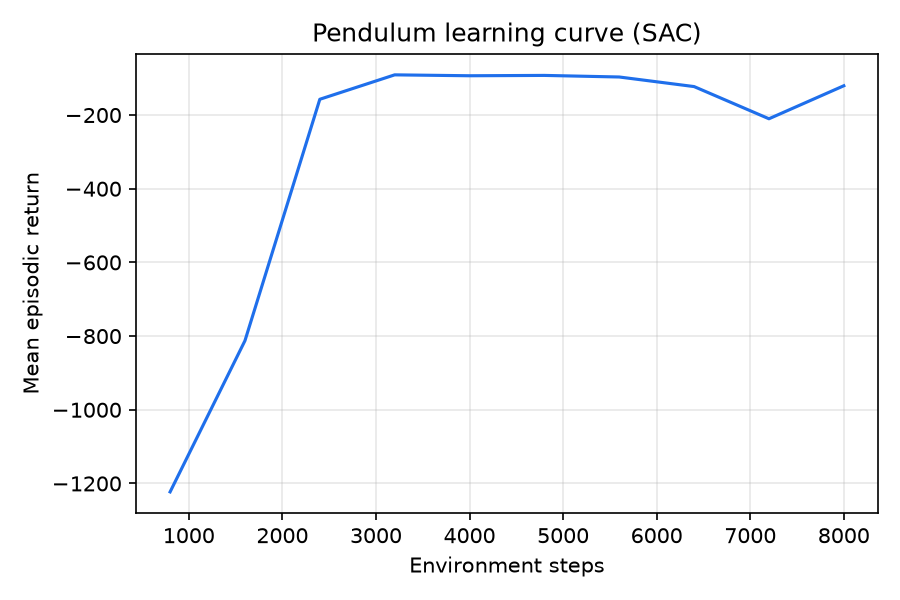
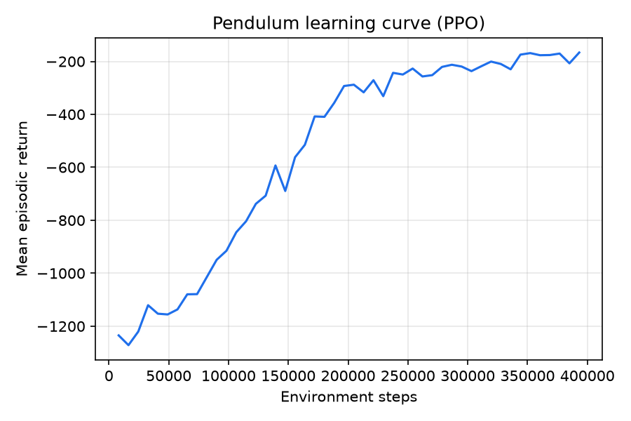

# Training and evaluation

**Status: wired end to end.** The RL core (`brick_builder/rl/nets.py`, `brick_builder/rl/ppo_asym.py`,
`brick_builder/rl/sac_asym.py`) trains against the three real `brick_builder/envs/` tasks, one
command each way: [Command-line training](#command-line-training) and
[Command-line evaluation](#command-line-evaluation). Both RL cores' own acceptance tests still use
a throwaway Dict-wrapped `Pendulum-v1` (see [Reproducing the example
run](#reproducing-the-example-run) and [SAC: the off-policy fallback
recipe](#sac-the-off-policy-fallback-recipe)) — tests of the implementations themselves, predating
any brick_builder environment.

!!! note "Measurement status"
    Most results on this page that depend on arm positioning or press success were measured
    before the servo model's encoder was moved to the output shaft
    ([Robot and servo model](03-robot-and-servo-model.md)) and have not been re-measured.
    Re-measured 2026-09-25, after the correction: the scripted-baseline row of the press smoke
    table below (20 episodes, level 0), and both Pendulum learning-curve figures (PPO and SAC;
    Pendulum-v1 is the RL core's own toy task, not a `brick_builder` arm environment, so
    re-running it is not an arm-environment training run). Still predating the correction, and
    not re-run this pass since each needs training a policy on an actual `brick_builder` arm
    task: the 6-update press smoke checkpoint row, the Reach/Press/Align PPO and SAC training
    runs referenced throughout this page. Current closed-loop results are in
    [Closed-loop videos](../demos/videos.md).

## Purpose

A policy is trained here (reinforcement learning) and a trained policy is scored against the
project's acceptance criteria here (evaluation).

## Capabilities

- Train the primary policy — a small residual-RL network layered on scripted motion, PPO with an
  asymmetric critic — with one command, progress visible in TensorBoard.
- Switch to an off-policy fallback (SAC, asymmetric twin critic, LayerNorm, automatic entropy
  tuning, 3-step returns — not a distributional critic; see
  [SAC: the off-policy fallback recipe](#sac-the-off-policy-fallback-recipe)) with one config field
  (`algo: sac`), with no change to the environment, actor network, or evaluation/export.
- Run the standard evaluation suite: held-out random seeds, the full domain-randomization range,
  hundreds of episodes per condition, a JSON and readable report with success rates and confidence
  intervals, sweeps over misalignment and other difficulty knobs, and an automatic failure
  taxonomy (wrong cell, partial seat, jam, structural damage, slip, overload trip, timeout,
  kinematic problem).
- Compare three policy tiers on the same task: a privileged "teacher" (sees information the real
  robot cannot access), the deployable "student," and a hand-scripted baseline — the ordering
  `teacher >= student >= scripted` is itself an acceptance check.

## The learning algorithm

PPO with an asymmetric critic (Pinto 2018), implemented from scratch in `brick_builder/rl/ppo_asym.py`
in one CleanRL-style file — no Stable-Baselines3, since its Dict-observation asymmetric policies
are awkward and export needs to stay simple. Any environment used with it must expose

```python
observation_space = gymnasium.spaces.Dict({"actor": Box(...), "critic": Box(...)})
```

The actor (`brick_builder.rl.nets.Actor`) sees only `"actor"`: an MLP, tanh hidden activations,
64x64 by default, state-independent log-std (one learned vector) — small and plain, since it will
be hand-mirrored into about 80 lines of C for the microcontroller (design report 02, section 6;
[the export page](07-export-and-firmware.md)). The critic (`brick_builder.rl.nets.Critic`, 256x256
default) sees only `"critic"`: privileged simulator state a real robot cannot measure (contact
forces, per-stud insertion depth, true in-hand offset, etc. for the press skill), reducing the
actor's gradient variance. Discarded at export, with its own normalizer.

Both observation halves are normalized by `brick_builder.rl.nets.RunningNorm` (running
mean/variance, Welford's algorithm), updated during training and
`.frozen = True` for evaluation and export, so a deployed actor always sees the same
normalization it trained under.

### Configuration — `PPOConfig`

`brick_builder.rl.ppo_asym.PPOConfig` is a keyword-only dataclass. Fields and starting values
(design report 02, section 3 — tuned for the press skill, not the toy environment used in the
tests below):

| Field | Default | Meaning |
|---|---|---|
| `n_envs` | 16 | parallel environments |
| `n_steps` | 512 | steps collected per environment per update |
| `epochs` | 5 | passes over each batch of collected data |
| `minibatches` | 8 | minibatches per epoch (minibatch size = `n_envs*n_steps/minibatches`) |
| `lr` | 3e-4 | Adam learning rate |
| `gamma`, `lam` | 0.99, 0.95 | discount and GAE trace decay |
| `clip` | 0.2 | PPO clipping range |
| `target_kl` | 0.02 | epochs for the current update stop early once mean approx-KL exceeds 1.5x this |
| `ent_coef`, `vf_coef` | 0.0, 0.5 | entropy bonus and value-loss weight |
| `max_grad_norm` | 0.5 | global gradient-norm clip |
| `init_log_std` | -1.0 | initial action noise (std ~= 0.37) |
| `total_steps` | *(required)* | training stops once this many env-steps have been collected |
| `seed` | 0 | seeds `torch.manual_seed` (network init, action sampling) and the numpy `Generator` used for minibatch shuffling, and is passed to every sub-environment's constructor and `reset(seed=...)` |
| `hidden_actor`, `hidden_critic` | (64,64), (256,256) | network widths |
| `async_envs` | `True` | `True` -> `gymnasium.vector.AsyncVectorEnv` (forkserver context); `False` -> `SyncVectorEnv`, used by the test suite so pytest is not spawning subprocesses |
| `vector_context` | `"forkserver"` | multiprocessing start method for `AsyncVectorEnv` |
| `norm_clip` | 10.0 | clamp applied by `RunningNorm.normalize` |
| `log_every` | 1 | updates between TensorBoard scalar writes |

Every field is an ordinary keyword argument; the table is a starting point, not a constant.

### Training entry point

The whole training loop is one function call — `scripts/train.py` (below) is a thin YAML-driven
wrapper around exactly this:

```python
from pathlib import Path
from brick_builder.rl.ppo_asym import PPOConfig, train

def make_env(seed: int):
    ...  # build and return one Dict-observation gymnasium.Env, using `seed` however it likes

cfg = PPOConfig(total_steps=10_000_000, seed=0)
checkpoint_path = train(make_env, cfg, run_dir=Path("runs/press-v0"))
```

`train` builds the vector env, runs PPO to `total_steps`, and returns the path to the checkpoint it
writes at the end, `<run_dir>/checkpoint.pt`. Set `CUDA_VISIBLE_DEVICES=""` before importing torch:
training is CPU-only, since the GPU may be busy with another job.

## Command-line training

```bash
.venv/bin/python scripts/train.py --config configs/train/reach.yaml
.venv/bin/python scripts/train.py --config configs/train/press.yaml
.venv/bin/python scripts/train.py --config configs/train/align.yaml
```

One config per task, under `configs/train/`. A config is a plain mapping:

```yaml
env: BrickBuilder/Reach-v0        # any id brick_builder.envs registers with gymnasium
env_kwargs: {}                 # passed straight to gym.make(env, **env_kwargs)
run_name: reach                 # runs/<run_name>/ is where everything lands
ppo:                             # every field of brick_builder.rl.ppo_asym.PPOConfig
  n_envs: 6
  n_steps: 256
  total_steps: 307200
  seed: 0
  # ...
```

`scripts/train.py --config <path>` reads this, builds `make_env(seed) = lambda: gym.make(env,
**env_kwargs)` and calls `train()`. `--total-steps`, `--seed` and `--n-envs` override the config's
`ppo` section without editing the file; `--sync-envs` forces `SyncVectorEnv` instead of
`async_envs` (what the test suite uses, so pytest does not spawn subprocesses). `--run-dir`
overrides the default `runs/<run_name>/`.

Every run writes, in `runs/<run_name>/`:

- `config.yaml` — an exact copy of the config this run used,
- `ppo_config.json` — the resolved `PPOConfig` after any command-line overrides,
- `tb/`, `checkpoint.pt`, `returns.json` — `ppo_asym.train`'s own outputs (above),
- `learning_curve.png` — `plot_learning_curve` applied to `returns.json`, written only once at
  least one episode has finished.

`configs/train/reach.yaml` reproduces `runs/reach_smoke/` exactly (see
[Reach: a trained skill](#reach-a-trained-skill)). `press.yaml` and `align.yaml` are real training
configurations (millions of steps — hours on this 16-thread, 6-process machine), not smoke tests;
smaller-budget measurements are in the sections below. The project's rule — never start more than
6 processes on this shared machine — is why every shipped config's `ppo.n_envs` is 6, not
`PPOConfig`'s default of 16.

### Logged outputs

Two things land in `run_dir` on every run:

- `tb/` — a TensorBoard event file: `train/pg_loss`, `train/v_loss`, `train/entropy`,
  `train/approx_kl`, `train/mean_return` (average return of episodes finished during that update),
  one point per PPO update. View with `tensorboard --logdir runs/press-v0/tb`.
- `returns.json` — the same `(global_step, mean_return)` pairs as a plain JSON list, avoiding a
  need to parse TensorBoard's event format. `brick_builder.rl.ppo_asym.plot_learning_curve` turns this
  into a PNG (matplotlib, `Agg` backend); `scripts/make_media.py` calls it for an RL run, producing
  `docs/media/rl/pendulum_learning_curve.png` below.

`train` also accepts an optional `callback(update_index, metrics)`, called every update with the
same logged numbers; the test suite uses it to check that two same-seed runs produce identical
losses without parsing the event file.

### Checkpoint format

`checkpoint.pt` is one `torch.save`d dict:

```python
{
    "actor": actor.state_dict(),
    "critic": critic.state_dict(),
    "norm_actor": norm_actor.state_dict(),
    "norm_critic": norm_critic.state_dict(),
    "cfg": dataclasses.asdict(cfg),
    "obs_spec": {"actor_dim": int, "critic_dim": int, "act_dim": int, "act_low": [...], "act_high": [...]},
}
```

`brick_builder.rl.ppo_asym.load_actor(checkpoint_path)` rebuilds just the actor and its frozen
normalizer (the critic is never needed after training). Loading the same checkpoint twice and
running the same observation through both reproduces the action bit-for-bit — one of four
acceptance tests in `tests/rl/test_ppo_asym.py`.

### Evaluation procedure

`brick_builder.rl.ppo_asym.evaluate(checkpoint_path, make_env, episodes, seed)` loads the actor,
freezes its normalizer, and rolls out `episodes` full episodes taking the mean action (no sampling
noise), one environment at a time, seeded `seed, seed+1, seed+2, ...`. Returns a
`list[brick_builder.eval.results.EpisodeResult]`, the record type the rest of `brick_builder` uses, so it
plugs directly into `brick_builder.eval.report` and the Wilson-interval machinery. An environment with
nothing richer than a raw return (the Pendulum example here) gets the `EpisodeResult` defaults
(`success=False` unless `info["success"]` is set, `seat_depth_error=None`, etc.); one reporting
seat depth, peak load, structure-intact and a `FailureClass` in `info` carries those through.

## Command-line evaluation

```bash
.venv/bin/python scripts/eval.py --checkpoint runs/reach/checkpoint.pt --env BrickBuilder/Reach-v0
```

Rolls out `--episodes` held-out episodes (default 100, seeded `--seed, --seed+1, ...`, default
`--seed 10000` so held-out seeds never overlap a training run's own), writes
`<out-dir>/report.json` and `report.md` (`brick_builder.eval.report`: Wilson intervals, failure
taxonomy; `--out-dir` defaults to `<checkpoint's directory>/eval`), and records `--videos` clips
(the first few episodes plus one per distinct failure class seen, so an evaluation shows *how* a
checkpoint fails, not only how often).

- `--env-kwargs '{"level": 3}'` — any JSON object, merged into `gym.make(env, **env_kwargs)`.
- `--producer surrogate|blob` — shorthand for `AlignFromTokens-v0`'s own `env_kwargs` key.
- `--actor torch|c` — `c` builds the exported C actor fresh from the checkpoint with the system
  `gcc` and evaluates through that, checking that it reproduces the torch actor's episode outcomes
  under the same seed (`tests/scripts/test_eval.py::test_c_actor_matches_torch_actor_outcomes`).
- `--sweep press-misalign` — runs `PressFromHeld-v0`'s misalignment sweep
  (`brick_builder.envs.press_env.baseline_jobs`/`sweep`) against the checkpoint, writing the sweep's
  JSON and success-curve figure. This is how "beats the scripted baseline by >=15 points at 4-6 mm"
  (Deliverable 1's acceptance target) is measured, by pointing the scripted baseline's own sweep at
  a checkpoint instead: `--actor torch` only (`evaluate_point` loads a torch checkpoint directly,
  once per process).

## SAC: the off-policy fallback recipe

Decision on record: fall back from PPO to an off-policy learner below about 2,000 environment
steps/s, or if a task needs more than about 50 million steps to converge. Reach measured 208
steps/s single-process, Press 41-82 steps/s — one to two orders of magnitude under that gate,
hence `brick_builder/rl/sac_asym.py`.

`brick_builder.rl.sac_asym.train` implements soft actor-critic (Haarnoja et al. 2018) with the same
asymmetric-observation contract as PPO (`{"actor": Box, "critic": Box}`) and reuses PPO's pieces
where the two algorithms mean the same thing:

- **The actor** is exactly `brick_builder.rl.nets.Actor` (same tanh MLP, same state-independent
  `log_std`, no new parameters), so a SAC checkpoint's `actor` state dict has the identical
  layer-key layout a PPO checkpoint's does — `brick_builder/export`'s C exporter (which only reads
  `actor`/`norm_actor`/`cfg`/`obs_spec`) works unchanged for either learner.
- **The input normalizer** is `brick_builder.rl.nets.RunningNorm`, used exactly as PPO uses it.
- **The checkpoint layout** shares the top-level keys, plus twin critics (`critic1`, `critic2`
  instead of PPO's single `critic`) and one new `cfg` field, `"squash"`.

What SAC needs and PPO does not:

- **A tanh-squashed action.** PPO's deployed action is the actor's raw mean, clamped to the action
  bounds; SAC's is `tanh(mean)` mapped onto the bounds (`action = tanh(mean) * scale + bias`,
  `scale = (high-low)/2`, `bias = (high+low)/2`), recorded as `cfg["squash"] = "tanh"` for the C
  exporter ([Exporting a SAC actor](#exporting-a-sac-actor) below).
- **Twin critics with LayerNorm** (`brick_builder.rl.sac_asym.QCritic`, not `nets.Critic`): `Linear ->
  LayerNorm -> Tanh` per hidden layer over the concatenated (critic observation, action), plus
  Polyak-averaged target networks — LayerNorm stabilizes the critic loss under this recipe's
  update-to-data ratio; PPO's on-policy critic doesn't need it. Never exported.
- **A replay buffer with 3-step returns** (CPU-only numpy) and **automatic entropy tuning** (a
  learned temperature, target entropy `-act_dim` by default).

### Configuration — `SACConfig`

| Field | Default | Meaning |
|---|---|---|
| `n_envs` | 8 | parallel environments |
| `n_step` | 3 | return length before bootstrapping from the target critics |
| `gamma`, `tau` | 0.99, 0.005 | discount and target-critic Polyak averaging rate |
| `lr_actor`, `lr_critic`, `lr_alpha` | 3e-4 each | Adam learning rates |
| `init_alpha`, `target_entropy` | 0.2, `None` (-> `-act_dim`) | entropy temperature starting point and target |
| `buffer_size`, `batch_size` | 200 000, 256 | replay buffer capacity and sample size per update |
| `warmup_steps` | 1 000 | env-steps of uniform-random action before any gradient update |
| `utd_ratio` | 0.5 | gradient updates per environment step, aggregated over `n_envs` |
| `init_log_std` | -0.5 | initial actor exploration noise |
| `total_steps` | *(required)* | training stops once this many env-steps have been collected |
| `seed` | 0 | seeds `torch.manual_seed` and the `numpy.random.Generator` the replay buffer samples with |
| `hidden_actor`, `hidden_critic` | (64,64), (256,256) | network widths (same defaults as `PPOConfig`) |
| `async_envs`, `vector_context`, `norm_clip`, `log_every` | same defaults and meaning as `PPOConfig` | |
| `squash` | `"tanh"` | recorded in the checkpoint; the only value `brick_builder/export` currently implements the SAC side of |

`brick_builder.rl.sac_asym.train(make_env, cfg, run_dir, callback=None)` has the same call shape as
`ppo_asym.train`; `brick_builder.rl.sac_asym.evaluate(checkpoint, make_env, episodes, seed)` the same
shape as `ppo_asym.evaluate` (deterministic `tanh(mean)` rollouts, same `EpisodeResult` fallbacks).
`brick_builder.rl.sac_asym.plot_learning_curve` re-exports `ppo_asym.plot_learning_curve`: a
`(step, mean_return)` list becomes a PNG the same way regardless of algorithm.

### Command line: `algo: sac`

```bash
.venv/bin/python scripts/train.py --config configs/train/reach_sac.yaml
.venv/bin/python scripts/train.py --config configs/train/press_sac.yaml
.venv/bin/python scripts/train.py --config configs/train/align_sac.yaml
```

A config selects SAC with two changes from the PPO shape: `algo: sac` and an `sac:` section (in
place of `ppo:`) with `SACConfig`'s fields; everything else works exactly as for PPO. The run
directory gets `sac_config.json` (the resolved `SACConfig`) in place of `ppo_config.json`;
`config.yaml`, `tb/`, `checkpoint.pt`, `returns.json` and `learning_curve.png` are named the same
either way.

`configs/train/reach_sac.yaml`, `press_sac.yaml` and `align_sac.yaml` mirror their PPO
counterparts' tasks and randomization settings with SAC hyperparameters in place of PPO ones.
**None of the three has been trained to convergence.** A run against the real Brick Builder Arm
Robot press task was capped at a five-minute smoke test; the full training campaign is future
work. What a short smoke run of `press_sac.yaml` measured is in the open issues below.

### Exporting a SAC actor

`scripts/eval.py --actor c` and `brick_builder.export.build.build_library` work on a SAC checkpoint
exactly as on a PPO one (the checkpoint layout is compatible by construction), except for the final
step `c/policy.c` takes: `policy_theta.h`'s `POLICY_SQUASH_TANH` macro (from `cfg["squash"]`, `0`
for a checkpoint with no such field, i.e. every existing PPO checkpoint) picks between clamping the
raw output (PPO) and `tanh(raw) * scale + bias` (SAC), reusing the `policy_tanh` the lookup-table
build already provides. `brick_builder.export.parity.check_parity` picks the matching torch-side
reference from the same field, so one function validates both learners.

Measured (`tests/export/test_sac_export.py`, a checkpoint from a few SAC updates on the Pendulum
wrapper, same fixture pattern as the PPO export tests): the SAC checkpoint's header carries
`POLICY_SQUASH_TANH 1` (a PPO checkpoint's carries `0`); parity between the torch actor and
compiled C actor is within the same `<= 1e-5` bound as PPO's, for both the float-`tanhf` and
lookup-table builds, over 10,000 random observations.

### Measured: Pendulum learning time and update throughput

`tests/rl/test_sac_asym.py::test_learns_pendulum` (`.venv/bin/python -m pytest -q -m slow
tests/rl/test_sac_asym.py::test_learns_pendulum -s`), same Dict-wrapped `Pendulum-v1` wrapper as
PPO's own acceptance test, `SACConfig(n_envs=4, total_steps=8_000, warmup_steps=300,
batch_size=256, buffer_size=50_000, utd_ratio=1.0, lr_actor=1e-3, lr_critic=1e-3, gamma=0.98,
hidden_critic=(128, 128), async_envs=False)`, seed 0:



Re-measured and the plot above regenerated 2026-09-25 (this project's dev machine, CPU only,
`SyncVectorEnv`, shared with the other packages' own compute at the time): mean return over 10
held-out episodes reaches **-167.7** (up from about -1200 for a random policy), in **76.7
seconds** wall-clock for training plus evaluation — inside the 3-minute acceptance budget.
`hidden_critic=(128, 128)` here (not `SACConfig`'s (256, 256) default) is deliberate for this
3-dimensional toy task, not a general recommendation (see the update-throughput measurement
below).

> **rl-eval-export-1.** This run (and the plot above) already includes the fix to
> `_flush_n_step`'s truncation handling (a time-limit truncation no longer stores `done=1` and
> drops the bootstrap the way a true termination does; it now stores `done=0` and bootstraps
> from the episode's real final observation). Two earlier measurements bracket it and are kept
> for the history: pre-fix, **-168.3** over 69.2 s; a first post-fix check at the same seed and
> config, **-168.0**, called "not re-measured carefully enough to replace the plot" at the time.
> This run is that replacement. The number barely moved across all three (this toy task's return
> is not sensitive to the fix); PPO's own number below did change materially.

`tests/rl/test_sac_asym.py::test_update_throughput_on_brick_builder_sized_networks` measures
`sac_update`'s own cost directly (random tensors, no environment stepping) at the observation/action
sizes relevant to the press skill: actor obs ~150, critic obs ~250, action 8 (real numbers from a
five-minute `PressFromHeld-v0` smoke run, below: 133, 192, 8), `hidden_actor=(64,64)`,
`hidden_critic=(256,256)`, batch 256. Measured on this machine, same loaded conditions (`loadavg`
8.83 12.20 10.09): **71.6 updates/second**. Barely changes with critic width (a separate
measurement at `hidden_critic=(64,64)`/`(128,128)`/`(256,256)` gave 65-85 updates/s across all
three): at this batch size and network scale, the per-call Python/torch overhead of five
forward/backward passes (two critics, two targets, the actor) dominates the actual FLOPs, so a
smaller network does not train meaningfully faster; the Pendulum test's own budget was tuned by
controlling `total_steps * utd_ratio` (the update count), not network width.

A five-minute smoke run of `press_sac.yaml` (`--sync-envs`, `n_envs=4`, `warmup_steps=20`,
`batch_size=32`, `buffer_size=500`, `utd_ratio=0.5`, `total_steps=400` — deliberately tiny) ran end
to end in about 11 seconds, confirmed the real `PressFromHeld-v0` dimensions (actor obs 133, critic
obs 192, action 8, level 0 with domain randomization on) flow through `sac_update` without error,
and produced a checkpoint that loads and exports like the Pendulum one. A plumbing check, not a
learning result (see open issues below).

## Reproducing the example run

Every number and the plot on this page come from the actual acceptance test,
`tests/rl/test_ppo_asym.py::test_learns_pendulum`, run with `.venv/bin/python -m pytest -q -m slow
tests/rl/test_ppo_asym.py::test_learns_pendulum`. It wraps `Pendulum-v1` so its plain `Box`
observation becomes `{"actor": obs, "critic": obs}` (both halves identical — Pendulum's
observation is already the full state, so there's no extra privileged information for the critic),
trains for 400,000 steps with `gamma=0.9` and `lr=1e-3` (tuned for this short-horizon toy task,
not the arm's `PPOConfig` defaults), and evaluates for 10 held-out episodes.



Re-measured and the plot above regenerated 2026-09-25 (this project's dev machine, CPU only,
`n_envs=8`, `SyncVectorEnv`): mean return improves from about -1200 (random policy) to **-229.3**
over held-out episodes, in **128.8 seconds** wall-clock for training plus evaluation — inside the
acceptance test's 4-minute budget.

> **rl-eval-export-1.** This run (and the plot above) already includes the fix to PPO's GAE
> bootstrap: every episode here truncates at Pendulum's 200-step time limit, and the pre-fix code
> treated that as a true termination, zeroing the value bootstrap instead of bootstrapping from
> the truncated episode's real final observation. The number this replaces, **-271.6**, was
> itself a pre-fix figure kept past the fix landing because the plot had not been regenerated; a
> controlled before/after comparison at reduced scale (150,000 of the full 400,000 steps, same
> seed and hyperparameters) had measured mean return over 20 held-out episodes at **-499.5
> (fixed) vs. -990.9 (pre-fix)** at that scale — nearly 2x better at the same step count. This
> run is the full-budget, full-plot replacement: -229.3 clears the acceptance bar with more room
> than -271.6 did, consistent with that reduced-scale comparison.

## Reach: a trained skill

`configs/train/reach.yaml` reproduces `runs/reach_smoke/` exactly: 6 async processes, CPU only,
`total_steps=307200`. Measured: training finished in 505 s (8.4 min); evaluating over 200 held-out
episodes (`scripts/eval.py --checkpoint runs/reach_smoke/checkpoint.pt --env
BrickBuilder/Reach-v0 --episodes 200 --seed 10000`) gives **200/200 successes**, Wilson interval
`[0.981, 1.000]`, mean final TCP error 1.02 mm — past the 90% target. This is the checkpoint the
`policy` demo plays by default (`docs/demos/README.md`).

## Press: measured results

`configs/train/press.yaml` is a real training configuration (2,000,000 steps — hours on this
shared, 6-process machine); running it to convergence and measuring the "beats scripted by
>=15 points at 4-6 mm" acceptance target is future work. What ran, with a tiny smoke
budget (`--sync-envs --n-envs 4 --total-steps 6144`, i.e. 6 PPO updates — a few minutes):

| policy | level | episodes | successes | 95% Wilson CI |
|---|---|---|---|---|
| scripted baseline (`press_env.scripted_action`) | 0 | 20 | 20 | [0.839, 1.000] |
| 6-update smoke checkpoint | 0 | 20 | 15 | [0.531, 0.888] |

The scripted-baseline row is re-measured (2026-09-25, after the servo-encoder correction); it
moved from 16/20 to 20/20 for the same reason the press-vs-oracle table in
[Environments](04-environments.md#measured-numbers-press) did — `PressFromHeld`'s weld grasp lets
the spiral search's socket-drop trigger fire once the corrected arm actually arrives within its
reach. **The 6-update smoke checkpoint row is not re-run**: reproducing it means training a PPO
policy on `PressFromHeld-v0`, an arm environment, which this pass does not do. Read the two rows
as no longer comparable — the checkpoint's 15/20 predates the correction, the baseline's 20/20
does not — rather than re-concluding "the two overlap." Six PPO updates moving the actor's
weights off their random init is still all that row checks: the training path (`scripts/train.py`
-> `PressFromHeld-v0` -> `scripts/eval.py`) runs end to end, not that the residual policy has
learned anything. A real run needs `press.yaml`'s full budget (or several times it — see open
issues) before the sweep comparison (`scripts/eval.py --sweep press-misalign`) means anything.

## AlignFromTokens: measured results

Same story, `configs/train/align.yaml`, same tiny smoke budget (6 PPO updates): 0/20 successes at
the default 3 mm / 5 deg tolerance, against the scripted (zero-residual) go-to-token controller's
own 2/20 at the same seeds — both small-sample noise around a genuinely hard threshold (measured
effect of token noise, age and producer: `brick_builder/envs/align_env.py`'s module docstring).
`align.yaml`'s real budget is 600,000 steps.

## Open issues

- **Neither `press.yaml` nor `align.yaml` has been trained to convergence.** Both are real budgets;
  running them under the project's 6-process limit is an overnight job, not yet done. The numbers
  above only check the tooling.
- **`PressFromHeld-v0` throughput is well below `Reach-v0`'s on this machine**: about 30
  single-process steps/s at level 0 with domain randomization, versus `Reach-v0`'s reported
  ~180-600 steps/s combined across 6 processes — partly the heavier scene (more bodies/equality
  constraints than Reach's bare gripper; see `docs/guide/02-simulator-and-bricks.md`'s physics-rate
  measurements), partly CPU contention on this 16-thread machine. Budget generously.
- **No automatic teacher/student/scripted comparison report.** `PressEnv`'s
  `scripted_action`/`oracle_action` (a privileged, cheating residual) and `scripts/eval.py --sweep
  press-misalign` give the pieces (`evaluate_point` already accepts `policy="oracle"`), but nothing
  wires the three into one table.
- **`--sweep press-misalign` only supports `--actor torch`.** `evaluate_point` loads a torch
  checkpoint directly inside a process (pickling); a C-actor sweep needs its own entry point.
- **No SAC config has been trained to convergence or tuned against a real task's reward scale.**
  The algorithm and export path are verified on Pendulum (learns) and a five-minute Press smoke
  run (plumbing only); choosing PPO vs. SAC for Deliverable 1, and tuning it, is open.
- **`scripts/eval.py --actor torch` does not know about SAC's tanh squash.**
  `demo.common.load_actor_fn` reconstructs any checkpoint's actor with the PPO clamp convention,
  regardless of which learner wrote it. SAC's C export (`--actor c`) and `sac_asym.evaluate` apply
  the correct tanh squash; only `scripts/eval.py --checkpoint <sac-checkpoint> --actor torch`
  doesn't. Fix: a squash-aware branch in `demo/common.py` on `cfg["squash"]` — not done.
- **`utd_ratio` and network width trade off wall-clock cost.** At Pendulum/press scale, per-call
  torch overhead dominates FLOPs (see above): a faster budget should cut `total_steps * utd_ratio`
  first, not shrink `hidden_critic`.
