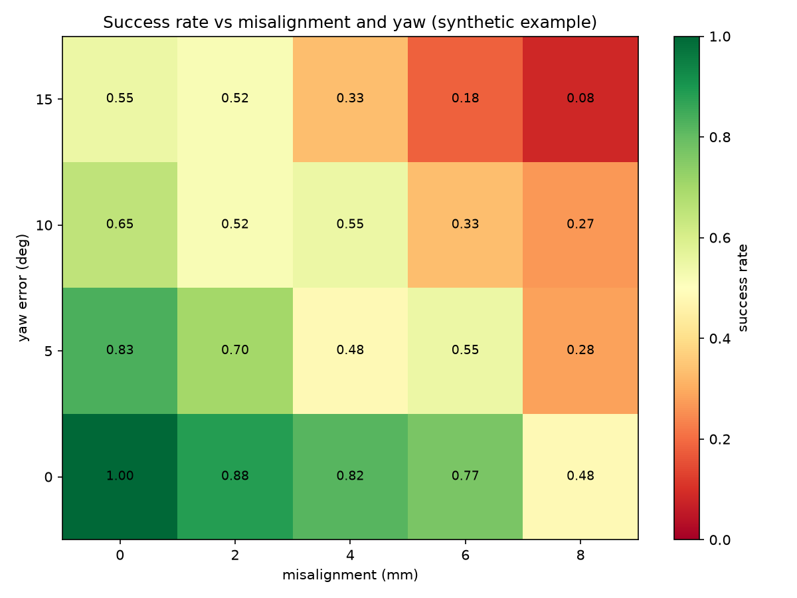

# Evaluation reports

This page covers `brick_builder/eval/` (`wilson.py`, `taxonomy.py`, `report.py`): the module that turns
a list of finished episodes into the numbers and pictures used to decide whether a policy is any
good. It does not run episodes itself — that is `brick_builder/rl/` and `brick_builder/envs/` — it only
consumes the `EpisodeResult` records they produce (`brick_builder/eval/results.py`).

## Episode result record

Every episode, wherever it comes from (a training checkpoint, the scripted baseline, a teacher
policy), ends up as one `EpisodeResult`:

```python
EpisodeResult(
    success: bool,
    steps: int,
    seat_depth_error: float | None,   # metres; None when the task has no seat
    peak_load: float,                 # max |servo load| as a fraction of full duty
    structure_intact: bool,
    failure: FailureClass | None,
    ret: float,                       # undiscounted return
    params: dict,                     # the sweep/randomization values this episode ran under
)
```

`params` is what makes sweeps possible: an evaluation run over, say, misalignment and yaw error
just tags each episode with `params={"misalign_mm": ..., "yaw_deg": ...}` and the report groups on
those keys.

## Confidence intervals: `wilson.py`

Raw success rates from a few hundred episodes are noisy, especially per sweep cell where the count
can be a few dozen. `wilson_interval(successes, n, z=1.96)` returns a 95% Wilson score interval
(`WilsonInterval(p_hat, low, high, n)`), which stays inside `[0, 1]` and is realistic near 0% or
100%, unlike the naive normal approximation. Example: 180/200 successes gives a lower bound of
about 0.851 and an upper bound of about 0.934. `intervals_disjoint(a, b)` checks whether two
intervals do not overlap, used for "beats the baseline with disjoint CIs" style comparisons.

## Failure taxonomy: `taxonomy.py`

`FailureClass` (defined in `results.py`) enumerates why an episode can fail: `wrong_cell`,
`partial_seat`, `jam`, `structure_damage`, `slip`, `overload_trip`, `timeout`, `kinematic`.
Environments are free to set `EpisodeResult.failure` themselves when they know exactly why an
episode ended; `taxonomy.label(result)` is a rule-based fallback labeller for records that only
carry raw simulator state (peak load, structure-intact flag, step count, seat-depth residual). It
checks, in order: structural damage, an emulated overload trip, a timeout at the step budget, a
sustained-load jam, then falls back to distinguishing a shallow/tilted seat (`partial_seat`) from a
clean miss (`wrong_cell`) by how large the seat-depth residual is, and finally `kinematic` when
none of that applies. `label_all(results)` applies this to a whole batch without touching episodes
that already carry an explicit failure class, and `failure_counts(results)` tallies failures by
class (episodes with no label at all show up under `"unlabelled"` rather than being dropped).

## Building a report: `report.py`

```python
from brick_builder.eval.report import (
    write_json_report, write_markdown_report, plot_success_heatmap,
    check_acceptance, AcceptanceThresholds, format_acceptance_table,
)

write_json_report(results, "runs/eval_001/report.json")
write_markdown_report(results, "runs/eval_001/report.md", sweep_keys=("misalign_mm", "yaw_deg"))
plot_success_heatmap(results, "misalign_mm", "yaw_deg", "runs/eval_001/heatmap.png")
```

- **JSON report** — every episode plus an overall Wilson interval and failure-class counts, for
  downstream tooling (dashboards, regression checks) to consume without re-parsing markdown.
- **Markdown report** — a human-readable summary: overall success rate with its 95% CI, a failure
  taxonomy table, and (when `sweep_keys` is given) a success table broken out by every combination
  of those `params` keys, each row with its own Wilson interval.
- **Sweep heatmaps** — `plot_success_heatmap(results, x_key, y_key, path)` groups episodes by two
  `params` keys (for example misalignment in mm and yaw error in degrees) and saves a PNG grid of
  success rate per cell. Combinations that were never swept are left blank rather than shown as 0%,
  so a gap in the sweep design is visible instead of looking like total failure.

  

  This example is generated from synthetic data (no trained policy involved) purely to show the
  shape of the figure; a real report's heatmap comes from actual evaluation episodes.

### Acceptance check

`check_acceptance(results, thresholds, scripted_results=None)` checks a results set against the
Definition-of-Done numbers (`AcceptanceThresholds`, defaults: Wilson
lower bound >= 0.85, seat-depth error median <= 0.3 mm, peak load <= 0.9 on >= 99% of episodes,
structure intact on >= 98%, and — when a scripted baseline's results are also supplied — the
student beating it by at least 15 points with disjoint confidence intervals). It returns one
`AcceptanceResult` row per criterion (name, pass/fail, the measured value, the threshold);
`format_acceptance_table(rows)` renders that as a plain-text pass/fail table for a terminal or log
file.

## Reproducing the example figure

`docs/media/eval/example_heatmap.png` was produced by calling `plot_success_heatmap` on a
synthetic sweep over `misalign_mm` in `{0, 2, 4, 6, 8}` and `yaw_deg` in `{0, 5, 10, 15}`, with a
success probability that decays smoothly with both. It has no bearing on a real policy's
performance; once Stage C produces real evaluation runs, this page's figure will be regenerated
from those instead.
