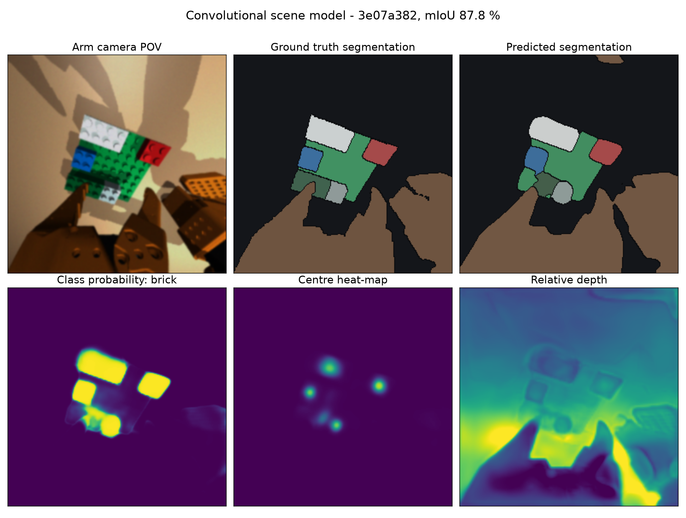
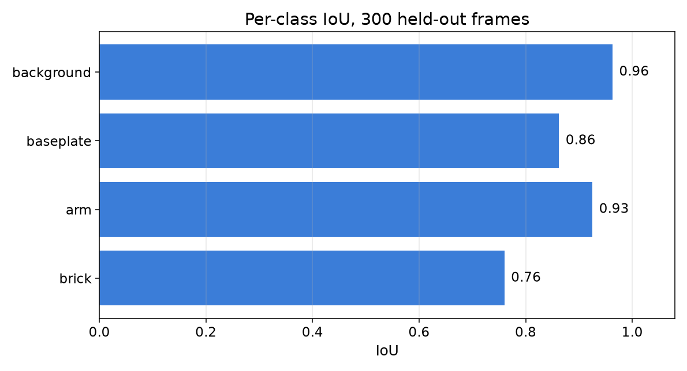
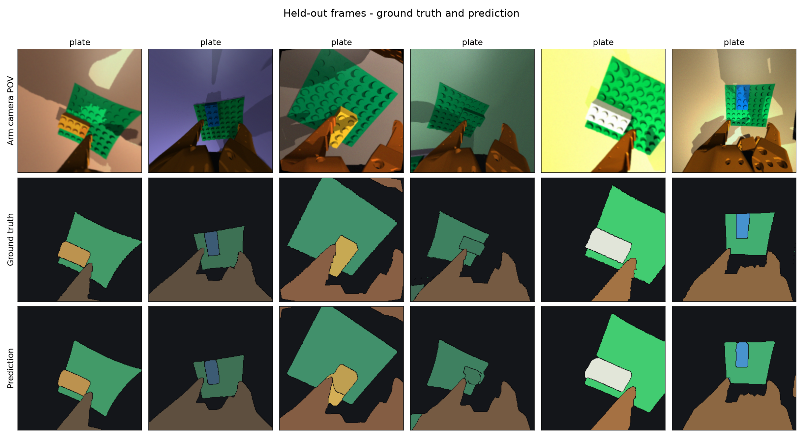
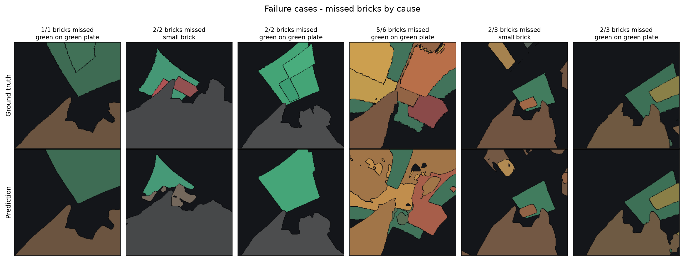
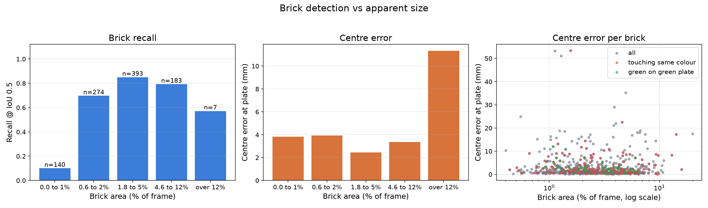
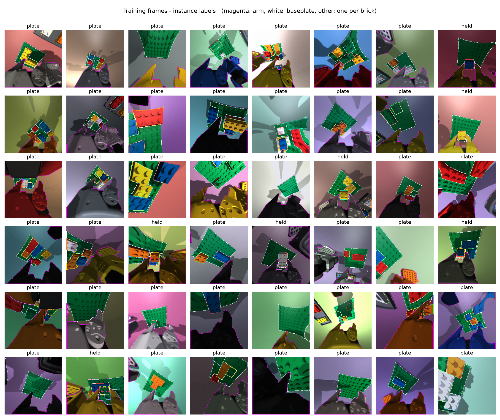
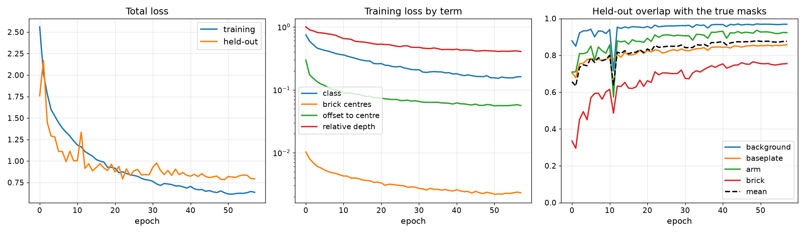

# Convolutional scene model

**Status: implemented and trained.** A 2.37 M-parameter convolutional network reads one 256x256
wrist-camera window and publishes the same `SceneState` as every other producer. Code in
`brick_builder/perception/cnn/`, weights in `brick_builder/perception/weights/vision_model.pt`
(4.8 MB).

## Purpose

The controller consumes slot states, not pixels: up to eight rows of named numbers per frame plus
an ordinal per-slot depth, described in [Perception](06-perception.md). Two
producers filled that interface before this one. `IdealSceneModel` reads the simulator's ground
truth and is unavailable on hardware. `ColourSegmentationSceneModel` thresholds colours on the CPU
and fails on touching same-coloured bricks, on lighting change, and on green bricks over the green
baseplate.

This is the laptop-scale third option: an ordinary U-Net encoder-decoder trained on simulator
frames only. Cost is 46 ms per frame on three CPU threads against 21 ms for
colour thresholding, in exchange for a 2.7x smaller centre error and a working answer in the cases
colour cannot resolve. It is the fallback when the microcontroller path is unavailable and a
second opinion when it is not; any further source plugs into the same interface unchanged.

## Architecture

Five-stage strided encoder (16/32/64/128/192 channels), dilated bottleneck, four-stage decoder
with skip connections, batch normalization and ReLU throughout, four 1x1 output heads. The decoder
stops at half resolution and the head outputs are bilinearly upsampled to 256x256; a 1x1 head
commutes with bilinear upsampling, so this is equivalent to a full-resolution head at a quarter of
the arithmetic. 1.27 GMAC per frame.

| head | output | purpose |
| --- | --- | --- |
| class | 4 channels | background/table, baseplate, arm (links and both jaws), brick |
| centre | 1 channel | heat map peaking at each brick centre |
| offset | 2 channels | vector from each brick pixel to its own brick's centre, in pixels |
| depth | 1 channel | relative depth, per-frame normalized |

Instance grouping is bottom-up, as in Panoptic-DeepLab: non-maximum suppression over the centre
heat map gives the instance centres; each brick pixel joins the centre its own offset points
nearest to. Colour plays no part, which is what separates two touching bricks of one colour. The
arm and the baseplate carry one renderer instance id each, so for those the class mask is the
instance.

Mask-to-slot conversion reuses the ideal source: `ideal_scene_model._blob_row` for the slot-row
statistics, `TemporalSlotAssigner` for identity across frames, `rank_scale` for the ordinal depth
field. This model is a different way of obtaining masks, not a different scene model.

## Usage

```python
from brick_builder.perception.cnn.source import CnnSceneModel

source = CnnSceneModel()                    # shipped weights, device="cpu"
state = source.observe(rgb, window=pose)    # SceneState, PLACEHOLDER_SLOT_SCHEMA
source.reset()                              # new episode: drop slot identity
```

`rgb` is a 256x256 image and the only input used. `device="cuda"` selects a GPU; `threads=` caps
intra-operation threads. `ConvolutionalSceneModel` is an alias, and
`conventional_scene_model.LearnedSceneModel` (older name `ConventionalGpuSceneModel`) forwards to
this class.

### Viewer API

Display and measurement only; never called from `brick_builder.control`.

```python
maps = source.feature_maps(rgb, window=pose)                       # one forward pass
inst_rgb = source.colourize_instances(maps["instance_map"], maps["state"])
heat_rgb = source.colourize_scalar(maps["centre_heatmap"], 0.0, 1.0)
scores = source.accuracy(maps["instance_map"], gt_instance, gt_class)
```

`feature_maps` returns `class_prob [4,H,W]`, `centre_heatmap [H,W]`, `offset [2,H,W]` in pixels,
`depth [H,W]`, `instance_map [H,W]` (int32, `0` = none, otherwise slot index + 1), `class_map`,
and the `SceneState` for the same frame in the same slot order. `colourize_instances` paints each
slot in the mean colour its own row publishes; `colourize_scalar` applies a perceptually uniform
colour map. `accuracy` returns mIoU over the four classes, per-class IoU, brick recall and
precision at IoU 0.5, and pixel accuracy, in 2.4 ms.

```bash
python -m brick_builder.perception.cnn.demo
```



## Evaluation

Checkpoint `3e07a382`. 300 held-out frames from scenes, colours, lighting and lens settings absent
from training, plus one full pick-and-place episode replayed in order so that slot identity is
exercised. The colour-
threshold source runs on the same frames; it publishes no class map and no masks, so its rows are
matched at slot level by centroid and the pixel-level rows are marked n/a rather than filled with
a different quantity.

| metric | CNN | colour threshold |
| --- | --- | --- |
| IoU background/table | 0.963 | n/a |
| IoU baseplate | 0.862 | n/a |
| IoU arm | 0.925 | n/a |
| IoU brick | 0.760 | n/a |
| mIoU, 4 classes | 0.878 | n/a |
| Brick recall @ IoU 0.5 | 0.690 | 0.744 (centroid match) |
| Brick precision @ IoU 0.5 | 0.830 | n/a |
| Brick recall, touching same colour (n=307) | 0.567 | n/a |
| Brick recall, green on green plate (n=183) | 0.290 | n/a |
| Centre error (px) | 3.20 | 8.31 |
| Centre error at plate (mm) | 3.12 | 8.49 |
| Centre error at plate, p90 (mm) | 8.01 | n/a |
| Orientation error, elongated bricks (deg, n=363) | 8.6 | n/a |
| Depth-order accuracy, brick pairs | 0.795 | n/a |
| Slot match rate vs ideal source | 0.851 | 0.600 |
| Slot-row error: mass | 0.0081 | 0.0326 |
| Slot-row error: centre | 0.0318 | 0.0706 |
| Slot-row error: second moments | 0.0150 | 0.0360 |
| Slot-row error: colour | 0.0495 | 0.2964 |
| Slot changes per 100 tracked frames | 0.0 | 1.9 |
| Latency, 1 CPU thread (ms/frame, median and best) | 78 / 62 | - |
| Latency, 3 CPU threads (ms/frame, median and best) | 46 / 41 | - |
| Latency, 1 CPU thread (ms/frame) | - | 21 |
| Parameters (M) | 2.37 | 0 |
| MAC per frame (G) | 1.27 | - |
| Checkpoint (MB) | 4.8 | - |





Episode replay, 90 frames in order: mIoU 0.919, brick IoU 0.876, brick recall 0.908, precision
0.921, centre error 2.6 mm, 0 slot changes per 100 tracked frames. Episode frames are easier than
the held-out set: the camera is close and the bricks are large.

### Failure modes





- **Green bricks on the green baseplate.** Recall 0.290 against 0.690 overall. The class head
  assigns them to the baseplate, so no centre survives and no instance is formed. This is the
  dominant weakness and the reason such bricks are excluded from tasks by default.
- **Small bricks.** Below 0.6 % of the frame (about 400 px) recall is 0.10. Mask area falls faster
  than the centre-head response, and the 60 px area floor in `GroupingConfig` removes what is
  left.
- **Bricks filling the window.** Above 12 % of the frame (n=7) recall is 0.57 and centre error
  11.3 mm. Such views are rare in the training mix.
- **Touching same-coloured bricks.** Recall 0.567. The grouping separates them more often than
  colour thresholding can, but a shared boundary still merges a fraction of pairs.
- **Depth order.** 0.795 on held-out frames and 0.689 on the episode, where the bricks sit on one
  plane and the true ordering is close to a tie. The field is ordinal and is not a distance.
- **Brick recall against the colour source.** The table's 0.690 (IoU 0.5) and the colour source's
  0.744 are different criteria: the colour source is scored by a 32 px centroid match, which
  passes on blobs whose mask overlap is far below 0.5.

## Retraining

```bash
# render ~2 700 training frames and ~550 held-out frames (~8 min)
python scripts/train_vision_model.py --generate --no-train

# inspect labels before training
python scripts/train_vision_model.py --contact-sheet --no-train

# train against a wall-clock budget; resumable
python scripts/train_vision_model.py --minutes 120
```



Check two things on that sheet: every object that should be labelled carries an outline, and studs
carry their brick's own colour. Grey studs indicate the brick generator is not painting them.

Rendering is single-threaded; a second helping can be produced in parallel and merged:

```bash
python -c "from brick_builder.perception.cnn.data import generate; \
  print(generate(split='train_b', n_scenes=170, frames_per_scene=16))"
python -c "from brick_builder.perception.cnn.data import merge_split, dataset_size; \
  merge_split('data_cache/vision_model', 'train_b'); \
  print(dataset_size('data_cache/vision_model', 'train'))"
```

`train_b` draws from its own seed range, disjoint from `train` and from `val`. The shipped
checkpoint was trained on 4 546 frames built this way, with 543 held-out frames.

Outputs land in `results/vision_model/` (git-ignored): `checkpoint.pt` for resuming,
`training_log.csv`, `loss_curves.png`, `train_summary.json`. The best held-out checkpoint is
written to `brick_builder/perception/weights/vision_model.pt`, which is the shipped file. Re-running
the same command resumes. Frames are cached as compressed shards under `data_cache/` (also
git-ignored) and are rebuildable from their seeds.



### Domain randomization

| quantity | range |
| --- | --- |
| lights | position, brightness, tint, ambient level, direction |
| lens | diagonal field of view 100-130 deg; barrel distortion k1 in [-0.35, -0.10], k2 in [0, 0.08] |
| sensor | exposure, white balance, gamma, shot and read noise, blur |
| brick colour | palette colour with +/-7 % shade jitter |
| table | flat colour, dark grey to pale wood; no texture |
| baseplate pose | +/-20 mm, +/-10 deg |
| arm colour | white, black, grey, orange, blue, yellow, red |

The arm's colour is randomized because the real arm's colour is unknown and every upstream mesh is
the same yellow; without it the network can learn "the arm is the yellow object".

Scene coverage: supply area with loose bricks (tray present and absent), baseplate empty and with
one to six bricks including a second layer, a brick held in the jaws at several heights above the
plate, an approach with the jaws open, same-coloured bricks touching, bricks cut by the window
edge, and the arm's own links in frame. Poses come from sampled tool-down viewing poses and from
`PickPlace` episodes sampled every few control ticks.

### Training recipe

Cross-entropy on the class map with inverse-square-root class weights measured on the training
split (bricks are 8.8 % of pixels, background 55.2 %). Mean-squared error on the centre heat map,
drawn as a Gaussian whose width follows each brick's apparent size. L1 on offsets over brick pixels
only. L1 on depth after per-frame median/MAD normalization, which keeps the target scale-invariant.
AdamW, one cosine decay across the wall-clock budget, gradient norm clipped at 5. Augmentation:
horizontal and vertical flips applied to image and labels together, plus small brightness, contrast
and per-channel gain jitter. Each step runs on a random 160x160 crop of the 256x256 window, which
the fully convolutional network makes equivalent to a whole-window step at 40 % of the cost;
validation always runs on the full window.

Knobs: `--scenes`, `--frames-per-scene`, `--width`, `--batch-size`, `--threads`, `--device cuda`.

### Code reuse

This package holds no copy of the blob statistics. It calls `ideal_scene_model._blob_row` and
`_background_mask` directly, because a second copy would be a second thing to keep in step with
`PLACEHOLDER_SLOT_SCHEMA` and there is already one copy too many
(`conventional_scene_model._blob_row_from_mask`). Suggested refactor: lift the closing block of
`IdealSceneModel.observe` — masks, frame, depth map and a `TemporalSlotAssigner` in, `SceneState`
out — into one public function and have all three producers call it.
`perception/cnn/postprocess.py:slots_from_masks` already has that shape and would shrink to a call.

## Fine-tuning on real frames

Rendered frames differ from photographs in gloss, vignetting and table texture. Procedure for
closing the gap once real frames exist:

1. **Collect.** Drive the arm through the same viewing poses the simulator uses and save the raw
   256x256 windows, the wrist camera pose from forward kinematics, and the joint angles. A few
   hundred frames covering the same situations is sufficient to adapt a model that already knows
   the task.
2. **Label.** Four classes and one instance id per brick. The arm mask can be rendered from the
   joint angles and the baseplate mask projected from a measured plate pose, leaving only the
   bricks to draw by hand. Depth may be left unlabelled; the loss masks invalid pixels, so an
   unlabelled depth channel simply does not train that head.
3. **Mix.** Roughly one real frame to four rendered ones. Fine-tuning on real frames alone
   discards the variation the rendered set supplies.
4. **Rate.** Start from the shipped checkpoint at about a tenth of the training rate and stop
   after a few thousand steps.
5. **Measure.** Hold out real frames that are never trained on and compare the same table. A
   centre error worse than the simulator figure indicates a situation missing from collection.

No code change is required: `data.py` stores `(rgb, instance, depth)` shards, and a labelled real
frame is the same three arrays.

## Limitations

- Four classes only. The tray and anything else on the table are background.
- No simulator object id, so identity comes from matching slot rows frame to frame, as in the
  colour source. An object hidden for more than `vanish_after` frames may return in a different
  slot.
- The slot contract keeps the seven largest objects; an eighth brick falls into the background
  slot. This is the interface's limit, not the model's.
- Relative depth is ordinal. Metric positions come from the camera geometry and
  `perception/backproject.py`.
