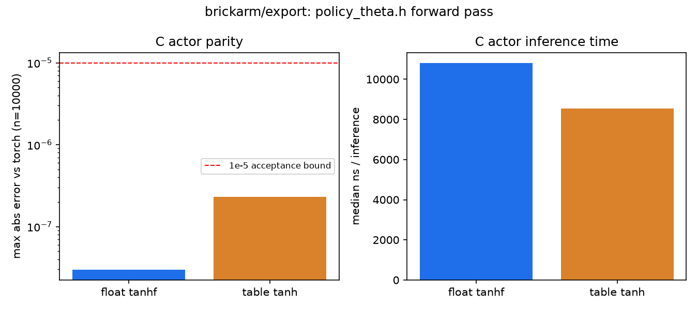

# Export and firmware

**Status: policy export (`brick_builder/export/`) is done. The controller firmware
(`firmware/p4_control`) builds for the ESP32-P4 with ESP-IDF 5.5.5; it has not been flashed or run
on a board.** Frame-time measurements on the board wait for that.

## Purpose

How a trained policy gets from a PyTorch model into C code for the Waveshare ESP32-P4-Pico
microcontroller — the board that will run the robot's real-time perception and control loop.

## Policy export (`brick_builder/export/`)

Works on any checkpoint written by `brick_builder.rl.ppo_asym.train` — the actor MLP
(`brick_builder/rl/nets.py`: tanh hidden layers, linear output, a fixed per-action `log_std`, no
squashing on the mean) plus its frozen input normalizer (`RunningNorm`: mean/var running
statistics, clipped to ±`norm_clip`). The exported C code reproduces the exact computation the
torch side uses at evaluation time (`brick_builder.rl.ppo_asym.evaluate`): normalize the
observation, take the Gaussian mean (no sampling), clamp to the action bounds.

### `actor_to_c.py`

`write_header(checkpoint, out_dir)` reads a checkpoint and writes `policy_theta.h` into `out_dir`:
every layer's weight matrix and bias vector as `static const float` arrays (row-major, `(out,
in)`, matching `torch.nn.Linear.weight`), the normalizer's mean and a precomputed
`1/sqrt(var + eps)` (so the C code never calls `sqrtf`), the action bounds, the layer-size macros
`policy.c` needs for its buffers, and the SHA-256 digest of the checkpoint for provenance.
`write_tanh_table(out_dir)` writes `tanh_table.h`: `tanh` at 4097 evenly spaced knots on `[-8, 8]`,
independent of any checkpoint. Both are generated files, written into a build directory
(`brick_builder/export/_build/` by default, git-ignored), never into `brick_builder/export/c/`, which
holds only the hand-written, checkpoint-independent sources.

### The C policy (`brick_builder/export/c/policy.c`, `policy.h`)

A plain C99 forward pass, `void policy_act(const float *obs, float *act)`: normalize, then
`Linear -> tanh -> Linear -> tanh -> ... -> Linear` (no activation on the output layer) using two
fixed-size stack buffers (`POLICY_MAX_WIDTH` floats each, sized from the checkpoint's own layer
sizes) that ping-pong as the input to one layer and the output of the next — no `malloc`, no heap
allocation. The only libm call is `tanhf`, switchable: building with `-DPOLICY_TANH_TABLE`
replaces it with a linear-interpolation lookup into `tanh_table.h`, needing no libm symbol. This is
the same file to be dropped, unchanged, into the ESP32-P4 firmware tree — everything
checkpoint-specific lives in the generated `policy_theta.h` it includes, not in `policy.c` itself.

### `build.py`

`build_library(checkpoint, build_dir, tanh_table=False)` generates the headers above and compiles
`policy.c` against them with the system `gcc`:

```
gcc -O2 -std=c99 -ffp-contract=off -shared -fPIC [-DPOLICY_TANH_TABLE] -I c -I <build_dir> \
    c/policy.c -o <build_dir>/policy_float.so   # or policy_table.so, and -lm only for the float build
```

`-ffp-contract=off` disables fused multiply-add contraction, needed to match torch's CPU kernels
bit-for-bit-ish rather than only to a looser tolerance.

### `CPolicy` and parity (`c_policy.py`, `parity.py`)

`CPolicy(lib_path, obs_dim, act_dim)` loads the shared library with `ctypes` and exposes `act(obs)`
— the same call the torch actor's deterministic path makes. `check_parity(checkpoint, cpolicy,
n=10_000)` draws `n` random observations from the checkpoint's own normalizer statistics (so they
land in the range the policy saw), runs both the torch actor and `CPolicy` on them, and
reports the max and mean absolute error. `benchmark_inference(cpolicy, obs, n_calls)` times `act()`
from Python with `time.perf_counter_ns` and returns the median nanoseconds per call.

### Measured numbers

Measured on this development machine (CPU only), checkpoint from a handful of PPO updates on the
`Pendulum-v1` wrapper `tests/rl` uses (spec section 5: test with this until a real Brick Builder
Arm Robot checkpoint exists) — actor shape 3 → 64 → 64 → 1, 3 `Linear` layers, 17 924 bytes of
`float32` weights:

| build            | parity vs. torch (max abs error, n=10 000) | median ns / call |
|------------------|---------------------------------------------|-------------------|
| float `tanhf`    | ~3e-8                                        | ~11 400           |
| table tanh       | ~2e-7                                        | ~8 600            |

Both are inside the 1e-5 acceptance bound from spec section 5. The lookup table (4097 knots,
linear interpolation, `[-8, 8]`) has a max absolute error against `math.tanh` of about 1.5e-6,
sampled densely between knots (`table_tanh_max_error()` in `actor_to_c.py`). The timing includes
Python `ctypes` call overhead on both sides equally; C code calling `policy_act` directly will not
pay it, so these numbers are an upper bound and a same-machine comparison between the two tanh
variants, not an absolute figure for the P4. Exact reproducible numbers:
`tests/export/test_actor_to_c.py::test_table_tanh_error_and_speed` (`pytest -s`).

### ESP32-P4 firmware build

`brick_builder/export/c/policy.c` and `policy.h` have zero dependencies beyond a C99 compiler and
(optionally) `tanhf`: no heap, no floating-point functions the table variant cannot replace, and
every checkpoint-specific number isolated in a separate generated header. Which tanh variant the
firmware uses (float vs. table) is a build-time choice, `-DPOLICY_TANH_TABLE`.



## Controller firmware (`firmware/p4_control`)

An ESP-IDF application (target `esp32p4`) that runs the run-time controller, `firmware/control_lib`,
the same C99 sources the host builds into `control_lib.so` and `control_runner`
([Hardware in the loop](13-hardware-in-the-loop.md)). The component
`components/control_lib` compiles them in place; nothing is copied.

| Part | Implementation |
|---|---|
| Session | `bb_session_run`, the same lock-step loop as the native runner; a new session after every RESET |
| Transport | the wire protocol on UART0 (the board's USB-UART), 921600 baud, 8N1, default pins; console and log output off so the line carries frames only |
| Servo bus | `bb_bus` seam: joint targets, with the compliance scalars as per-joint torque limits (vertical on shoulder lift, elbow flex, wrist flex; lateral on shoulder pan, wrist roll), are queued and written one per 20 ms period by a task woken by an `esp_timer`; the device behind it is `bb_bus_loopback` until the STS3215 driver exists |
| Tick timing | STATUS: mean and worst microseconds per vision tick (`bb_tick_begin` plus `bb_tick_end`), bus writes, bus targets dropped, longest bus period |
| Target bundle | 4 MB in PSRAM when present (`CONFIG_SPIRAM_IGNORE_NOTFOUND`), otherwise up to 448 kB of internal RAM; HELLO reports the capacity |
| Cores | session task on core 1, bus task on core 0 |
| Arithmetic | `-O2`, `-ffp-contract=off` as on the host; the P4's FPU is single precision, so the controller's doubles run in software floating point |

### Build

```bash
export IDF_TOOLS_PATH=<where the ESP-IDF tools are installed>   # default ~/.espressif
. <esp-idf>/export.sh
cd firmware/p4_control
idf.py set-target esp32p4
idf.py build
idf.py size
```

Measured build, ESP-IDF v5.5.5, default configuration plus `sdkconfig.defaults`:

| Quantity | Value [bytes] |
|---|---|
| Application image `p4_control.bin` | 257 776 (0x3eef0), 25 % of the 1 MB app partition |
| Flash code `.text` | 144 274 |
| Flash read-only data `.rodata` | 33 476 |
| Internal RAM used (DIRAM: `.text` 69 608, `.data` 9 216, `.bss` 14 680) | 93 504 of 655 360 (14.3 %) |
| Bootloader | 16 224 (0x3f60) |

Heap is not included: the bundle buffer, the UART driver's 16 kB receive and 8 kB transmit
buffers, the 16 kB session stack and the 4 kB bus stack are allocated at start.

The default configuration targets chip revision v3.1 or later (`CONFIG_ESP32P4_REV_MIN_301`).
A board with an earlier revision needs `CONFIG_ESP32P4_SELECTS_REV_LESS_V3=y` in
`sdkconfig.defaults` and a rebuild.

### Flash and run

```bash
export IDF_TOOLS_PATH=<where the ESP-IDF tools are installed>   # the same as for the build
. <esp-idf>/export.sh
cd firmware/p4_control
idf.py set-target esp32p4         # once per checkout; builds nothing yet
idf.py -p <port> flash            # builds if needed; <port>: the board's USB-UART device
```

`export.sh` looks for the ESP-IDF Python environment under `IDF_TOOLS_PATH`; without the export
line it looks under `~/.espressif` and stops with "ESP-IDF Python virtual environment ... not
found" when the tools were installed elsewhere.

There is no `idf.py monitor` step: UART0 carries protocol frames only. The processor-in-the-loop
commands are in [Hardware in the loop](13-hardware-in-the-loop.md#processor-in-the-loop).

## Not yet written

The perception C kernel, parity fixtures against real hardware, and a measured frame-time matrix
(perception and control loop timing across float vs. lookup-table tanh, one core vs. two). The
controller firmware's timing on the board waits for the first flash.
