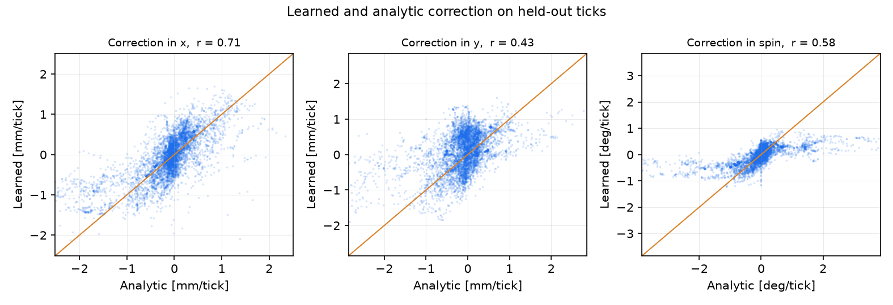
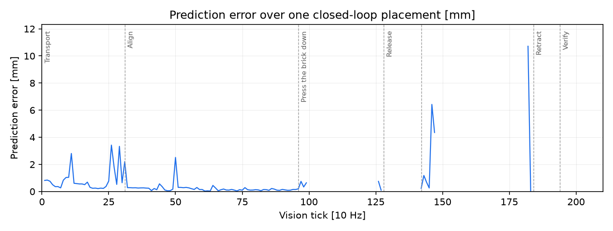

# Closed-loop control

The loop that places a brick runs at 10 Hz and tracks a **sequence** of scene states, not a goal
picture. This page describes that controller, the analytic inverse it uses today, and the two
small learned models that were trained from the arm's own motion to replace and to predict it:
a next-scene-state predictor `F` and a one-step inverse `G`.

Everything on the control path reads slot states (`brick_builder/perception/scene_model.py`) and
what the servo bus reports, and nothing else. `brick_builder/action/place.py` has no way to reach
a body pose, a contact or the snap model, and the guard tests in `tests/action/` check both it
and `brick_builder/action/models/`.

## Controller structure

`record_ideal` executes the task once in a digital twin built from the goal and nominal
parameters. What that run saw and did becomes the target sequence

    (S*_0, a*_0), (S*_1, a*_1), ... , (S*_T, .)

where `S*_k` is a scene state in the same representation the wrist camera produces and `a*_k` is
the net change of the tool target over that vision tick. `TrackingEpisode` then runs the real
world against the recording. At tick `k` it issues the recorded action and adds one step of
feedback:

    u = a*_k + G(S_k, S*_k, mechanical state)

with `G` the analytic inverse `-lambda J_k^+ (features(S_k) - features(S*_k))` by default. The
feedback term is an increment to a persistent correction, saturated at 1.2 mm and 0.7 degrees per
tick and bounded at 15 mm in total; the correction is added to every recorded tool target.

The progress index `k` advances only while the observed state is inside a tolerance tube around
`S*_k`, the tube widening in proportion to how fast the reference is moving and never narrower
than the measurement's own floor. The comparison frame is the best match among the last eight
reference frames and never one ahead, so a lagging arm reads as lag rather than as a displaced
world.

### Dwells, and the unknown estimated at each

Everything the loop estimates is static: where the baseplate is, where the loose brick lies, how
the brick sits in the jaws. A residual measured while the arm is moving is dominated by tracking
lag, so the estimate is updated only where the sequence stands still.

| Dwell | Step | Unknown estimated |
|---|---|---|
| 55 mm above the brick | Approach | Where the brick lies on the table |
| 20 mm above the brick | Approach | The same, from as close as the view allows; this is the estimate the grasp uses |
| Top of the lift, over bare table | Lift | How the brick sits in the jaws |
| Over the target cell | Align | Where the baseplate is |

The placement task starts with the brick already held and has only the align dwell, and it was
measured better estimating throughout than gating to dwells; the pick gates to dwells
(`PlaceConfig.dwell_only`).

### Gates

A tick acts only when all of these hold: the loop is closed, the correction is not frozen, the
sequence is dwelling (when the task gates on dwells), and the step's Jacobian is trusted -- its
weaker singular value is at least 1.2 feature units per metre and at least two reference blobs
matched, or one when the whole step is about a single brick. Below a dead band of 0.35 mm (1.2 mm
on a single blob) nothing is commanded, because that is inside the reading's own noise.

The correction freezes after `Align` and, on a pick, below 34 mm above the table. Past those
points the arm is leaning on something or the open jaws cut the brick's blob in two, and an
estimate updated there gets worse rather than better.

### Failure classes

| Class | What the run reports |
|---|---|
| Stalled with an error it can see | held past `max_hold` ticks with a residual nothing reduces |
| Stalled blind | held past `max_hold` with nothing to line up on for most of those ticks |
| Grasp short | forward kinematics says the jaws closed more than 3 mm above the commanded height; the grasp is remade once, twice is a failure |
| Finished outside tolerance | the last frame never settled inside `tol_mm` |
| Seated on the wrong cell | scored afterwards by `verify_placement`, not by the loop |

## The analytic inverse

`J_k` is measured in the twin by central differences: the twin is re-posed by +-2 mm and +-2
degrees, re-rendered, and the reference blobs' centres differenced. It is re-measured at every
step boundary and every eight frames in between. Two parts are solved separately:

- `d_r = J_r^+ (r - r*)`, where the tool sits relative to the baseplate;
- `d_b = J_b^+ (b - b*)`, how far off-centre the brick sits in the jaws, from the held brick's own
  row.

Their sum is the brick's error against the cell, and the tool is commanded by minus `lambda`
times it. The pseudo-inverse drops singular values below 15 % of the largest rather than damping
them: a direction the camera has almost no opinion about is not seen, and guessing along it once
walked a brick 113 mm. Yaw is read from the angle of the line joining two reference blobs, or
from a single blob's fourth-order moment through the complex ratio, never from two wrapped
angles.

## The predictor and the learned inverse

Both models read the same fixed slate of slot rows: the three reference slots the step lines
itself up on, ordered by their own titles so the order is the same in every episode, plus the
brick in the hand. Eight numbers are read from each row through the schema -- mass, the two
centre coordinates, the three second moments and the two components of `orient4` -- with a
validity flag and the blob's weight (`1 - border fraction`). Colour is left out because it is
what the slot was selected by, and age counts frames rather than describing the scene.

| | Predictor `F` | Inverse `G` |
|---|---|---|
| Inputs | slate rows, six joint positions and six joint speeds, the tool-target change over the tick | slate **differences** (observed minus target), six joint positions and six joint speeds |
| Output | the change of the same slate rows over one tick | the correction increment: dx, dy [m] and spin [rad] |
| Shape | 57 -> 64 -> 64 -> 32, tanh | 54 -> 64 -> 64 -> 3, tanh |
| Loss | weighted mean square on the normalized change | hindsight regression, distal teacher, action penalty |

Inputs are normalized by statistics measured on the training set and clipped at three standard
deviations. That clipping is what makes a far target read as a direction: an input ten times
further out than anything in the log arrives at the first layer saturated, so the answer has the
right sign rather than an extrapolated magnitude.

`G` is trained in reverse, two ways at once.

- **Hindsight.** The state `j` ticks later is used as the target, `j` drawn in 1..8, and the label
  is the correction increment the controller actually commanded at that tick, read back from the
  log as the difference of the corrections in force. The probe (below) is part of that increment
  and part of what the later state shows, so it is signal rather than noise.
- **Distal teacher.** The predictor is frozen and `G`'s output is fed through it. The loss is the
  slot distance between `F(S_k, mech, a*_k + G(S_k, S_target, mech))` and the target state's own
  rows, plus a penalty on the size of the action. No label is needed: the target state is its own
  supervision.

A third term regresses on the analytic inverse's answer. It is off by default -- the point is an
inverse learned from the arm's motion, not a distillation of the Jacobian -- and it is what the
DAgger-style remedy turns on.

### Data

Tuples are logged at every vision tick through `TrackingEpisode.observer`, which the loop's own
behaviour does not depend on. Each row holds the observed slate, the same slate read off the
target frame, the slots' identities, the mechanical state, the tool target commanded, the
analytic inverse's answer, the correction increment applied, the step, and the dwell and trust
gates.

Three things vary across episodes, because a log of successful runs only ever shows states on the
target sequence: the seed (which moves the baseplate 4-8 mm and 2-3 degrees, and the loose brick
8-15 mm and 10-20 degrees), a deliberate starting offset of up to 7 mm and 2 degrees, and a
probe -- a mean-reverting first-order perturbation of the commanded tool motion, smooth over
about six ticks rather than white noise. Collection seeds start at 100; seeds 0-9, which the
tables below are measured on, are never trained on.

The set these models were trained on: **47 198 ticks from 269 episodes**, 25 188 of them
placement and 22 010 pick-and-place, collected in 134 process-minutes (about 78 minutes of wall
clock with two processes on a shared machine). Of the episodes, 35 % ran clean, 25 % from a
deliberate offset, 25 % with the probe and 15 % with both. The aim was 100 000 ticks; the machine
was shared with other work throughout and the rate was 420-440 ticks per minute for placement and
220 for the pick, which is where the figure comes from.

A second set of 16 012 ticks from 105 episodes was collected with the learned inverse driving, for
the DAgger-style remedy below, and a third of 8 146 ticks from 35 pick-and-place episodes for the
second round, bringing the log to 71 356 ticks from 409 episodes in all. Every state in it comes
from the ground-truth scene model; a second set through the convolutional one was not collected.

## Offline metrics

### Predictor

Root-mean-square error of the predicted change of each slot field, on held-out **episodes** so a
scored tick is never the neighbour of a trained one. 6 800 pairs. Fields are in the slot row's own
units: `mass` is a fraction of the window's pixels, the centre and the moments are in the window's
`[-1, 1]` coordinates, `orient4` is the normalized fourth moment.

| One step | mass | centre x | centre y | sxx | sxy | syy | orient4 re | orient4 im | centre [mm] |
|---|---|---|---|---|---|---|---|---|---|
| `F` | 0.00045 | 0.00761 | 0.00745 | 0.00031 | 0.00016 | 0.00018 | 0.195 | 0.173 | 1.66 |
| no change | 0.00117 | 0.01550 | 0.01313 | 0.00080 | 0.00033 | 0.00057 | 0.221 | 0.202 | 3.16 |
| last change repeats | 0.00310 | 0.02108 | 0.02011 | 0.00159 | 0.00047 | 0.00140 | 0.338 | 0.297 | 4.53 |

| Five steps, fed its own output | mass | centre x | centre y | sxx | sxy | syy | orient4 re | orient4 im | centre [mm] |
|---|---|---|---|---|---|---|---|---|---|
| `F` | 0.00636 | 0.02372 | 0.03289 | 0.00283 | 0.00116 | 0.00226 | 0.315 | 0.335 | 6.30 |
| no change | 0.00605 | 0.04277 | 0.03750 | 0.00314 | 0.00088 | 0.00210 | 0.356 | 0.379 | 8.84 |

The millimetre column is the stacked centre error times 87.4 mm per unit, which is the median
ratio of the analytic inverse's own answer in metres of tool motion to the same centre difference,
measured on this log. At one step `F` halves the centre error against "nothing changes" and is
better on every field; over five it holds a 1.4x margin on the centre but loses `mass` and `sxy`,
where the naive predictor is already at the noise floor.

The controller's own one-step prediction -- this tick's residual plus the correction it commanded
-- has a median error of **0.475 mm** over the same log. It is not the same reduction and the two
numbers should not be subtracted: that one is the residual after the Jacobian's least-squares
projection onto the two directions the tool can move, and the table above is the whole slot row.

### The prediction in the loop

`PlaceConfig.predictor` selects which of those two rules the loop's reported prediction error is
measured against.

- `"analytic"`, the default, is the loop's own line: the residual will change by exactly the
  correction just commanded, and nothing else.
- `"learned"` loads `action/weights/predictor.npz`, runs `F` on the tick's slate and the tool
  motion about to be commanded, writes the predicted rows back into a copy of the scene state and
  reads a predicted residual out of it through the **same** `VisualServo.update` the real reading
  goes through (`action/models/predictor.py`). What comes out is in the same metres of tool
  motion, through the same feature matching, the same weights and the same pseudo-inverse, so the
  two are comparable tick for tick.

Nothing on the control path reads the prediction, so the switch changes what is measured and not
what is done: on placement seeds 0-4 every tick's correction, tracking error and prediction error
is bit-for-bit identical with the field absent and with it set to either value.

Measured on placement seeds 0-9, one run per seed per rule, the analytic inverse driving:

| One-step prediction | Median prediction error [mm] | Seated on target cell | Lateral error, seated runs [mm] |
|---|---|---|---|
| the loop's own rule | 0.24 | 10/10 | 0.02-0.13 |
| `F` read back through the servo | 0.17 | 10/10 | 0.02-0.13 |

`F` is better on every one of the ten seeds (0.14-0.22 mm against 0.19-0.28 mm), and the placement
columns are identical because the two are the same run scored twice.

### Inverse

6 162 held-out ticks, against the analytic inverse's own (unsaturated) answer at the same tick.

| | x [mm/tick] | y [mm/tick] | spin [deg/tick] |
|---|---|---|---|
| analytic answer, rms | 0.554 | 0.593 | 0.554 |
| `G` - analytic, rms | 0.496 | 0.586 | 0.444 |
| `G` - analytic, mean | -0.011 | +0.176 | -0.075 |
| correlation | 0.63 | 0.53 | 0.60 |

The error is about as large as the signal, and there is a systematic +0.18 mm/tick in y. The
scatter below shows the shape of it: `G` is a compressed copy of the analytic answer, saturating
near +-1 mm and +-0.5 degrees where the analytic one reaches +-2.5 mm and +-3 degrees. The
clipping that makes a far target read as a direction also caps how hard the loop can push, and
that cap is what the closed-loop table is measuring.

Closed form, `F(S_k, mech, a*_k + G(S_k, S*_k, mech))` against the target, over 6 081 ticks where
the state is more than 0.5 mm from it: **3.203 mm** with the learned action, against 3.213 mm
before the tick, 3.235 mm with the analytic action and 3.248 mm with no action at all. One tick of
a correction saturated at 1.2 mm cannot close a 3 mm gap, so the four are close together; the
ordering is what the term is trained on.





Ticks where the loop took no reading -- pressing, frozen, or with too little in view to trust --
are gaps rather than a held value.

## Closed loop

The measurement that decides this: the same ten seeds and the same displaced worlds as the
published tables, the ground-truth scene model driving, one recorded target sequence per seed
shared by every column, and nothing different between the columns but where the correction
increment comes from.

These numbers were re-measured on the current tree. Contact-physics defaults in
`brick_builder/bricks` and `brick_builder/scene` were being changed while they were taken, and
the analytic baseline moved with them, so every column of every table below was run back to back
against the same recording rather than quoted from the published page.

### Placement, seeds 0-9

| Inverse | Seated on target cell | On target cell | Lateral error, seated runs [mm] | Stalled | Median tracking error [mm] | Ticks to converge at Align | Median prediction error [mm] |
|---|---|---|---|---|---|---|---|
| analytic | 10/10 | 10/10 | 0.02-0.13 | 0/10 | 1.28 | 12 | 0.24 |
| learned | 0/10 | 10/10 | -- | 10/10 | 5.28 | 8 | 0.36 |
| residual, `analytic + G` | 2/10 | 9/10 | 0.01-0.13 | 6/10 | 2.59 | 8 | 0.70 |

The analytic column reproduces the published 10/10 at 0.02-0.13 mm exactly. Every learned run
stalls -- eight at `Transport`, two at `Align` -- and none of them misplaces the brick: the
episode ends with the brick still in the jaws above the cell, which is why the lateral errors are
small and nothing is seated.

The scatter above says why. `G` saturates near +-1 mm and +-0.5 degrees where the analytic answer
reaches +-2.5 mm and +-3 degrees, so the correction never crosses the 4-8 mm the baseplate is
displaced by before the progress index runs out of held ticks. The median tracking error is
5.28 mm against 1.28 mm.

### Pick-and-place, seeds 0-9

| Inverse | Seated on target cell | On target cell | Lateral error, seated runs [mm] | Stalled | Median tracking error [mm] | Ticks to converge at Align | Median prediction error [mm] |
|---|---|---|---|---|---|---|---|
| analytic | 7/10 | 7/10 | 0.05-0.11 | 0/10 | 4.10 | 42 | 0.29 |
| learned | 1/10 | 4/10 | 0.05 | 5/10 | 6.49 | 20 | 0.21 |
| residual, `analytic + G` | 7/10 | 7/10 | 0.05-0.21 | 0/10 | 3.45 | 42 | 0.39 |

The analytic column is 7/10 here against the published 8/10 at 0.02-0.23 mm; that is the tree
moving under the measurement, not the inverse. The residual form reaches the same 7/10 and fails
on different seeds (1, 2 and 6 against the analytic's 3, 4 and 9), so on this task adding a
learned term to the analytic one neither helps nor hurts.

### Stacked placements

A brick that goes on top of another one seats on that brick's studs, one brick height above the
plate's top face. Every height the script derives is measured from the seat, so the target's
layer has to reach the geometry: `Geometry` takes `(x, y)` or `(x, y, layer)`, and

```
seat = plate top + layer * 19.2 mm
```

With the baseplate 3.0 mm thick and a DUPLO 2x2 19.2 mm tall with 4.5 mm studs, that is what the
script asks for at each layer, as TCP heights above the table:

| Height | Layer 0 | Layer 1 | Layer 2 |
|---|---|---|---|
| Seat, the held brick's bottom face | 3.0 | 22.2 | 41.4 |
| Align hover, 20 mm up | 39.0 | 58.2 | 77.4 |
| Low dwell, 6 mm up | 25.0 | 44.2 | 63.4 |
| Press target | 19.0 | 38.2 | 57.4 |
| Release clearance | 53.4 | 72.6 | 91.8 |
| Foot on the roof, for the push | 34.7 | 53.9 | 73.1 |
| Carry | 64.0 | 64.0 | 77.4 |
| Verify pose | 61.0 | 61.0 | 61.0 |

The carry and the verify pose are the two that do not move with the layer, because neither is
about the cell: the carry clears the tallest thing standing on the plate and is never below the
hover it descends from, and the verify pose stands off the plate's own top face. Layer 0 is
unchanged to the bit, and a two-element target is layer 0.

What the missing seat height cost: with the geometry aiming at the plate, a layer-1 placement
puts the held brick's bottom at 23.0 mm at the align hover, which is 3.7 mm **below** the stud
tops it is supposed to be hovering over, and the press then drives it at 3.0 mm -- 19.2 mm inside
the brick underneath. The push on the roof aims the fixed jaw's tip at 26.7 mm, which is the
layer-0 stud height and 14.7 mm below the roof it is meant to be pushing on.

`verify_placement` scores the layer too: `at_target_layer` is the brick's bottom face against the
height the layer puts it at, within half a brick height, and `lower_bodies` names what the snap
model has it standing on. Without it a brick that ended up on the plate beside the tower scored
as a success, because the lateral check and the depth check are both satisfied there.

<!-- STACK RESULTS -->

### Remedies

Each tried once, on the placement task, against the same recordings.

| Inverse | Seated on target cell | On target cell | Lateral error, seated runs [mm] | Stalled | Ticks to converge at Align |
|---|---|---|---|---|---|
| analytic | 10/10 | 10/10 | 0.02-0.13 | 0/10 | 12 |
| more data near the dwells | 1/10 | 2/10 | 0.07 | 9/10 | 4 |
| DAgger relabelling | 10/10 | 10/10 | 0.01-0.12 | 0/10 | 4 |
| residual, `analytic + G` | 2/10 | 9/10 | 0.01-0.13 | 6/10 | 8 |

**More data near the dwells** keeps only hindsight windows over which the recorded target moves
less than 2 mm (`--max-ff-mm 2.0`). It is worse, 1/10: that filter removes exactly the transport
data the placement task calls `G` on, since this task does not gate on dwells.

**DAgger relabelling** collects 16 012 ticks with the learned inverse driving and trains with the
analytic inverse's answer on those states as an extra regression target (`--teacher 1.0`), on top
of the hindsight and distal-teacher terms. On placement it matches the analytic inverse exactly --
10/10 at 0.01-0.12 mm -- and the align dwell converges in 4 ticks against 12, because it is not
carrying the analytic gain of 0.15 and reaches the plate's offset sooner. On the pick it is 6/10
seated against 7/10 and 8/10 on the target cell against 7/10, with one stall.

| Inverse | Pick: seated on target cell | On target cell | Lateral error, seated runs [mm] | Stalled |
|---|---|---|---|---|
| analytic | 7/10 | 7/10 | 0.05-0.11 | 0/10 |
| DAgger relabelling | 6/10 | 8/10 | 0.05-0.21 | 1/10 |

### A second DAgger round, on the pick

The first round relabelled placement states only. The second collects **8 146 ticks from 35
pick-and-place episodes with the learned inverse driving** and retrains on all four sets --
placement, pick, the first round's placement states and these -- with the same `--teacher 1.0`.
Sixty epochs in 1.7 minutes; the held-out hindsight loss settled at 0.581.

All three columns were run back to back against the same ten recordings on the current tree.

| Inverse | Seated on target cell | On target cell | Lateral error, seated runs [mm] | Stalled | Median prediction error [mm] | Ticks to converge at Align |
|---|---|---|---|---|---|---|
| analytic | 9/10 | 10/10 | 0.05-0.18 | 0/10 | 0.28 | 42 |
| DAgger round 1 | 7/10 | 9/10 | 0.01-0.12 | 1/10 | 0.26 | 45 |
| DAgger round 2 | 7/10 | 10/10 | 0.04-0.21 | 1/10 | 0.32 | 44 |

The analytic column is 9/10 here against the 7/10 two tables above; that is the tree moving under
the measurement again, not the inverse, which is why the round-1 column was re-run beside it
rather than quoted. Against that baseline the second round is **not an improvement**: the same
7/10 seated as the first round, one stall each, and a slightly worse lateral spread and prediction
error. Every seed it seats, the analytic inverse seats too.

**The default stays `analytic`, and the shipped inverse stays the first round's.** The learned
inverse matches the analytic one on placement and does not on the pick, and "matches on both" is
the bar; a second round of relabelling on the task it loses did not close the gap.
`brick_builder/action/weights/inverse.npz` -- what `inverse="learned"` loads -- is the
first-round DAgger-relabelled one; `inverse_hindsight.npz` is the hindsight-and-distal-teacher one
the first two tables measure, kept so those rows can be reproduced.

## Cost per tick

| Per vision tick | Multiply-accumulates | Parameters | Bytes (float32) |
|---|---|---|---|
| Inverse `G` | 7 744 | 7 875 | 31 956 |
| Predictor `F` | 9 792 | 9 952 | 40 520 |

At 10 Hz that is 77 kMAC/s for the inverse and 98 kMAC/s for the predictor, and 72 kB of constants
for both. What else runs on the same tick: the scene model over one 256x256 wrist frame, which
dominates everything else; matching each reference against the eight slot rows by colour and
ellipse size (`select_slot`, a few hundred operations); and, on the analytic path only, the damped
pseudo-inverse of a 6x3 Jacobian.

The reason to want the learned inverse on a microcontroller is not the arithmetic, which is small
either way. It is what the analytic inverse needs around it: `J_k` is measured by posing a second
copy of the scene, rendering it six times and running the scene model over each render, at every
step boundary and every eighth frame in between. That is a renderer, a physics model and a second
scene-model pass on the device. `G` replaces all of it with one matrix stack over slot rows the
device already has.

## Rounds

`brick_builder/action/learn/rounds.py` is the stable entry point for repeating the whole loop --
perform the task, train `F` and `G` on what happened, redeploy, measure. It owns nothing the rest
of the package does not already do and adds the three things a repeated loop needs: version ids, a
record of what is deployed, and a gate that refuses to deploy a round that did not earn it.

| Call | What it does |
|---|---|
| `collect_round(specs)` | runs task episodes with whichever inverse is named and logs one `.npz` per episode; `CollectSpec(task, minutes, inverse, seed, name)` |
| `train_round(cfg)` | fits `F` on next-state prediction, then `G` on hindsight, distal-teacher and analytic-relabelling terms, and writes a versioned pair; `RoundConfig(data, seed, minutes, epochs, hidden, distal, teacher, ...)` |
| `measure_round(result, seeds, tasks)` | the closed-loop table for a round, against the analytic inverse on the same seeds |
| `deploy_if_better(result, scores)` | writes the shipped pair only when the learned inverse matches the analytic one on **every** task |

    data_cache/action/<set>/ep_*.npz                  logged episodes, one file per episode
    data_cache/action/rounds/<version>/predictor.npz  the round's own checkpoints
    data_cache/action/rounds/<version>/inverse.npz
    data_cache/action/rounds/<version>/report.json    config, data, held-out losses, wall clock
    data_cache/action/rounds/<version>/state/*.pt     optimizer state, for resuming
    brick_builder/action/weights/predictor.npz        what the loop loads today
    brick_builder/action/weights/inverse.npz
    brick_builder/action/weights/deployed.json        which version those two are, and its scores

A version id is a hash of the datasets and the hyperparameters that decide the fit, and not of the
time budget, so the same call is the same round: it writes to the same directory, resumes from the
same optimizer state, and -- given the same `seed` -- produces the same weights. A round stopped by
its own `minutes` budget continues from the epoch it reached when called again. Everything under
`data_cache/` is git-ignored and rebuildable; the two deployed checkpoints and the one JSON record
are what ships, and `rounds.py` is the only thing that writes them.

## Running it

Collect, train, measure, select:

```bash
CUDA_VISIBLE_DEVICES="" MUJOCO_GL=egl OMP_NUM_THREADS=3 \
  python -m brick_builder.action.learn.collect --task placement --minutes 60 \
    --out data_cache/action/placement
CUDA_VISIBLE_DEVICES="" MUJOCO_GL=egl OMP_NUM_THREADS=3 \
  python -m brick_builder.action.learn.collect --task pick --minutes 60 --seed 1 \
    --out data_cache/action/pick

CUDA_VISIBLE_DEVICES="" python scripts/train_action_model.py \
  --data data_cache/action/placement data_cache/action/pick --minutes 20

CUDA_VISIBLE_DEVICES="" MUJOCO_GL=egl python -m brick_builder.action.learn.evaluate \
  closed-loop --task placement --variants analytic,learned --seeds 0-9
CUDA_VISIBLE_DEVICES="" python -m brick_builder.action.learn.evaluate \
  offline --data data_cache/action/placement
```

The DAgger round, which is what the shipped inverse was trained with:

```bash
CUDA_VISIBLE_DEVICES="" MUJOCO_GL=egl OMP_NUM_THREADS=3 \
  python -m brick_builder.action.learn.collect --task placement --minutes 16 --seed 7 \
    --inverse learned --out data_cache/action/dagger
CUDA_VISIBLE_DEVICES="" python scripts/train_action_model.py --teacher 1.0 \
  --data data_cache/action/placement data_cache/action/pick data_cache/action/dagger
```

The second round, on the pick, and the three-column measurement it was rejected by:

```bash
CUDA_VISIBLE_DEVICES="" MUJOCO_GL=egl OMP_NUM_THREADS=3 \
  python -m brick_builder.action.learn.collect --task pick --minutes 24 --seed 8 \
    --inverse learned --out data_cache/action/dagger_pick
CUDA_VISIBLE_DEVICES="" python scripts/train_action_model.py --teacher 1.0 --only inverse \
  --weights <a scratch directory> --data data_cache/action/placement data_cache/action/pick \
    data_cache/action/dagger data_cache/action/dagger_pick
CUDA_VISIBLE_DEVICES="" MUJOCO_GL=egl python -m brick_builder.action.learn.evaluate \
  closed-loop --task pick --variants analytic,learned,learned:<that>/inverse.npz --seeds 0-9
```

A candidate is trained into a scratch directory and measured before anything is copied over the
shipped checkpoint, which is what `learn/rounds.py` does for a campaign.

`data_cache/` is git-ignored; the three checkpoints under `brick_builder/action/weights/` are
shipped. Training is deterministic given `--seed`, time-budgeted by `--minutes` and resumable:
the optimizer state is written after every epoch under `--state-dir`, so a run stopped by its own
budget continues from where it left off.

Select the inverse with one config field:

```python
PlaceConfig(inverse="analytic")   # the default
PlaceConfig(inverse="learned")    # loads brick_builder/action/weights/inverse.npz
```

Regenerate the figures on this page with

```bash
CUDA_VISIBLE_DEVICES="" MUJOCO_GL=egl python -m brick_builder.action.learn.figures \
  --out docs/media/action --data data_cache/action/placement data_cache/action/pick \
  --weights brick_builder/action/weights/inverse_hindsight.npz
```

The scatter is of the hindsight-and-distal-teacher inverse, which is the one the closed-loop
tables' `learned` column measures.

## C export

`brick_builder/export/action_to_c.py` writes both networks into one generated header,
`action_theta.h`, and `c/action_net.c` is the hand-written forward pass that includes it -- the
same split the actor export uses. Two entry points, `action_inverse` and `action_predict`, no
dynamic allocation, and the only libm symbol is `tanhf`, which `-DACTION_TANH_TABLE` removes.
The normalizer divides rather than multiplying by a stored reciprocal so that it matches the
NumPy reference bit for bit.

```bash
python -m brick_builder.export.action_to_c --out brick_builder/export/_build \
  --data data_cache/action/placement
```

Parity on 1 000 logged inputs, against the NumPy forward pass: **1.1e-8** for the inverse and
**7.2e-7** for the predictor. One full closed-loop placement with the C inverse in the loop
through ctypes (seed 1, 110 calls) reaches the same answer as the Python path -- seated on the
target cell at 0.121 mm, with the accumulated correction agreeing to 3.8e-8 m.
