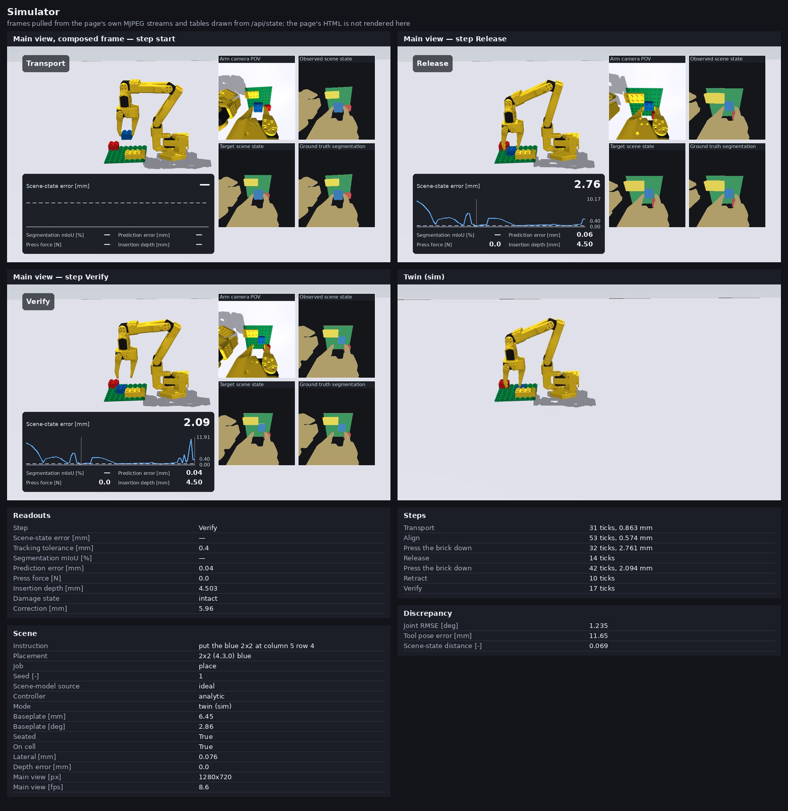

# Simulator page

A browser front end for the closed-loop placement loop: set a scene up, run it, watch the arm and
the wrist camera with the scene-model panels beside them, step, pause, inject a disturbance,
change the scene model or the controller, edit parameters, record, sweep seeds, and compare a
world against a second simulator standing in for the digital twin.

```bash
CUDA_VISIBLE_DEVICES="" MUJOCO_GL=egl .venv/bin/python -m brick_builder.gui
```

It prints two addresses and stays up until interrupted:

```
simulator page: http://127.0.0.1:8765
from another machine: http://10.0.0.14:8765
output directory: /.../media_out/gui
```

Options: `--params my_params.yaml` opens with that parameter file selected, `--port` moves the
port, `--host 127.0.0.1` keeps it off the network, `--quality live|draft|hd1080` sets the main
view size (960x540, 1280x720, 1920x1080), `--out` moves the output directory, `--verbose` logs
every request.



*The page's own pictures and numbers, composed into a contact sheet without a browser
(`python -m brick_builder.gui.contact_sheet`). The surrounding HTML is not rendered here.*

## Design

The simulator process serves the page itself, on `http.server` from the standard library. The two
live views arrive as MJPEG streams (`multipart/x-mixed-replace`) that the page's two ``
elements read; everything else is JSON, polled twice a second and posted on every control. No
script is fetched from a network and nothing is installed in the browser, so the page loads
offline and from any machine that can reach the port.

Two threads sit behind it. The physics thread owns the world: it builds the scene, records the
reference sequence, runs one vision tick at a time, and publishes a copy of `MjData` when the
tick is done. The render thread takes that copy, renders the free camera, and draws the four
panels and the readout strip over it with the same toolkit the published video uses
(`brick_builder.demo.video`, `brick_builder.demo.video_panels`), so the page and the video put
the same picture in the same place under the same titles. They are separate threads because they
run at different rates: one vision tick costs about a quarter of a second of physics and a
composed frame about eighty milliseconds, so rendering inside the physics thread would tie the
stream to the slower of the two and freeze the view while the loop worked.

Frame rates, measured on a sixteen-core machine with no GPU, one seed of the placement task:

| Main view | Idle | Physics running | Physics running, twin on |
|---|---|---|---|
| 1280x720 (`draft`, the default) | 13.2 fps | 10.0 fps | 8.6 fps |
| 960x540 (`live`) | 24.8 fps | 22.2 fps | — |

The loop itself runs at about 0.7 times real time at 1280x720 with the render thread beside it.
The twin costs a second scene of physics and a second render, which is where the last frame and a
half go.

## Panels

Four square panels, the same four the video carries.

| Panel | Contents |
|---|---|
| Arm camera POV | the wrist camera frame the scene model is given |
| Observed scene state | the driving scene model's own labels, or the renderer's when it publishes none |
| Target scene state | the reference sequence's frame for this step, recorded in the nominal world |
| Ground truth segmentation | the renderer's labels for the world as it is |

Background and table are dark, the arm tan, the baseplate green, and every brick takes the mean
colour of its own pixels, so the same brick is the same colour in all three label panels.
Segmentation mIoU is measured against the ground-truth panel and is only filled in for a scene
model that publishes label maps; the ground-truth and colour-threshold sources publish slot
states only, and the cell stays empty for them.

## Readouts

The strip across the composed frame carries the five the video carries: scene-state error [mm] as
the plot with its tolerance line, segmentation mIoU [%], prediction error [mm], press force [N]
and insertion depth [mm]. The page's own readout table carries those and the rest: the step
title, the tracking tolerance [mm], the damage state, the accumulated correction [mm], the number
of reference blobs matched, and the vision and control tick counts.

The step table fills as the run goes, one row per step of the sequence with its vision-tick count
and its last scene-state error. The result table is filled once the run ends: seated, on cell,
lateral [mm], depth error [mm], damage state, and the failure the loop stopped on, if any.

## Scene setup

| Control | Effect |
|---|---|
| Instruction | compiled by `brick_builder.language`; the placement text and the expected grid are shown, and the first step's cell becomes the target |
| Job | `place` starts with the brick in the jaws; `pick and place` fetches it off the table first |
| Bricks on the plate | one placement per line, in the `2x4 (0,5,0) yellow` format |
| Seed [-] | draws the displacements, the in-hand offset and the servo noise |
| Baseplate displacement | `nominal`, `seed` (4-8 mm and 2-3 deg), or typed millimetres and degrees |
| Supply brick displacement | the same three, for the brick the pick job fetches (8-15 mm, 10-20 deg) |
| Scene-model source | ground truth, colour threshold, convolutional, and anything else in the registry |
| Controller | `analytic` is the one-step inverse measured in the twin, `learned` the trained one |
| Mode | `sim`, `twin (sim)`, and two entries greyed out until their adapters exist |
| Breakable bricks, Damage monitor | `SceneConfig.breakable` and `SceneConfig.damage_monitor` |
| Parameter file | any file in `configs/params/`, or one uploaded from the browser |

Apply builds the scene. The first Apply for a given job, target cell, scene model and seed also
records the reference sequence in the nominal world, which takes about twenty seconds; it is kept
in the output directory afterwards and read back in under a second.

The parameter table is the whole of the selected file, one row per dotted path with its unit. A
typed value is checked against the schema in `brick_builder.params` as it is typed: a value
outside its range comes back with the schema's own message and the unedited file is used.
Uploading a file writes it to the output directory and validates it the same way.

## Run

Run, Pause, Step and Reset. Step advances exactly one vision tick, which is five control ticks of
physics and one camera frame. Speed is either real time, which caps the loop at ten vision ticks
a second, or as fast as possible; on a machine where one vision tick costs more than a tenth of a
second the two are the same thing.

Drag the main view to orbit, the wheel to zoom. The camera is the free camera of the video
toolkit, and the twin view is rendered from the same pose so the two are comparable.

## Disturbances

Every disturbance is applied on the scene-setup side, the way `brick_builder.action.worlds`
applies one: written straight into the simulator between two vision ticks. None of it reaches the
controller, which keeps writing tool targets throughout and is never told.

| Disturbance | What happens |
|---|---|
| Nudge | one loose brick moves by the typed millimetres and degrees |
| Remove | one brick is parked off the table, at rest; the brick in the jaws is refused |
| Displace | the baseplate and every brick standing on it move as one rigid body |
| Hold | the arm's position actuators lose their gain for a number of vision ticks and the arm sags |

## Record

Record writes the composed frame to an mp4 in the output directory at fifteen frames a second,
through the same `imageio` writer the video uses; at the `as fast as possible` speed the result
is not wall-clock real time. Still writes the current composed frame as a PNG. Save log writes
the per-tick records as an npz -- tick, time, progress index, step index, scene-state error,
tolerance, prediction error, press force, insertion depth, mIoU, commanded tool position and
accumulated correction. A finished run saves its log without being asked.

## Batch

Runs N seeds headless in the background: the reference sequence is recorded once, then every seed
builds the world that seed displaces, tracks the sequence in it and scores the brick with
`verify_placement`. The table carries one row per seed and a summary with the seated count, the
Wilson interval on it, and the median and worst lateral error. Export CSV writes the table to the
output directory. The sweep shares the machine with the live view, so both run slower while it is
going.

## Twin view

`Mode: twin (sim)` builds a second scene beside the first and shows it next to the main view. Each
control tick the twin's servos are commanded to the joint positions the first arm's bus reports,
so the twin follows the real arm rather than the controller's intent. The discrepancy table
carries joint RMSE [deg], tool pose error [mm] and the scene-state distance between the two
worlds, measured from the same wrist window in each.

With the same parameter file on both sides the tool pose error still reaches about a centimetre
during a fast move: the twin's own servos chase the reported positions with their own lag. What
the strip measures is that lag plus whatever the two parameter files disagree about, which is
what the same strip will measure when the first world is a real arm.

`real arm` and `microcontroller` are listed and greyed out. Their adapters are built elsewhere and
this package imports nothing from them; connecting one means giving the session a source of joint
readings in place of `WorldAdapter`, and nothing else on the page changes.

## Keyboard shortcuts

| Key | Action |
|---|---|
| Space | Run / Pause |
| S | Step |
| R | Reset |
| C | Record / Stop |
| P | Still |
| Arrows | Orbit |
| + / - | Zoom |
| 0 | Camera home |

## Running it on a lab machine

The server binds every address by default, so one machine runs the simulator and everyone else
opens it:

```bash
CUDA_VISIBLE_DEVICES="" MUJOCO_GL=egl OMP_NUM_THREADS=4 \
    .venv/bin/python -m brick_builder.gui --port 8765
```

Then open `http://<that machine>:8765` from any browser on the same network. The address is
printed at startup. There is no authentication and no session separation: anyone who can reach
the port drives the same simulation, which is what a shared lab machine wants and what a machine
on an open network does not -- use `--host 127.0.0.1` and an SSH tunnel there. `MUJOCO_GL=osmesa`
works on a machine with no GPU, more slowly.

## Adding a control

A control is four small edits, and the scene-setup ones need no new route.

1. `brick_builder/gui/world.py`: add the field to `Setup` with its default, and read it in
   `build`. `Setup.from_json` coerces by the default's type, so a new field needs nothing else.
2. `brick_builder/gui/static/index.html`: add the input, with a title carrying its unit in
   brackets.
3. `brick_builder/gui/static/app.js`: read it in `collectSetup` and write it in `applySetup`.
4. `tests/gui/test_server.py`: post it and assert on what comes back.

A control that acts on a running scene rather than on the next one is a `_handle` branch in
`brick_builder/gui/session.py` plus a `Session.post` from a route in `server.py`; the disturbances
are the pattern.

## Limits

- The brick is a blue 2x2 and the supply row holds one. The command's cell is honoured; its brick
  size and colour are not, because the world's supply is fixed in `brick_builder.action.worlds`.
- The reference sequence lines up on the bricks in the nominal world, which are the yellow 2x4 and
  the red 2x2. Extra bricks on the plate are scenery the loop does not reference; removing one of
  those two costs it a reference and the run degrades rather than failing cleanly.
- The nominal world and the digital twin are built from the shipped defaults. The parameter file
  applies to the world the arm runs in, which is the point: the twin is what the controller
  believes and the parameter file is what was measured.
- One session, one simulation. A second browser sees and drives the same one.
- Recording writes at a fixed fifteen frames a second and the page streams at whatever the machine
  manages, so a recording is not a wall-clock record of the run.
