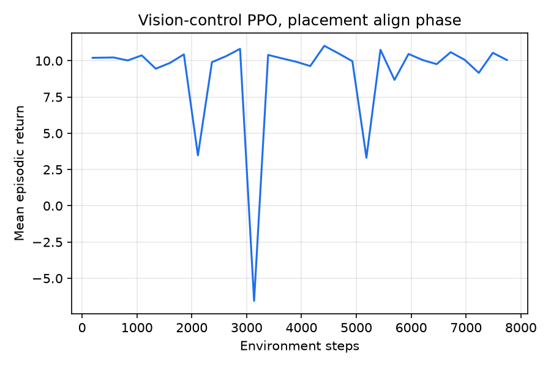

# Reinforcement learning from pixels to a tool correction

The closed-loop controller of [Closed-loop control](12-closed-loop-control.md) tracks a target
sequence of scene states and turns the difference into a tool correction. Everything on that path
up to the scene model is fixed: the convolutional model publishes slot rows, the rows are matched
against the target, and an inverse turns the difference into millimetres. This page is the stack
that lets the **scene model and the action model move together**, trained from task outcomes
rather than from a label.

Three pieces make that possible.

1. A **differentiable pixel-to-slot head** (`brick_builder/perception/cnn/slot_head.py`), so a
   gradient can travel from a slot row back into the network that produced it.
2. A **Gymnasium environment** around one closed-loop placement
   (`brick_builder/rl/vision_control/env.py`), whose action is a residual on the analytic
   controller. A zero action is today's controller exactly.
3. **Asymmetric PPO** over the whole path (`brick_builder/rl/vision_control/train.py`), with an
   auxiliary next-state prediction loss through the trained predictor `F` as the alignment term.

The bounded run is reported at the bottom, with its limits.

## The differentiable slot head

`perception/cnn/postprocess.py` turns the network's four per-pixel maps into a `SceneState` by
hard decisions: an argmax class map, an argmin over predicted centres, boolean masks, a median
depth. Those decisions are what the shipped model publishes, and none of them has a derivative.
`slot_head.py` does the same arithmetic with soft assignments.

| Hard (`postprocess.py`) | Soft (`slot_head.py`) |
|---|---|
| `classes = argmax(class_logits)` | the argmax mask in the forward pass, the class probability's gradient in the backward one |
| a brick pixel joins its nearest predicted centre | `softmax` over `-d^2 / (2 tau^2) + log p_centre(peak)` |
| a boolean mask, then `_blob_row` | the same statistics, weighted by the soft mask |
| whatever no object claimed is background | `clamp(1 - sum of the kept soft masks, 0, 1)` |
| `rank_scale` on the per-slot median depth | the same ranks through a logistic comparison |
| `TemporalSlotAssigner` on the rows | the same assigner, on the detached rows |

The class gate is the one place where the obvious choice is the wrong one. Weighting every pixel
by its class probability is the plainest soft assignment, and it does not reproduce the published
rows: the class head gives a table pixel a small but non-zero brick probability, and a small
number summed over sixty thousand pixels is not small. Measured on held-out frames, the plain soft
gate moves a blob's centre by 0.025 in window coordinates -- three pixels -- and its mean colour
by 0.046. `class_gate="straight_through"` keeps the argmax mask in the forward pass and the
probability's gradient in the backward one, so the rows *are* the published rows and the class
head still receives a gradient. It is the default; `class_gate="soft"` is kept and measured below.

The competition between two bricks stays genuinely soft either way. That is where two objects
contend for the same pixels, and it is the band a gradient has something to move in.

### Parity

Two comparisons, because two different things can disagree. **Per object** compares the rows built
from the same centre peaks in the same order, which is the head's own accuracy. **Per slot**
compares the whole assembled state, slot index for slot index, including the temporal assigner; it
is only meaningful on a sequence, since slot identity is carried across frames. Errors are the
largest absolute difference within each schema field, in the field's own units.

Forty held-out frames from `data_cache/vision_model/val` (234 objects), per object:

| Class gate | mass | centre | moments | colour | colour spread | border | orient4 | frames with a different candidate count |
|---|---|---|---|---|---|---|---|---|
| straight-through, mean | 2.2e-6 | 2.3e-5 | 3.9e-6 | 8.0e-5 | 2.1e-5 | 1.1e-6 | 1.2e-3 | 0 / 40 |
| straight-through, max | 2.5e-5 | 4.5e-4 | 7.4e-5 | 2.3e-3 | 9.0e-4 | 1.1e-4 | 0.061 | |
| plain soft, mean | 3.2e-3 | 0.025 | 0.018 | 0.046 | 0.017 | 1.6e-3 | 2.38 | 3 / 40 |

Sixty consecutive wrist frames from one closed-loop placement (seed 3), where the temporal
assigner has a real history, per slot -- 326 slots scored, none filled by one path and not the
other:

| | mass | centre | moments | colour | colour spread | border | orient4 | depth |
|---|---|---|---|---|---|---|---|---|
| mean absolute error | 1e-6 | 1.9e-5 | 7e-6 | 8.0e-5 | 1.9e-5 | 2e-7 | 1.7e-3 | 0.0086 |

The centre is the field the controller servos on: 1.9e-5 of the window's `[-1, 1]` coordinates is
2.4e-3 of a pixel, and about 2 micrometres of tool motion at the conversion the offline metrics
use. The depth field is ordinal, so 0.0086 is a fraction of a rank step, not a distance.

`orient4` is the loosest field, at about 1 % of its own typical magnitude of 0.2. It is a
normalized fourth moment, so it divides by the square of the blob's spread and amplifies whatever
the grouping band did to the pixels furthest from the centre.

### Cost

One 256x256 frame, three threads, no GPU:

| | Milliseconds |
|---|---|
| The network's forward pass (1.27 GMAC) | 40 |
| The slot head, with the depth order | 41 |
| The slot head, without it (`with_depth=False`) | 19 |
| Pixels to slot rows, forward and backward | 183 |

The depth order costs more than everything else in the head because a weighted median is a sort
per object over the whole window. Nothing on the control path reads the depth field --
`action/models/features.ROW_FIELDS` is mass, centre, the second moments and `orient4` -- so the
policy runs the head with `with_depth=False`.

## The environment

`brick_builder.rl.vision_control.env.VisionControlEnv` wraps one `TrackingEpisode`. One
environment step is one vision tick: five 20 ms control writes, one wrist frame, one reading, one
correction update, at the 10 Hz the controller acts at.

### Action

The action is a residual added to the analytic controller's own correction increment:

    correction <- correction + G_analytic(observed, target) + residual

| Component | Unit | Range |
|---|---|---|
| `dx` | the loop's per-tick saturation, 1.2 mm | `[-1, 1]` |
| `dy` | the same | `[-1, 1]` |
| `spin` | the loop's per-tick saturation, 0.7 deg | `[-1, 1]` |

Three components, not four. The controller has no z correction channel -- it commands the recorded
height unchanged -- and neither has the learned inverse, whose `models.features.INVERSE_OUT` has
no z column. A fourth action that nothing could apply would be a dead dimension.

The sum is held to the loop's own 15 mm ceiling, and the residual is applied only while the loop's
own correction is live, not after the freeze. A zero action therefore reproduces today's
controller tick for tick; `tests/rl/vision_control/test_env.py` asserts that the accumulated
correction agrees at every vision tick of seed 0 to 1e-9, and that the placement is the same.

### Observation

The actor's half is what a real arm could provide. The critic's half is privileged and is dropped
at export, as in `brick_builder/rl/ppo_asym.py`.

| Half | Field | Shape | Contents |
|---|---|---|---|
| actor | `image` | `[256, 256, 3]` uint8 | the wrist camera window this tick |
| actor | `mech` | `[12]` | six joint positions and six joint speeds, as the bus reports them |
| actor | `target` | `[8, 14]` | the target sequence's scene state for this tick, in slot rows |
| actor | `progress` | `[3]` | the progress index, the step index and the held-tick count, each scaled to `[0, 1]` |
| critic | | `[30]` | the plate's real position and yaw, the held brick's real pose, the tool pose, the accumulated correction, the tracked error, the damage level, the gates, the progress and the joint loads |

Nothing decoded and nothing from the simulator reaches the actor. `test_env.py` checks that the
plate's real displacement appears in the critic half and nowhere in the actor's.

### Reward

| Term | Sign | Size |
|---|---|---|
| Progress along the target sequence | + when the tracked scene-state error falls | 1.0 per millimetre |
| Action size | - | 0.05 per unit of saturation, averaged over the three axes |
| Holding the progress index | - | 0.02 per tick |
| The damage monitor's state rising | - | 5.0 per step of `bricks.damage.STATES` |
| Seated on the target cell, at the end | + | 10.0, plus 2.0 x `max(0, 1 - lateral_mm)` |
| Ended in a stall or a failed grasp | - | 5.0 |

A tick the loop could not read has no tracked error and pays no progress either way, rather than
reading as a large improvement. `env.step_reward` is a function of numbers alone, so every sign is
checked on synthetic sequences in `tests/rl/vision_control/test_reward.py` without a simulator.

### Episode

One placement (`task="placement"`) or one pick-and-place (`task="pick"`), in the same displaced
worlds as the published tables -- the plate 4-8 mm and 2-3 degrees out, and for the pick the loose
brick 8-15 mm and 10-20 degrees out. Training draws from seeds 10-19; seeds 0-9 are the evaluation
table's and are never trained in.

Two bounds keep an episode to the ticks the action matters for.

- `start_step="Align"` plays the sequence up to the align dwell with a zero residual and starts the
  episode there. The prefix is not scored.
- `stop_when_frozen=True` ends the episode when the loop freezes its correction, and plays the
  press, the release and the retreat out with no residual before scoring. Past the freeze the loop
  deliberately stops moving the estimate and a residual does nothing, so those ticks would be a
  hundred and fifty steps of dead time the policy would still be blamed for.

Between them a placement episode is about 40 scored steps instead of about 220. `info` carries the
scored result -- seated, on the target cell, the lateral error, the seat depth error, the damage
state, the failure, the median tracking and prediction errors and the tick count.

### Vectorisation

Over processes, through `ppo_asym.make_vector_env` with gymnasium's `SAME_STEP` autoreset.
**Two on this machine**: each sub-environment holds a MuJoCo world, a digital twin and an EGL
context, the policy's own forward pass runs in the parent, and the machine is shared. `n_envs` is
a parameter; two is what the numbers below were measured with.

## Training

    policy = the convolutional encoder -> the slot head -> a G-shaped MLP -> the residual

The encoder starts from `perception/weights/vision_model.pt` and stays in evaluation mode, so its
batch-norm statistics never move: a minibatch of a few dozen wrist frames would re-estimate
statistics measured over a whole training set and the shipped weights would not survive it. Its
convolution weights still receive gradients, at `encoder_lr_scale = 0.01` of the head's rate --
the learning-rate scale that makes the scene model move slowly while the action head moves at
full speed.

Two things differ from the controller's own slate and are written down rather than glossed over.

- **Slot order.** The controller's slate is three named references plus the brick in the hand,
  ordered by title. A policy has no titles, so slots are filled in the frame's own candidate order
  and no temporal assigner is used, which makes a forward pass a pure function of the frame. That
  is what lets an update replay exactly the pass the rollout took. Correspondence with the target
  state comes from a soft match on what an object *is* -- colour, mass and the second moments --
  not on where it is.
- **Width.** Because the slate is all eight slots rather than four, the MLP reads 97 numbers where
  `G` reads 54. It is `G`-shaped -- the same slot-row differences, the same mechanical state, the
  same two tanh layers, the same three outputs in the same units -- but the shipped `inverse.npz`
  weights do not fit it and are not loaded. The output layer is initialised to zero, so an
  untrained policy's mean action is exactly zero.

The algorithm, the generalized advantage estimator, the vector-environment construction, the
critic and its normalizer, and the learning-curve figure are `brick_builder/rl/ppo_asym.py`'s. The
rollout and update loops are written out again in `vision_control/train.py` for one reason: that
module's actor is an MLP over a flat `Box`, and this observation is an image plus three small
vectors, so there is no flat actor half to hand it. `ppo_asym.py` itself is unchanged.

### The alignment term

The auxiliary loss is the next-state prediction that keeps the representation tied to what the
world does. The frozen predictor `F` is fed the policy's own slot rows, the mechanical state and
the tool motion the world saw, and its predicted change is compared against the next frame's rows
**as the policy itself read them during the rollout**. That target is a frame the encoder has
already moved past by the time the update runs, which makes it a target-network-style constraint:
it asks the representation to stay predictable, not to match a fixed label.

Two honest limits on it. `F` was trained on the controller's slate -- three named references and
the brick in the hand, in that order -- and the policy's rows are in the frame's own candidate
order instead, so the entries do not line up object for object; the term is a predictability
constraint on the representation rather than a calibrated forecast. And the loss is a Huber, not a
square: a brick entering or leaving the candidate list shuffles a whole row between two ticks and
the squared error of that one pair reaches the hundreds, which would swamp the policy gradient it
is meant to sit beside.

### Running it

```bash
CUDA_VISIBLE_DEVICES="" MUJOCO_GL=egl OMP_NUM_THREADS=3 nice -n 10 \
  python scripts/train_vision_control.py train --run runs/vision_control/align \
    --minutes 85 --n-envs 2 --n-steps 128 --minibatches 4 --epochs 1 --threads 3

CUDA_VISIBLE_DEVICES="" MUJOCO_GL=egl python scripts/train_vision_control.py evaluate \
  --run runs/vision_control/align --seeds 0-9
CUDA_VISIBLE_DEVICES="" MUJOCO_GL=egl python scripts/train_vision_control.py evaluate \
  --run runs/vision_control/align --seeds 0-9 --baseline
```

CPU only, deterministic given `--seed`, budgeted by `--minutes` and resumable: a checkpoint is
written after every update, so a run stopped by its own budget continues from where it left off
when started again with the same `--run`. Logging is `log.csv` and `learning_curve.png` under the
run directory; nothing writes TensorBoard event files.

## The bounded run

**7 744 environment steps, 71 episodes, 35 updates, about 68 minutes of CPU at three threads with
two environment processes.** One run on the placement task's align phase, seeds 10-19, seed 0 for
the policy and the shuffles. It was interrupted twice and resumed from its own checkpoint both
times -- once by its own budget, once by the machine, which killed it at thirteen minutes because
each episode leaks three simulator models and three render contexts into reference cycles until
something collects them. The environment now collects between episodes; `log.csv` carries the
whole chain, with one extra row from a two-minute shakedown process that overlapped the start.



| Over the run | First half | Last half |
|---|---|---|
| Mean episodic return | 8.66 | 9.66 |
| Alignment loss (Huber, `F`'s normalized units) | 1.62 | 1.11 |
| Mean lateral error of the training episodes [mm] | 0.170 | 0.267 |

The return is dominated by the terminal seated bonus, which the untrained policy already collects:
28 of the 31 updates that finished an episode seated every one of them, and the overall seated rate
across the 71 training episodes is 0.94. The difference between the halves is three bad episodes
early, not a trend. The alignment loss does fall, but it also falls in the first five updates
before the encoder has moved appreciably, which is the running normalizer settling.

### Ten seeds, before and after

Seeds 0-9, the same displaced worlds as the published tables, the trained policy's mean action
against a zero residual. An episode here runs from the align dwell to the loop's freeze; the rest
of the sequence is played out and the placement is scored by `verify_placement`.

| | Seated on target cell | Lateral error [mm] | Median tracking error [mm] | Median prediction error [mm] | Ticks from Align to the freeze |
|---|---|---|---|---|---|
| Analytic controller (zero residual) | 10/10 | 0.020-0.133, median 0.074 | 1.28 | 0.24 | 73 |
| Trained policy | 10/10 | 0.016-0.097, median 0.070 | 1.24 | 0.23 | 72 |

The analytic column reproduces the published table exactly, which is the residual-zero equivalence
measured rather than asserted. The trained column is **not an improvement that can be told from
noise**: paired seed by seed, the lateral error is 0.013 mm smaller on average and better on 7 of
10 seeds, the tracking error 0.020 mm smaller and better on 5 of 10, the prediction error 0.005 mm
smaller and better on 6 of 10. At 10/10 either way the 95 % Wilson interval on the success rate is
0.72-1.00, so the seating column cannot separate them at all.

**The honest summary: in this budget the policy neither beat the analytic controller nor damaged
it.** The residual form is what makes the second half of that sentence true by construction, and
the first half is what a run three orders of magnitude short of an image-input PPO budget should be
expected to produce. What the run does establish is that the loop closes -- a gradient reaches the
convolutional encoder from task reward and from next-state prediction error, the policy trains
without losing the shipped scene model, and the measurement is the same one the published tables
use.

## Limits

- **The budget is the result.** Seven thousand environment steps is two to three orders of
  magnitude below what an image-input PPO run normally needs, and the align phase's analytic
  baseline is already 10/10 at a tenth of a millimetre, so there is very little headroom for a
  residual to find. What is demonstrated is that the loop closes, not that the policy has learned
  a better controller.
- **The controller underneath reads the ground-truth scene model**, as the published tables do
  (`controller_source="ideal"`). The policy's own view is the raw frame either way; switching the
  controller to the convolutional source (`controller_source="conv"`) is a parameter and has not
  been measured.
- **The alignment term is not a calibrated forecast**, for the two reasons above.
- **The action is three-dimensional.** Nothing here corrects the tool's height.
- **The pick-and-place is a parameter, not a measurement.** `task="pick"` builds and runs; no
  training run has been made on it.

## Next steps

- Train the align phase for an order of magnitude more steps, on more than two processes.
- Give `F` the policy's own slate order by training a round of it on tuples logged through the
  policy's scene model rather than the controller's, which `action/learn/rounds.py` already
  supports -- that turns the alignment term from a predictability constraint into a forecast.
- Measure `controller_source="conv"`, so the whole loop, not only the policy, runs on the
  convolutional scene model.
- Run the same environment on the pick-and-place, where the analytic controller is 7/10 rather
  than 10/10 and there is room for a residual to earn something.
