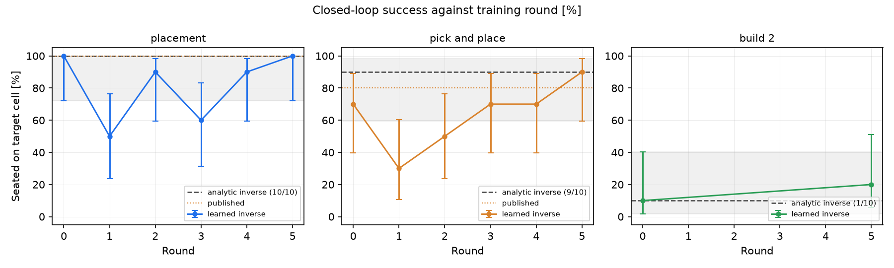
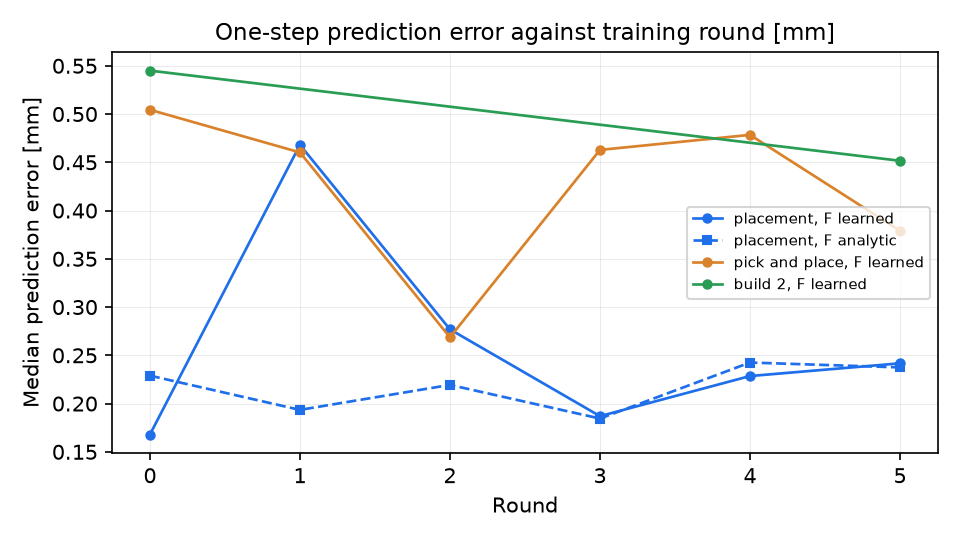
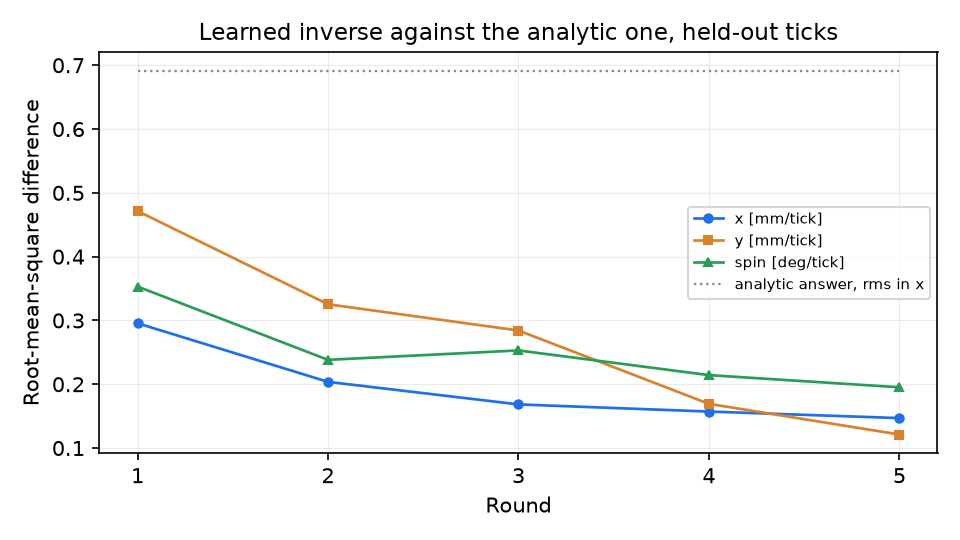
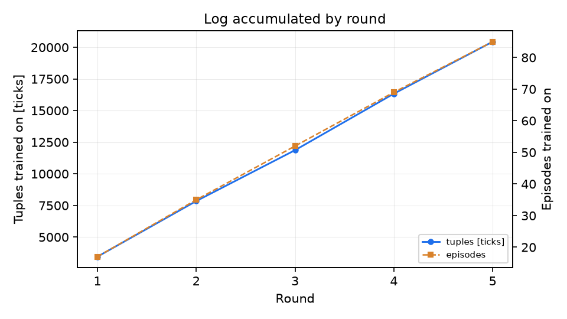

# Closed-loop campaign

The arm performs brick tasks in simulation while the two models on the control path are trained
from what it did, and the closed-loop result is measured after every training round. Nothing is
scripted between rounds: the same loop that places the brick produces the tuples the next round
fits, and the same held-out seeds score every version.

## The loop

```
        +-------------------------------------------------------------+
        |                                                             |
        v                                                             |
   PERFORM ------------> TRAIN ------------> REDEPLOY ------------> EVALUATE
   N episodes per task   F: next scene       version id,           seeds 0-9,
   on fresh seeds,       state | mech, a     campaign weights      every task,
   current models        G: DAgger on the    directory             learned and
   driving; every        analytic inverse                          analytic inverse
   tick logged           at the logged
                         states
```

- **Perform.** `N` episodes of each task on seeds drawn from a stream that never meets the
  evaluation set. The learned inverse drives once the campaign has deployed one; the analytic
  inverse drives before that. Every vision tick is logged through `TrackingEpisode.observer`, in
  the layout `action.learn.dataset` reads.
- **Train.** `action.learn.rounds.train_round` fits the next-scene-state predictor `F` on the
  change of the slot rows given the mechanical state and the action, then the one-step inverse
  `G` on three terms: the hindsight target, the distal teacher through that `F`, and regression
  on the analytic inverse's answer at the states the round itself visited. Driving with the
  learned inverse and labelling with the analytic one is what makes a round a DAgger round.
- **Redeploy.** The round's two checkpoints become the pair the campaign's own runs load, under a
  version id. The campaign writes them to `results/campaign/<name>/weights/` and never to the
  pair the repository ships.
- **Evaluate.** Every task on seeds 0-9, with the learned inverse and with the analytic one, and
  with both prediction rules on `placement` so the two are compared on identical trajectories.

The analytic inverse does not change between rounds, so it is measured once, in round 0, and
carried into every table as the fixed baseline; the last round re-measures it on `placement` as a
check that it really did not move.

The campaign deploys every round to its own directory unconditionally. A campaign that deployed
only the rounds that already won would never collect the states a losing round visits, and those
are the states the next round is relabelled on. Whether a round earned the checkpoints the
repository *ships* is a separate question, and every round's table answers it in the **Would
ship** column: that is what `action.learn.rounds.deploy_if_better` would have decided -- the
learned inverse at least matching the analytic baseline on every task, not winning on one and
losing on another.

## The task set

| Task | Cycles | Starts | Unknown to the controller | Scored |
|---|---|---|---|---|
| `placement` | 1 | brick already held | baseplate 4-8 mm, 2-3 deg | one brick |
| `pick_and_place` | 1 | brick loose on the table | the above, and the brick 8-15 mm, 10-20 deg | one brick |
| `build_2` | 2 | as above, twice | the above, per cycle | both bricks |

`build_2` is one English command, compiled by `brick_builder.language`:

```
put a blue 2x2 at column 5 row 4 then put a blue 2x2 left of the blue brick
```

which becomes two placements, `2x2 (4,3,0) blue` and `2x2 (2,3,0) blue`, executed as consecutive
pick-and-place cycles. After each cycle `Goal.remaining_steps` is recomputed against what is
really on the plate; a brick that did not land on its cell leaves its own step outstanding and
that cycle is run once more. Both bricks are on the bottom layer and both are blue 2x2, because
the seat height the geometry places on is the plate's own top face and the supply row offers a
blue 2x2. The compiler has no pronouns, so the second brick names the first by colour.

The second brick goes to the left-hand neighbour (column 3, row 4; 154 mm from the base). The
right-hand neighbour (column 7, row 4; 218 mm) lies outside the 100-200 mm band over which the
gripper's downward force was characterised: on five seeds there, lateral placement was within
0.02-0.29 mm on four of them, but the press stopped 0.43-4.50 mm short of full insertion depth.

The second cycle's world carries the first brick on the plate; so does the nominal plate its
target sequence is recorded against (`record_ideal(..., placed=...)`) and so do the twins its
Jacobians are measured in (`TrackingEpisode(..., placed=...)`). All three have to agree: a
recording made against a bare plate matches nothing where the run has just put a brick, and a
twin that lacks a brick the recording lines itself up on drops that reference silently.

### Scoring

`control.pick_place.verify_placement` reads the simulator after the arm has left: every stud
within 0.3 mm of full insertion depth is `seated`, and a brick within 0.4 of a stud pitch
(6.4 mm) of the cell centre is `at_target_cell`. An episode succeeds when **every** brick the
task asked for is seated on the cell it was sent to, so a build_2 episode with one brick down is
a failure even though one brick landed; the per-brick count is reported beside it.

Each episode's record carries the task, the seed, the models' version ids, per brick the seated
flag and the lateral and depth errors, the vision ticks per step, the failure class, the median
tracking and prediction errors, the damage state the monitor reached, and the wall clock. Success
rates carry Wilson 95 % intervals (`eval.wilson`).

## Commands

Start a campaign:

```bash
CUDA_VISIBLE_DEVICES="" MUJOCO_GL=egl OMP_NUM_THREADS=3 \
  python scripts/run_campaign.py --rounds 5 --episodes 3 --seeds 0-9 \
    --sparse-tasks build_2 --train-minutes 3 --budget-minutes 265
```

`--sparse-tasks build_2` evaluates the build in the first and last round only, and performs it in
every one. Ten held-out builds are twenty closed-loop cycles and about half of what a round of
evaluation costs; this is the knob the budget turns before it gives up a round.

Continue one that stopped, for any reason, from the round it reached:

```bash
python scripts/run_campaign.py --rounds 5 --episodes 3 --budget-minutes 200 --resume
```

Score one round's deployed models without performing or training, and with the convolutional
scene model driving:

```bash
python scripts/run_campaign.py --evaluate-only --round 0 --source cnn --name closed_loop_cnn
```

Redraw the figures and the tables from what is already measured:

```bash
python scripts/run_campaign.py --curves-only
python -m brick_builder.campaign.curves --campaign results/campaign/closed_loop
python -m brick_builder.campaign.tables --campaign results/campaign/closed_loop
```

Two episode processes at a time with three threads each, no GPU, and a wall-clock budget checked
before every round, so a campaign that runs out of time stops between rounds with its state
consistent. `results/campaign/<name>/campaign.json` is that state; deleting a phase's entry from
it re-runs that phase.

## Results

Five rounds, ten held-out seeds per task per round, `--sparse-tasks build_2`. Tables and figures
from `python -m brick_builder.campaign.tables --campaign results/campaign/closed_loop` and
`python -m brick_builder.campaign.curves --campaign results/campaign/closed_loop`, with the
`Would ship` column that command prints left out; see why below the failures table.

### Placement, seeds 0-9

| Round | Inverse | Version | Seated on target cell | Wilson 95 % | Bricks | Lateral error [mm] | Median tracking [mm] | Median prediction [mm] | Ticks at Align | Tuples trained on |
|---|---|---|---|---|---|---|---|---|---|---|
| fixed | analytic | -- | 10/10 | 72-100 % | 10/10 | 0.07 | 1.28 | 0.24 | 73 | -- |
| published | ground truth | -- | 10/10 | -- | -- | -- | -- | -- | -- | -- |
| 0 | learned | shipped | 10/10 | 72-100 % | 10/10 | 0.07 | 1.21 | 0.17 | 77 | -- |
| 1 | learned | r5 | 5/10 | 24-76 % | 5/10 | 0.10 | 1.39 | 0.47 | 93 | 3448 |
| 2 | learned | r5 | 9/10 | 60-98 % | 9/10 | 0.07 | 1.43 | 0.28 | 101 | 7845 |
| 3 | learned | r5 | 6/10 | 31-83 % | 6/10 | 0.11 | 1.41 | 0.19 | 108 | 11869 |
| 4 | learned | r5 | 9/10 | 60-98 % | 9/10 | 0.07 | 1.24 | 0.23 | 88 | 16334 |
| 5 | learned | r5 | 10/10 | 72-100 % | 10/10 | 0.07 | 1.25 | 0.24 | 85 | 20444 |

### Pick and place, seeds 0-9

| Round | Inverse | Version | Seated on target cell | Wilson 95 % | Bricks | Lateral error [mm] | Median tracking [mm] | Median prediction [mm] | Ticks at Align | Tuples trained on |
|---|---|---|---|---|---|---|---|---|---|---|
| fixed | analytic | -- | 9/10 | 60-98 % | 9/10 | 0.10 | 4.12 | 0.70 | 69 | -- |
| published | ground truth | -- | 8/10 | -- | -- | -- | -- | -- | -- | -- |
| 0 | learned | shipped | 7/10 | 40-89 % | 7/10 | 0.07 | 3.48 | 0.50 | 84 | -- |
| 1 | learned | r5 | 3/10 | 11-60 % | 3/10 | 0.05 | 4.20 | 0.46 | 106 | 3448 |
| 2 | learned | r5 | 5/10 | 24-76 % | 5/10 | 0.10 | 4.11 | 0.27 | 86 | 7845 |
| 3 | learned | r5 | 7/10 | 40-89 % | 7/10 | 0.13 | 4.27 | 0.46 | 83 | 11869 |
| 4 | learned | r5 | 7/10 | 40-89 % | 7/10 | 0.11 | 4.41 | 0.48 | 74 | 16334 |
| 5 | learned | r5 | 9/10 | 60-98 % | 9/10 | 0.07 | 3.78 | 0.38 | 70 | 20444 |

### Build 2, seeds 0-9

| Round | Inverse | Version | Seated on target cell | Wilson 95 % | Bricks | Lateral error [mm] | Median tracking [mm] | Median prediction [mm] | Ticks at Align | Tuples trained on |
|---|---|---|---|---|---|---|---|---|---|---|
| fixed | analytic | -- | 1/10 | 2-40 % | 10/20 | 0.10 | 4.19 | 0.73 | 138 | -- |
| 0 | learned | shipped | 1/10 | 2-40 % | 9/20 | 0.07 | 3.67 | 0.55 | 185 | -- |
| 5 | learned | r5 | 2/10 | 6-51 % | 12/20 | 0.07 | 4.17 | 0.45 | 162 | 20444 |

### Cost per round

| Round | Perform [min] | Train [min] | Evaluate [min] | Episodes logged | Tuples |
|---|---|---|---|---|---|
| 0 | 0.0 | 0.0 | 61.5 | 0 | 0 |
| 1 | 11.1 | 0.1 | 14.4 | 17 | 3448 |
| 2 | 9.8 | 0.2 | 12.2 | 35 | 7845 |
| 3 | 7.8 | 0.3 | 9.9 | 52 | 11869 |
| 4 | 8.5 | 0.4 | 10.2 | 69 | 16334 |
| 5 | 7.5 | 0.5 | 38.9 | 85 | 20444 |

### Failures

| Round | Task | Seated on target cell | Failures |
|---|---|---|---|
| 0 | build 2 | 1/10 | partial seat=6; seated on the wrong cell=2; stalled with an error it can see=1 |
| 0 | pick and place | 7/10 | partial seat=1; seated on the wrong cell=1; stalled with an error it can see=1 |
| 0 | placement | 10/10 | none |
| 1 | pick and place | 3/10 | partial seat=3; seated on the wrong cell=3; stalled with an error it can see=1 |
| 1 | placement | 5/10 | stalled with an error it can see=5 |
| 2 | pick and place | 5/10 | partial seat=2; seated on the wrong cell=2; stalled with an error it can see=1 |
| 2 | placement | 9/10 | stalled with an error it can see=1 |
| 3 | pick and place | 7/10 | partial seat=2; stalled with an error it can see=1 |
| 3 | placement | 6/10 | stalled with an error it can see=4 |
| 4 | pick and place | 7/10 | seated on the wrong cell=3 |
| 4 | placement | 9/10 | partial seat=1 |
| 5 | build 2 | 2/10 | partial seat=5; seated on the wrong cell=2; stalled with an error it can see=1 |
| 5 | pick and place | 9/10 | stalled with an error it can see=1 |
| 5 | placement | 10/10 | none |









Both tasks dip in round 1 and recover by round 5. Pick-and-place goes 7/10 (round 0) to 3/10
(round 1, the campaign's low point, Wilson 11-60 %), then 5/10, 7/10, 7/10, and 9/10 at round 5,
matching the fixed analytic baseline (9/10, 60-98 %). Placement goes 10/10 to 5/10 (round 1,
24-76 %), then 9/10, 6/10, 9/10, and back to 10/10 at round 5. `build_2`, scored only at round 0
and round 5, goes from 1/10 (2-40 %) to 2/10 (6-51 %) seated, bricks on target 9/20 to 12/20. On
ten seeds a Wilson interval is wide: every round's interval on both tasks overlaps round 0's and
the fixed analytic baseline's, so none of these round-to-round changes is a significant difference
from either reference point. Round 1's is the tightest case: 5/10 (24-76 %) against round 0's
10/10 (72-100 %) overlaps only at its own upper edge, and 3/10 (11-60 %) against the
`pick_and_place` baseline's 9/10 (60-98 %) overlaps only at a single point.

Median one-step prediction error on `placement` and `pick_and_place` is lowest at round 0 (F
shipped, no DAgger data yet) and round 3 (0.19 mm, 0.46 mm), and highest at round 1 (0.47 mm,
0.46 mm) while F is trained on the smallest, least-covered dataset (3448 ticks); it does not fall
monotonically with more data. The learned inverse's disagreement with the analytic teacher on
held-out ticks (`campaign_action_error.png`) falls on every axis, round 1 to round 5: x 0.30 to
0.15 mm/tick, y 0.47 to 0.12 mm/tick, spin 0.35 to 0.20 deg/tick, all well under the analytic
answer's own root-mean-square size in x (0.69 mm/tick, unchanged, the fixed baseline) throughout.
More DAgger data makes the inverse track its analytic teacher more closely even in rounds where
closed-loop success does not move the same way, because tracking the teacher off-policy on
held-out ticks and succeeding closed-loop on ten held-out worlds are different measurements.

Whether a round would ship, by the rule in [The loop](#the-loop) -- the learned inverse's seated
fraction at least matching the fixed analytic baseline on every task the round measured -- only
round 5 does: 10/10 against the baseline's 10/10 on `placement`, 9/10 against 9/10 on
`pick_and_place`, 2/10 against 1/10 on `build_2`. Rounds 1-4 do not: `pick_and_place` stays below
the baseline's 9/10 in all four (3/10, 5/10, 7/10, 7/10), and `placement` falls short in rounds 1
and 3 (5/10, 6/10 against 10/10). `action.learn.rounds.deploy_if_better` is the function that
decision belongs to, and it is not what produced the numbers above: `campaign.would_ship` compares
each row's `seated_on_target` fraction through `rounds.seated_fraction`, which reads a
`seated_on_target_cell` key that the campaign's own score rows do not have, so both sides of every
comparison read 0/0 and the comparison is vacuously true. The tables this page used to print a
`Would ship` column from that value; it is left out above because every round read `yes`
regardless of the numbers beside it. The comparison in this paragraph is the one `deploy_if_better`
specifies, done by hand from the `Seated on target cell` columns.

## Limits

- The success rates are ten seeds per task per round. A Wilson interval on ten trials is wide:
  8/10 and 10/10 overlap, and a one-seed change moves the point estimate by ten points.
- The evaluation seeds are fixed, so the same ten worlds are scored every round. That is what
  makes the rounds comparable and it is also the whole of the sample.
- `build_2` was evaluated in the first and the last round only (`--sparse-tasks build_2`), so its
  curve has two points where the other two tasks have one per round. It was performed in every
  round, so the training set grew with it throughout.
- `build_2`'s two bricks go side by side on the bottom layer. A stacked build needs a seat height
  above the plate's top face, which `action.place.Geometry` has no way to express.
- The build's two cells are flush neighbours, and the second brick is pressed against a wall that
  is already there. That is what the build measures beyond two pick-and-places, and it is where
  it fails: see the table.
- Each of the build's cycles runs in its own world, built with the bricks the earlier cycles were
  sent to place, on the cells they were sent to. The plan carries over, the physics does not: a
  brick that missed is rebuilt on its cell for the next cycle, so the second cycle's result is a
  measurement of the second cycle rather than of the first one's luck.
- The campaign's own deployed pair is written under `results/`, which is git-ignored. Nothing here
  changes what `PlaceConfig(inverse="learned")` loads by default.

## Next steps

- More performing episodes per round. The log is the thing the curve is a function of, and a
  round of three episodes per task is a few thousand ticks.
- A round that trains on the convolutional scene model's own states rather than the simulator's.
- The predictor in the loop as a signal rather than a report: `PlaceConfig.predictor` selects
  which one-step prediction the error is measured against, and nothing reads it.
