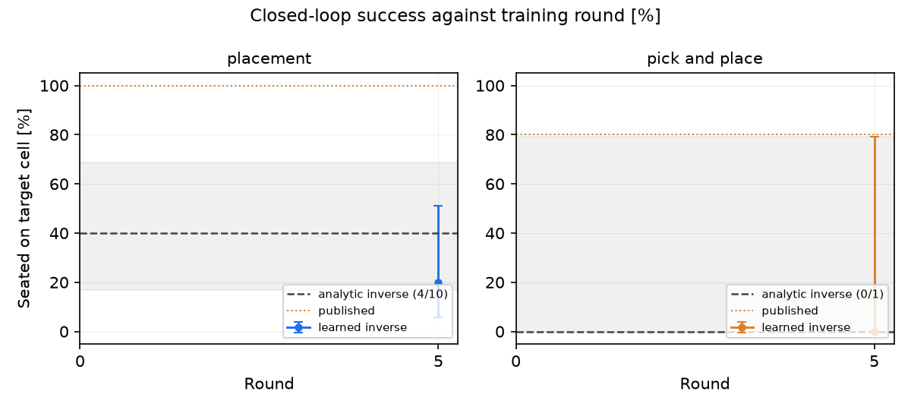

# Campaign on the scene model

The closed-loop campaign (`docs/guide/16-closed-loop-campaign.md`) drives with simulator ground
truth and scores the analytic and learned inverse against it. This page drives the same loop with
the convolutional scene model instead: the loop reads `SceneState` rows the scene model produced
from the rendered frame, not the simulator's own state. Three runs are reported, plus a
re-run of the first after two sets of fixes.

- `closed_loop_cnn`, evaluate-only: how much the ground-truth-trained round-5 pair loses when the
  states it sees at test time come from the scene model instead of the simulator, against the
  analytic baseline measured the same way. Round 0 (analytic) and round 5 (learned).
- `closed_loop_cnn_train`, two rounds asked for, three episodes per task per round: a campaign
  that performs and trains on the scene model's own states rather than the simulator's. It logs a
  predictor checkpoint at round 1 and does not reach a trained inverse; see Results.
- `closed_loop_cnn_refs`, evaluate-only, round 0 (analytic): the first run's round 0 again, after
  the scene model's reference bodies are named by matching its slots to ground truth instead of
  by slot index; see Reference bodies matched to ground truth.

The first two campaigns reuse `brick_builder/campaign/**` unchanged; only `--source cnn` and the
campaign name differ from `docs/guide/16-closed-loop-campaign.md`. The third also runs the
reference-body change, which renames the scene-model recording cache in `campaign/tasks.py`.

## Scene-model weights

`brick_builder/perception/weights/vision_model.pt`, sha256
`3e07a382f963145318479f81b61dbe273ffd421ea2e772dd2c0df1bbe40bcafb`. Every measured number on this
page is against this checkpoint. A later checkpoint at the same path needs its own sha256 line
here and its own numbers.

`brick_builder/action/twin.py` and `brick_builder/action/learn/dataset.py` changed after the
numbers below were measured (see Fixes to the crashes); the sha256 above did not change, and the
tables and the figure are unchanged, measured-before-the-fix numbers. They are not re-run here.
`brick_builder/action/place.py`'s reference-body naming changed after that as well (Reference
bodies matched to ground truth): every `--source cnn` number on this page above that section was
measured with the slot-index naming.

## Evaluate-only against the round-5 pair

`--evaluate-only` scores whatever a campaign has deployed. Pointed at a fresh campaign name it
finds nothing under `results/campaign/<name>/weights/` and, at round 0, falls back to the pair the
repository ships. To score the closed-loop campaign's own round-5 pair under a different name (its
own `results/campaign/closed_loop/weights/` holds a round-5 evaluation still in progress elsewhere
and is not touched here), its two checkpoints and `deployed.json` are copied into
`results/campaign/closed_loop_cnn/weights/` before the round-5 call -- that directory is exactly
what `Campaign.deployed_paths()` reads, so nothing in `campaign.py` changes.

```bash
.venv/bin/python scripts/run_campaign.py \
  --evaluate-only --round 0 --seeds 0-9 --tasks placement pick_and_place \
  --source cnn --processes 1 --no-baseline-learned \
  --name closed_loop_cnn --root results/campaign

cp results/campaign/closed_loop/weights/{inverse.npz,predictor.npz,deployed.json} \
   results/campaign/closed_loop_cnn/weights/

.venv/bin/python scripts/run_campaign.py \
  --evaluate-only --round 5 --seeds 0-9 --tasks placement pick_and_place \
  --source cnn --processes 1 --no-baseline-learned \
  --name closed_loop_cnn --root results/campaign
```

`--no-baseline-learned` drops the repository-shipped pair's own column; the page compares the
analytic baseline and the round-5 pair. `--processes 1` throughout. `build_2` is not in either
call: it needs its own recorded target sequence per cycle under `--source cnn` (see The pickling
fix), and it was not run.

Before the pickling fix these commands did not run on a fresh checkout without a cache
workaround (see The pickling fix); Re-evaluation after the fixes gives the numbers measured with
the fix in place.

## Training campaign

`closed_loop_cnn_train` is a full, short `run_campaign.py` call, not `--evaluate-only`: it performs
the tasks with the scene model driving, logs the tuples `TrackingEpisode.observer` records at every
vision tick -- the scene model's own slot rows, not the simulator's -- trains `F` and `G` on them,
redeploys, and scores the held-out seeds, as `docs/guide/16-closed-loop-campaign.md` describes,
with `--source cnn` the only substantive difference.

```bash
.venv/bin/python scripts/run_campaign.py \
  --rounds 2 --episodes 3 --seeds 0-9 --tasks placement pick_and_place \
  --source cnn --processes 1 --no-baseline-learned \
  --budget-minutes 150 --round-minutes 30 \
  --name closed_loop_cnn_train --root results/campaign
```

Two rounds and three episodes per task (the ground-truth campaign: five and three), sized from
the evaluate-only throughput. The run stopped when round 1's train phase raised (see Results), not
on the time limit.

## Results

### Ground truth against the scene model, seeds 0-9

Same two checkpoint pairs (the fixed analytic inverse, and `closed_loop`'s round-5 learned pair)
on the same ten held-out worlds. Ground truth is `docs/guide/16-closed-loop-campaign.md`'s own
measured numbers for the same pairs, the `fixed` and round-5 rows in its per-task tables; scene
model is `closed_loop_cnn`'s round 0 and round 5. Both columns' reference sequences and driving
states change together with `--source`: `record_for` records the target sequence through the same
scene model that will drive the run, so the scene-model column is not the ground-truth column with
only the driving state swapped (see Mislabeled reference bodies).

| Task | Inverse | Ground truth (`--source ideal`) | Scene model (`--source cnn`) |
|---|---|---|---|
| Placement | analytic | 10/10 (72-100 %) | 4/10 (17-69 %) |
| Placement | learned (r5) | 10/10 (72-100 %) | 2/10 (6-51 %) |
| Pick and place | analytic | 9/10 (60-98 %) | 0/1 (0-79 %, see below) |
| Pick and place | learned (r5) | 9/10 (60-98 %) | 0/1 (0-79 %, see below) |

Placement scores every episode under `--source cnn`: 10/10 to 4/10 for the analytic baseline,
10/10 to 2/10 for the round-5 pair. The round-5 pair is below the analytic baseline under the
scene model (2/10 against 4/10) though not under ground truth (10/10 against 10/10); by the rule
in `docs/guide/16-closed-loop-campaign.md`'s "The loop" (the learned inverse's seated fraction at
least matching the fixed analytic baseline) it does not clear it here.
(`campaign.would_ship`'s own column reads `yes` for both rows regardless -- the same
`seated_on_target_cell` key mismatch `docs/guide/16-closed-loop-campaign.md` already reports; the
comparison above is by hand from the `Seated on target cell` values, not from that column.)

Pick and place raises before nine of the ten held-out episodes finish, for both inverses, on the
same seven seeds at `Approach` and the same two at `Lift`, never seed 7 -- see Mislabeled reference
bodies. `0/1` is the one seed that ran to completion, not nine failures and one success; the
Wilson interval and every other number in that row is one episode's worth.



Both panels plot the table above: the fixed analytic inverse at round 0, the round-5 learned pair
at round 5, each pair of bars the ground-truth number beside the scene-model number. Pick and
place's two scene-model bars are the same one-episode measurement described above, marked `n=1`.

### Cost per round

| Campaign | Round | Evaluate [min] | Episodes scored | Episodes crashed |
|---|---|---|---|---|
| `closed_loop_cnn` | 0 (analytic) | 18.8 | 21 / 30 | 9 |
| `closed_loop_cnn` | 5 (learned, plus the analytic recheck) | 49.3 | 41 / 50 | 9 |

Total heavy time for this step: 68.1 min inside `run_campaign.py` (both rounds, cumulative, the
figure the campaign itself reports) plus roughly 10 min of one-off recording outside it, seeds 0-9
for both tasks (see The pickling workaround) -- about 78 min.

Placement's per-episode wall time spans widely and does not move the same way between rounds, or
even between two rows of the same round. Round 0 scores placement twenty times (ten seeds against
each of two `predictor` columns, the analytic inverse throughout): 27-63 s. Round 5 scores it forty
times (ten seeds times two inverses times two `predictor` columns), 17-232 s, but the two halves
do not behave alike: the twenty rows using the round-5 learned inverse run 17-56 s; every row above 150 s uses the analytic inverse that `recheck_analytic`
(`campaign.py:402`) reruns at the final round for comparison -- its five slowest are 151.6, 162.8,
205.6, 220.8 and 231.8 s. The 49.3 min in the table above includes this recheck; it is not the cost
of the learned pair.

`evaluate.csv`'s `replanned` and `vision_ticks` columns separate replanning from machine load for
these analytic-inverse rows. On seeds 0, 1, 2, 4, 5, 7, 8 and 9 the same seed carries the same
`vision_ticks` and `replanned` flag in round 0 and round 5 (seed 0: 163 ticks, replanned, in both),
and within round 5 the two `predictor` columns for the same seed and inverse carry identical values
yet differ in wall time by up to 4x -- seed 0: 54.0 s against 205.6 s; seed 9: 71.6 s against
220.8 s. On those seeds machine load, not replanning, explains the spread. Seed 3 is the
exception and the slowest row: in round 5 its analytic/analytic row replanned (239 ticks, 231.8 s)
while its sibling did not (239 ticks, 37.7 s); seed 6's tick counts differ by one (184 / 185).

### Mislabeled reference bodies

Every `pick_and_place` crash before the fix in twin.py (see Fixes to the crashes) raised
`RuntimeError` from the same check in `build_step`, at `Approach` or `Lift`, with a different
reference count each time -- Approach:

```
RuntimeError: step 'Approach': the twin only shows 0 of the 0 reference blobs, which is not enough to line up on
```

and Lift:

```
RuntimeError: step 'Lift': the twin only shows 0 of the 1 reference blobs, which is not enough to line up on
```

The exception comes from `brick_builder/action/twin.py`'s `build_step`, called from
`brick_builder/action/place.py`'s `_prepare_step` while building the twin's expectation for that
step -- not from the scene model reporting nothing during the pick, which is a different, working
part of the loop. `TrackingEpisode` always measures the twin's own expectation with
`IdealSceneModel`, ground truth rendered from the twin's nominal scene (`twin.py:107`), regardless
of `--source`.

What changes under `--source cnn` is the recorded reference labels `build_step` is asked to line
up on. Before the change in Reference bodies matched to ground truth, `record_ideal` named each
step's reference bodies with `reference_bodies()` (now `place.py:359`), which then read every
state's `slot_ids` as renderer instance ids -- true of the simulator's own `SceneState`, not of
the convolutional model's: its `slot_ids` are plain slot indices, with a comment on that line in
`postprocess.py:209` saying so. Under `--source cnn` the recorded sequence carries the scene
model's states throughout (`record_for` records the target sequence through the same source that
will drive the run), so `reference_bodies()` read slot indices as if they were instance ids.

The rule this gave, before the change: a body was named in every frame where the scene model's
slot whose index equals that body's instance id (2 the baseplate, 3 the held brick, 4 onwards the
placed bricks and then the loose bricks, `compose.py`'s `build_scene`) held any blob that passed
the size and border filters, whichever body that blob belonged to. The rule therefore named bodies
that are not in view whenever such a slot held another body's blob, and left out bodies that are
in view whenever their slot was empty or its blob failed the filters. Which blob a slot holds
depends on the order the tracker handed slots out, so the labels come and go along the recording.

Measured on the seeds 0-9 recordings of Label check (`closed_loop_cnn_v2/ideals/`, the slot-index
reading, against ground-truth recordings of the same frames; a scratch script pairs each naming
slot with a ground-truth blob by `match_slots`), `pick_and_place`: of the 5070 names the old rule
gave, 945 were read off the named body's own blob, 2107 off another body's blob and 2018 off a
blob `match_slots` pairs with no ground-truth body (merged, split, or outside its gates). 1196 of
the 5070 name a body ground truth does not show in that frame, on 1130 of 2810 frames. The four
largest groups and the `Approach` one; the other 281 are spread over `Transport`, `Release`,
`Retract`, `Verify` and placed brick 1 at `Lift`:

| Step | Body named, not in the ground-truth frame | Frames | Blob in that body's slot |
|---|---|---|---|
| `Align` | spare brick | 200 | 160 no ground-truth body, 40 the brick in the hand |
| `Press the brick down` | spare brick | 404 | 313 no ground-truth body, 76 the brick in the hand, 15 placed brick 0 |
| `Lift` | baseplate | 143 | 84 spare brick, 32 the brick in the hand, 27 no ground-truth body |
| `Lift` | placed brick 0 | 111 | 63 the brick in the hand, 47 spare brick, 1 no ground-truth body |
| `Approach` | brick to pick up | 57 | 46 no ground-truth body, 11 placed brick 0 |

The recorded caches of the earlier `closed_loop_cnn` run show the `Approach` part of this. A
ground-truth `pick_and_place` recording's `Approach` step names
`{'brick to pick up': 'supply_brick_0'}` in 520 of 620 frames across the ten seeds -- every frame
after the first ten of each 62-frame step. The matching `--source cnn` recordings name the same
body in 353 of 620 Approach frames and an empty set in the other 267, never any other body:
`place.py`'s pick-and-place filter keeps only entries that equal `SUPPLY_BODY` at
`Approach`/`Grasp` (`place.py:750-758`, unchanged), so every other name the slot-index reading
gave there is dropped. What remains is a name read off whichever blob sat in the slot whose index
is the brick to pick up's instance id, which is not always that brick's blob (the last row of the
table above).

`placement` recordings were read by the same rule, but under `--source cnn` most of their per-step
body sets are not empty: `Align` is empty in none of 400 cnn frames, `Transport` in 14 of 80,
`Press the brick down` in 144 of 728, `Verify` in 8 of 150 -- 166 of 1597 frames overall, about
10 %. In `placement` the rule never named a body that is not in view (0 of 1597 frames, Label
check): every body it could name there -- the baseplate, the held brick and the two placed
bricks -- is in every ground-truth frame, so a name read off any blob in those slots was a body
in view, whichever blob it was read off. Only 393 of its 2621 names were read off the named
body's own blob; 1060 were read off the held brick's, 592 off another placed brick's and 576 off
a blob that pairs with no ground-truth body. What `placement` lost was references: at `Align`
the rule named the baseplate alone on 240 of 400 frames, placed brick 0 alone on 40, placed
brick 1 alone on 40 and the baseplate with placed brick 0 on 80, where ground truth names the
baseplate and both placed bricks on all 400. Why `placement`'s `build_step` calls did not raise
is not analyzed further here.

`held` named as a reference at `Release`, `Retract` and `Verify` in ground-truth `placement`
recordings, in all ten seeds, is not a mislabeling: the released brick keeps the MuJoCo body name
`held` (`compose.py:87`, `HELD_BODY`), and `reference_bodies()` only excludes it while
`_in_hand(step)` (`place.py:765`) -- true through `Lift`/`Transport`/`Align`/`Press the brick
down`, false once the brick is let go, so it names the released brick's own body.

The pattern that stays fixed across both inverses in the table above (seven seeds crash at
`Approach`, two at `Lift`, seed 7 is the one that completes) is the recorded label, not either
inverse: both rounds replay the same cached `pick_and_place` recordings. The label mapping is
fixed in `record_ideal`/`reference_bodies`; see Reference bodies matched to ground truth.

### Training round

`closed_loop_cnn_train`, two rounds, three episodes per task per round, `--source cnn`. Round 0
(analytic, no learned pair yet) reproduces `closed_loop_cnn`'s own round 0 on the same seeds --
placement 4/10, pick and place 0/1, the same crash pattern -- which is expected: same weights,
same scene model, same held-out worlds.

Round 1's `perform` phase ran six episodes (three placement, three pick and place) with the
analytic inverse: placement's three completed and none landed the brick (two "seated on the wrong
cell", one "partial seat"), consistent with round 0's 4/10 on a small sample; all three
pick-and-place episodes hit the reference-body crash above (`ideal_seed=900000` for every one of
them, since `--processes 1` collapses the recorded-sequence pool to one recording -- see Limits),
so pick-and-place logged nothing. `train_round` (`brick_builder/action/learn/rounds.py`) then
trained the predictor `F` and wrote `predictor.npz` to disk before training the inverse `G`, which
raised:

```
ValueError: need at least one array to stack
```

in `brick_builder/action/learn/dataset.py`'s `hindsight_pairs`, called from `train_inverse`. Every
tick placement's three episodes logged (10 ticks per attempt, 6 attempts -- two per episode, the
campaign's own replan retry -- 60 rows total) carried `trusted=True` and `frozen=True`, so
`acting = trusted & ~frozen` was empty on all 60 and `hindsight_pairs` had nothing to stack. Why
only 10, already-frozen ticks were logged per attempt rather than a full trajectory is not traced
further here: `place.py` latches `frozen` once `frame.step_index` passes a fixed index and does
not clear it again within an episode, which is documented, working behaviour, not itself the
defect; whether the short, already-frozen log is downstream of the same reference-body labelling
above, of the collector, or of something else in `place.py`/`action/learn/collect.py` (neither
edited here) is unverified.

### Fixes to the crashes

Two changes, made so the two crashes above no longer end a whole episode or a whole campaign.
Each has unit tests that do not need a campaign run (`tests/action/test_twin_blind_step.py`,
`tests/action/learn/test_dataset_empty_gate.py`; `.venv/bin/python -m pytest -q
tests/action` also passes, 48 tests, no regressions).

- **`brick_builder/action/twin.py`.** `build_step`'s reference-count check raised a bare
  `RuntimeError` when it saw fewer than `min_refs` blobs before any Jacobian is measured; the check
  just below it, once probing starts, already raises `BlindStep`, and `place.py`'s
  `_prepare_step` already catches `BlindStep` and marks the step untrusted instead of losing the
  episode. The first check now raises `BlindStep` too, and prints the count (blobs seen, blobs
  needed, the step name) to stderr before raising, since nothing downstream of the catch sees the
  message again. Reading `_prepare_step`, a `pick_and_place` episode that hits this at `Approach`
  or `Lift` should play that step open-loop and reach `verify_placement` at the end like any other
  episode -- confirmed by Re-evaluation after the fixes: all ten `pick_and_place` seeds complete
  under `--source cnn` with this fix in place, where nine of ten raised before it. Neither
  `place.py` nor `campaign/tasks.py`'s `EpisodeRecord` (both outside this page's files) give the
  blind step its own failure class, so a blind step's effect on the reported numbers is
  indistinguishable from any other cause of a low seated fraction in `evaluate.csv`. The crash
  counts in the Results table above are from before this change; Re-evaluation after the fixes has
  the numbers measured with it applied.
- **`brick_builder/action/learn/dataset.py`.** `hindsight_pairs` and `teacher_pairs` both crashed
  on `np.stack([])` when zero ticks passed the `trusted & ~frozen` gate. Both now return zero-row
  `x`/`y` arrays and log one line saying how many of how many ticks passed the gate, through an
  optional `log` argument (`print` by default). This does not, on its own, make
  `closed_loop_cnn_train`'s round 1 train cleanly: `train_inverse`
  (`brick_builder/action/learn/train.py`) reshapes `obs[j] - obs[i]` against `len(i)` at
  `train.py:194`, 18 lines after calling `hindsight_pairs` at `train.py:176`, and numpy refuses to
  reshape a zero-size array into `(0, -1)` -- a different `ValueError`
  (`cannot reshape array of size 0 into shape (0,newaxis)`), confirmed by calling `train_inverse`
  directly on a synthetic zero-acting-tick log. The round still ends the campaign on this input;
  fixing it needs a change in `train.py`.

## The pickling fix

The first evaluate-only attempt (one seed, one task, before any of the numbers on this page) failed
every episode:

```
AttributeError: Can't pickle local object 'slots_from_masks.<locals>.decode_fn'
```

`record_for` (`brick_builder/campaign/tasks.py`) records the nominal target sequence through the
*same* scene model that will drive the run (see its docstring), so under `--source cnn` the cached
`IdealSequence` carries `SceneState` objects from the scene model, and `SceneState._decode_fn`
(`brick_builder/perception/scene_model.py`) is a closure `perception/cnn/postprocess.slots_from_masks`
builds locally -- not picklable, and `record_for` unconditionally writes its cache to
`results/campaign/<name>/ideals/*.pkl`. Under `--source ideal` this path is not exercised the same
way, and nothing before this page had run the closed loop with `--source cnn` end to end.

`decode` is documented as "viewer/evaluation only... not read by anything on the control path"
(`scene_model.py`), so dropping `_decode_fn` before pickling changes nothing the loop reads.
`SceneState` now does this itself: `__getstate__` copies `__dict__` and replaces `_decode_fn` with
`None`, `__setstate__` restores the rest unchanged. A round-tripped state answers every
control-path query exactly as before; it just has no decode function any more (`has_decode` is
`False`, `decode` raises the same "no decode function" `RuntimeError` it already raises for any
producer that never built one) -- see
`test_cnn_source_state_round_trips_through_pickle` in `tests/perception/test_scene_model.py`.
`record_for`'s plain `pickle.dump`/`pickle.load` needed no change: a fresh `--source cnn` run now
populates its own ideal-sequence cache directly.

The numbers on this page below "Re-evaluation after the fixes" were measured before this fix
landed, using a one-off script (scratch, uncommitted, never imported by the repository) that
monkey-patched `SceneState.__getstate__` the same way, outside the process that ran
`run_campaign.py`. Nothing downstream needed the patch to read the cache files it wrote --
they are ordinary pickles with `_decode_fn: None`, exactly what the fix above now writes directly.
The commands in Evaluate-only against the round-5 pair and in Training campaign reproduce those
numbers on a fresh checkout by themselves now that the fix is in `SceneState`; they did not before.

## Re-evaluation after the fixes

`closed_loop_cnn_v2`: the same two commands as Evaluate-only against the round-5 pair (`--source
cnn --evaluate-only --processes 1`, seeds 0-9, placement and pick and place, round 0 against the
fixed analytic baseline and round 5 against `closed_loop`'s own round-5 pair), renamed and re-run
with the twin.py and dataset.py fixes (see Fixes to the crashes) and the pickling fix (see The
pickling fix) in place -- the first `--source cnn` campaign run this project has not needed a
workaround for. Same checkpoints throughout: `vision_model.pt` is still `3e07a382` (see
Scene-model weights and `docs/guide/06b-conventional-vision-model.md`'s Decision, which records
the candidate checkpoint was not shipped), and the round-5 `inverse.npz`/`predictor.npz` pair
copied from `results/campaign/closed_loop/weights/` is byte-identical to the one
`closed_loop_cnn` used -- sha256 `d7be3b0eeafdb925482fd81049d644b921c0c289ef8e378bed47df2e195274fa`
(`inverse.npz`) and `b2c735fe598cefe59c5f908094b41446e1ef9b441cfe3d46693d93ee209728a0`
(`predictor.npz`) in both `closed_loop_cnn/weights/` and `closed_loop_cnn_v2/weights/`. The
difference below is the code fixes, not a different model.

| Task | Round | Inverse | `closed_loop_cnn` (before) | `closed_loop_cnn_v2` (after) |
|---|---|---|---|---|
| Placement | 0 | analytic | 4/10 (17-69 %) | 4/10 (17-69 %) |
| Placement | 5 | learned (r5) | 2/10 (6-51 %) | 2/10 (6-51 %) |
| Pick and place | 0 | analytic | 0/1 (0-79 %) | 5/10 (24-76 %) |
| Pick and place | 5 | learned (r5) | 0/1 (0-79 %) | 2/10 (6-51 %) |

Placement is unaffected either way -- it never hit the reference-body crash -- and reproducing its
exact seated fraction and Wilson interval on a second, independent run is itself a check that the
fixes changed nothing on a path that was already working. Pick and place is the one the crash was
hiding: all ten seeds now complete instead of nine raising, and the completed baseline is a real
ten-episode measurement (5/10) rather than the one seed that happened not to crash (0/1, itself a
failure). The round-5 learned pair reaches 2/10, below the ten-seed analytic baseline (5/10); by
`docs/guide/16-closed-loop-campaign.md`'s "The loop" rule (the learned inverse's seated fraction
at least matching the fixed analytic baseline) pick and place does not clear it here either, the
same conclusion placement already reported, now on a full sample for both tasks. Failure classes,
`closed_loop_cnn_v2`, seeds 0-9: pick and place round 0 (5 failures) -- seated on the wrong
cell=4, partial seat=1; round 5 (8 failures) -- seated on the wrong cell=7, partial seat=1.

Commands (identical to Evaluate-only against the round-5 pair, `--name closed_loop_cnn_v2`):

```bash
.venv/bin/python scripts/run_campaign.py \
  --evaluate-only --round 0 --seeds 0-9 --tasks placement pick_and_place \
  --source cnn --processes 1 --no-baseline-learned \
  --name closed_loop_cnn_v2 --root results/campaign

cp results/campaign/closed_loop/weights/{inverse.npz,predictor.npz,deployed.json} \
   results/campaign/closed_loop_cnn_v2/weights/

.venv/bin/python scripts/run_campaign.py \
  --evaluate-only --round 5 --seeds 0-9 --tasks placement pick_and_place \
  --source cnn --processes 1 --no-baseline-learned \
  --name closed_loop_cnn_v2 --root results/campaign
```

## Reference bodies matched to ground truth

`record_ideal` names each reference frame's bodies from the scene model's own slots, matched to
the ground-truth blobs of the same render, instead of reading the scene model's slot indices as
instance ids (see Mislabeled reference bodies).

### Change

- `brick_builder/action/adapter.py`: `WorldAdapter.observe_labelled()` renders one wrist frame and
  returns the source's `SceneState` and a ground-truth `SceneState` of the same render
  (`IdealSceneModel`, `K = 16`, so no visible body is folded into the background slot). With the
  ground-truth source both are the same object. It sits with `scene_for_scoring` in the adapter's
  scoring-and-recording section; `record_ideal` is its only caller, checked on `place.py`'s syntax
  tree by `tests/action/test_reference_bodies.py`.
- `brick_builder/action/place.py`: `match_slots(state, truth)` pairs the source's slots with the
  ground-truth blobs one to one (`scipy.optimize.linear_sum_assignment`) on what both publish:
  centre, mass and mean colour. A pair outside any of three tolerances stays unpaired: centre
  0.08 window units (10 px of the 256 px frame), mass ratio 1.6 either way, colour 0.30
  (`DigitalTwin.calibrate`'s own tolerance). A blob the scene model merged, split or lost
  therefore names no body. `reference_bodies(..., truth=)` names each source slot after its
  paired blob's body; the size and border filters still read the source's own slot, the one the
  servo searches at run time. A state whose source is not `ideal`, passed without `truth`,
  raises `ValueError`.
- `brick_builder/campaign/tasks.py`: `record_for` caches a scene-model recording as
  `<task>_c<cycle>_s<seed>_cnn_matched_...pkl` (was `..._cnn_...`), so no recording cached before
  the change is read back under any campaign name.

Under `--source ideal` the naming is unchanged: the state is its own ground truth and its
`slot_ids` are read as before.

### Tests

`tests/action/test_reference_bodies.py`, 15 tests, 30 s at one thread.

| Test | Input | Expected |
|---|---|---|
| Naming by appearance | Scene-model state, every blob in a slot whose index is another body's instance id | the two placed bricks named, as ground truth names them |
| The defect | The same state read as instance ids | wrong set: `baseplate` and `placed brick 0` |
| Slot order | 20 random slot orders | same pairing, same names |
| Segmentation error | Blobs 4-5 px off, mass 0.75x and 1.2x, colour 0.07-0.09 off | still named |
| Merge, side by side | Two equal bricks reported as one blob | neither named |
| Merge, second layer | Brick under the held brick reported inside the held brick's blob | held brick matched and excluded, brick under it not named |
| Missed brick, wrong colour | Blob absent; blob in place with another colour | not named |
| Background slot | Scene model's background slot (token -1) with a brick's row | never paired |
| No ground truth | Scene-model state without `truth` | `ValueError` |
| Rendered recording | Placement, seed 0, recorded through ground truth and through a source publishing the same ground-truth rows under slot-index tokens | same bodies on 161 of 161 frames; read by slot index, 161 of 161 differ |
| Guard | `observe_labelled` call sites in `place.py` | `record_ideal` only |

`pytest -q -m "not slow" tests/action`: 78 passed, 7 deselected (67 s); `tests/campaign` and
`tests/perception/test_scene_model.py`: 60 passed, 2 deselected; `tests/rl/vision_control` and
`tests/gui`: 20 passed, 12 deselected.

### Label check

Per frame, the bodies named from a `--source cnn` recording against the bodies ground truth names
from the same render: seed 0, the campaign's lighting, `placement` and `pick_and_place` and the
second cycle of `stack_2` (the pick and place onto the first brick); a scratch script that also
runs the old slot-index reading on the same states. "Wrong" is a set that names a body the
ground-truth set of the same frame does not.

| Recording | Frames | Wrong body named, slot index | Wrong body named, matched | `Align` frames with 2 or more references, slot index / matched / ground truth |
|---|---|---|---|---|
| `placement` | 161 | 0 | 0 | 0 / 40 / 40 of 40 |
| `pick_and_place` | 279 | 199 | 0 | 40 / 40 / 40 of 40 (all 40 slot-index sets wrong) |
| `stack_2`, cycle 2 | 273 | 25 | 0 | 40 / 40 / 40 of 40 |

The matched set is a subset of the ground-truth set on every frame of the three recordings
(713 of 713). The bodies it leaves out are ones the scene model does not report as their own
blob; at `Align` these are the red 2x2 (nearest scene-model blob 0.19-0.20 window units away,
7-12x its mass) and, at the second layer, the blue brick under the held one (nearest scene-model
blob 0.14 window units away, 5.4x its mass: the one blue region `docs/demos/videos.md` reports at
`Align`).

Over seeds 0-9 the recordings the two evaluations below replayed (`closed_loop_cnn_v2/ideals/`,
slot-index naming; `closed_loop_cnn_refs/ideals/`) were compared frame by frame with fresh
ground-truth recordings of the same seeds (`record_for(..., source=None)`, scratch cache); every
frame sequence matched step for step.

| Task | Frames | Wrong body named, slot index / matched | No body named, slot index / matched / ground truth | `Align` frames with 2 or more references, slot index / matched / ground truth |
|---|---|---|---|---|
| `placement` | 1597 | 0 / 0 | 166 / 0 / 0 | 80 / 400 / 400 of 400 |
| `pick_and_place` | 2810 | 1130 / 0 | 346 / 219 / 100 | 320 / 399 / 400 of 400 (200 of the 320 wrong) |

The `pick_and_place` `Approach` frames with nothing named (212 matched, 100 ground truth) are the
scene model not separating the brick to pick up from what surrounds it, not a naming error.

### Evaluate-only, before and after

Same command as Re-evaluation after the fixes, round 0 only, `--name closed_loop_cnn_refs`:
`--source cnn --evaluate-only --round 0 --seeds 0-9 --tasks placement pick_and_place
--processes 1 --no-baseline-learned`, analytic inverse, scene-model weights `3e07a382`. Before is
`closed_loop_cnn_v2` round 0 (Re-evaluation after the fixes), measured with the slot-index naming.

| Task | Predictor column | Before (`closed_loop_cnn_v2`) | After (`closed_loop_cnn_refs`) | Paired exact McNemar |
|---|---|---|---|---|
| Placement | analytic | 4/10 (17-69 %) | 10/10 (72-100 %) | 6 fail to seated, 0 seated to fail; p = 0.031 |
| Placement | learned | 4/10 (17-69 %) | 10/10 (72-100 %) | 6 / 0; p = 0.031 |
| Pick and place | learned | 5/10 (24-76 %) | 9/10 (60-98 %) | 5 / 1; p = 0.22 |

Per seed, the analytic-predictor placement column and pick and place:

| Seed | Placement, before | Placement, after | Pick and place, before | Pick and place, after |
|---|---|---|---|---|
| 0 | seated on the wrong cell, 16.01 mm | seated, 0.03 mm | seated, 0.15 mm | seated, 0.14 mm |
| 1 | seated, 0.15 mm | seated, 0.07 mm | seated, 0.08 mm | partial seat, 0.15 mm, depth error 0.46 mm |
| 2 | seated on the wrong cell, 7.95 mm | seated, 0.06 mm | seated on the wrong cell, 15.99 mm | seated, 0.10 mm |
| 3 | seated, 0.10 mm | seated, 0.04 mm | seated, 0.08 mm | seated, 0.05 mm |
| 4 | partial seat, 0.16 mm | seated, 0.07 mm | seated, 0.07 mm | seated, 0.10 mm |
| 5 | seated, 0.14 mm | seated, 0.07 mm | seated, 0.10 mm | seated, 0.13 mm |
| 6 | seated, 0.07 mm | seated, 0.12 mm | seated on the wrong cell, 16.08 mm | seated, 0.09 mm |
| 7 | partial seat, 0.19 mm | seated, 0.11 mm | seated on the wrong cell, 14.20 mm | seated, 0.05 mm |
| 8 | partial seat, 0.15 mm | seated, 0.10 mm | seated on the wrong cell, 8.15 mm | seated, 0.11 mm |
| 9 | seated on the wrong cell, 7.70 mm | seated, 0.07 mm | partial seat, 0.21 mm | seated, 0.05 mm |

Millimetres are the brick's lateral error from the target cell. Placement is 10/10 in each
predictor column after the change, the ground-truth column's own 10/10
(`docs/guide/16-closed-loop-campaign.md`); pick and place is 9/10 against ground truth's 9/10.
Placement's median `Align` vision ticks go from 40 to 68. Before, 80 of the 400 recorded `Align`
frames named two or more reference bodies (Label check), the step was untrusted on the rest, and on
8 of 10 seeds (analytic-predictor column) the progress index played through the 40 recorded `Align`
frames in 40 ticks; after, it holds on a measured error.
Replanned episodes: placement 7 and 6 of 10 (two columns) before, 0 and 0 after; pick and place 5
before, 1 after (seed 1). Evaluate time 32.4 min against 50.7 min, both at `--processes 1` on a
shared machine, not a like-for-like cost figure.

The learned round-5 pair was not re-measured after the change.

### Stacked build, seeds 0-2

`scripts/make_campaign_video.py --task stack_2 --cnn-drives --probe`, one run per seed, target
sequences recorded through the scene model (`--targets driving`, the default), scene-model
weights `3e07a382` (`results/video/vision_model_frozen.pt`). Before is `docs/demos/videos.md`'s
re-probe after the crash fixes. `Align` is given as vision ticks with a measured scene-state error
(the loop measures only on trusted ticks there) over vision ticks spent at `Align`; the script's
own "measured ticks" line counts control-tick records, six per advancing vision tick: the earlier
"0/240" is 40 vision ticks.

| Seed | Brick 0, before | Brick 0, after | Brick 1, before | Brick 1, after | `Align` measured, cycle 1, before / after | `Align` measured, cycle 2, before / after |
|---|---|---|---|---|---|---|
| 0 | not seated, 17.47 mm off | seated, 0.04 mm | not seated, 20.59 mm off | not seated, 94.00 mm off | 0/40 / 107/107 | 0/40 / 51/67 |
| 1 | not seated, 13.62 mm off | seated, 0.04 mm | seated, wrong cell, 16.28 mm off | not seated, 23.40 mm off | 0/40 / 59/59 | 0/40 / 37/53 |
| 2 | not seated, 6.43 mm off | seated, 0.11 mm | not seated, 21.66 mm off | not seated, 17.60 mm off | 0/40 / 390/390 | 0/40 / 40/56 |

The first brick (a placement from the jaws) seats on all three seeds, 0.04-0.11 mm from the cell,
where it seated on none before. The second brick (a pick and place onto the first) seats on none
of the three, before or after: `RESULT: not built` on every seed, `failure: none` on both cycles.
Cycle 2's last measured `Align` error is 4.77, 2.20 and 0.40 mm (seeds 0-2), `Lift` has no
measured tick on any seed (0 of 32 vision ticks), and the second press step ends at 15.28, 9.01
and 15.81 mm. In the recording of the same cycle under the campaign's lighting (seed 0, Label
check) the matched naming at `Align` leaves out the red 2x2 and the blue brick under the held one
on all 40 frames; the probe's own recordings (the video's lighting, `studio_look`) were not
inspected. Why the second brick misses is not traced further here.

### Commands

```bash
.venv/bin/python scripts/run_campaign.py \
  --evaluate-only --round 0 --seeds 0-9 --tasks placement pick_and_place \
  --source cnn --processes 1 --no-baseline-learned \
  --name closed_loop_cnn_refs --root results/campaign

for seed in 0 1 2; do
  .venv/bin/python scripts/make_campaign_video.py --task stack_2 --seed $seed --cnn-drives --probe
done
```

## Limits

- `pick_and_place` under `--source cnn` raised on 9 of 10 held-out seeds before the twin.py fix
  above (see Mislabeled reference bodies); the `closed_loop_cnn` numbers in the Results table
  above are one episode, not ten. `placement` did not raise and was measured on the full ten
  throughout. Re-evaluation after the fixes reports the same measurement at n=10 for both tasks,
  after the fix.
- Ten seeds per task per round, same as `docs/guide/16-closed-loop-campaign.md`; the Wilson
  interval on ten trials is wide and its limits apply here unchanged.
- `build_2` was not measured under `--source cnn`: it needs its own recorded target sequence per
  cycle, and it was not run.
- `--processes 1` throughout (the machine-wide limit while other work is running), so the
  performing rounds' recorded-sequence pool (`ideal_pool_seed`) is one recording, not the two a
  `--processes 2` run would keep; every performing episode of a task in `closed_loop_cnn_train`
  drove against the same recorded reference, varying only the world's own seed noise.
- `closed_loop_cnn_train` did not complete a round: `perform` ran (three placement, three pick and
  place), `train` wrote a predictor checkpoint and then raised training the inverse (see Training
  round and Fixes to the crashes), so there is no round-1 pair, no round 2, and nothing to compare
  against `docs/guide/16-closed-loop-campaign.md`'s own five rounds of ground-truth training.
- The dataset.py fix (see Fixes to the crashes) does not by itself get `closed_loop_cnn_train`
  past round 1: `train_inverse` (`brick_builder/action/learn/train.py:194`) still raises on the
  same zero-tick input, 18 lines further into training than the `hindsight_pairs` call.
- The twin.py fix's effect on a `pick_and_place` episode is now observed, not only inferred from
  reading `_prepare_step` (see Fixes to the crashes and Re-evaluation after the fixes): all ten
  seeds complete under `--source cnn`. Neither `place.py` nor `campaign/tasks.py` give a blind
  step its own failure class in `evaluate.csv`, so which completed episodes hit a blind step is
  still not visible in the per-episode record.
- The matched naming reads ground truth of the nominal world the target sequence is recorded in.
  That world is simulated; a target sequence recorded on the arm itself has no ground truth to
  name its bodies from.
- The three tolerances of `match_slots` (0.08 window units, mass ratio 1.6, colour 0.30) were set
  before the label check and the evaluation above, from the frame size, the two-bricks-as-one case and
  `DigitalTwin.calibrate`'s colour tolerance; they were not tuned on seeds 0-9.
- After the reference-body change only round 0 (analytic inverse) was re-measured. The round-5
  learned pair and `closed_loop_cnn_train` were not re-run, so their numbers on this page are
  slot-index-naming numbers.
- `stack_2` under the scene model was probed on seeds 0-2 only, not evaluated with
  `run_campaign.py`; its second brick seats on none of the three after the change.
