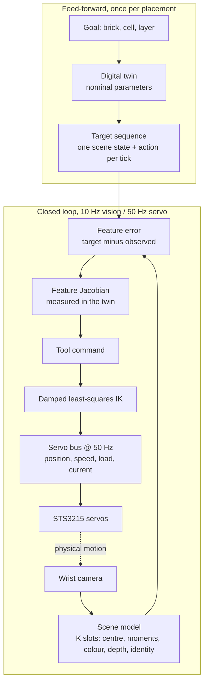

# Brick Builder Arm Robot

An SO-101 robot arm that builds LEGO DUPLO structures in a MuJoCo simulation. Stock hardware: the
vendored SO-101 follower arm with its own wrist camera, a bare table, an 8x8 baseplate and loose
bricks. Nothing is bolted on and nothing is fixtured.

This site is the user manual for the simulator and the technical notes behind it. New here: start
with the [Quickstart](quickstart.md).

## The stack

| Layer | What it is | Page |
|---|---|---|
| Bricks | DUPLO dimensions, a per-stud friction-joint snap-fit model, a press bench, structures, materials and damage | [Simulator and bricks](guide/02-simulator-and-bricks.md) |
| Robot | the vendored SO-101 MJCF patched at load time: STS3215 servo law, gear free play, bus emulator, FK/IK, force map | [Robot and servo model](guide/03-robot-and-servo-model.md) |
| Rendering | off-screen renderer, ground-truth instance and depth passes, camera post-processing, dataset generation | [Rendering and datasets](guide/02b-rendering-and-datasets.md) |
| Perception | one wrist-camera frame to a handful of per-object slot states, from three interchangeable sources | [Perception](guide/06-perception.md) |
| Control | scripted primitives, a skill FSM, Gymnasium environments with a residual policy | [Environments](guide/04-environments.md) |
| Learning | PPO and SAC with an asymmetric critic, evaluation reports with Wilson intervals, C export | [Training and evaluation](guide/05-training-and-evaluation.md) |
| Closed loop | target-sequence tracking against a digital twin | [the video](demos/videos.md) |

## How a placement works

Feed-forward and feedback are separate, and the feedback is on scene state, not on pixels or on
simulator truth.

Two seams keep this from becoming one large, brittle system:

1. **The scene model is replaceable.** Everything above it reads a `SceneState` — a small set of
   per-object slot rows, read by name through a declared schema — and nothing else. Simulator
   ground truth, colour segmentation and the trained convolutional model all publish the same
   shape, and a fourth source registers itself through
   `brick_builder.perception.sources` without the rest of the code knowing it exists.
2. **The controller never reads the simulator.** `brick_builder.action` talks to the world
   through four verbs (read the bus, write joint targets, grab a frame as a `SceneState`, step
   time). No body poses, no contact state, no snap state. A static source scan enforces it.

## Status

| Area | State |
|---|---|
| Brick physics | Built and measured. All eight bench tests pass with the `detent` force curve; the default `ramp` curve still fails two, diagnosed and kept as `xfail`. |
| Robot and servo model | Built and measured. The encoder is on the output shaft, so the tool settles within about 0.4 mm of its commanded pose. |
| Scripted pick-and-place | Built. Blind, and that is its limit: it seats a 2x4 in 0-17 % of runs and a 2x2 in about 83 %. See [Brick seating with the stock gripper](guide/02-simulator-and-bricks.md#brick-seating-with-the-stock-gripper). |
| Closed-loop placement | Built. Target-sequence tracking seats a 2x2 against a baseplate offset the controller is not told about. |
| Perception | Built. The convolutional scene model ships trained; accuracy, latency and failure modes are in [its own page](guide/06b-conventional-vision-model.md). |
| RL loop | Built and tested for all three environments. `Reach-v0` is trained to target (200/200 held out, Wilson [0.981, 1.0]); `PressFromHeld-v0` and `AlignFromTokens-v0` need hours-scale budgets not yet spent. |
| Export | Built. A trained actor exports to C and reproduces the torch actor's episode outcomes under the same seed. |
| Hardware | Not started. Every number on this site is from simulation. |

## Conventions

- An unmet target is a measured `xfail` with the number in its reason, never a weakened
  assertion.
- Every figure under `docs/media/` is produced by a function in `brick_builder/`, with a fixed
  seed, and regenerated by `scripts/make_media.py`.
- Stock hardware only. No invented fingertips, jigs or fixtures.

## Finding your way

- [Quickstart](quickstart.md) — clone to a closed-loop placement.
- [Install](guide/01-install.md) — requirements, extras, rendering backends.
- **User guide** — one page per subsystem, in the navigation.
- [Measure and enter parameters](guide/10-measure-and-enter-parameters.md) — what to measure on a
  real brick and arm, and what each number changes.
- [Commands](guide/11-commands.md) — the ordinary-English building commands the language front end accepts.
- [Demos](demos/README.md) — what each demo shows and how to reproduce it.
- [Glossary](glossary.md) — the terms.
